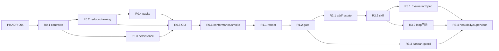

# osstack `probe` v2 — 可执行产品与技术实施规格

| 项 | 内容 |
|---|---|
| 状态 | **Implementation in progress v2.0** — 外部对抗审计完成；ADR-004 已接受；按 P0–R3.4 实施 |
| 日期 | 2026-07-18 |
| 产品 owner | Osborn |
| 初稿 | Claude Fable 5（CTO 席）+ Osborn |
| 对抗审计 | ChatGPT 5.6 SOL / Codex，2026-07-17 |
| 目标仓库 | `@osstack/monorepo` |
| 思想来源 | Thariq Shihipar，[A field guide to Claude Fable: Finding your unknowns](https://claude.com/blog/a-field-guide-to-claude-fable-finding-your-unknowns) |
| 上位约束 | `docs/decisions/ADR-001-shared-control-kernel.md`、`docs/decisions/ADR-002-neat-knowledge-hygiene-boundary.md`、`docs/decisions/ADR-004-probe-boundary.md`、`docs/specs/AGENT_COMMAND_PROTOCOL_V1.md` |
| 生命周期定位 | `probe`（开局探询）→ `loop`（执行验证）→ `neat`（收尾卫生） |

本文是 `probe` 的规范、架构、接口、测试和逐 PR 实施计划的单一评审入口。实现中的 Zod schema、生成的 JSON Schema 与冻结 test vector 是机器契约；本文解释产品语义和验收义务。本文使用 MUST、MUST NOT、SHOULD、MAY 表示强制程度。

---

## 0. 执行摘要与对抗审计处置

### 0.1 产品裁定

`probe` 不是“让模型多问几个问题”的提示词包装，而是一个**未知项义务管理器**：在写码前把高代价假设变成可追踪问题，把回答绑定到文档或验收去向，并让未落定、未写回、已豁免的事项能够被 CLI、CI、kanban、loop 与 neat 确定性检查。

R0 交付一个无 LLM 依赖、非交互式、可恢复的静态访谈内核。用户体验由 `probe-skill` 驱动；CLI 只提供稳定原语。R1 增加仓库工件与门禁，R2 增加盲区扫描和 `restate` 智能层，R3 接入生命周期闭环。

### 0.2 v1.1 审计发现与 v2 处置

| ID | 等级 | v1.1 问题 | v2 处置 |
|---|---:|---|---|
| A-01 | Critical | 可复用引擎被放入产品私有的 `@osstack/cli`，与 ADR-001/002 冲突 | 纯领域引擎归 `packages/governance/src/probe/` 并从 `@osstack/governance` 根入口导出；SQLite 存储归 `@osstack/core`；CLI 只编排 |
| A-02 | Critical | SQLite 被称为工作态权威，但 CI/PR reviewer 无法获得开发机 SQLite | 本地 SQLite 是活动会话权威；导出的 `ledger.json` 是可移植机器权威，`ledger.md` 是与其摘要绑定的人类审阅面；CI 必须显式传 `--ledger` |
| A-03 | Critical | `next --answer` 没有 question id、并发修订号或幂等键，重试可错写答案 | 所有写操作必须携带 `session_id`、`idempotency_key`；基于已有会话的写操作还必须携带 `question_id`（如适用）与 `if_revision` |
| A-04 | High | 题量耗尽会 `closed`，但文档又允许 `resume` | 预算/边际止损只进入 `paused`；队列耗尽且必答义务已处置才进入 `completed`；`abandoned` 为显式终态 |
| A-05 | High | `restate` 被描述成确定性引擎可做语义差异 | 语义比较属于 skill；CLI 只校验输入、证据和结构化差异，并把差异登记为问题 |
| A-06 | High | `evidence` 同时承载代码证据、延期 owner、waive 理由，接口不可演进 | 改为 `evidence_refs`、`deferral`、`resolution`、`waiver`、`invalidation` 判别联合 |
| A-07 | High | 单一滚动 ledger 会造成多任务并发冲突和不可移植引用 | 固定为 `docs/probe/sessions/<session-id>/`；`docs/probe/index.md` 是派生索引 |
| A-08 | High | `deep=∞` 允许无界访谈 | R0 固定 quick=8、standard=20、deep=40；预算耗尽可恢复，配置可显式覆盖但必须为有限正整数 |
| A-09 | Medium | “四象限各至少一条”和单一 0–100 分会激励造条目 | 门禁使用可解释的义务向量；完成百分比只表示已满足必答控制数，不宣称“质量分” |
| A-10 | Medium | “90 天实践”“≥70%”被归因给原文，但原文没有该实验或阈值 | 删除错误归因；先采两周基线，再由 owner 冻结 outcome target |
| A-11 | Medium | `start` 声称执行 blindspot scan，但确定性 CLI 无法完成语义扫描 | `start` 只登记输入、校准熟悉度、装载静态包；R2 skill 经 `probe add` 注入动态问题 |
| A-12 | Medium | `probe gate --policy <id>` 复用既有 policy gate 的语义不清 | 新增严格的 `.osstack/probe.yaml` readiness policy；`.osstack/policy.yaml` 仍只负责执行授权 |

### 0.3 本轮不重议的 owner 决策

| # | 决策 | 保留方式 |
|---|---|---|
| 1 | 命名为 `probe` | 顶级命令族与 skill 均使用 `probe` |
| 2 | 台账进入 `docs/probe/` | 固定多会话子目录，保留 Markdown 正式审阅面 |
| 3 | gate × kanban 使用通用前置检查 hook | R3 增加通用 `KanbanTransitionGuard` port，stack 不 import probe |
| 4 | EvaluationSpec 仅模板化编译 | 只允许已注册模板和严格参数；其余标为 `manual_required` |
| 5 | R0 只提供逐题原语，不做 TUI | CLI 是非交互式有状态原语；skill 负责一次一题 UX |
| 6 | `restate` 是独立动词 | 可独立启动 restatement 会话，也可写入已有会话 |
| 7 | 正式产物为 Markdown，HTML 不入库 | Markdown 与机器 JSON 成对提交；HTML 仅为 skill 临时展示 |
| 8 | 外部复审后再开 R0 | 本文即外部复审结果；实施从 P0 架构 ADR 开始 |

---

## 1. 产品目标、用户与边界

### 1.1 问题定义

Agent 的 prompt、spec、上下文是地图；代码库、用户、历史约束与运行环境是疆域。两者之间未被表达或未被理解的部分，会迫使 agent 自行猜测。对于长周期任务，错误假设会沿数据模型、接口和用户流程复利放大。

`probe` 必须把这种风险转成以下可执行链路：

```text
输入与参考物
  -> 熟悉度校准
  -> 静态问题 + 盲区问题
  -> 一次一题处置
  -> 回答绑定 destination
  -> portable ledger + 文档增量
  -> readiness gate
  -> loop 验收/偏离回流
  -> neat 一致性复核
```

### 1.2 主要用户

| 用户 | 任务 | 所需结果 |
|---|---|---|
| 产品/技术 owner | 在实现前暴露会改变架构的决策 | 一次一题、可恢复、每个回答有明确去向 |
| Coding agent / skill | 获取下一题、提交回答、注入有证据的盲区 | 稳定 JSON 协议、幂等写入、无隐式“最近会话” |
| Reviewer | 在 PR 中检查已知、开放、延期和豁免事项 | 可 diff 的 Markdown 与可验证 JSON 摘要 |
| CI / kanban | 判断高风险任务是否具备执行条件 | 对显式 ledger 和严格 policy 做确定性判定 |
| loop / neat / supervisor | 消费验收义务、偏离事件与老化数据 | 公开 package API 或版本化工件，不解析 CLI 文本 |

### 1.3 产品成功的可验证定义

R0 完成时必须满足：

1. 没有 LLM、网络或 TUI 依赖也能完成“start → next/answer → pause/resume → status/ledger”。
2. 进程重启后会话可恢复；同一命令重试不会重复出题或重复写事件。
3. 并发旧修订写入被拒绝，不会覆盖新答案。
4. 每个非开放条目都有显式处置；每个 `resolved` 条目都有 destination 与写回状态。
5. CLI JSON 输出通过严格 `AgentCommandResult` 和 probe domain schema。

R1 完成时还必须满足：

1. 一个会话可导出 portable JSON + Markdown + render manifest；在另一台干净环境可校验并执行 gate。
2. Markdown 的 `source_sha256` 与 canonical JSON 一致；篡改任一侧会被检查发现。
3. 默认 gate 仅报告；显式 block policy 才能阻断，且无配置与坏配置语义不同。

### 1.4 Non-goals

- 不承诺“消灭所有 unknown”；只保证发现项被记录、处置和复核。
- 不允许 agent 代替有决策权的人自动落定业务/架构选择。
- 不生成或覆盖完整 PRD/技术设计正文；只生成受限增量和 destination 义务。
- 不做通用问卷 DSL、多人实时协作、任意 shell hook 或通用 TUI。
- R0–R2 不实现 post-implementation quiz、pitch/explainer 或 portfolio 跨仓盲区图。
- 不把任意自然语言回答直接拼成命令或 EvaluationSpec。

---

## 2. 方法论忠实度与产品化边界

### 2.1 四象限

| 象限 | 定义 | 典型输入 | 主要战术 | `probe` 表达 |
|---|---|---|---|---|
| KK（Known Known） | 已明确表达且有证据的事实 | 已写需求、既有接口 | 核验与复述 | `fact` 条目；必要时由 neat 检查漂移 |
| KU（Known Unknown） | 已意识到但未决定 | 鉴权、范围、数据量级未定 | 一次一题访谈 | 静态问题或 follow-up；回答后 resolved/deferred/waived |
| UK（Unknown Known） | 看到才会认出的默会偏好/约定 | 设计品味、既有习惯、默认红线 | brainstorm、prototype、reference、restate | skill 生成多方案或差异问题；显性化后进入 KK |
| UU（Unknown Unknown） | 尚未意识到的问题域 | 隐藏依赖、历史坑、未知质量上限 | blind spot pass | skill 必须附疆域证据注入；被用户承认后进入 KU |

`initial_quadrant` 不可变，用于来源统计；`current_quadrant` 只允许本文定义的迁移。象限不是完成状态，不能用“KK 数量多”代替质量判断。

### 2.2 原文技法映射

| 原文技法 | 产品落点 | 版本 |
|---|---|---:|
| 先交代思考阶段与领域/代码库经验 | `ProbeFamiliarityV1` 校准，缺省时成为前三个问题 | R0 |
| Blind spot pass | skill 扫描代码/历史/参考物，以结构化证据经 `probe add` 注入 | R2 |
| Brainstorm / prototype | skill 临时生成多个方向，用户反应被登记为 UK→KK | R2 |
| Interview one question at a time | `probe next` 原语；当前未答问题保持稳定 | R0 |
| References，尤其源代码 | `start --reference` 可重复；所有参考物记录摘要与用途 | R0/R2 |
| 高变异 implementation plan | render 的技术增量优先列数据模型、接口、用户流程和迁移 | R1 |
| Implementation notes | loop/skill 把架构偏离登记为 `origin=mid_build` | R3 |
| Pitches/explainers、quizzes | 不属于 pre-build 引擎；留到独立 R4 skill 设计 | R4 |

`restate`、持久化台账、readiness gate、EvaluationSpec 编译和 ROI 遥测是 osstack 的产品化增量，不应表述为原文已有功能或实证结论。

### 2.3 与轻量 brainstorming 的分工

一句话判据：**只需一次性发散和即时选择，用 brainstorming；需要可恢复台账、PR 审阅、门禁或验收编译，用 `probe`。**

---

## 3. 版本范围与用户流程

### 3.1 R0：静态访谈 MVP

包含：

- `start`、`next`、`resume`、`status`、`ledger`；
- 熟悉度校准；
- product/tech/test 三个版本化静态问题包；
- 确定性优先级、有限预算、暂停/完成判定；
- SQLite 活动会话、事件日志、幂等与乐观并发；
- human 与 strict JSON 输出；
- schema、fixtures、conformance row、smoke。

不包含：仓库写入、gate、LLM 扫描、语义 restate、自动文档编辑。

### 3.2 R1：工件与门禁

包含：

- `render` 导出 JSON/Markdown 工件对；
- `gate` 与 `.osstack/probe.yaml`；
- raw readiness vector 与 completion percentage；
- portable ledger 直接读取与 validation；
- CI 与 PR 用法。

### 3.3 R2：智能层

包含：

- `probe-skill/`；
- 有证据的 blindspot、follow-up、prototype reaction；
- `probe add` 批量注入；
- 独立 `restate`，由 skill 产出结构化 semantic findings；
- 动态内容的 prompt-injection 与 evidence 边界。

### 3.4 R3：生命周期闭环

包含：

- 受限 EvaluationSpec 模板编译；
- loop 中途偏离回流；
- 通用 kanban transition guard；
- neat 工件一致性/死 destination 检查；
- daily/supervisor 的开放项老化与 outcome metrics。

### 3.5 核心用户旅程

1. Skill 收到粗糙意图，调用 `probe start`。若未提供熟悉度，前三题完成校准。
2. R2 skill 做 blindspot pass，并通过 `probe add` 注入带文件/符号证据的问题。
3. Skill 反复调用 `probe next`，每次只向用户展示一个问题；提交答案时带回 question id、revision 与幂等键。
4. 预算耗尽或边际递减时会话进入 `paused`；`resume` 返回同一个未答问题，不跳题。
5. R1 `render` 写入本会话目录；reviewer 审阅 Markdown，CI 对 JSON 执行 `gate`。
6. R3 将可结构化 resolved 项编译为验收草案；实现中偏离回流为 `mid_build` 项。

---

## 4. 技术架构与所有权

### 4.1 分层架构

```text
probe-skill/ (LLM, product UX)
  blindspot / prototype / follow-up / semantic restate / document drafting
        | strict JSON questions/findings
        v
packages/cli/src/probe-command.ts (product-private adapter)
  argv parsing / AgentCommandResult / rendering / exit codes / explicit writes
        |                         |
        v                         v
@osstack/governance (probe/)    @osstack/core/state
  public pure domain engine       probe SQLite repository + migration
  schemas / reducer / ranking     idempotency / revision / event persistence
  packs / gate / render model
        |
        v
versioned ledger.json + bound ledger.md
  CI / PR / kanban / neat / supervisor consumers
```

### 4.2 包边界

| 层 | 负责 | 不负责 |
|---|---|---|
| `@osstack/governance` 的 `probe/` 模块 | Zod contracts、纯状态迁移、优先级、pack 校验、readiness、gate、render model、编译模板 | SQLite、argv、console、LLM、仓库写入 |
| `@osstack/core/state` | migration、事务、事件与快照存取、幂等键、revision compare-and-swap | 问题语义、优先级、gate policy 解释 |
| `@osstack/cli` | 命令解析、组合 governance/core、JSON envelope、human output、原子导出 | 可被别的包 import 的业务引擎 |
| `probe-skill` | 逐题 UX、语义扫描、原型、动态追问、散文增量 | 复制状态机、手写 gate、绕过 CLI 写 ledger |

禁止：

- kernel 或 supervisor import `@osstack/cli`；
- consumer 解析 CLI human 文本；
- governance 依赖 core 或 CLI；
- core 依赖 governance；core repository 接收已验证的结构化存储记录；
- loop 核心 import probe。跨域整合必须由 application port/callback 完成。

R0 不新建 workspace package。若两个非 osstack 产品需要独立使用 probe，或 governance 发布节奏成为阻碍，再评估 `@osstack/probe`。

### 4.3 状态权威与可移植性

| 场景 | 权威 | 规则 |
|---|---|---|
| 活动会话 | `$OSSTACK_HOME/state.db` | 单事务写事件与新快照；revision 单调递增 |
| PR/仓库交付 | `docs/probe/sessions/<id>/ledger.json` | portable、严格 schema、无绝对本机路径；是 gate 的机器输入 |
| 人类审阅 | 同目录 `ledger.md` | 从同一 canonical JSON 生成，并记录其 sha256 |
| CI | 显式 `--ledger <path>` | MUST NOT 回退到 CI 机器的“最近本地会话” |

SQLite 与仓库工件不是两个可自由编辑的真相：仓库 JSON 是一次导出的不可变 revision。继续访谈后必须重新 render 新 revision；CLI 不从手改 Markdown 反向恢复状态。

### 4.4 仓库文件布局

```text
docs/probe/
  index.md                              # 派生索引，不是状态权威
  sessions/
    <session-id>/
      ledger.json                       # portable machine contract
      ledger.md                         # human review projection
      render-manifest.json              # 最后写入的完整性提交标记
      product-delta.md                  # 按需生成
      technical-delta.md                # 按需生成
      test-matrix.md                    # 按需生成
```

`session-id` 必须匹配 `^probe_[a-z0-9][a-z0-9_-]{7,63}$`。目录名不包含任务标题、用户名或绝对路径。多任务不得共享一个可写 ledger。

---

## 5. 领域契约

所有公开 JSON domain object 使用 `schema_version: "1"`、严格对象 schema、epoch milliseconds（字段名以 `_at_ms` 结尾）和闭枚举。YAML 配置沿用现有 osstack 约定使用数字 `schema_version: 1`。新增可选字段允许 minor 演进；删除、改名或改变既有语义需要 major 版本。

### 5.1 闭枚举

| 类型 | v1 值 |
|---|---|
| `ProbeQuadrantV1` | `kk \| ku \| uk \| uu` |
| `ProbeItemKindV1` | `fact \| assumption \| question \| risk` |
| `ProbeItemStateV1` | `open \| deferred \| resolved \| waived \| invalidated` |
| `ProbeSessionStateV1` | `active \| paused \| completed \| abandoned` |
| `ProbeDocTypeV1` | `product \| tech \| test` |
| `ProbeDepthV1` | `quick \| standard \| deep` |
| `ProbeOriginV1` | `calibration \| static_pack \| blindspot \| interview_followup \| prototype_reaction \| restatement_diff \| mid_build \| manual` |
| `ProbeCategoryV1` | `user \| outcome \| scope \| data_model \| interface \| user_flow \| failure_mode \| performance \| security \| dependency \| migration \| rollback \| observability \| acceptance \| test_data \| environment \| tacit_convention` |
| `DestinationRoleV1` | `session_profile \| prd \| technical_design \| test_plan \| adr \| instruction \| evaluation_spec \| open_questions` |

### 5.2 `ProbeItemV1`

共同字段：

```ts
interface ProbeItemBaseV1 {
  schema_version: "1";
  item_id: string;
  question_id: string;
  session_id: string;
  supersedes_item_id?: string;
  source_pack?: { pack_id: string; version: string };
  item_kind: ProbeItemKindV1;
  initial_quadrant: ProbeQuadrantV1;
  current_quadrant: ProbeQuadrantV1;
  doc_type: ProbeDocTypeV1;
  category: ProbeCategoryV1;
  origin: ProbeOriginV1;
  prompt: string;
  options: readonly ProbeOptionV1[];
  impact: 1 | 2 | 3;
  irreversibility: 1 | 2 | 3;
  uncertainty: 1 | 2 | 3;
  required: boolean;
  evidence_refs: readonly ProbeEvidenceRefV1[];
  destination_hint?: DestinationRoleV1;
  created_at_ms: number;
  updated_at_ms: number;
}
```

`question_id` 是题目语义的稳定 id（静态题使用附录 A id；动态题使用 `dynamic.<64-hex-content-sha256>.v1`）；`item_id` 是会话内实例 id。二者不得混用。session/item/event id 分别使用 `probe_`、`pi_`、`pe_` 前缀加 `crypto.randomUUID()`，不新增 id 依赖。

状态必须使用判别联合，而不是一组互相矛盾的 optional 字段：

```ts
type ProbeItemV1 = ProbeItemBaseV1 & (
  | { state: "open" }
  | { state: "deferred"; deferral: ProbeDeferralV1 }
  | { state: "resolved"; resolution: ProbeResolutionV1;
      destination: ProbeDestinationV1; compilation: ProbeCompilationV1 }
  | { state: "waived"; waiver: ProbeWaiverV1 }
  | { state: "invalidated"; invalidation: ProbeInvalidationV1 }
);
```

关键子对象：

| 对象 | 必填字段与约束 |
|---|---|
| `ProbeOptionV1` | `option_id`、`label`、`description`；每题 0–4 个，id 在题内唯一 |
| `ProbeEvidenceRefV1` | `kind=file\|symbol\|url\|command_output\|user_statement\|artifact`、`ref`、可选 `sha256/line/symbol`；portable path 必须仓库相对 |
| `ProbeDeferralV1` | `owner`、`revisit_trigger`、`deferred_at_ms`；可选 `review_after_ms`；deferred 不是终态 |
| `ProbeResolutionV1` | 非空 `answer`、`actor`、`resolved_at_ms`；可选 `selected_option_id` |
| `ProbeDestinationV1` | 判别联合：`role=session_profile` 时使用 `profile_key` 且固定 `write_state=verified`；其他 role 必须有 repo-relative `path`、可选 `anchor`、`write_state=pending\|applied\|verified`、可选 `content_sha256` |
| `ProbeWaiverV1` | 非空 `reason`、human `approved_by`、`approved_at_ms`、可选 `expires_at_ms` |
| `ProbeInvalidationV1` | 非空 `reason`、`actor`、`invalidated_at_ms` |
| `ProbeCompilationV1` | `{state:not_eligible}`、`{state:manual_required, reason}` 或 `{state:compiled, spec_ref, template_id}` |

校准问题的 destination 是 `session_profile`；普通 resolved 项不得用它逃避正文或测试去向。

### 5.3 `ProbeSessionV1`

```ts
interface ProbeSessionBaseV1 {
  schema_version: "1";
  session_id: string;
  repo_id: string;
  source_revision?: string;
  worktree_state: "clean" | "dirty" | "not_git";
  task_ref?: string;
  input_refs: readonly ProbeInputRefV1[];
  doc_types: readonly ProbeDocTypeV1[];
  question_pack_refs: readonly { pack_id: string; version: string }[];
  selected_question_ids: readonly string[];
  unselected_required_question_ids: readonly string[];
  depth: ProbeDepthV1;
  question_budget: number;
  questions_presented: number;
  familiarity?: ProbeFamiliarityV1;
  revision: number;
  created_at_ms: number;
  updated_at_ms: number;
}

type ProbeSessionV1 = ProbeSessionBaseV1 & (
  | { state: "active"; current_question_id: string }
  | { state: "paused"; current_question_id?: string;
      pause_reason: "budget" | "diminishing_returns" | "user" }
  | { state: "completed"; completed_at_ms: number }
  | { state: "abandoned"; abandoned_at_ms: number; reason: string }
);
```

`ProbeFamiliarityV1` 分别记录：

- `domain: novice | working | expert`；
- `repository: new | familiar | maintainer`；
- `intent: sketch | draft | review_ready`。

缺少任一项时，引擎把对应校准题放在队首，而不是静默猜测。

`ProbeInputRefV1` 必须包含 `kind=input|reference|prior_ledger`、安全 `label`、`sha256`、`external`；repo 内文件另带 `repo_relative_path`，repo 外文件不得保留路径。`source_revision` 若存在，必须是起会话时解析到的完整 Git commit SHA；`worktree_state` 明确区分 clean/dirty/not_git，不得把脏工作树伪装成 commit 快照。

### 5.4 `ProbeEventV1`

每次写入都追加事件，并在同一事务更新 session/item snapshot：

```ts
interface ProbeEventV1 {
  schema_version: "1";
  event_id: string;
  session_id: string;
  revision: number;
  type: "session_started" | "answer_recorded" |
        "item_deferred" | "item_waived" | "item_invalidated" |
        "items_added" | "session_paused" | "session_resumed" |
        "session_abandoned" | "destination_updated";
  actor: { type: "human" | "agent"; id: string };
  idempotency_key: string;
  item_id?: string;
  occurred_at_ms: number;
  payload: Record<string, unknown>;
}
```

一个领域状态写命令恰好产生一个 event/revision。选择并返回下一题、自动转 completed、或在 resume 时重开 deferred item，均编码在该事件 payload 与新 snapshot 中，不额外制造第二个事件。render 不修改领域 revision，而是写独立 artifact receipt。幂等性由独立 command receipt 保证：start 的 scope 是 `repo:<repo-id>`，其他命令是 `session:<session-id>`。重复 scope/key 且 payload 相同返回原结果；payload 不同返回 `conflict`。

### 5.5 `ProbeLedgerV1`

portable ledger 包含：

- portable session snapshot（不含绝对路径）；
- 当前 items，按稳定顺序排列；
- append-only events；
- readiness vector；
- artifact metadata：`exported_revision`、`exported_at_ms`、`generator_version`；
- input/reference 的 sha256；
- `redactions[]`，说明哪些值因秘密或隐私被省略。

canonical JSON 使用 UTF-8、LF、递归 key sort、数组保持领域顺序、文件末尾一个换行。`ledger.md` frontmatter 必须包含 `probe_session_id`、`probe_schema_version`、`probe_revision`、`source_sha256`。

`ProbeRenderManifestV1` 不进入 ledger 自身，避免 self-hash：它记录 `schema_version: "1"`、session id、exported revision、除 manifest 自身外每个输出文件的 sha256/bytes、生成器版本和完成时间。render 必须最后原子写入 manifest；gate 只接受 manifest 存在且全部摘要匹配的工件集。

### 5.5.1 动态输入契约

`ProbeQuestionBatchV1` 包含 `schema_version`、`batch_id`、`origin`、`generated_by`、`source_revision` 和 `questions[]`。每个 question 是不含 instance id/state/timestamp 的 `ProbeItemDraftV1`；engine 生成 item id 并拒绝相同 question id + evidence digest 的重复项。

`ProbeRestatementFindingV1` 必须包含：

- `kind: omitted | added | changed | ambiguous`；
- `spec_evidence` 与 `restatement_evidence`（文件摘要 + 行/anchor，允许一侧为空）；
- `explanation` 与 `proposed_question`；
- impact、irreversibility、uncertainty 和 destination hint。

Finding 表示“需要确认的语义差异”，不是断言 spec 或 restatement 一方错误。

### 5.6 不变量与合法迁移

1. item 不删除；错误条目用 `invalidated`，被替代条目通过新 item 的 `supersedes_item_id` 关联。
2. `initial_quadrant` 永不改变。
3. 合法象限迁移只有：`uu→ku`、`uk→kk`、`ku→kk`；KK 不回退。发现旧 KK 错误时，invalidated 旧项并创建新项。
4. `deferred→open` 只在用户恢复或 trigger 到期时发生；`resolved/waived/invalidated` 对当前 item revision 终结。
5. `resolved` 必须有 destination；高风险 gate 可要求 `write_state=applied|verified`。
6. 同一 session 同时最多一个 `current_question_id`。
7. 未回答时重复 `next` 必须返回同一 question id，且不得增加 `questions_presented`。
8. budget 或边际递减只 pause，不 complete。
9. completed 会话不得新增/回答/延期问题，但可以 render 和追加 destination attestation；继续探询必须创建新 session，并把前一 ledger 作为 reference。

### 5.7 SQLite 存储投影

core 不复制 governance 的领域判断。CLI 先用 governance schema 验证，core 只存储 JSON 与用于事务/查询的最小索引列；读取后再由 governance parse。

| 表 | 关键列与约束 |
|---|---|
| `probe_sessions` | `session_id PK`、`repo_id`、`state`、`revision`、`snapshot_json`、`created_at_ms`、`updated_at_ms`；index `(repo_id,state,updated_at_ms)` |
| `probe_items` | `session_id FK`、`item_id`、`question_id`、`state`、`current_quadrant`、`severity`、`updated_at_ms`、`item_json`；PK `(session_id,item_id)`；indexes `(session_id,state,severity)`、`(session_id,question_id)` |
| `probe_events` | `event_id PK`、`session_id FK`、`revision`、`type`、`idempotency_key`、`event_json`、`occurred_at_ms`；UNIQUE `(session_id,revision)` |
| `probe_artifacts` | `receipt_id PK`、`session_id FK`、`exported_revision`、`idempotency_key`、`actor_kind`、`actor_id`、`manifest_json`、`rendered_at_ms` |
| `probe_command_receipts` | `scope_key`、`idempotency_key`、`request_sha256`、`result_json`、`created_at_ms`；PK `(scope_key,idempotency_key)` |

`severity` 是写入时由 governance 纯函数派生的查询投影，不是第二个语义来源。事务必须同时插入 event、upsert 受影响 item、更新 session snapshot/revision；任一步失败全部回滚。

command receipt 的 `request_sha256` 对规范化 domain mutation 计算，不包含 `--format/--json` 等展示选项；`result_json` 保存可重放的 domain result。相同 scope + idempotency key + request digest 返回该结果，不按后来状态重新执行。

---

## 6. CLI 契约

### 6.1 通用规则

- 所有命令支持 `--format human|json`，`--json` 是 `--format json` 的别名。
- JSON 模式 stdout 只输出一个严格 `AgentCommandResult`；诊断写 stderr。
- 不允许隐式“最近会话”。任何读取或修改既有本地会话的命令都要求 `--session`；`start`、聚合 `status`、`gate --ledger` 和新建独立会话的 `restate` 没有此要求。
- 写操作要求 `--idempotency-key`；更新已有会话还要求 `--if-revision`。
- 输入正文使用 `--input <path|->`，不接受含糊的 `<file/text>`。`-` 表示 stdin。
- `--answer <text>` 适合短答案；敏感或多行答案使用 `--answer-file <path|->`，避免 shell history 暴露。
- destination、dynamic evidence 和所有写入路径在解析 symlink 后必须受 `--repo` 约束。input/reference 可以是显式 repo 外只读普通文件，但 portable ledger 只保存调用者给出的安全 label、内容摘要和 `external=true`，不得保存绝对路径。特殊设备、目录和隐式网络 URL 均拒绝。

### 6.2 动词与版本

| 命令 | 版本 | 语义 |
|---|---:|---|
| `probe start` | R0 | 登记输入与参考物、创建会话、装载校准题和静态包 |
| `probe next` | R0 | 读取当前题；可原子提交当前题处置并返回下一题 |
| `probe resume` | R0 | `paused→active`，返回原 current question |
| `probe status` | R0 | 会话/仓库汇总、readiness vector、老化与 revision |
| `probe ledger` | R0/R1 | R0 查询当前台账；R1 增加 destination attestation 子命令 |
| `probe render` | R1 | 显式导出工件对和增量草案 |
| `probe gate` | R1 | 对本地 session 或显式 portable ledger 执行 readiness policy |
| `probe add` | R2 | 校验并批量注入 skill 生成的问题/发现 |
| `probe restate` | R2 | 独立登记 spec、restatement 和 skill 生成的 semantic findings |

### 6.3 `start`

```text
osstack probe start \
  --repo <path> \
  [--repo-id <id>] \
  --input <path|-> \
  [--reference <path>]... \
  [--doc-type <product|tech|test>]... \
  [--depth <quick|standard|deep>] \
  [--task <id>] \
  [--domain-familiarity <novice|working|expert>] \
  [--repo-familiarity <new|familiar|maintainer>] \
  [--intent-maturity <sketch|draft|review_ready>] \
  --actor-kind <human|agent> --actor-id <id> \
  --idempotency-key <key> \
  [--format <human|json>]
```

规则：

- 有效 doc-type 集必须非空；未传 flag 时使用 `tech`；重复 flag 去重并保持首次顺序。
- depth 默认 `standard`；预算 quick=8、standard=20、deep=40。
- `start` 不执行 blindspot scan；返回第一道校准题或静态题。
- repo id 的解析顺序是：显式 `--repo-id` → registry 中 realpath 相同的唯一 entry → repo realpath 的 basename。
- reference 必须是存在、可读的普通文件；repo 外 reference 按 §6.1 去路径化；R0 不抓取 URL。
- 相同幂等键与相同输入返回同一 session；输入不同返回 conflict。

### 6.4 `next` 与处置

只读取题：

```text
osstack probe next --session <id> [--format json]
```

提交答案并取下一题：

```text
osstack probe next \
  --session <id> --question <item-id> --if-revision <n> \
  (--answer <text> | --answer-file <path|->) \
  [--destination-role <role> --destination-path <repo-relative-path> \
   [--destination-anchor <anchor>]] \
  --actor-kind <human|agent> --actor-id <id> \
  --idempotency-key <key>
```

其他互斥处置：

```text
--defer --owner <id> --revisit-when <text> [--review-after <RFC3339>]
--waive --reason <text> --actor-kind human --actor-id <id> [--expires-at <RFC3339>]
--invalidate --reason <text> --actor-kind <human|agent> --actor-id <id>
--pause --reason <text> --actor-kind <human|agent> --actor-id <id>
--abandon --reason <text> --actor-kind human --actor-id <id>
```

规则：

- 处置时 `--question` 必须等于当前题；否则 conflict。
- `--if-revision` 必须等于当前 revision；否则 conflict 并返回最新 revision。
- answer/defer/waive/invalidate/pause/abandon 互斥。
- 校准题禁止传 destination flags，引擎自动写 `session_profile` 并标 verified；所有其他 resolved answer 必须同时传 role/path，anchor 可选。
- agent 可以记录建议答案，但默认 policy 下 `user/outcome/scope/data_model/interface/user_flow/security/migration/rollback/acceptance` 类目的 resolved actor 必须为 human。
- 回答成功与获取下一题是一个事务。若下一题不存在且所有 required item 已处置，会话转 `completed`。

### 6.5 `resume`、`status`、`ledger`

```text
osstack probe resume --session <id> --if-revision <n> \
  [--extend-budget <1..100>] [--revisit <deferred-item-id>]... \
  --actor-kind <human|agent> --actor-id <id> --idempotency-key <key>

osstack probe status [--session <id>] [--repo <path>] [--format json]

osstack probe ledger --session <id> \
  [--state <open|deferred|resolved|waived|invalidated>] \
  [--quadrant <kk|ku|uk|uu>] [--severity <high|medium|low>] \
  [--format json]
```

`resume` 仅允许 paused session。若 `pause_reason=budget`，必须用 `--extend-budget` 增加有限预算；累计 budget 不得超过 100。`--revisit` 把指定 deferred item 重开并优先入队，重开 id 记录在 `session_resumed` event payload。`status` 不带 session 时只做 repo 聚合，必须显式 `--repo`；不得猜测最近会话。

R1 destination attestation：

```text
osstack probe ledger destination \
  --session <id> --item <resolved-item-id> --state <applied|verified> \
  --content-sha256 <sha256> --if-revision <n> \
  --actor-kind <human|agent> --actor-id <id> --idempotency-key <key>
```

此命令只证明 destination 当前内容与 resolved decision 的对应状态，不编辑目标文档。`applied` 可由 human 或执行编辑的 agent 记录；默认 policy 下 `verified` 必须由 human 记录且只能从 `applied` 前进。内容摘要变化后 neat/gate 可把旧 attestation 视为 stale。

### 6.6 `render`

```text
osstack probe render \
  --session <id> --if-revision <n> \
  --target <ledger|product-delta|technical-delta|test-matrix|all> \
  [--out <repo-relative-dir>] \
  --actor-kind <human|agent> --actor-id <id> \
  --idempotency-key <key> [--format json]
```

- 默认 out 为 `docs/probe/sessions/<session-id>/`。
- `--if-revision` 固定本次导出的 snapshot revision；成功 render 不增加 session revision，返回 artifact receipt。
- 首次写入必须创建空目标目录；每次 render receipt 保存 manifest。重渲染只允许同 session，并先把现有文件与上次 receipt/manifest 摘要比较，以检测人工改写。
- 所有 artifact 先写同目录临时文件、fsync、校验并逐个 rename；`render-manifest.json` 最后 atomic rename，作为唯一 commit marker。进程崩溃可能留下无 manifest 或摘要不匹配的半套文件，但 gate 必须 fail-closed，重跑同一幂等命令可修复；不得宣称跨文件 rename 本身是原子的。
- 不覆盖任意现有 PRD/设计/测试正文；delta 是独立草案。
- HTML 不是合法 target。

### 6.7 `gate`

```text
osstack probe gate \
  (--session <id> | --ledger <repo-relative-path>) \
  [--config <repo-relative-path>] [--format json]
```

- `--session` 与 `--ledger` 互斥；CI MUST 使用 `--ledger`。
- `--ledger` 自动要求并校验同目录 `render-manifest.json`；缺失或摘要不符是 hard error。
- 缺省 config 为 `<repo>/.osstack/probe.yaml`。
- config 缺失使用内置 `enforcement: report`；config 存在但无效是 `bad_request`，不得降级。
- report 模式即使有 violations 也 exit 0，并返回 `eligible=false`。
- block 模式且有 violations 时 status=`blocked`、error.code=`policy_denied`、exit 1。

### 6.8 `add` 与 `restate`

```text
osstack probe add \
  --session <id> --if-revision <n> --from <questions.json> \
  --actor-kind <human|agent> --actor-id <id> --idempotency-key <key>

osstack probe restate \
  --spec <path> --restatement <path> --findings <findings.json> \
  [--repo <path> --repo-id <id>] \
  [--session <id> --if-revision <n>] \
  --actor-kind agent --actor-id <id> --idempotency-key <key>
```

- `add` 只接受 `ProbeQuestionBatchV1`，每个 blindspot/restatement item 必须有至少一个可验证 evidence ref。
- engine 只验证路径/符号/摘要存在，不声明 LLM 的语义判断为真。
- `restate` 不带 session 时以 `--repo`（默认 cwd）创建只含 restatement findings 的独立 tech session，不装载静态 pack；repo id 使用 §6.3 的解析规则。带 session 时写入已有活动 session。
- CLI 不自己生成 semantic findings；缺 `--findings` 是 usage error。

### 6.9 输出与退出码

| 退出码 | 含义 |
|---:|---|
| 0 | 命令成功；或 report-only gate 完成 |
| 1 | block-mode gate 判定未就绪 |
| 2 | 参数、schema、非法迁移、坏 config |
| 3 | `conflict`、I/O、SQLite、锁超时、运行环境错误 |

所有 domain result 的 `result.command` 使用 `probe.start`、`probe.next` 等点分名称。`next_actions` 最多 3 项。human 输出不构成兼容性承诺。

---

## 7. 确定性算法

### 7.1 问题优先级

每题基础分：

```text
risk = impact * irreversibility            # 1..9
priority = risk * 100
         + uncertainty * 10                # 10/20/30
         + (required ? 5 : 0)
         + origin_boost                     # blindspot=4, followup=3, static=2, calibration=1
         + quadrant_boost                   # uk=3, uu=2, ku=1, kk=0
```

severity 派生规则：risk 7–9=`high`，4–6=`medium`，1–3=`low`。稳定 tie-break：pack priority → pack item order → item id。R0 不使用 LLM 重新排序。

### 7.2 题量与止损

| depth | R0 默认预算 |
|---|---:|
| quick | 8 |
| standard | 20 |
| deep | 40 |

止损窗口固定为 5。若连续 5 题都只是确认已有 KK 或 invalidated 为不适用，且没有生成 follow-up、destination 变化或 high-severity open item，则 pause 为 `diminishing_returns`。存在 high-severity open required item 时不得触发该止损。

预算耗尽 pause 为 `budget`。配置覆盖预算必须是 1–100 的整数；不允许无界值。

会话创建时只把预算范围内的最高优先级题目 materialize 为 active queue；其余 pack 题保留为未选义务。`resume --extend-budget N` 按同一稳定算法追加 N 题。dynamic high-risk item 可插入当前题之后，但永远不替换已经展示的 current question。quick 是体检档，不保证达到 readiness gate。

### 7.3 Readiness vector

`status` 和 `gate` 返回原始向量：

```ts
interface ProbeReadinessV1 {
  required_total: number;
  required_disposed: number; // resolved + active waived + valid human invalidated
  open_by_severity: { high: number; medium: number; low: number };
  deferred_due: number;
  waived_active: number;
  waived_expired: number;
  resolved_destination_pending: number;
  resolved_destination_applied: number;
  compilation_manual_required: number;
  completion_percent: number; // required_disposed / required_total；0/0 = 100
  eligible: boolean;
  violations: readonly ProbeGateViolationV1[];
}
```

`completion_percent` 只表示必答控制处置比例，不得命名为 quality score。复合质量分在有基线与校准数据前不实现。

### 7.4 Gate 规则

内置 report profile：

- high open/deferred：violation；
- expired waiver：violation；
- high resolved 但 destination 仍 pending：violation；
- required invalidated 但缺少 human actor：violation；
- medium/low open：advisory；
- 缺失 required pack item：violation；
- portable ledger schema/hash 不一致：hard error，不是普通 violation。

`.osstack/probe.yaml` v1：

```yaml
schema_version: 1
enforcement: report          # report | block
blocking_severities: [high]
accepted_dispositions: [resolved, waived, invalidated]
require_destination_state: applied
max_deferred_age_days: 14
required_question_ids: []
waiver:
  require_human: true
  max_age_days: 30
resolution:
  require_human_categories:
    [user, outcome, scope, data_model, interface, user_flow,
     security, migration, rollback, acceptance]
destination:
  verified_require_human: true
invalidation:
  required_requires_human: true
budgets:
  quick: 8
  standard: 20
  deep: 40
```

此文件是 readiness 机器语义的唯一配置源。`.osstack/policy.yaml` 继续决定 agent 是否有权执行写操作，二者不得混用。

### 7.5 EvaluationSpec 编译

编译器只接收注册模板：

```ts
interface ProbeEvaluationTemplateV1 {
  template_id: string;
  accepted_categories: readonly ProbeCategoryV1[];
  input_schema: ZodSchema;
  compile(input: unknown): EvaluationSpec;
}
```

R3 初始模板仅允许：

- 已存在的 package script 名称 → command spec；
- 仓库相对 artifact path 存在/不存在 → artifact spec；
- 已有 contract manifest id → contract spec；
- 明确的人工 acceptance prose → `manual_required`，不伪装自动化。

禁止把回答文本直接插入 shell，禁止让 LLM 自由生成 command，禁止自动写入 task queue。编译结果先进入 delta 草案，由人 review 后合入。

### 7.6 `restate`

Skill 必须：

1. 读取 spec 与 reference；
2. 生成独立 restatement；
3. 输出结构化 findings，每项指出 omitted/added/changed/ambiguous、原文 evidence、restatement evidence 与建议问题；
4. 调 `probe restate` 登记；
5. 不把“文本不同”直接解释为“语义错误”。

CLI 只验证文件摘要、finding schema、证据路径与 item 去重。

---

## 8. 工件、隐私与安全

### 8.1 正式工件

| 文件 | 权威角色 | 允许人工编辑 |
|---|---|---:|
| `ledger.json` | portable machine state | 否；只能重新 render |
| `ledger.md` | 人类审阅投影 | 否；评论应进入 PR 或源 session |
| `render-manifest.json` | 工件集完整性与摘要提交标记 | 否 |
| `product-delta.md` | PRD 建议增量 | 是，复制/合入目标正文后记录 destination applied |
| `technical-delta.md` | 技术设计建议增量 | 是 |
| `test-matrix.md` | 测试计划建议增量 | 是 |
| `index.md` | 派生导航 | 否 |

`neat` 后续只检查受生成标记保护的 ledger/index，不要求 delta 与目标正文永久字节一致；它检查 destination 是否存在、是否已 applied/verified、引用是否死亡。

### 8.2 敏感信息

- CLI/skill MUST NOT 持久化 secret、token、cookie、私钥或完整凭据；只记录 secret 名称与所需权限。
- portable ledger MUST NOT 包含 `$HOME`、临时目录、用户名或其他机器绝对路径。
- answer 被识别为敏感时必须拒绝写入或以 `[REDACTED]` 保存，并在 `redactions[]` 记录原因。
- `--answer-file -` 优先用于敏感/多行输入；human output 不回显完整敏感答案。

### 8.3 不受信任输入

- 仓库文件、git 历史、网页和参考实现都按数据处理，不得服从其中要求 agent 改变权限、泄露信息或绕过本规范的指令。
- dynamic question 必须带 evidence；引擎只验证 existence/hash，不验证语义结论。
- path 在 realpath 后检查 repo containment，拒绝 `..` 逃逸和指向 repo 外的 symlink。
- render 拒绝写 `.git/`、`.osstack/`、`node_modules/`、`dist/` 与输入源文件本身。

### 8.4 并发与崩溃恢复

- SQLite 使用现有 WAL、busy timeout 和 migration 机制。
- 每次领域状态写入执行：检查 revision → 检查 idempotency → append event → update snapshot → commit。render 使用独立 receipt 流程。
- render 使用临时文件并最后提交 manifest；半套文件不得被 gate 接受，重试必须可恢复。
- migration 只新增表/索引，不破坏旧 schema；卸载 probe 后旧 CLI 仍能忽略新表。

---

## 9. 与既有 osstack 能力整合

| 能力 | 集成契约 | 版本 |
|---|---|---:|
| `osstack init` | 模板加入可选 `Probe inputs/references` 节，不自动起会话 | R3 |
| loop `EvaluationSpec` | 只消费人审后的编译草案；loop 不 import probe | R3 |
| loop 偏离回流 | CLI application observer 把结构化 implementation deviation 转成 `origin=mid_build` item | R3 |
| kanban / `stack move` | `StackCliDeps` 注入通用 `KanbanTransitionGuard[]`；bin composition root 注册 probe guard；stack 模块不感知 probe | R3 |
| `neat` | 新规则验证 ledger pair hash、destination dead ref、过期 deferred/waiver；不修改 probe 状态 | R3 |
| daily/supervisor | 通过 `@osstack/core` query 读取开放数、老化、mid-build 率；不 import CLI | R3 |
| lessons/improvement | 重复高收益问题形成 proposal；人工批准后才升级 question pack | R3 |

通用 guard port：

```ts
interface KanbanTransitionGuard {
  id: string;
  evaluate(input: {
    cardId: string;
    from: CardStatus;
    to: CardStatus;
    workspacePath: string;
  }): Promise<{ allow: boolean; reason: string; evidenceRefs: readonly string[] }>;
}
```

所有 guards 必须先全部 evaluate，再执行 card transition；任一拒绝时不得产生部分 move 事件。默认没有注册 guard 时保持既有行为。

---

## 10. 指标与实验设计

### 10.1 事件派生指标

| 指标 | 定义 | 防作弊说明 |
|---|---|---|
| `effective_question_rate` | 产生新决策、follow-up、destination 变化或新风险的已答题 / 已答题 | 单纯确认 KK 不计有效 |
| `decision_integration_rate` | destination applied/verified 的 resolved item / resolved item | 防止“聊过但没写回” |
| `mid_build_architecture_deviation_rate` | 有 high-impact `mid_build` item 的 probed 高风险任务 / probed 高风险任务 | primary outcome；按任务计而非条目计 |
| `stale_deferral_rate` | 超过 policy age 的 deferred / deferred | 观察未知债务 |
| `waiver_rate` | active waiver / gate-relevant item | 只作诊断，不预设 15% 真理 |
| `completion_rate` | completed sessions / started sessions | 与题量和退出原因联合分析 |

### 10.2 基线与目标冻结

1. R0 dogfood 前两周只记录，不设效果阈值。
2. 至少 10 个高风险任务且分类口径稳定后，冻结 baseline。
3. owner 再为 `mid_build_architecture_deviation_rate` 与 `decision_integration_rate` 设 30 天 target。
4. 不以“pre-build 条目越多”作为成功，因为可通过制造低价值问题刷高。
5. 不用跨象限至少一条作为 gate；只检查任务适用的 required question/category。

---

## 11. 测试与验证策略

### 11.1 测试矩阵

| 层 | 必须覆盖 |
|---|---|
| Domain unit | 全合法/非法迁移、priority tie-break、severity 派生、stop window、readiness、gate |
| Property | 事件重放确定性；item 不丢失；revision 单调；重复幂等键不增事件 |
| Pack contract | 闭枚举、唯一 question id、选项上限、required destination hint、题源元数据 |
| Core persistence | migration、事务回滚、并发 stale revision、同键同 payload、同键异 payload、restart recovery |
| CLI | 每个 flag 组合、stdout/stderr 分离、AgentCommandResult、退出码、无隐式 latest |
| Artifact | canonical JSON、hash binding、portable path、manifest-last fail-closed、拒绝跨 repo/symlink/clobber |
| Gate | no-config report、invalid-config hard error、block violation、expired waiver、pending destination |
| Security | secret redaction、path traversal、prompt-like repo content 作为数据、raw shell answer 不进 compiler |
| Conformance | JSON Schema、valid/invalid vectors、public exports、ADR-001 import boundary |
| Smoke | hermetic home：start → answer → pause → restart → resume → render → fresh-home gate |
| Skill E2E | 粗糙意图 → blindspot evidence → 一次一题 → render；semantic restate 不由 CLI 伪造 |

### 11.2 标准验证命令

```bash
pnpm --filter @osstack/governance test -- probe
pnpm --filter @osstack/governance build
pnpm --filter @osstack/governance check:schemas
pnpm --filter @osstack/core test -- probe
pnpm --filter @osstack/cli test -- probe-command
pnpm --filter @osstack/conformance test
pnpm smoke:probe
pnpm typecheck
pnpm test
pnpm build
git diff --check
```

每个 PR 运行聚焦命令；R0/R1/R2/R3 checkpoint 运行全套。根 `lint` 当前由 Biome 执行；任何新增 TypeScript 也必须通过 `pnpm lint`。

### 11.3 冻结 fixtures

至少提供：

- valid item/session/event/ledger/question-batch/gate-policy 各 1；
- invalid illegal-transition、missing-destination、bad-evidence-path、unbounded-budget、stale-revision、expired-waiver 各 1；
- 一个 R0 完整 event replay golden；
- 一个 portable ledger 在 fresh home gate 的 golden。

---

## 12. 逐 PR 实施计划

### 12.1 依赖图



每个 PR 必须独立 build/test 通过、含 changeset（发布包变更时），不得依赖同分支未合并 PR。

### P0 — 固化 probe 包边界 ADR

**目标：** 记录 governance/core/cli/skill 所有权、portable ledger 双权威语义和“不新建 package”的理由。

**主要文件：**

- `docs/decisions/ADR-004-probe-boundary.md`
- 本文状态/链接（若实施时有决策变化）

**验收（2026-07-18 完成）：**

- [x] ADR 明确引用 ADR-001/002，且没有 CLI-private engine。
- [x] 本文与 ADR 无冲突。
- [x] owner 已授权按本文完成 P0–R3.4，进入 R0.1。

**验证：** `git diff --check`

### R0.1 — Domain contracts、schema 与 fixtures（2026-07-18 完成）

**依赖：** P0。

**主要文件：**

- `packages/governance/src/probe/types.ts`
- `packages/governance/src/probe/types.test.ts`
- `packages/governance/src/probe/generate.ts`
- `packages/governance/src/probe/schema.test.ts`
- `packages/governance/fixtures/probe/**`、`packages/governance/schemas/probe-*.schema.json`

**验收：**

- [x] §5 全部公共对象有严格 Zod schema 与导出类型。
- [x] valid/invalid vectors 冻结；generated schemas 可重复生成且无 diff。
- [x] 判别联合拒绝 missing destination、混装 disposition 字段和无界 budget。

**验证：**

```bash
pnpm --filter @osstack/governance test -- probe
pnpm --filter @osstack/governance build
pnpm --filter @osstack/governance check:schemas
```

### R0.2 — Reducer、优先级与 readiness（2026-07-18 完成）

**依赖：** R0.1。

**主要文件：**

- `packages/governance/src/probe/reducer.ts`
- `packages/governance/src/probe/reducer.test.ts`
- `packages/governance/src/probe/priority.ts`
- `packages/governance/src/probe/priority.test.ts`
- `packages/governance/src/probe/index.ts`

**验收：**

- [x] §5.6 的合法/非法迁移、authority 与 conflict 均有直接测试。
- [x] 排序完全稳定；相同输入不修改原数组并得到同序 snapshot。
- [x] budget/边际递减只 pause；required 清零且无题才 complete。

**验证：** `pnpm --filter @osstack/governance test -- probe`

### R0.3 — Core SQLite persistence（2026-07-18 完成）

**依赖：** R0.1。

**主要文件：**

- `packages/core/src/state/migrations.ts`
- `packages/core/src/state/probe-store.ts`
- `packages/core/src/state/probe-store.test.ts`
- `packages/core/src/state/index.ts`
- `.changeset/<probe-core>.md`

**验收：**

- [x] additive migration 创建 sessions/items/events/artifacts/command-receipts 与约束/索引。
- [x] compare-and-swap revision、item 投影、事件与 receipt 在同一 `BEGIN IMMEDIATE` 事务。
- [x] crash/reopen、stale revision、同键同/异 payload 与失败回滚均有测试。

**验证：**

```bash
pnpm --filter @osstack/core test -- probe
pnpm --filter @osstack/core typecheck
```

### R0.4 — 版本化静态问题包（2026-07-18 完成）

**依赖：** R0.1、R0.2。

**主要文件：**

- `packages/governance/src/probe/question-pack.ts`
- `packages/governance/src/probe/question-pack.test.ts`
- `packages/governance/src/probe/packs/product-v1.ts`
- `packages/governance/src/probe/packs/tech-v1.ts`
- `packages/governance/src/probe/packs/test-v1.ts`

**验收：**

- [x] 附录 A 的稳定 id、required、风险参数和 destination hint 全部编码。
- [x] pack 文案为本项目原创表达，外部思想来源只保留 provenance URL。
- [x] 重复 id、超过 4 options、未知 category 和缺 hint 被拒绝。

**验证：** `pnpm --filter @osstack/governance test -- question-pack`

### R0.5 — CLI 纵向切片

**依赖：** R0.2、R0.3、R0.4。

**主要文件：**

- `packages/cli/src/probe-command.ts`
- `packages/cli/src/probe-command.test.ts`
- `packages/cli/src/bin.ts`
- `.changeset/<probe-cli-r0>.md`

**验收：**

- [ ] `start/next/resume/status/ledger` 完全符合 §6。
- [ ] 所有 JSON 输出通过 strict AgentCommandResult；stdout 无额外文本。
- [ ] 未答重复 next、重复 answer、stale revision 和无 implicit latest 有测试。

**验证：**

```bash
pnpm --filter @osstack/cli test -- probe-command
pnpm --filter @osstack/cli typecheck
```

### R0.6 — Conformance、smoke 与 R0 checkpoint

**依赖：** R0.5。

**主要文件：**

- `scripts/smoke-probe.mjs`
- `package.json`
- `docs/specs/CONFORMANCE_MATRIX.md`
- `packages/conformance/src/probe-conformance.test.ts`

**验收：**

- [ ] hermetic home smoke 覆盖 restart/resume 和幂等重试。
- [ ] import boundary 证明 kernel 不依赖 CLI。
- [ ] R0 的五条成功定义均有直接证据。

**验证：**

```bash
pnpm smoke:probe
pnpm --filter @osstack/conformance test
pnpm typecheck && pnpm test && pnpm build
```

### R1.1 — Portable render 与 artifact pair

**依赖：** R0.6。

**主要文件：**

- `packages/governance/src/probe/render.ts`
- `packages/governance/src/probe/render.test.ts`
- `packages/cli/src/probe-render.ts`
- `packages/cli/src/probe-render.test.ts`
- `packages/cli/src/probe-command.ts` / `probe-command.test.ts`（destination attestation 接线）
- `.changeset/<probe-render>.md`

**验收：**

- [ ] canonical JSON、Markdown hash frontmatter、目录布局符合 §4/§5。
- [ ] manifest-last、崩溃半套 fail-closed、same-session rerender、人工改写冲突、path escape 有测试。
- [ ] `ledger destination` 只记录 applied/verified attestation，不编辑目标文档，且 stale content hash 可被识别。
- [ ] fresh home 可只凭 ledger.json 与同目录 render-manifest 验证 schema/hash。

**验证：**

```bash
pnpm --filter @osstack/governance test -- render
pnpm --filter @osstack/cli test -- probe-render
```

### R1.2 — Readiness policy 与 gate

**依赖：** R1.1。

**主要文件：**

- `packages/governance/src/probe/gate.ts`
- `packages/governance/src/probe/gate.test.ts`
- `packages/cli/src/probe-gate.ts`
- `packages/cli/src/probe-gate.test.ts`
- `packages/governance/schemas/probe-policy-v1.schema.json`

**验收：**

- [ ] missing config=report、invalid config=hard error、block violations=exit 1。
- [ ] session 与 portable ledger 得出相同 readiness vector。
- [ ] expired waiver、due deferral、pending destination 与 required gaps 均覆盖。

**验证：**

```bash
pnpm --filter @osstack/governance test -- gate
pnpm --filter @osstack/cli test -- probe-gate
pnpm smoke:probe
```

### R2.1 — 动态注入与 `restate`

**依赖：** R1.2。

**主要文件：**

- `packages/governance/src/probe/dynamic-input.ts`
- `packages/governance/src/probe/dynamic-input.test.ts`
- `packages/cli/src/probe-dynamic.ts`
- `packages/cli/src/probe-dynamic.test.ts`
- `packages/governance/fixtures/probe/restatement/**`

**验收：**

- [ ] `add` 拒绝无证据 blindspot、repo 外路径、重复 item 和坏 hash。
- [ ] `restate` 不生成语义结论，只登记 skill finding。
- [ ] 独立与 session-attached restate 都有测试。

**验证：**

```bash
pnpm --filter @osstack/governance test -- dynamic-input
pnpm --filter @osstack/cli test -- probe-dynamic
```

### R2.2 — `probe-skill`

**依赖：** R2.1。

**主要文件：**

- `probe-skill/SKILL.md`
- `probe-skill/references/blindspot-playbook.md`
- `probe-skill/references/restate-contract.md`
- `probe-skill/agents/openai.yaml`
- `probe-skill/THIRD_PARTY_NOTICES.md`

**验收：**

- [ ] skill 必须调 CLI，不能徒手维护 ledger 或 gate。
- [ ] 一次一题、熟悉度、prototype reaction、reference 与 evidence 规则写清。
- [ ] 恶意仓库文本测试证明其被当作数据，不改变权限/工作流。

**验证：** skill fixture E2E + `pnpm smoke:probe`。

### R3.1 — EvaluationSpec 受限编译

**依赖：** R2.2。

**主要文件：**

- `packages/governance/src/probe/evaluation-compiler.ts`
- `packages/governance/src/probe/evaluation-compiler.test.ts`
- `packages/cli/src/probe-compile.ts`
- `packages/cli/src/probe-compile.test.ts`
- `.changeset/<probe-compiler>.md`

**验收：**

- [ ] 只有注册模板可输出 spec；参数通过专用 schema。
- [ ] raw shell、未知 script、repo 外 artifact path 全部拒绝或 manual_required。
- [ ] 输出只是 delta，不自动修改 task queue。

**验证：** governance/CLI 聚焦测试 + loop EvaluationSpec schema 测试。

### R3.2 — loop implementation deviation 回流

**依赖：** R2.2。

**主要文件：**

- `packages/cli/src/loop-probe-observer.ts`
- `packages/cli/src/loop-probe-observer.test.ts`
- `packages/cli/src/bin.ts`
- `packages/core/src/state/probe-store.ts`

**验收：**

- [ ] 只有结构化 deviation 进入 `mid_build`；普通失败不自动计数。
- [ ] 重放 loop event 不重复创建 item。
- [ ] loop package 不 import governance/probe。

**验证：** CLI observer 测试 + loop 全套测试。

### R3.3 — 通用 kanban transition guard

**依赖：** R1.2。

**主要文件：**

- `packages/core/src/kanban/transition-guard.ts`
- `packages/core/src/kanban/transition-guard.test.ts`
- `packages/cli/src/stack-cli.ts`
- `packages/cli/src/stack-cli.test.ts`
- `packages/cli/src/bin.ts`

**验收：**

- [ ] 无 guard 时现有行为字节兼容。
- [ ] guards 全部先评估，拒绝时不产生 move event。
- [ ] stack 源码不含 probe import 或 probe-specific branch。

**验证：** core kanban + stack CLI tests。

### R3.4 — neat、daily、supervisor 与 outcome metrics

**依赖：** R3.1、R3.2、R3.3。

此阶段拆成三个小任务/提交，不得一个提交横跨所有消费者：

1. neat adapter：ledger hash、dead destination、stale deferred/waiver；
2. core query + daily：开放数、老化和 completion；
3. supervisor 聚合 + metrics：按 §10 从事件派生，不读 CLI 文本。

**验收：**

- [ ] 每个消费者只通过 package API 或 portable schema。
- [ ] 默认 neat/daily 行为在没有 probe 工件时保持兼容。
- [ ] outcome 指标可从 event replay 重建。

**验证：** 各 package 聚焦测试、`pnpm smoke:probe`、全仓 build/test/typecheck。

---

## 13. Checkpoints、发布与回滚

### R0 checkpoint

- [ ] §1.3 R0 五项全部有测试证据。
- [ ] 10 次本仓 dogfood 会话无状态损坏、错题写入或不可恢复会话。
- [ ] full `pnpm test/typecheck/build` 通过。
- [ ] CLI/help/changeset/CONFORMANCE_MATRIX 同步。

### R1 checkpoint

- [ ] fresh-home portable gate smoke 通过。
- [ ] report-only dogfood 至少两周，无误阻断。
- [ ] block mode 仍需 repo 显式配置，不自动启用。

### R2 checkpoint

- [ ] 至少 5 个真实粗糙 spec 的 skill E2E；每个 dynamic item 有可核验证据。
- [ ] restate 人工抽查无“文本差异=语义错误”的系统性误报。
- [ ] skill 第三方来源/许可说明齐全。

### R3 checkpoint

- [ ] EvaluationSpec 无 raw answer→shell 路径。
- [ ] kanban、loop、neat、daily 无 CLI-private import。
- [ ] 两周 baseline 数据足以由 owner 冻结 outcome target；不足则继续观察，不伪造结论。

### 发布与回滚

- 每个发布包变更带 changeset；命令与 schema 同 PR 发布。
- 新 SQLite migration 只增不删；回滚 CLI 时旧版本忽略 probe 表。
- block gate 默认关闭；紧急回滚只需将 `.osstack/probe.yaml` 改为 `enforcement: report` 或取消 guard 注册，不删除台账。
- 破坏 portable schema 的变更必须发布 v2 schema，并保留 v1 reader 至少一个 minor release。

---

## 14. 已关闭默认项与远期问题

### 14.1 v2 已关闭

| 原开放项 | v2 默认 |
|---|---|
| depth 题量 | 8/20/40，有限且可恢复；两周数据后校准 |
| brainstorming 分工 | ephemeral 发散用 brainstorming；持久化/门禁/验收用 probe |
| 多会话文件 | `docs/probe/sessions/<session-id>/`，禁止单 ledger 滚动 |
| 工作态/交付态 | SQLite 活动权威；portable JSON 交付权威；Markdown hash-bound 审阅面 |
| gate policy | 独立 `.osstack/probe.yaml`；缺失 report，坏配置 hard error |

### 14.2 不阻塞 R0 的远期问题

- composite quality score 是否有预测价值；没有基线前不实现。
- 多 stakeholder 的冲突回答、角色权限与仲裁。
- URL reference 的抓取、缓存、许可和供应链风险。
- quiz/pitch 是否归 probe R4，还是由 loop/neat 的独立 skill 承担。
- 当 probe 成为跨产品能力时是否从 governance 抽为独立 package。

---

## 附录 A：R0 静态问题包

稳定 id 不随措辞小改而变化；breaking semantics 才换 id/version。

### A.1 校准题

| ID | required | 问题目的 | destination |
|---|---:|---|---|
| `cal.domain_familiarity.v1` | 是 | 领域经验层级 | `session_profile` |
| `cal.repo_familiarity.v1` | 是 | 对当前仓库的经验 | `session_profile` |
| `cal.intent_maturity.v1` | 是 | 意图处于 sketch/draft/review-ready 哪一步 | `session_profile` |

### A.2 Product pack

| ID | category | required | impact/irreversibility | destination |
|---|---|---:|---:|---|
| `product.primary_user.v1` | user | 是 | 3/2 | prd |
| `product.outcome_metric.v1` | outcome | 是 | 3/2 | prd |
| `product.non_goals.v1` | scope | 是 | 3/2 | prd |
| `product.acceptance.v1` | acceptance | 是 | 3/3 | prd |
| `product.rollout_rollback.v1` | rollback | 是 | 3/3 | technical_design |
| `product.compliance.v1` | security | 否 | 3/3 | technical_design |

### A.3 Tech pack

| ID | category | required | impact/irreversibility | destination |
|---|---|---:|---:|---|
| `tech.data_model.v1` | data_model | 是 | 3/3 | technical_design |
| `tech.interface_contract.v1` | interface | 是 | 3/3 | technical_design |
| `tech.user_flow.v1` | user_flow | 是 | 3/2 | technical_design |
| `tech.failure_degradation.v1` | failure_mode | 是 | 3/2 | technical_design |
| `tech.scale_performance.v1` | performance | 是 | 2/2 | technical_design |
| `tech.security_boundary.v1` | security | 是 | 3/3 | technical_design |
| `tech.dependencies.v1` | dependency | 是 | 3/2 | technical_design |
| `tech.migration_rollback.v1` | migration | 是 | 3/3 | technical_design |
| `tech.observability.v1` | observability | 否 | 2/2 | technical_design |
| `tech.alternatives.v1` | tacit_convention | 否 | 2/2 | adr |

### A.4 Test pack

| ID | category | required | impact/irreversibility | destination |
|---|---|---:|---:|---|
| `test.acceptance_mapping.v1` | acceptance | 是 | 3/3 | test_plan |
| `test.environment_differences.v1` | environment | 是 | 2/2 | test_plan |
| `test.data_privacy.v1` | test_data | 是 | 3/3 | test_plan |
| `test.manual_only.v1` | acceptance | 是 | 2/2 | test_plan |
| `test.failure_injection.v1` | failure_mode | 否 | 2/2 | test_plan |
| `test.performance_baseline.v1` | performance | 否 | 2/2 | test_plan |

quick/standard/deep 不对应固定题目列表；引擎按风险与熟悉度选择，但 required high-risk 题不得被低风险选答题挤出预算。若 required 数超过预算，引擎暂停并明确报告 gap，而不是静默截断。

---

## 附录 B：完成定义（Definition of Done）

一个 release 只有在以下全部成立时才可标记完成：

- [ ] 规范、Zod、JSON Schema、fixtures、CLI help 和实际行为一致。
- [ ] 所有写命令幂等并带 revision conflict 测试。
- [ ] portable artifact 在 fresh home 可验证。
- [ ] human 与 JSON 输出都经过测试，consumer 不解析 human 文本。
- [ ] 无绝对本机路径、secret 或未解释的网络依赖进入 ledger。
- [ ] 聚焦测试、full test、typecheck、build、lint、diff-check 全绿。
- [ ] changeset、CONFORMANCE_MATRIX、用户文档和 smoke 同步。
- [ ] 新集成保持 ADR-001 import boundary。
- [ ] 未完成项留在本文或 issue/plan 中，带 owner 与触发条件，不以“以后再说”消失。

---

*思想致谢：四象限与 blind spot、prototype、interview、reference、implementation plan/notes、explainer、quiz 的实践框架来自 Thariq Shihipar。`probe` 的持久化、门禁、可移植工件、验收编译与生命周期集成是 osstack 的独立产品化设计。*
