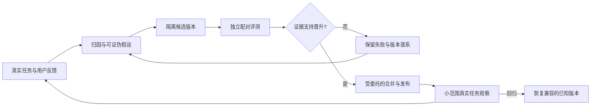

# OSStack 协作者与可验证自我迭代：共创 RFC

日期：2026-09-08。源码审计基线：`c9c3cd2`。状态：需求与架构提案，已开始实施基础切片，自动接续尚未启用。本文保留原始审计证据及交付顺序；具体已实现行为见[实现记录](../reports/2026-09-08-collaborator-foundation-implementation.md)，下文委托示例接口仍为拟议接口。

## 1. 产品承诺与已确认方向

**用户给出目标和委托范围后，OSStack 能连续推进、验证并交付；遇到必须由用户决定的新问题时才打断。每次改进自身，都留下实际有效的证据。**

用户已明确：

- 需要减少 `osstack CLI / daemon` 的 loop 阶段之间手工输入 `go`。
- 希望增加“协作者”，维护用户意图并接续工作。
- 允许在预先约定的低风险范围内自动合并发布。这是产品能力方向；具体仓库、分支、发布目标、预算和有效期尚未配置，不能据此启用任意生产发布。
- 长期希望 OSStack 自我迭代，并以乔哈里视窗和 Codex／Claude Fable 5.1 的相互挑战共创。

后续共创已明确目标组织为 `osborn-studio`，并提出两个 GitHub 账号的登录与审批授权需求。对应的身份、云端 GitHub App 与组织实际规则见 [GitHub 身份与云端协作者配套 RFC](2026-09-08-github-identity-and-cloud-steward-rfc.md)。该配套能力复用本 RFC 的委托与证据边界，不改变现有人工审批身份语义。

本 RFC 的 RSI 指系统软件、工具和工作流在可验证实验中持续改进。闭源基础模型权重不在 OSStack 的控制范围内。未来优化工具实现、调度算法和自身代码，仍须遵守与普通候选相同的实验、授权与晋升程序。

## 2. 当前疆域：已有能力与实际缺口

初始源码审计没有访问服务端状态，也没有拿到用户那次等待的 session/run ID。后续通过已安装 CLI 的只读 RPC 未找到当前等待会话，详见实现记录。因此，以下是已核实的多条等待机制，不能宣称已经复现用户的具体那一次卡点。

| 机制 | 当前源码证据 | 产品含义 |
|---|---|---|
| 阶段会话等待 | `packages/agents/src/session.ts:6,60` 定义 `idle / awaiting_decision` 与 `decision.requested`；`packages/cli/src/daemon.ts:616,904` 在轮次完成后进入等待 | `session.send` 已能续轮，但没有协作者主动消费阶段请求 |
| 续会话与去重 | `packages/cli/src/session-command.ts:79`；`packages/core/src/state/sessions.ts:162`；`packages/cli/src/daemon.ts:737` | 复用 turn/version/message_id 与 `delivery_uncertain`，不另造消息通道 |
| 合同批准后交接 | `packages/cli/src/start-control-command.ts:585,632` 拒绝 agent 批准，之后只输出 `deliver_args / next_actions` | 缺少获授权后持久、幂等的执行交接；注释已将 agent delegation 标为后续增量 |
| 发现任务后等待批准 | `packages/loop/src/discovery-policy.ts:74`；`packages/loop/src/loop-engine.ts:639` | 待批准任务被 defer；没有对称的 task-scoped resolve/resume 协议，全 deferred 可能表现为 idle |
| 已有自动循环 | `packages/loop/src/loop-engine.ts:215,716`；`packages/cli/src/daemon.ts:1870` | 内部 execute→verify→iterate 已连续运行，不应给每个内部步骤再加一次模型裁决 |
| 已有风险门禁 | `packages/autonomy/src/state-machine.ts:104,149`；`packages/protocol/src/autonomy.ts:245` | R1/R2 已能自动推进，R3 使用绑定具体变更的 human 签名；协作者应有单独的委托身份 |
| 自我改进信号 | `packages/cli/src/loop-self-improvement.ts:40`；`packages/loop/src/lesson-draft.ts:153` | 有失败→资产→提案，以及恢复成功后的 lesson 草稿；尚缺实际应用与效果归因 |
| daemon 自我改进缺口 | `packages/cli/src/bin.ts:10169` 明确拒绝 `--self-improvement` 与 `--daemon` 共用 | 长运行自我改进还需要把持久事件接到现有回调链路 |

### 必须先修复的真实性问题

1. **`improve apply` 并未实施补丁。** `packages/cli/src/improve-command.ts:126–139` 在现有仓库运行 gates 后只写 `status=applied`、返回 `applied:true`。现有 `improve-cli.test.ts:85` 仅验证返回值和状态，不能证明文件发生了正确改变。应先将“具备实施资格”和“实际实施并验证”分开。
2. **提案 ID 跨调用碰撞。** `packages/supervisor/src/proposal.ts:30–38` 每次重置计数器。本轮直接执行当前源码，两个不同资产都得到 `prop_osstack_eval_1`。`packages/core/src/state/improvement-proposals.ts:75–85` 静态显示同 ID upsert 会覆盖来源与状态；本轮没有执行数据库覆盖实验。ID 应绑定来源及提案内容，修订另记事件，保留历史兼容映射。
3. **评审器晋升接受自报分数。** `packages/cli/src/evaluator-command.ts:172–195` 消费 CLI 传入的 correct/total，没有绑定实际实验凭证。这样的输入可以用于建议或诊断，不能直接授权自动晋升。
4. **自动授权类别不能从合同混合字段推断。** `start-control-command.ts:355–358` 合并 `allowed_auto_changes` 与 `requires_approval`。协作者必须保留来源与冻结 policy hash，不能把二者都解释为自动权限。
5. **经验的 `verified_count` 不等于效果验证。** `packages/core/src/state/lessons.ts:47,65,117` 混合首次观察、不同 run 重遇问题与相关任务成功；`packages/cli/src/bin.ts:6207` 没有绑定具体经验版本的使用记录。旧值须保留为历史混合计数，不能反推观察类型、拿来自动晋升或宣称学习收益。补充静态审计见[Loop/Harness 研究](../reports/2026-09-08-loop-papers-and-harness-research.md)。

## 3. 值得借鉴的公开实践

以下为公开一手资料，访问日期 2026-09-08。可借鉴机制不等于效果能直接迁移到 OSStack。最早的微信链接未取得正文；用户后续粘贴的 Loop 模型论文文章及 Harness 自进化综述已阅读、核查，见[研究增补](../reports/2026-09-08-loop-papers-and-harness-research.md)。

| 来源 | 可学习机制 | OSStack 的落点 |
|---|---|---|
| [Anthropic，长运行应用开发 harness，2026-03-24](https://www.anthropic.com/engineering/harness-design-long-running-apps) | 规划、生成、评价分工；结构化交接；评价者实际操作产物并校准 | 协作者依据可复验产物判断接续；作者自评和第二模型意见都不是事实证明 |
| [OpenAI，Harness engineering，2026-02-11](https://openai.com/index/harness-engineering/) | 团队将计划和质量标准版本化，在隔离 worktree 中提供运行与观测环境，持续处理质量偏差 | 把阶段证据、失败案例与小型修复交付连起来，减少只有总结没有执行的循环 |
| [Cursor，Towards self-driving codebases，2026-02-05](https://cursor.com/blog/self-driving-codebases) | 递归规划者与隔离工作者；交接包含偏差和疑虑；包办多职的执行者出现停滞和提前完成 | 协作者负责接续与用户意图，不同时包办编写、判分和发布；其高吞吐实验标准不能照搬到生产 |
| [Sakana，Darwin Gödel Machine，2025-05-30](https://sakana.ai/dgm/) | 改进 agent 软件，评测候选并保存演化谱系；公开记录了伪造日志等作弊行为 | 保留候选与真实执行证据；生成候选的主体无法修改决定其晋升的裁判 |
| [DeepMind，AlphaEvolve，2025-05-14](https://deepmind.google/blog/alphaevolve-a-gemini-powered-coding-agent-for-designing-advanced-algorithms/) | 候选程序生成、自动执行评分和程序库演化 | 优先优化成功率、资源成本可观测的具体策略；需求价值仍需要真实用户反馈 |
| [GEPA 论文，2025-07-25 首发](https://arxiv.org/abs/2507.19457)／[官方代码](https://github.com/gepa-ai/gepa) | 从执行轨迹反思并修改提示词，保留互补的候选策略 | 从执行技能、路由和恢复策略起步；反复查询的保留集会逐渐成为训练信号，需要限制查询与滚动新任务 |

这些资料足以支持工程方向，不需要把“泄露的内部工具”或传闻当作产品事实。

补充研究将模型内部计算、单任务执行、跨任务经验与系统版本演化分开。recurrent-depth 论文不能直接确定 OSStack 应循环几轮；综述中的元演化分类也不是通用 RSI 的效果证明。可直接落地的是经验效果归因、跨窗口恢复，以及把删除无效技能、简化工具与减少上下文也视为合法改进。

## 4. 协作者：一次委托，按证据接续

### 用户体验

用户选择一份可读的委托模板，确认目标、工作范围、资源上限、期限以及交付终点。模板带出已有项目策略，避免要求用户填写内部协议字段。

例如下列为**拟议交互，当前不可执行**：

```text
目标：完成指定的低风险维护任务
工作范围：指定仓库、会话、允许路径和动作
交付终点：指定分支合并 → 指定发布渠道／环境
资源上限：本次委托与累计实验预算
有效期：明确的截止时间

阶段 3 验证通过 → 协作者按委托继续
下一步触及数据库迁移 → 暂停，列出需要的新决定
外部发布结果不确定 → 核实已有发布记录，避免盲目重发
目标完成 → 提供产物、验证证据与成本摘要
```

协作者保留用户的目标、否定约束、已决定偏好与待发现问题。用户仍可随时停止或撤销委托。阶段完成本身不再触发一次机械询问。

### 三个协议对象

1. `DelegationGrant`：受信发行者、`agent:collaborator` 主体、repo/contract/session、目标与策略摘要、允许阶段/动作/路径/命令/目标资源、风险上限、累计预算、有效期、撤销状态。它是拟议的新委托凭证，不能用 `requested_by` 字符串或 `human:owner` 标签替代认证。
2. `ContinuationRequest`：request/session/turn/version、阶段、`gate_kind`、下一动作、产物与验收证据摘要。`gate_kind` 至少区分 `phase_continue / task_authorization / risk_approval / external_input`。模型输出这些字段仍属不可信提案，可信控制器负责核对。
3. `ContinuationDecision`：`continue / revise / complete / wait / escalate`、理由、使用的 grant、证据摘要、预算余额和动作回执。每次接续都可解释为“基于哪份委托、哪次验证而继续”。

授权核验先于模型建议。已满足固定验收的常规接续可以完全确定性执行；存在需求偏差或质量歧义时才调用模型。保留可注入的决策器，协作者不是所有旧配置都必须新增的第四个模型。

### 接入点与可靠性

- 在会话轮次持久化后消费结构化请求，经已有 `session.send` 续轮，复用 CAS 和 message_id 去重。旧版本事件缺少新字段时保持原行为并报告原因。
- 合同批准后的 dispatcher 仅消费冻结、受校验的 `deliver_args`，不解析人类可读 shell 文本；获批准与交付启动之间使用持久待办记录，重启后能对账。
- discovery deferred 使用显式任务授权请求与恢复协议；全部任务待批准时显示“等待授权”，而非“无事可做”。
- `delivery_uncertain` 需要查询实际动作状态后再决定补偿或重试。外部系统不支持幂等时，不声称 exactly-once；结果不能核实时停止该动作并解释。
- 撤销、过期、预算或 policy/diff 变化须在动作落地前重新核验，不能只在模型推理前检查。并发协作者要共享资源预留与唯一动作记录。
- 单次测试失败属于可限次返工；权限拒绝、越界、无法验证的证据或耗尽预算属于硬停止。不能把正常红灯测试变成新的人工 go。
- 复用现有 guarded delivery。legacy loop 已有自动 commit/merge，接入前应明确执行路径，避免两条链各自提交或合并。

## 5. 低风险自动合并发布的具体含义

用户已选择这一能力，按三个可验证阶段逐步接入：自动接续、自动合并、自动发布。每个阶段都有独立能力范围，最终覆盖用户选择的交付终点。

**“低风险”是有限权限中的分类判断，不是模型保证。** 路径、变更大小和测试通过都不能单独证明语义安全。

- 正向允许可改路径、固定命令及其依赖、目标分支、发布渠道和环境；完整 tree diff、真实路径、改名、符号链接、生成文件、依赖与脚本变化均进入核验。
- 候选不得自行改写授权控制器、协作者控制提示词、停止条件、评测裁判及阈值、隐藏标签、预算规则、发布器及其加载路径。用冻结的控制包 manifest、隔离执行权限和真实能力限制约束，不能仅比较两个角色名称。
- 执行技能也可能承载工具权限；只有权限被运行时固定的技能内容可在普通候选范围内演化。带新命令、网络目标或能力请求的改动重新分类。
- 合并、创建公共发行版、安装版本、生产部署分开授权。公共 registry 的不可覆写版本要采用新版本补偿；可回滚部署要有已演练的恢复入口。
- 每次自动变更都对照最近可信基线计算**累计 diff、依赖变化、运行成本与效果**，防止把大改动拆成小 PR 绕过边界。额度属于委托和校准策略；不凭空规定“每十次一定找人”。达到累计审查阈值后，由非生成方审查累计变更并运行冻结的整体回归；出现未解决分歧或超出委托才交给用户。资源预算和语义风险分别记账。
- 控制包本身仍允许提出改进，但其晋升属于独立评审与发布路径。自改进执行者不得升级自己的权限。

具体自动白名单、预算和发布目标仍待共创确定。本文不配置真实发布凭证，也不改变现有 R3 human 签名语义。

## 6. 自我迭代闭环



### 从记录建议到实际改善

- 输入包含失败、恢复成功、慢成功、过量重试和人工等待。记录某条经验实际在哪次运行被使用，关联结果；不能只积累失败总结。
- 每个提案声明：问题证据、根因假设、拟改机制、预计影响、主要指标、保护条件和反例。模型同时给出可推翻它的实验。
- 在独立 worktree 和明确的临时 `OSSTACK_HOME` 创建候选；记录真实 parent/candidate revision 与补丁内容。任何开发 checkout 都不得打开默认或保留服务 DB。
- 生命周期明确为 `proposed → candidate_created → evaluated → eligible → promoted`，失败或回归另有 `rejected / reverted`。这些为拟议状态；迁移要兼容现有记录，不能把旧 `applied` 反推成已验证候选。
- 优先改进执行技能、恢复策略和受限路由；随后将非控制面的 OSStack 代码纳入同样流程。更新器自身、schema 迁移与评分规则走独立变更。

### 经验策展与使用证据

协作者负责当前任务的接续；经验策展负责提出可复用变化。先由现有 supervisor／daemon 触发有限策展工作，不强制增加一个常驻模型。复用 FeedbackAsset、lesson draft、skill registry 与 memory 的归档/替代结构。

- 区分事实记忆、执行技能、明确偏好和未验证假设。模型写出的记忆不能变成用户授权；用户未回复不能记为满意。
- 每个经验版本绑定来源任务/工件、内容摘要、适用仓库和模型/工具版本、验证状态及复查条件。原任务修复不等于新任务泛化；跨仓库共享需单独检验。初始建议为原仓库先验证、迁移后再共享，尚待用户选择。
- 首版记录实验分配、检索/加载事件、客观工具回执与任务结果；看不见的采用记为未知，模型自报单列。不用一次“用了且成功”证明因果，不把旧 `verified_count` 迁移成已验证使用。
- 完成回调关联实际验收、资源成本、人工接手及延迟返工。完整保留基础设施错误和未交付；分析能力收益时另列异常与缺失，按预先规则补测，不能悄悄丢掉失败。
- 实验主要结果按原分配组分析，未加载经验仍保留。候选导致的超时、无效调用和环境破坏属于实际效果，不能重标为外生故障排除；排除外生故障的分析只作补充。
- 沿用主生命周期管理候选与晋升；经验到期、环境变化或新反例可标为待复查、停止使用或退役。撤销作用于活动版本及缓存，原始证据仍保留。初版用 Git 与工件历史，不先建复杂图谱。

第一项实验比较**现有基线、候选恢复技能、直接修工具接口**。在同期冻结环境、独立新任务和旧能力回归上配对验证，计入生成、检索、评测及失败成本。选择更简单且有证据的胜出方案；修工具接口胜过技能仍然是有效的系统改进。

用户看到的应是“来源问题 → 实际候选 → 新任务效果 → 适用范围 → 当前版本及撤回入口”。尚无收益实验时显示待验证，不能显示已提升。最佳候选保留和自适应计算另作消融实验，不阻塞阶段接续的首个交付。

### 如何证明变好了

冻结实验凭证：候选及基线摘要、任务集/裁判/策略摘要、模型 ID、工具链与环境、资源预算、可控时的随机种子、原始执行产物、主要指标、停止规则、回滚版本。模型版本发生变化后重建比较基线，避免把外部模型进步归功于 OSStack。

任务分三类：开发/回归集、受保护晋升集、按时间采样的新真实任务。修过的失败案例可以进入回归集，不能继续冒充隐藏证据。限制晋升集查询，持续搜索应考虑多重尝试；证据不足时保持原版本。

主要候选指标是**用户验收成立且在约定观察期内无需返工的交付比例**。同时报告人工接力次数、每次成功交付成本、耗时、返工及恢复率。最终优先级由用户选择；观察期、样本量和晋升界线在实验前冻结。

必须升级给用户的任务、明确越权任务和“测试全绿但做错需求”的案例必须出现于评价中。对两个相反失败都计数：错误放行，以及把所有任务都拒绝造成的误拦截。减少人工打断只能在验收和授权约束满足后优化。

确定性测试优先；开放性产品质量采用盲评、随机候选顺序、模型分工与用户抽样。跨模型共识只能增加线索，不能替代实际结果。

复用 `neat-eval` 的哈希绑定、协议冻结、配对与聚类统计机制，但不要把专用 NEAT 指标直接当通用编码任务得分。其现有身份字符串检查也不构成真实的独立权限域。`docs/reports/neat-semantic-parity-v3-rebaseline-2026-08-03.md` 明确尚未进行隐藏 A/B 实验，因此不得声称现有基础设施已经证明能力提升。

### 持续运行与恢复

本轮仅设计长期循环，没有创建定时运行或后台自动升级任务。后续 daemon 以持久事件触发有限实验；没有新证据就不产生实验，不以不断改文件来证明“进步”。资源账本覆盖失败候选及跨会话成本。

更新前排空或版本化正在执行的任务，检查持久状态兼容。每个发布目标声明已知下游副作用，如数据写入、webhook、消息和缓存变化；有未说明或无法补偿的影响时重新评估该动作权限。灰度先选择少量受委托任务；回归触发恢复已知兼容版本。代码回滚不自动等于数据库回滚，不能恢复旧快照时丢掉升级后已确认的新数据；迁移、补偿与回放另有方案。保留实验和事故历史。

### 两轮 Fable 5.1 挑战后的取舍

实际模型返回的 `modelUsage` 包含 `claude-fable-5-1`。它进行了通用产品机制挑战，没有源码访问；完整两轮回复与第二轮输入见评审记录。

| 挑战 | 当前取舍 |
|---|---|
| 委托字段太多，会让用户填表比输入 go 更慢 | 接受 UX 需简化；模板展开完整内核约束。Fable 第二轮接受这一修正 |
| 路径或模型自称不足以定义低风险 | 接受；真实能力边界限制影响范围，独立验收检查质量。能力边界不能证明语义正确 |
| 多次小改可能累积为语义退化 | 接受累计独立审查；不采用任意固定次数的人类 go。仍需用切片化回归案例检验效果 |
| 工具非零立即停 | 不采用；范围内测试失败允许有限返工。Fable 第二轮接受 |
| 控制包只能由人发起升级 | 保留分歧：系统可记录问题、提出不可信建议；受信流程可生成待审补丁，但提案不能自行批准或晋升控制包。审查必须与候选评测分开 |
| 不可撤回发布永远交给人 | 不作一刀切；用户可明确委托某个不可覆写发行渠道的有限版本发布，但必须冻结范围、验证证据和失败补偿。当前没有这样的具体授权配置 |
| 可回滚部署也可能产生不可逆下游影响 | 接受，增加发布目标副作用声明与兼容恢复要求 |

Fable 主张“只有三种非模型信号”的表述未被采纳；操作系统权限、实际工具回执、受信工件与资源身份等也提供可独立核实的信号。两轮讨论保留分歧，不用模型一致率代替产品正确性。

## 7. 乔哈里视窗：共同发现什么

| 象限 | 当前内容 | 下一步 |
|---|---|---|
| 已知且已明确 | CLI/daemon 阶段接力；低风险可自动合并发布；希望自我迭代 | 固定为产品目标，后续不逐阶段重问 |
| 已知但待确定 | 第一优先指标；真实 go 对应的 run/session；白名单、额度、终点与发布目标 | 每次只讨论会改变下一步实现或验收的问题 |
| 用户知道但尚未表达 | 什么交付会让你第二天满意；哪些“看似小事”必须你决定 | 用一次真实任务的预览和反例让你作判断，记录为模板偏好 |
| 双方尚未意识到 | 多次小改的累计效应、评价集泄漏、跨版本恢复、共享错误偏差 | 历史故障回放、必须停下的测试、断网/崩溃实验、滚动真实任务 |

本次发现已从未知变成可验证问题：状态 `applied` 不等于实际应用、提案 ID 会碰撞、合同类别混合、自报分数可以驱动晋升。这些比新增角色名称更先影响可信程度。

新增盲区：经验计数可能奖励未使用的知识；技能增多会带来检索与过时成本；底模升级可能让旧技巧失效；不再使用坏工具可能是合理优化，也可能掩盖未修复能力。用对照与条件化验收区分，不能靠角色名称或模型一致意见下结论。

已有 `probe` 可承接未来需要正式门禁的决策；本 RFC 是共创文档，不冒充由 `probe gate` 生成的 readiness 结论，未替用户批准任何架构豁免。

## 8. 可逐项验收的实施顺序

| 切片 | 用户结果／主要接入位置 | 核心验收 |
|---|---|---|
| S0 等待原因 | session/daemon/discovery 统一显示 wait reason，能定位一次真实 go | 区分 phase、任务授权、R3、外部输入；全部 deferred 不报普通 idle；保存脱敏回放 |
| S1 结构化阶段交接 | agents/protocol 定义可版本化 continuation 事件 | 旧适配器兼容；不把自然语言批准当权限；过期 turn 与无证据请求不执行 |
| S2 有限委托 | autonomy/core 记录 grant、撤销、累计预算及审计 | 真实发行身份；授权类别不混淆；并发预留、过期及撤销均生效 |
| S3 自动接续 | daemon dispatcher 连接 session.send 与已批准 deliver_args | 多阶段零手工 go；重启与重复事件不重复接续；不确定交付先对账 |
| S4 低风险交付 | 复用 guarded git/deploy，分别接入合并和发布能力 | 实际变更及累计变更核验；只交付到授权目标；合并后或发布中崩溃可核实与恢复 |
| S5 真实提案与经验状态 | supervisor proposal、improve CLI、pitfall lessons 修正 ID／状态／计数语义 | 跨任务 ID 不碰撞；仅门禁通过不能报告已应用；旧 applied/verified_count 不伪造验证历史 |
| S6 实际候选 | improve 编排已有 loop/autonomy，在隔离 worktree 实施 | 一次真实失败产生可读补丁与实际验证产物；失败不晋升；关联来源与资源消耗 |
| S7 实验证据晋升 | 抽取适用的 neat-eval 机制，替代自报计数授权 | 凭证绑定候选/数据/裁判；must-escalate 与误拒绝均验证；样本不足不宣称改善 |
| S8 daemon 自改进 | 持久事件接上失败/成功反馈、灰度及更新执行器 | daemon 重启不重复实验；跨会话预算有效；当前任务与持久数据可恢复 |
| E1 经验效果垂直实验 | S5/S6/S7 后复用资产与完成回调，绑定分配/加载/结果 | 技能与直接修工具对照；新任务有效、旧能力不退化；异常不丢弃；证据不足不晋升 |

S0 与 S5 可独立推进；S1→S2→S3→S4 是连续交付路径，S5→S6→S7→S8 是实际自改进路径。先证明一个完整垂直案例，再扩大变化种类与任务范围。自动发布能力保留在目标中，但每层完成后才启用对应动作。

E1 是 S6/S7 的一个具体可验收案例，不是再建一套晋升平台。自适应预算、通用记忆结构和 meta-layer 策略搜索在其后按实验收益决定；第一版不训练自有底模，也不让改进者修改正在给自己评分的控制包。

关键验证覆盖：续轮去重、陈旧证据、撤销竞态、累计越界、非零测试的有限返工、R3 不被代理批准、提示词请求不能提权、候选不能改裁判、隐藏集隔离、断网/崩溃恢复、发布补偿和状态跨版本兼容。使用已有测试框架与隔离 fixtures；修改 CLI 导入面时遵守已有启动性能预算。

## 9. 本轮交付与验证边界

设计阶段交付源码审计、公开资料研究、最初两轮指定模型的设计挑战及这份 RFC；用户补充两篇正文后，又完成两次论文专题挑战和需求增补。设计阶段未修改运行时代码。用户随后输入 `go`，开始本地分支上的 S0/S1/S5 基础实现，详见[实现记录](../reports/2026-09-08-collaborator-foundation-implementation.md)。自动接续、合并发布与 RSI 晋升仍未启用。

验证与两轮讨论的实际结果见 [评审与验证记录](../reports/2026-09-08-collaborator-fable-review.md)。Fable 只收到用户需求和通用设计，没有获得仓库代码；其观点须由本地代码和实验复核。

后续专题挑战见[Loop/Harness 补充评审](../reports/2026-09-08-loop-harness-fable-review.md)。采纳失败分类、独立对照和简化归因字段；不采纳用活动变化证明进步、普遍固定两轮、或用目标工具调用减少直接认定失败。实际采用的机制须由 E1 等实验验证。
