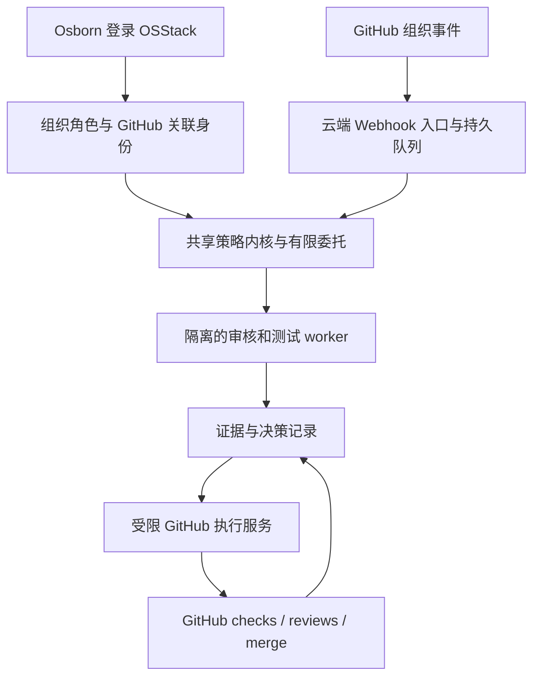

# OSStack 登录、GitHub 身份与云端组织协作者

日期：2026-09-08。状态：架构建议，未实施、未安装 App、未修改 GitHub 设置或执行审批。

承接：[协作者与自我迭代 RFC](2026-09-08-collaborator-and-self-improvement-rfc.md)。用户明确管理目标为 [osborn-studio](https://github.com/osborn-studio)，希望通过 OSStack 登录与授权，使用 `gilberthello` 或 `gilosbornhello` 的权限完成 PR 审核及组织代码管理。

## 1. 推荐决策

**OSStack 提供统一的产品入口、委托策略和审计；独立部署一个云端 GitHub App 服务，负责接收组织事件和执行获准的 GitHub 操作。**

代码初期仍放在同一 monorepo，复用共享内核。云端服务独立进程、独立凭据与升级生命周期，电脑离线时也能工作。它是 OSStack 的云端执行组件，不需要同时开发另一套登录、审批和知识系统。

| 选择 | 适用性 | 结论 |
|---|---|---|
| 只在本地 OSStack 中切换两个个人账号 | 单机演示简单，但依赖本机在线与全局凭据状态，多任务身份容易混淆 | 保留现有本地能力，不作为长期架构 |
| 单独做一个全功能组织管理机器人产品 | 能独立运行，但容易复制策略、审批、审计与配置 | 当前没有必要 |
| OSStack 产品＋独立部署 GitHub App | 复用现有内核，云端持续接续，真实身份与权限可区分 | 推荐 |

GitHub 官方通常推荐 GitHub App：可限定仓库、细粒度权限、短期令牌，既能作为 App 自身运行，也能经用户授权代表用户操作。[官方比较](https://docs.github.com/en/apps/oauth-apps/building-oauth-apps/differences-between-github-apps-and-oauth-apps)

## 2. 本轮只读核实的现状

通过已连接的 GitHub CLI 读取 API，没有读取或输出令牌，也没有外部写操作：

- 当前连接身份：`gilosbornhello`。
- `osborn-studio` 为 GitHub Organization；两个指定账号的成员状态均为 `active`，角色均为 `admin`（组织 Owner）。
- 组织当前有 12 个私有仓库，默认仓库权限为 `none`。本轮没有修改这些设置。
- 抽查 `osborn-studio/osstack`：默认分支 `main`，普通仓库而非 fork；当前没有 open PR。
- 该仓库 `main` 保护要求 1 个批准、旧审批随新改动失效、最后一次可评审 push 需要其他人批准；`enforce_admins=true`。
- 该仓库 required status checks 为 `null`，不代表没有 CI，只说明此保护配置尚未强制 CI 检查。
- 该仓库 native auto-merge 开关关闭；包含父级来源的 rulesets API 当前返回空数组。本轮未核实其余 11 个仓库的保护配置，不外推一致性。

**含义：用户具备组织管理身份；产品缺口主要是 OSStack 登录、身份授权与受限执行链。** 当前 main 的规则对管理员也生效，不能把 Owner 身份当作自动跳过审批的入口。启用自动交付前，应先将实际需要的 CI 和 OSStack 检查纳入保护条件。

工作区当前 git remote 是个人命名空间 `gilosbornhello/osstack`，用户此次指定的是组织仓库 `osborn-studio/osstack`。新集成必须绑定目标 repository ID，不能从本地 remote 推断发布或审批目标；本轮没有同步或改写 remote，也未证明两仓代码一致。

## 3. 登录、代用户操作、机器人身份

| 层次 | 表达什么 | 建议实现 |
|---|---|---|
| OSStack 登录 | 当前自然人是谁，属于哪个工作空间，有哪些产品权限 | GitHub 登录＋组织成员核验；用户在自己的 Studio 工作空间登记为 Owner；平台维护权限与客户组织权限分开 |
| GitHub 关联身份 | 用户已验证并授权使用哪个 GitHub 账号 | 两个账号分别完成 OAuth；使用不可变 GitHub user ID 关联，不能仅输入用户名或按同邮箱自动合并 |
| GitHub 个人操作 | 某次批准在 GitHub 上应归属于哪个用户 | 显式选定已授权身份，通过 GitHub App user access token 调用；动作发生前核实用户/App/仓库权限 |
| 自动协作者 | 按用户事先委托，在后台执行一类动作 | GitHub App installation token，以 App bot 身份运行，审计记录谁发起委托 |

GitHub 要求每个用户单独授权 App 才能代表该用户操作；user access token 只能使用用户权限、App 权限与安装资源范围共同允许的部分。登录 A 账号不能自然获得 B 账号的授权。[用户身份认证规则](https://docs.github.com/en/apps/creating-github-apps/authenticating-with-a-github-app/authenticating-with-a-github-app-on-behalf-of-a-user)

因此，两个账号可以分别关联并用于合法的本人操作。日常自动化优先使用 bot，避免把长期后台执行都归到个人名下。用户手动确认和自动策略批准在界面及审计中必须可辨认；自动行为不写成用户刚刚亲自审阅。

拟议日志：

```text
发起人：Osborn／某份有效委托
产品身份：Studio Owner
执行主体：指定 GitHub App 的 bot
对象：repository ID、PR、head SHA、base SHA
动作：review.submit / merge / release 等独立动作
依据：策略版本、测试与审查证据、委托范围
结果：GitHub review/check/merge 的返回凭证
```

现有本机 `requested_by` 或 `human:owner` 字符串不能承担云端身份认证。新登录服务也不能因为“研发者”标签而硬编码对所有租户的管理员权限。

## 4. PR 审核、批准和合并的边界

这三种动作应分别可授权：

- **审核**：读取 diff、执行测试、找问题，输出 report/check。
- **批准**：向 GitHub 提交 `APPROVE` review，表达该执行身份的评审意见。
- **合并**：将 GitHub 认可、满足目标分支规则的改动合入目标分支。

GitHub 明确禁止 PR 作者批准自己的 PR；当前目标仓库还要求批准者不同于最后一次可评审 push 的主体。两个账号若由同一自然人控制，也不构成两个独立人的复核证据。[GitHub 评审规则](https://docs.github.com/en/pull-requests/how-tos/review-pull-requests/reviewing-proposed-changes-in-a-pull-request)

GitHub API 支持 App installation token 创建 review，要求 Pull requests 写权限。但“成功创建 APPROVE”不代表必然满足该仓库的 required reviewer／CODEOWNERS／最新 push 规则，必须用实际安装与测试 PR 验证。当前没有 open PR，因此本轮未验证机器人审批是否计入此仓库要求。[Review API](https://docs.github.com/en/rest/pulls/reviews#create-a-review-for-a-pull-request)

推荐将 OSStack 的自动审核首先表达为一个固定来源的 required check，例如拟议的 `osstack/policy-review`，并将预期来源锁定到该 GitHub App。GitHub 支持 required status check 指定 App 来源。[分支保护说明](https://docs.github.com/en/repositories/configuring-branches-and-merges-in-your-repository/managing-protected-branches/about-protected-branches)

**required check 不替代现有 required approval。** 初期保留当前 1 个批准要求：符合条件的独立审核 bot 或合法个人身份提供有效批准，所有检查满足后再合并。如果使用同一个 App 生成和批准 PR 会触及作者规则，应让 Builder 和审核执行方具有不同身份及独立权限；不能靠同一 App 内两个“角色名”制造独立性。

还应处理：push 后旧证据失效、审核与合并间 head 改变、base 改变、webhook 重复或乱序、已有 changes requested，以及 merge queue 场景下的待合并组合版本。轻量初期可使用 GitHub 原生 auto-merge；并发量高且套餐支持时再启用 merge queue，不自造队列语义。

## 5. 运行架构与边界



- OSStack：登录入口、组织仓库映射、Owner/maintainer/reviewer/viewer 等产品角色、委托、风险与证据展示。
- 云端服务：OAuth callback、webhook 验签、队列、任务去重、对账、GitHub API；消费协议对象，不解析 CLI 文本。
- 审核 worker：按委托在隔离环境运行检查或模型；不持有 App 私钥、Owner token 或组织管理凭据。私有代码能否发送外部模型也是独立配置，安装 App 不代表同意任意模型外发。
- 凭据与动作服务：保管 App 私钥及必要的用户 refresh token，按任务签发更窄的短期 installation token；PR 原文或模型输出不能直接变成任意 API 请求。
- CI/CD：继续承担构建测试与既有部署；合并和发布权限不自动继承到组织成员管理。

先用一个云端部署服务、一个持久队列和状态存储即可；不同凭据/执行职责需要隔离，不要求第一版就拆成很多微服务。长时间模型任务进入 worker，不阻塞 webhook HTTP 请求。现有 localhost dashboard 和 Unix socket daemon 均不能直接作为公网管理入口。

GitHub installation token 通常一小时到期，签发时可进一步收窄仓库和权限；到期前重签并在动作前检查撤销，而非长期保存个人 PAT。[Installation token](https://docs.github.com/en/apps/creating-github-apps/authenticating-with-a-github-app/generating-an-installation-access-token-for-a-github-app)

## 6. 首版权限与组织管理范围

| 能力 | App 请求范围 | 执行约束 |
|---|---|---|
| 读代码／PR／CI | Contents、Pull requests 及所需检查数据的读权限 | 仅安装选中的仓库 |
| 写审核报告 | Checks 写权限；提交 review 时 Pull requests 写权限 | 绑定当前候选 SHA、证据与委托 |
| 合并低风险 PR | GitHub 合并端点所需 Contents 写权限 | 既有保护规则满足、匹配最新 head、目标分支允许 |
| Issues／标签／分派 | 按实际 endpoint 增加 Issues 或 PR 权限 | 单独能力模板；后续增量 |
| 组织成员／团队／仓库管理 | 单独管理权限与授权流程 | 不与普通 PR worker 共用高权限凭据 |
| 仓库删除／transfer／规则放宽／生产 secrets | 首版自动 PR 角色不授予 | 显式管理动作与影响预览；不能由 RSI 自行扩大权限 |

权限名与需求应在实现时按具体 API 逐项核对；GitHub 一个写权限往往覆盖多个端点，因此执行服务还必须限制可调用动作。审核 App 不默认获取组织 Administration 或规则 bypass。

可将 App 注册在 `osborn-studio` 下，先设为仅本组织使用的 private App，安装到选中的试点仓库。私有 GitHub App 只能安装在拥有它的账号下；未来若服务两个个人命名空间或其他组织，需要调整分发方式及安装白名单。App 的 public 可安装性不等于仓库公开，也不要求立即上架 Marketplace。[GitHub App 注册与可见性](https://docs.github.com/en/apps/creating-github-apps/registering-a-github-app)

## 7. 如何复用当前 OSStack

| 当前源码 | 可复用能力／需要增加的部分 |
|---|---|
| `packages/github/src/delivery.ts:676,892,908` | 已有 PR 交付、保护规则检查及 `--match-head-commit`；增加按 installation/user 注入身份的 API adapter，保留本机 gh 实现 |
| `packages/github/src/delivery.ts:89,690` | 当前继承 GH_TOKEN/GH_CONFIG_DIR 并检查 gh 登录；云端不得全局切换两个个人账号 |
| `packages/autonomy/src/engine.ts:284` | 已有 `deliverGit` 端口，可接新的云端交付实现 |
| `packages/core/src/state/contract-approvals.ts:119` | 复用不可变审批事件设计，补充产品 principal、GitHub actor、installation、repository ID、PR/SHA 和委托关联 |
| `packages/protocol/src/autonomy.ts:245` | 现有 ScopedApprovalDecision 为 human-only；机器人走独立 service/delegation 协议，不篡改既有人工审批语义 |
| `packages/cli/src/daemon.ts:3768` 与 `dashboard.ts:518` | 当前是本机 socket／HTTP 使用方式；新增认证入口，不直接暴露现有服务 |
| `docs/decisions/ADR-001-shared-control-kernel.md` | 共享 protocol/core/autonomy；外部组件不得导入私有 CLI 或解析 CLI 文本 |

拟议目录可以是 `packages/github-app`，以实际边界评审确定最终命名；它不是已存在的组件。初期每个工作空间的 Owner 由组织权限核验与明确登记产生，账号关联、App 安装和有限委托是三个可分别撤销的对象。

## 8. 实施顺序与验收

1. **身份与权限预览。** 登录 OSStack，分别验证可关联账号，绑定组织和安装。验收：能解释每个仓库“我是谁、机器人是谁、可做什么”；错误租户或未授权第二账号不能执行。
2. **单仓库云端审核。** 接 webhook、输出只读分析与 check，建立脱敏证据。验收：断网/重试不重复发布结果；新 push 使旧结果失效；模型失败不能生成成功 check。
3. **有效批准与低风险合并。** 在测试 PR 上验证 bot review 是否满足当前规则，补齐 required CI/check 来源，配置允许的有限动作。验收：作者/最后推送者限制生效、保护管理员生效、SHA 变更不误合并、凭据撤销生效。
4. **组织仓库逐步覆盖。** 先复用已验证模板，再扩展标签分派、依赖更新、发布编排及权限盘点。组织管理写操作分开开放。
5. **连接原有协作者／RSI。** loop 完成任务后通过同一权威链交付。RSI 可提出对自身的改进，但不能给自己加 App 权限、改审批标准或批准控制面升级。

本轮没有注册 App、配置 OAuth、改保护规则、启用 auto-merge 或提交 review；这些需要具体可审阅配置和受权安装后执行。本文已将用户的组织和账号信息落实为架构约束，不把“允许讨论与设计”当作更改组织策略的授权。
