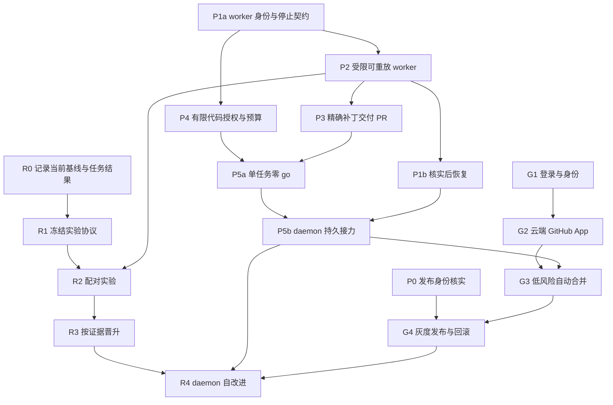

# OSStack 下一阶段实施计划：连续交付与可验证自改进

状态：分片执行中。用户已授权计划就绪后直接开发。R0 / P1a 首片（观察基线、worker 标识与停止请求）已实现并通过完整本地验证，待 PR 审核与合并；不代表 M1 / M2 已完成。见[交付说明](../reports/2026-09-09-improvement-execution-control.md)。

规划基线：main `32146c40cf179d16a87768fa921d606adf61dbca`。GitHub 已确认 [#217](https://github.com/osborn-studio/osstack/pull/217) 和 [#218](https://github.com/osborn-studio/osstack/pull/218) 均合并。承接[协作者 RFC](2026-09-08-collaborator-and-self-improvement-rfc.md)、[GitHub 身份 RFC](2026-09-08-github-identity-and-cloud-steward-rfc.md)和[候选执行记录](../reports/2026-09-08-improvement-candidate-execution.md)。

## 1. 下一阶段的产品结果

第一目标：用户一次定义任务、允许修改的范围、预算和交付终点，OSStack 完成构建、验证、有限返工及 PR 交付；正常阶段推进不再索要 `go`。碰到真实授权缺口或无法核实的执行结果时，说明具体原因并保留进度。

第二目标：一次真实失败能沉淀为候选改进，在冻结的新任务上与基线比较，证据足够才采用；后续回归时可以撤回。首先改进测试、文档、恢复流程和工具接口，暂不把底模训练纳入范围。

用户已表达低风险范围内可自动合并发布，这个目标继续保留。后续实现将它拆为可分别撤销的代码执行、PR、合并和部署权限，落到具体仓库、策略和预算；不在每个普通阶段重新询问。

## 2. 已交付与仍缺少的环节

| 已有证据 | 仍缺少的用户结果 |
|---|---|
| 提供材料的规划／评审会话，可按签名的有限指令自动接续 | 真实代码任务的合同批准后自动启动与接力 |
| 提案和执行请求均绑定摘要；候选在外部 worktree 构建 | 准备可复现的依赖环境、处理中断与失联 worker |
| Codex 构建、Kimi 检查完整补丁、保存回执和哈希 | 把这份精确补丁交付成 PR，并与远端状态对账 |
| 区分 `candidate_verified`、`applied` 与效果证明 | 冻结基线／保留任务集，真实比较并控制晋升 |
| 已有 guarded delivery、部署与升级机制 | 将这些机制接入候选流程，完成一次真实安装与回滚演练 |
| 已明确 OSStack 登录与云端 GitHub App 的分工 | 实际登录、安装授权、机器人审核及组织权限展示 |

具体代码证据：`start-control-command.ts` 仍只输出 `deliver_args`；`improvement-candidate.ts` 仍是显式本地执行；`improvement-executions.ts` 对不确定运行保留占用；普通 shell gate 尚无独立操作系统权限边界。这些是下一批的实现入口。

## 3. 优先顺序与依赖

首个可用版本收缩为一个仓库、一个任务、一种经过验证的 worker 环境，终点为草稿 PR。这个试点终点不取消用户已表达的低风险合并发布目标；后者在对应交付切片接入。

| 里程碑 | 可验收结果 | 包含切片 |
|---|---|---|
| M0：开始记录 | 冻结现状及先导任务口径；发布身份另行核实 | R0；P0 并行，不阻塞本地 PR 纵切 |
| M1：最小执行边界 | 一次代码授权在受支持 worker 中有范围、预算与明确停止语义 | P1a、P2a/P2b、P4，分 PR 交付 |
| M2：首先兑现零 go | 单任务正常路径经验证后自动交付同一补丁的草稿 PR | P3、P5a；检查点 A |
| M3：持续与恢复 | 崩溃后先核实，再恢复；daemon 跨重启继续已授权任务 | P1b、P5b；检查点 B |
| M4：自动交付与自改进 | 按权限合并发布；独立比较候选效果、灰度采用或撤回 | G1–G4、R1–R4，按图中依赖分别推进 |

M2 崩溃时允许暂停且保留不确定结果；不能自动清锁重跑，也不能显示成功。M3 才承诺核实后的自动恢复。收缩运行平台和任务数量，不推迟凭据隔离来换取提前上线。

## 4. 可单独验收的 PR 切片

每项是一个产品切片，不要求一个 PR 塞完所有子系统。实现若超过约五个核心文件，先提交不改变行为的接口切片，再提交接入；每个 PR 都应可独立构建和验证。

### P0：发布身份核实与修正（小；无依赖）

- 结果：发布检查能明确展示目标组织、仓库、workflow 和 npm 包的实际信任映射。
- 验收：先只读核实真实配置；配置工具和 preflight 使用同一显式目标；旧仓库名不匹配时明确报错，不静默覆盖远端信任。
- 验证：旧名、正确名、缺配置三类 fixture；真实只读预检。仓库重定向不能被当作 npm 信任已迁移的证据。
- 入口：`scripts/configure-npm-trusted-publishers.mjs`、`scripts/preflight-npm-trusted-publishers.mjs` 及现有 smoke 脚本。

当前两个脚本仍指向 `gilosbornhello/osstack`，其中配置工具为硬编码。真实 npm 配置尚未核实，不能断言已坏或已正常。npm Trusted Publisher 配置包含组织／用户、仓库及 workflow，所以应单独验证迁移后的映射。[npm 官方文档](https://docs.npmjs.com/trusted-publishers/)

### P1：执行身份、停止与恢复（拆为 P1a / P1b）

- P1a（M1，无依赖）：先定义执行 ID、worker 实例身份、代次、动作提交点及停止状态接口，供执行边界和授权账本共同使用。
- P1b（M3，依赖 P1a、P2）：接入真实 worker 终止／隔离证据、对账与恢复命令。完整恢复不再作为最小纵切的前置条件。

- 结果：用户能解释并处理长期 `claimed/running`，不必手改 SQLite 或删锁。
- 验收：区分运行中、已确认结束、失联且不确定；只有确认旧 worker 不会继续产生有效写入时才允许新尝试；旧回调不能复活已终止的尝试。
- 验证：重启、PID 重用、旧 worker 延迟回执、重复中止与并发恢复；保留原尝试和证据，不改写历史结果。
- 入口：core 的 `improvement-executions.ts`、CLI 的执行命令及拟新增 recovery 模块。若持久字段变化，追加迁移，不能修改已发布的 migration 25。

不能通过给活动锁设一个超时就宣称安全恢复。代次只能约束实际校验它的资源；DB 拒绝旧回调不能阻止 shell 写文件或已发出的网络请求。控制面 fencing 与 worker 的终止／隔离证据必须分别验证；心跳超时只证明失联，不证明死亡或停写。不能确认停止时保持不确定状态和占用。

### P2：可复现且受限的执行 worker（拆为两个中型 PR；依赖 P1a）

- P2a 环境准备：按锁文件建立候选依赖环境，记录工具链和环境摘要；依赖安装失败单独归因；构建输出有显式分类，不能借“缓存”隐藏源代码变更。
- P2b 执行边界：Builder、验证命令与控制平面分离；Builder 和验证 worker 均不获得签名私钥、GitHub 写凭据或控制 DB 写权限；GitHub 写动作由受控交付服务执行。候选构建不接触隐藏评测集。最小版只支持一种明确验证过的 worker 环境。
- 验收／验证：干净环境可重放；只验证受支持的平台和运行方式；尝试读取凭据、修改控制 DB、后台残留进程与超时取消均有真实边界测试。边界无法建立时不启用后台代码委托。
- 入口：现有 candidate runner、执行 adapter factory、拟新增 worker/environment 模块及测试；环境准备与权限隔离分开提交。首版按现有锁文件准备一种环境并记录工具链，不建设通用环境管理平台；不承诺位级可复现。验证命令运行在无写凭据的独立 worker，交付服务只消费绑定补丁的证明。在线模型调用须经明确允许的 provider 通道，不能因“只允许包注册表”而使产品无法执行。

### P3：把已审查的补丁交付成 PR（中；依赖 P2）

- 结果：`candidate_verified` 能继续到一个可点击的真实 PR，失败后能核实是否已经创建。
- 验收：从绑定的 base 重放保存的 patch，核对最终树并复用 guarded Git 的适用验证／交付阶段；不重新生成候选，不直接提交旧 worktree 的 index。
- 验证：base 前移、patch 被修改、创建 PR 后本地未收回执、重复调用；只能创建一个逻辑交付，远端结果不明时先对账。M2 只实现本次分支／PR 的查询与人工核实入口，查不清就保留 unknown；M3 再扩展自动恢复。分支推送、PR 创建分别记为外部动作，不能只记录最后一个 PR 回执。
- 入口：`improvement-candidate.ts`、`guarded-git-runtime.ts`、`packages/autonomy` 的候选／证明接口及对应测试。

P3 先验收精确补丁交付接口；与 P5a 合起来才验收一次授权到 PR 的体验，不能把人工接力的交付误报为零 go。

### P4：代码执行的有限委托（拆为协议／执行两个中型 PR；协议依赖 P1a，执行接入依赖 P2）

- 结果：用户一次签发一个工作包，明确任务来源、允许变化、终点、时间和资源额度。尚未生成的补丁不能预先获内容批准；授权绑定仓库／base、允许路径与副作用、工具／网络限制、冻结的验收门和交付终点，生成后再验精确补丁。路径白名单不是语义低风险的充分证据。
- 验收：代码委托与现有 `phase_continue` 不互换；原子预留累计预算；撤销、并发消费和重启后均不能重置额度或扩大权限。
- 验证：篡改范围、超预算、旧授权重放、撤销竞态、试图授权自身改权限；未知实际成本不能显示为零成本；无法强制美元上限的 provider 不宣称有硬金额保证，使用可执行的调用／token／时间上限并明确费用可观测性。
- 入口：protocol 的独立授权结构、autonomy 校验模块、core 使用账本，再单独接执行器。账本记录 token、调用次数、时间和已报告费用及其可观测性。

### P5：合同批准后自动接力（拆为单任务与 daemon 两个切片）

- P5a（M2，依赖 P3、P4）：单任务正常链路持续到草稿 PR；记录执行状态与外部动作，不要求崩溃后自动重试。
- P5b（M3，依赖 P5a、P1b）：接入持久队列与 daemon 发送／对账，支持跨重启恢复。

- 结果：合同批准后进入执行队列，完成构建、验证、有限返工和 PR；正常阶段无需再次输入 `go`。
- 验收：`deliver_args` 升为有类型、可校验的执行请求；持久队列与发送记录绑定；失败仅在授权的重试规则内继续，真实风险批准及缺失需求仍暂停。
- 验证：重复合同事件、重启、网络断开、验证失败再修复、无可用任务；队列投递成功不等于外部执行成功。
- 入口：`start-control-command.ts`、daemon dispatcher、core 队列／发送记录与测试。复用等待原因展示，不新增一个只有角色名的转发层。

检查点 A（M2）：一次明确授权下，一条真实低风险任务通过验证并生成可点击草稿 PR，普通阶段手工 go 为零；崩溃保留 unknown 并展示下一步。首次在线模型运行使用已批准提供方和明确预算，fixture 不替代实际验收。

检查点 B（M3）：一组预先选定的低风险任务在一次委托内运行，正常链路手工 `go` 为零；必须暂停的反例全部暂停，预设应继续的正常 fixture 也必须实际到达终点。暂停本身不计成功，预算剩余也不构成冒险交付义务。试点建议并发 1、最多 3 轮、每轮至多 1 次返工；具体金额、任务数及终点在实际委托预览中冻结，本计划不视为运行授权。

### G1：OSStack 登录与关联身份（分两个中型 PR；可先于 P5）

- 结果：用户登录后能看到 Studio 身份、GitHub 关联账号和每个仓库可执行的动作。
- 验收：两个账号分别验证；绑定不可变用户 ID、组织和 repository ID；注销、失去组织成员资格、撤销关联后旧操作不能继续获权。
- 验证：错误组织、同邮箱不同账号、失效授权；显示“已登录”不能自动获得组织管理员权限。
- 入口：拟新增认证／身份模块及 CLI 或 dashboard 登录入口；现有本地 daemon 不直接暴露到公网。

### G2：云端 GitHub App 审核服务（分接收、worker、状态三个 PR；依赖 G1）

- 结果：云端接收 PR 事件并生成绑定提交 SHA 的检查结果，OSStack 展示其进度和阻塞原因。
- 验收：webhook 验签、持久队列、去重与对账；新提交使旧检查失效；审核 worker 与持有 GitHub 写凭据的执行服务分离。
- 验证：伪造事件、乱序事件、重复投递、安装被撤销、检查完成时 HEAD 已改变；先在选定试点仓库验证。
- 入口：`packages/github` 的类型接口，加拟新增云端 App 模块；不用复制现有策略引擎。

架构选择仍是“OSStack 统一产品入口＋独立部署的 GitHub App”，而不是再做一个互不相通的组织机器人产品。GitHub App 可限定仓库与细粒度权限，并区分用户授权动作和 App bot 动作。[GitHub 官方比较](https://docs.github.com/en/apps/oauth-apps/building-oauth-apps/differences-between-github-apps-and-oauth-apps)

### G3：低风险自动合并（中；依赖 P5、G2）

- 结果：明确白名单内的 PR 在独立审批与所有要求成立后自动合并。
- 验收：合并前重新核对 repository ID、当前 HEAD、检查来源、审批和策略；R3 仍需对应授权；不能以两个角色名称或同一控制者的两个账号制造独立审批。已知关联关系只能用于限制，不能因未识别到关联就宣称真正独立。
- 验证：新提交、审批撤销、CI 失效、累计小改超出范围、合并后响应丢失；不修改保护规则来消除失败。
- 入口：现有 guarded Git 合并端口与 GitHub App 执行模块。提交检查结果和提交 GitHub Approve 是不同动作。

### G4：发布、灰度与回滚（分发布接线／安装演练两个 PR；依赖 P0、G3）

- 结果：用户能区分已合并、已发布、已安装、健康检查通过，并回退到可用版本。
- 验收：分别绑定发布目标与部署环境；更新前 drain、备份并判断 DB 兼容性；健康检查失败恢复到已验证状态，不能假定旧二进制能读取新 schema。
- 验证：升级过程中断、进程未退出、迁移失败、旧版本不兼容；先验证隔离环境和试点安装，再启用正式自动更新。
- 入口：现有 `upgrade.ts`、release workflow、部署／恢复机制；不从开发 checkout 打开正式 `OSSTACK_HOME`。

### R0：先记录基线（小；无依赖，M0 开始）

- 结果：保留本轮变更前的版本、配置、任务定义、完成终点和验收口径，并记录先导任务的成功、失败、人工接力、时间与成本。
- 验收：未实际运行的基线标为待测；历史不完整的成本标为未知；观察数据不能冒充随机对照。收集数据不启用额外后台模型调用。
- 验证：正常交付、验证失败、环境失败、人工阻塞四类 fixture 均有完整记录，且均计入报告分母。优先复用现有事件／回执字段，缺失时才追加最小字段。

### R1：冻结可比较的实验基线（中；依赖 R0，不依赖 PR 交付）

- 结果：为一个实际失败类别建立基线、训练／开发任务和独立保留任务集，以及失败和成本的统一记录。
- 验收：任务集、模型、环境、裁判版本、主指标与停止规则在实验前固定；保存超时和失败样本；改动这些条件使旧比较失效。
- 验证：同一凭证可重放，环境／数据摘要变化被识别；Builder 无法读取保留集。
- 入口：现有 evaluator epoch、neat-eval 可复用机制与拟新增 experiment manifest。先做一个失败家族，避免建立无实际样本的通用评测平台。

### R2：候选与基线的对照实验（中；依赖 R1、P2）

- 结果：比较“现有版本、候选恢复方案、直接修工具”哪一个在新任务上更有效。
- 验收：报告成功率、返工、人工介入、成本、耗时与旧能力回归；失败和生成成本全部计入；只改自己的测试并通过，不能算收益。
- 验证：配对任务、预先固定的重复次数／随机顺序；小样本可作为可行性证据，不能直接晋升。样本需求由先导方差和可接受退化程度确定。
- 入口：实验 runner、结果模型及报告；复用候选证据，不修改执行器的完成含义。

### R3：按证据晋升与撤回（中；依赖 R2）

- 结果：只有收益与回归条件满足的候选才替换活动版本，且能追溯与撤销。
- 验收：验证者与改进者的权限分离；被测候选不能改当轮指标、隐藏集、审批策略或裁判版本；证据不足保持待验证。
- 验证：评测污染、指标被降低、来源不匹配、新反例及并发晋升；撤回停止使用旧经验，但保留历史证据。
- 入口：evaluator epoch／promotion、活动版本注册表与测试。改善策略／裁判本身是独立变更，不能自己给自己批准。

### R4：事件驱动的 daemon 自改进（中；依赖 P5、G4、R3）

- 结果：新的失败证据触发有限实验，通过后灰度采用，退化后撤回。
- 验收：没有新证据就不制造实验；同一来源不重复消耗；跨重启资源账本有效；有熔断和可查看的等待原因。
- 验证：长时间运行、重启、断网、额度耗尽、撤销与升级时的活动任务；先影子模式只建议，再开放低风险采用。
- 入口：现有 self-improvement hook、daemon 队列及实验状态机，不创建另一个独立循环系统。

## 5. 乔哈里视窗：把未知转为实验

| 当前象限 | 值得解决的问题 | 处理方式 |
|---|---|---|
| 共同已知 | 少输入 go；低风险可合并发布；希望软件自我改进 | 保持目标，不重复确认方向 |
| 用户知道、系统尚不知道 | 第二天看到什么才算完成：可审核 PR、已合并，还是已安装并健康？哪些文件看似小改却必须本人决定？ | 做成工作包中的终点与例外模板；用首次任务的具体预览收敛，不发一长串抽象问卷 |
| 工程已发现、产品容易忽略 | 代码合并不代表服务升级；GitHub 审批和聊天确认不同；仓库迁移与 npm 发布信任不同 | 状态面板分别显示这几步及其证据，避免一个“完成”覆盖全部含义 |
| 双方仍未知 | 日常失败主要来自模型能力、依赖环境、需求缺失还是工具接口？更多评审是否只增加费用？ | 对真实任务分类，做“加评审／修接口／明确需求”对照，不默认多 Agent 更好 |
| 双方仍未知 | 真实环境取消是否能停掉所有有效写入？自改进是否只是适应旧任务？ | 崩溃注入、失联恢复和冻结的新任务集，分别验收 |

本轮已实际邀请 Claude Fable 5.1 挑战通用方案，并向其反馈反驳；调用范围、原文、采纳与保留分歧见[跨模型评审记录](../reports/2026-09-09-autonomy-plan-fable-review.md)。模型评审用于发现待验证假设，不能代替代码审计或实验通过证据。后续关键架构方案、代码委托与实验协议冻结时沿用“Codex 提案 → 实际指定 claude-fable-5-1 挑战 → Codex 反驳 → Fable 回应 → 记录采纳与分歧”的流程；不可用其他模型冒充 Fable，不可用模型共识代替验证。后续继续挑战“何时必须停”“如何作弊拿高分”“谁能改变验收标准”。

## 6. 面向用户的最小控制面

每个工作包显示：目标、当前阶段、等待原因、已用／剩余额度、最近证据、PR／发布／安装状态。提供暂停、撤销及需要人工处理的明确入口。优先整合现有 CLI／dashboard；完整新前端可以等检查点 B 后再排。

暂停／撤销契约：暂停停止调度新动作；撤销使旧授权不能提交新动作。二者均须报告已发出且可能继续完成的操作，不能承诺外部效果瞬间消失。控制面以持久化授权校验和动作提交记录确定先后；逻辑动作 ID、发送意图、结果回执分开保存。网络响应丢失标记 unknown，先远端对账，不能盲目重复创建 PR。关闭 PR 是补偿，不会抹去通知和审计历史；合并／发布也需独立补偿，不能把撤销权限说成撤回既有外部效果。

主指标：约定终点达成且观察期内无需返工的任务比例。配套指标：正常阶段手工 go 次数、每次成功交付成本、无效重试次数、不确定运行数量、回滚率。所有已接纳任务计入分母：可核实阻塞单列，无说明停止计未交付／失败，不能排除这些任务美化完成率。任务统计结果与远端动作状态分开：未交付不意味着可以把 unknown 动作认定为未发生。先导前固定记录口径；可用先导数据设计正式实验的阈值，但必须在正式比较前冻结，不回头改先导结果。

## 7. 下一批明确交付

1. **R0 与 P1a**：先保留基线，明确 worker 身份和停止契约；P0 发布核实并行推进。
2. **P4 协议与 P2 worker**：分别交付可校验的代码委托／累计预算，以及一种可重放、受限的执行环境；随后接入授权执行。
3. **P3 与 P5a**：接上已验证补丁到草稿 PR，完成单任务一次授权、正常阶段零 go。这是第一份用户可用成果。
4. **P1b 与 P5b**：从中断对账扩展到 daemon 持久接力，再覆盖跨重启的连续任务。

身份与云端 App、实验协议可以分别准备，真实自动合并／发布和实验晋升按依赖启用。不要等待整个身份平台或通用评测平台建成才交付 M2；也不能为了提前展示零 go 而取消执行边界。本计划没有启用新权限或后台运行。

验证要求：每个实现 PR 有对应行为测试、构建／类型检查、适用的迁移／故障恢复测试；提交前跑仓库要求的全量测试，遵守 CLI 启动及 loop 开销预算。规划文档本身只检查链接、引用路径和差异，不为文档新增测试。
