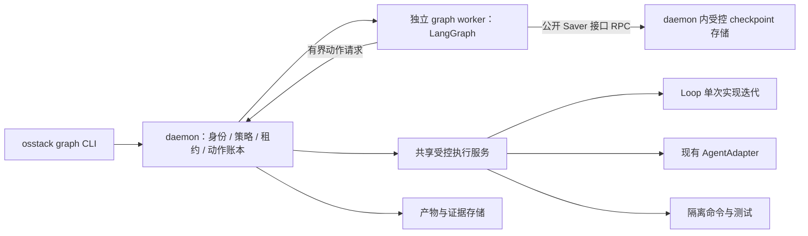

# OSStack 可执行图：接口、恢复语义与实施计划

日期：2026-09-13。状态：**建议实施，尚未实现**。基线：`b476bcc`。本设计补充 [开源研究报告](../reports/2026-09-13-executable-graph-research.md)，不把关系查询扩展当作执行功能。

执行拆解已更新为 [4 个里程碑、30 张任务卡的详细实施计划](../implementation/2026-09-13-osstack-graph-upgrade.md)。本文件继续作为架构与语义依据；实际任务编号、依赖、状态和验收以详细计划及其 JSON 清单为准。

当前内核决定已更新：[Functional API + sync](2026-09-13-graph-functional-runtime.md) 通过 C2 限定准入。G00–G07 完成，生产图执行链尚未实现；具体状态见实施计划。原 StateGraph 并行部分写入反例保留，不作为生产编译目标。

## 1. 决策与产品验收

产品入口为 `osstack graph`；新增 `@osstack/graph` 包；首个执行内核使用 LangGraph.js。独立 graph worker 按需启动，经 daemon 执行受控动作。现有 `graph explain` 保留其只读语义。初版不创建新的控制面产品、模型客户端体系或通用多引擎插件层。

首个用户可验收的成果：给定一个明确代码任务和已有执行授权，系统产出候选 commit、可独立恢复的 patch/内容包、针对同一 commit 的评审和测试证据；通过时状态为 `ready`，失败时给出分类和下一步，不停留在“关系已查清楚”。

首个模板：`code-delivery-v1`。原始实现加最多两轮修复，共最多三个 epoch。图结构静态展开；每轮一个 writer，随后评审和测试并行。发布另设受控节点，不由实现节点自动合并。

## 2. 模块边界



- `packages/graph`：图规格、模板、编译、节点包装、质量门、worker 协议、LangGraph 唯一绑定。运行时导出单独入口，避免 package barrel 触发加载。
- `packages/protocol`：图 API 的序列化契约、状态与错误码；不引入 LangGraph 对象或 Zod 实例跨进程传递。
- `packages/core`：图 run 身份、worker lease、动作账本、证据索引及 checkpoint 存储服务。checkpoint 可使用独立数据库文件，仍由 daemon 控制写入和迁移。
- `packages/loop`：提炼一次受控实现迭代，返回候选结果，支持外部 signal；不运行整个发现队列。
- `packages/agents`：复用现有 invoke / capability / runtime identity，补必要终态和取消适配。
- `packages/cli`：命令与 daemon handler；把已有私有门控逻辑提炼为共享服务，不让 graph 另做一套权限判断。

graph worker 不直接打开控制面 DB、不直接 import 现有 adapter 发起动作、不以 prompt 决定权限。节点内的模型调用、文件变更、进程、git、网络动作都经受控执行路径。纯函数只处理已传入的数据。

**权威归属：** checkpoint 决定图的调度位置、图数据和待执行分支；ledger 决定动作是否已发起、已确认、未知以及权限/资源所有权。graph status 是汇总投影，不再维护另一套能独立发出动作的调度状态机。重启时不可丢弃 checkpoint 并仅靠 ledger 猜测拓扑进度。

## 3. 图规格与类型契约

初版接收声明式 JSON/YAML，使用注册过的模板、节点种类、schema id 和纯函数路由。禁止把模型生成的 JS 表达式当路由执行。下面为**契约草案，非已支持的 CLI 配置**：

```yaml
schemaVersion: 1
template: code-delivery-v1
input:
  taskRef: task-123
  repositoryRef: repo-registered-id
  baseRevision: "<full commit sha>"
  acceptanceRef: artifact-acceptance-spec
limits:
  maxEpochs: 3
  maxBranchAttempts: 2      # 包含首次执行；仅在动作状态可安全开始新尝试时使用
  maxConcurrentReaders: 2
  maxConcurrentWritersPerRepo: 1
  maxActionStarts: 64
  deadlineSeconds: 3600
  tokenReservationLimit: 100000
publication: artifact_only
```

数值是初始模板默认值建议，允许用户在授权范围内收紧或修改，不是本次测得的最佳值。编译器必须计算所有可达分支的动作上限，检查与总预算的关系；循环展开不产生无限图。图规格保存 hash，运行时不能静默替换。新增作用域需要重新授权；仅放宽图数值不会扩大 grant。

建议的公共请求形状：

```ts
// 设计示意；具体 schema 在 P0 实现。
type StartGraphRequest = {
  spec: GraphSpecV1;
  inputArtifactRef: string;
  idempotencyKey: string;
  // tenant/principal 从已认证连接解析；客户端字段不能自授身份。
};
type ResumeGraphRequest = {
  graphRunId: string;
  expectedRevision: number;
  interruptId: string;
  input: unknown;
  idempotencyKey: string;
};
type NodeEvidence = {
  schemaVersion: 1;
  graphRunId: string;
  nodeId: string;
  epoch: number;
  candidateRevision: string;
  artifactRefs: string[];
  evidenceDigest: string;
};
```

所有 artifactRef 在当前 tenant/workspace 的存储中解析，验证对象存在、大小、内容摘要与 schema；不直接信任模型返回的路径、SHA 或“已执行测试”文本。`candidateRevision` 必须由可信 git 操作读取。输入和输出都由边界包装器验证，不能依赖 TS 类型或仅声明 schema。

| 节点 | 必需输入 | 必需输出 | 执行性质 |
|---|---|---|---|
| implement / repair | 目标、验收、base/candidate revision、当前轮反馈、scope | 初步改动及执行收据 | 一个有界写动作，使用独立 worktree |
| freeze | 写动作完成收据、工作区租约 | commit SHA、patch/内容包、摘要 | 在仓库写锁下冻结；持久产物先落稳 |
| review | 同一个 candidate SHA、验收说明、必要差异 | 结构化 verdict、发现、证据引用 | 独立评审身份与上下文，不共享 writer 可变工作区 |
| tests | 同一个 candidate SHA、允许的命令规格 | 退出码、命令收据、报告摘要、明确 passed | 隔离执行；测试缓存和构建文件留在其工作区 |
| join | 本轮两个分支的有效结果收据 | 配对后的 EvidenceBundle | 纯函数检查；不靠模型总结 |
| route | EvidenceBundle、预算、epoch | ready / repair / stop | 注册的确定性判定 |
| ready | 均通过的 EvidenceBundle、冻结产物 | 可交付包引用与质量门记录 | 不自动 push/merge/deploy |

两种“成功”要分清：**节点成功**表示产生了合法、可验证的结果；**代码通过**由结果中的业务判定决定。测试发现代码失败，仍可以成功产生一份合法测试报告，进入 join 后路由 repair。进程异常、输出缺失、schema 错误则不是合格结果，走 branch_retry 或 stop，不触发代码修复。

## 4. 并行汇合与条件分支

每轮 barrier 固定期望 `review`、`tests` 两个前驱，标识包含 `graphRunId + specHash + epoch + candidateRevision`。不得用不同修复轮、不同 commit、不同租户的结果拼成一次通过。

进入 join 的条件：两个前驱都有当前逻辑尝试的已确认合法结果，产物摘要通过校验，工作区及评审身份符合约束。join 只触发一次。业务通过条件：review 的判定可接受，tests 的指定验收检查通过，且全部引用同一 candidate。

某分支失败时，图先进入明确错误处理路径；不能让普通 AND barrier 永久等待，或把 failed/skipped/undefined 当作成功。另一个分支的成功证据可保留；只要 candidate 未变且证据仍有效，就不无故重跑它。条件路由选定的路径之外节点标为 skipped；所有必需输入必须在可达路径上有定义。

schema 错误与基础设施重试共用 `maxBranchAttempts`，该预算独立于代码修复 epoch。它可能由模型格式错误引起，不能一概归为网络故障；有限尝试仍不合格则 `OUTPUT_CONTRACT_INVALID` 停止。

## 5. Loop 的复用边界

不能直接公开现有 `runTask` 然后套一层节点。源码在成功时自动 commit + ff-only merge，并在 finally 清理 worktree；这会让未经过图级并行质量门的结果进入目标分支。

提炼一个单次实现迭代服务，接受已校验的 execution scope、workspace lease、外部 signal、remaining budget 和 `publication: artifact_only`。执行一次实现动作后输出 `implementation_complete` 与工作区引用；后续 freeze 服务在可信 commit 和产物持久化完成后才输出 `candidate_ready`，两者都不是已完成交付。图上的 review/tests 负责独立质量门。原有 Loop 的自评审循环保持其现有默认语义；新图模式不重复运行两套质量评审。

公共提炼位置应在执行与证据形成接缝，不能为了复用而调用 discovery/archive/cycle 状态写回。现有 verifier 与治理逻辑可以在独立评审节点复用；writer 和 reviewer 的职责分离仍然是强约束。

终态契约必须先修：无 done、多个冲突 done、终态后继续输出、abort 后错误地 completed，都必须被明确处理。adapter 的“进程结束”和业务的“实现通过”分开。command 模式无实际命令的 noop 不应成为代码交付模板的成功实现动作。

## 6. 动作键、重试、预算与恢复

建议唯一动作键：

`effectKey = hash(tenant, workspace, graphRunId, specHash, epoch, nodeId, logicalAttempt, effectSlot)`

- **不含 worker generation。** 同一动作在新 worker 恢复时必须找到旧结果；代际只用于权限与租约 fencing。
- **logicalAttempt 只能由 daemon ledger 分配。** worker 对 `(run, epoch, node, slot)` 请求“登记或返回现有记录”，不能从 checkpoint 计数猜测新 attempt。在 intent 已落库但 checkpoint 未写的窗口，必须先返回已有动作及状态；确定其可安全重试后才分配新尝试。
- checkpoint 重放使用相同键。只有前一动作已明确结束、重试分类允许且预算已原子预留，才生成新的 logicalAttempt。
- SDK 隐藏重试对有副作用的节点默认关闭；图 wrapper 只进行不会新发外部动作的安全重放。新的实际执行由 broker 分配并计数。
- 代码修复增加 epoch；同一候选版本的评审格式纠正或基础设施重试增加 branch attempt。两者与 provider 内部行为不能混成一个计数。
- 第一版实现节点一次实际模型执行；不在同一节点内启动未计入图预算的完整 Loop 重试。未来如有内层预算，必须由同一 daemon 账本预留，不能简单叠加默认值。

动作账本最少保存：作用域、effectKey、node/epoch/attempt、intent digest、执行资源标识、状态、结果引用、错误分类、用量预留及已知/未知实际用量、时间、fencing generation。唯一键保证并发请求不会重复登记同一动作。副作用返回结果后先确认账本，再让节点返回供引擎 checkpoint。

| 恢复看到的动作状态 | 允许行为 |
|---|---|
| 尚无 intent | 当前授权与预算成立后登记 intent，再执行 |
| confirmed 且摘要完整 | 返回同一结果，禁止新执行；若结果不符合节点 schema，则走明确分支错误 |
| 明确失败、确定未生效 | 依错误类别决定是否允许有预算的新尝试 |
| running / unknown | 查询执行器或外部系统；非幂等动作禁止直接重发 |
| cancel_pending / reconciliation_required | 暂停该动作的重放，等待核对；不以新 attempt 绕过 |
| cancelled | 不因 resume 自动复活；需要新的合法执行决定 |

处理崩溃窗口：

1. intent 已登记、执行是否发出未知：视为不确定状态；即便事实上尚未发出，也不能无证据认定可重发。
2. 动作已生效、ledger 未确认：reconcile；若 provider 不支持查询/幂等，保持 unknown 并请求所需输入。
3. ledger confirmed、checkpoint 未写：重放读取原结果，不执行第二次。
4. checkpoint 已写、状态 UI 投影未刷新：从 checkpoint 和 ledger 重新计算展示状态。

不承诺外部动作物理“恰好一次”。目标是逻辑动作的结果确认唯一、下游消费受控、未知动作不会被无声重做。超时不等于动作没发生；已取消请求也不等于 provider 已停止。

## 7. 持久存储与 worker 代际

详细实施计划已将 v1 存储选项收敛为控制面同一 SQLite 内的独立 graph_* 表；专用 checkpoint DB 是后续可评估选项，不在 v1 混用。以下所有权与恢复原则仍适用，具体 DDL 归属和顺序见 G08/G11/G13/G16。

初版采用一个 daemon 管理多个受限图 worker，每个 graph run 同时最多一个有效 generation。worker 崩溃或租约超时后，旧 generation 失去新动作及 checkpoint 写权限。

通过 `BaseCheckpointSaver` 的公开接口做 daemon RPC facade，覆盖 `getTuple`、`list`、`put`、`putWrites` 等需要的方法。daemon 是 lease 与 checkpoint 的唯一写入者；按 graphRunId 串行，在同一临界区内检查 generation 并完成 checkpoint 写入，代际切换也进入此临界区。独立数据库之间不声称存在单一原子事务；daemon 崩溃后先恢复持久租约并核对存储，再开放请求。不能先检查再让旧 worker 另行直接写 SQLite。`putWrites` 的 pending writes 必须与完整 checkpoint 同样受控。

使用幂等请求 id 处理 saver RPC 重试，幂等缓存绑定 generation，检查陈旧代际优先于返回旧缓存成功响应；使用完整 scope + graphRunId 生成内部 thread key，不让客户端任意拼接可撞租户的 thread_id。初版只使用基本 JSON 状态和产物引用，明确版本与序列化边界。升级时固定 spec hash、节点注册表版本、engine/checkpoint 版本；不兼容的旧图拒绝静默继续，保留原始证据并执行显式迁移或新 run。

第一阶段验证公开 saver 扩展是否足够；不得修改 LangGraph 内部实现来通过准入。原生 SqliteSaver 的离线成功只证明可持久化，不证明受控 saver、fencing 或多租户已经实现。

## 8. 权限、工作区、取消与回收

graph spec、checkpoint、恢复输入都不是 grant。daemon 在 run/resume 入口以及**每个动作启动前**重新检查身份、tenant/workspace、任务范围、能力、grant expiry/revocation、风险级别与执行健康状态。纯函数节点不能通过路由改变这项原则。已有授权足够时直接执行，不人为追加确认。

仓库身份由可信 registry 与 canonical git common directory 解析，不能由模型填写 `repo_id` 决定。worktree add/remove、commit、merge 等共享 git 元数据变更经仓库写锁串行。评审和测试仅在准备完成的独立工作区中并行；其耗时并行不等于共享 git 元数据可并行写。

仓库写者租约由共享受控执行服务统一签发，覆盖 graph、daemon 直接执行及进入受管模式的旧 Loop 写路径；不是只统计单张图的 writer。绕过 daemon 的旧路径必须在 P0 中接入同一租约，或在图执行期间明确拒绝对同一受管仓库并行写入。初版图不直接推动 task status FSM；`ready` 产出候选包，后续发布/交付动作通过既有治理变更任务状态。

每个写动作有独立 worktree lease，旧 generation 未确认退出时不复用其工作区。候选 commit 冻结并导出持久产物后，review 与 tests 分别从该 SHA 创建独立工作区。跨工作区共享依赖缓存必须避免可写目录导致污染；首版可以牺牲缓存速度换明确隔离。

取消链：用户/预算/撤权 → daemon → graph worker 和 active node → 外部 signal → adapter/子进程组。先停止新节点准入；尝试终止当前执行。确认退出才写 cancelled；无法确认则 cancel_pending，再转 reconciliation_required 并给出可核对的资源标识。

worktree 保留与执行终态分开。失败/未知动作保留证据和租约，不在 finally 强制删掉未导出的成果。成功时先确保 commit + patch/内容包可独立恢复，再允许 GC 删除临时工作区。GC 默认仅处理已登记、已确认没有活进程的资源，有大小/保留期配置和审计；不是扫描前缀就删除所有目录。

## 9. 状态与用户接口

图状态建议：`queued → running → ready | failed | cancelled`；中间可进入 `waiting_input`、`cancel_pending`、`reconciliation_required`。`ready` 不等于已经发布。节点状态区分 `pending/running/succeeded/failed/skipped/cancelled/waiting_input`；未知外部动作从账本展示，不能伪装成可直接重试的普通 failed。

`reconciliation_required` 对应持久化的对账请求 id，并映射为带 interruptId 的恢复点。自动 reconciler 或具备所需授权的用户提交结构化裁定：已生效/确定未生效/仍未知及证据引用；daemon 校验证据与权限后更新 ledger，再允许 checkpoint 继续或转 failed。仍未知继续等待。若 worker 在保存 interrupt 前退出，daemon 根据动作账本重建对账请求，恢复节点先取得相同请求再中断。`cancelled` 是终态，不能通过 resume 复活；需要执行新任务时创建新 run。

建议命令和 RPC（均待开发）：

| CLI | 行为 |
|---|---|
| `osstack graph validate <spec>` | 离线检查 schema、类型映射、可达性、预算、节点注册表；不执行 agent |
| `osstack graph run <spec>` | 经 daemon 创建幂等 run，返回 run id；不由 CLI 直接写控制面 DB |
| `osstack graph status <id> --json` | 显示各分支、候选版本、预算、错误与待核对动作 |
| `osstack graph cancel <id>` | 发起幂等取消，区分已请求与已确认 |
| `osstack graph resume <id>` | 提交结构化输入与 expected revision，重新校验授权 |

错误码至少包括：`SPEC_INVALID`、`INPUT_CONTRACT_INVALID`、`OUTPUT_CONTRACT_INVALID`、`JOIN_REVISION_MISMATCH`、`POLICY_DENIED`、`GRANT_EXPIRED`、`BUDGET_EXHAUSTED`、`ACTION_OUTCOME_UNKNOWN`、`STALE_GENERATION`、`CANCEL_UNCONFIRMED`、`CHECKPOINT_INCOMPATIBLE`。错误带 node/epoch/action id、是否可重试及可执行的下一步；不只显示框架堆栈。

## 10. 实施任务与依赖

### P0：执行契约和恢复接缝

1. executor 终态校验与外部 signal。位置：`packages/loop/src/executor.ts:42,145`、`packages/agents/src/base.ts:54`。用提前断流、冲突终态、abort、timeout 的故障测试验证。
2. 从 `loop-engine.ts:671,920` 提炼一次候选执行；返回 `candidate_ready`，禁自动 merge、禁整队列 discovery；图评审和旧 Loop 评审各自唯一负责其模式。
3. 从 `daemon.ts:2955,3284` 提炼共享受控执行服务，提供可信 repo scope 和租约；补图 action ledger 与 artifact 持久化契约。
4. 用单一 LangGraph 实现接通独立 worker、受控 saver 和 broker。先测试一条有副作用的两节点链，贯穿 intent、result、checkpoint 三阶段故障窗口。

依赖：1、2 的接口稳定后接 3；3 与 saver 存储设计协调，再完成 4。P0 结束时仍不得把实验开启为普通用户默认写执行。

### P1：完整业务垂直切片

5. 实现 GraphSpecV1、注册表、三个 epoch 静态展开、输入映射、必需分支与质量门。
6. 实现 immutable candidate、独立 review/tests 工作区、分支错误分类、受预算约束的分支重试与代码修复。
7. 实现 daemon RPC 与 CLI；保留 explain；增加完整成功、repair 后成功、证据失败、预算停止的端到端用例。

### P2：发布准入

8. 执行下表故障矩阵，完成最低运行时与性能验证；不因普通 happy path 成功而跳过。
9. 灰度开关默认关闭；先对明确授权的本地代码任务启用；观察真实成本/延迟/介入率。回滚关闭新图准入，保留旧 run 的状态查询、取消和对账，不删除 checkpoint。

### P3：结果驱动的产品扩展

10. 执行轨迹 UI、模板复用与对比报告；有真实需求后再增加研究模板、动态拓扑或多 writer。独立 osgraph 的拆分条件见研究报告。

## 11. 必须通过的验收矩阵

| 测试 | 必须观察到的结果 |
|---|---|
| adapter 无 done / 多个冲突 done | 不能标成功，不能进入合格结果汇合 |
| 输入/输出字段缺失、空输出、摘要错误 | 阻止下游；错误定位到生产该输出的节点 |
| review 慢、tests 快及相反顺序 | 真并行，join 仅一次，且拿到两份同版本结果 |
| 旧 epoch / 旧 commit 输出晚到 | 拒收或隔离，不能让新一轮通过 |
| tests 合法报告 passed=false | 进入代码修复；格式错误走分支错误而非修代码 |
| 每个 intent/effect/result/checkpoint 边界 kill | confirmed 重放复用；unknown 停止自动重发；保存足够对账信息 |
| 跨进程重启 / pending writes 中途崩溃 | 从真实持久存储恢复，已完成分支不无故重做 |
| 两个 generation 竞争 | 陈旧 put 和 putWrites 均被拒，新动作不能越权发出 |
| 陈旧子进程继续写旧 worktree | 新代候选结果不被污染，旧资源被隔离 |
| run/resume 并发和重复 idempotencyKey | 同一请求不创建重复图/动作；CAS 冲突明确返回 |
| 运行中撤权、过期、跨 tenant resume | 后续动作拒绝启动；已有动作取消或隔离状态如实展示 |
| timeout 后执行器仍在跑 | 不直接重发，显示 unknown/cancel_pending 并可核对 |
| 达到 epoch/branch/action/deadline 预算 | 不再启动下一动作；未知用量保守计入，不按零处理 |
| worktree add/remove 与并发测试 | 共享 git 操作受锁；测试不写 writer 或用户工作区 |
| 成功和失败后的 GC | 已导出成果可恢复；活进程、未知结果及未导出证据不被误删 |
| Node 20 + 当前 CI Node；原生 SQLite 打包 | 相应测试通过；本次 Node 26 离线结果不能替代 |
| CLI version/help 和并发 daemon RPC | 继续满足项目既有预算，graph 首次加载不阻塞主 daemon |
| graph 禁用/升级/旧 checkpoint | 旧功能正常；旧 run 可查询与处置；不兼容恢复明确拒绝 |

故障注入至少覆盖上述每个确定性窗口，再做带固定随机种子的重复运行；“随机 kill 100 次没事”不能替代关键窗口覆盖。不得把“没有重复结果确认”写成“外部 provider 从未重复执行/计费”。

项目预算：CLI `--version` <150 ms 本地 /250 ms CI；完整 `--help` <500/900 ms；daemon 非流式 RPC p95 <10 ms；Loop tick <1% 会话墙钟。graph worker 启动成本单独记录，不能藏进 CLI 或 daemon 的既有预算。

所有开发 CLI / DB 集成测试使用显式临时 `OSSTACK_HOME`。禁止从开发 checkout 打开默认或保留 serving home。发布前按项目约定运行必要测试、typecheck 与 build；本研究未执行这些尚不存在的新实现检查。

## 12. 仍需工程验证的未知项

- daemon saver facade 的顺序、幂等、序列化和 fencing 是否能完全使用公开接口实现；这是内核准入门槛。
- 所有目标 adapter 的取消是否可确认，provider 是否支持查询/幂等；按 adapter 记录能力，不能统一假定。
- 图模式单次执行从 Loop 提炼时的最小稳定边界，以及旧模式回归范围。
- Node 20 实际支持、原生模块与单文件打包路径、跨进程 IPC 的开销。
- 大仓库准备 worktree/依赖对并行收益的抵消程度，及真实任务的质量与成本变化。

这些未知项有明确的验证任务和失败处理路径；不要求先建知识图谱来解除，也不要求为了给模块命名而先拆出新产品。
