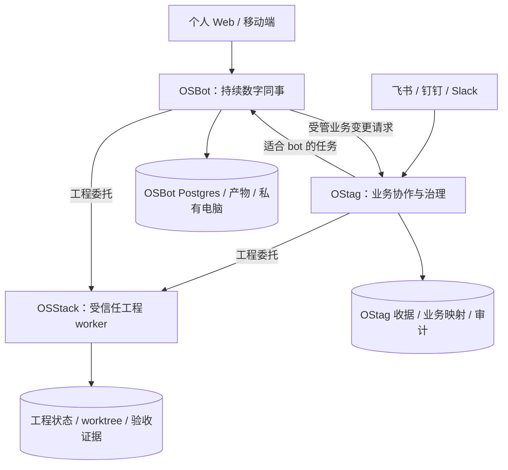

# OSStack、OStag、OSBot：内部产品定义与协作边界

日期：2026-09-13。用途：公司及个人内部工具的长期定位。状态：产品定义与集成方向，尚未部署 OSBot 或实现新的跨产品协议。

**OSStack 把代码任务做扎实；OStag 让组织中的工作有责任、有授权、有回执；OSBot 是持续在线、能使用电脑完成任务的数字同事。** 三者可以组成一套内部工作系统，但不是每个任务都要穿过三个产品。

## 1. 从用户意图出发

长期目标是提高自己与公司完成工作的能力，而不是同时经营三套通用 agent 平台。OSStack 已明确聚焦编程强化，Loop Engineering 与可执行 Graph Engineering 是核心。OSBot 则需要 Rakazo 所体现的持续身份、长期工作状态、电脑与浏览器能力，部署在自己控制的服务器上。

本方案默认 OSBot 是综合数字同事，首批覆盖研究、文件处理和工程任务委托。具体日常场景仍可按用户偏好收窄；不会因为名字里有 bot，就将它定义成群聊插件或几个角色 prompt。

| 产品 | 一句话定义 | 主要使用者 | 用户交给它的事情 | 完成的含义 |
|---|---|---|---|---|
| **OSStack** | 内部编程强化与工程执行引擎 | 用户、开发者、编码 agent | 修复功能、实现需求、验证候选版本、有界迭代 | 交付经过明确质量门的代码和证据，或解释停止原因 |
| **OStag** | 面向组织协作的工作入口与业务治理层 | 群聊中的负责人、业务与开发团队 | 受理需求、分派、更新业务记录、审批、追踪与收口 | 正确的业务对象被正确授权地处理，并在来源线程留下回执 |
| **OSBot** | 自托管、持续在线的通用数字同事工作台 | 用户及授权的小团队 | 调研、浏览器任务、文档与数据处理、持续跟进、委派专门工作 | 有可检查的产物或目标系统结果，保留工作上下文并能继续 |

区别在于职责和状态所有权，不在于是否有聊天框、是否使用多 agent、是否部署在服务器。OStag 同样可以部署服务器、调用模型、运行工作流；OSBot 同样可以通过消息进入；OSStack 也可以后台长期运行。

## 2. OSStack：专注编程强化

### 核心承诺

把一个有范围的工程目标转成可验证的候选结果，在预算、权限和停止规则内自主推进。用户可以直接用 CLI，也可以由 OStag 或 OSBot 提交受控工程任务。

- **Loop Engineering**：围绕验收证据做实现、验证、反馈与有界修复；发现没有进展时停止或升级。
- **Graph Engineering**：显式节点输入输出、依赖、并行评审/测试、同版本汇合、条件路由、失败与恢复。
- **工程执行**：编码 adapter、仓库身份、worktree、候选 commit、测试证据、动作账本、取消、资源租约和执行时权限。

OSStack 不承担所有公司业务流程，也不成为每个数字同事的永久聊天和浏览器账户存储。普通调研、群协作和业务表格不必为了“统一”而进入其工程图。

当前 `graph explain` 是关系诊断。可执行图仍按 [既有实施计划](2026-09-13-executable-graph-plan.md) 推进；本产品定义没有改变这一事实。工程图暂不独立成立第四个产品 OSGraph。

### 允许存在的外部代码活动

“工程执行归 OSStack”不等于其他产品不能运行任何程序。OSBot 可以在隔离临时目录运行 Python 处理 CSV、生成文档、分析公开仓库。**受管仓库的正式修改、候选版本、验收执行与工程交付责任归 OSStack。** 不让 OSBot 借通用 terminal 绕过工程治理。

发布责任需按实际动作单独指定。OStag 已有 GitHub/Vercel 受治理发布流程，不能为了重新命名边界就再由 OSStack 同时发布一次。后续若迁移发布 executor，需要明确切换唯一执行者，审批来源与执行权威仍分别保留。

**首期联动的工程结果止于候选分支/PR 与证据，使用 artifact_only，不自行合并受保护分支。** 每仓库登记受保护分支、merge 执行者、发布执行者及自动部署触发关系；若合并会触发生产部署，该合并按发布效果纳入授权。现有 OStag 发布源码不证明它已经实现自动 merge；合并可先由已有受控 CI/负责人办理，或在验收后登记专用 executor。启用联动前需核对实际 CI/CD 触发规则，不依赖平台默认行为。旧 Loop 的自动 merge 接缝须按工程图 P0 改造后才能用于此模式。

## 3. OStag：组织协作与业务治理

本地 OStag 并非标签工具或轻量消息转发器。当前 README、收据处理和发布工作流源码包含：来源线程、actor/channel 策略、业务连接器、冻结 payload 的收据、审批与执行、审计、follow-up、监控与 Copilot relay。[S2]

### 核心承诺

让团队在已有飞书/钉钉/Slack 等工作场景中提出工作、明确责任、授予适当权限、看到真实进度，并把结果落到需求表、任务系统或其他业务记录。

OStag 自己负责：

- 来源线程与业务 case/run、责任人、待办和业务上下文。
- actor/频道权限、组织审批、冻结变更收据及连接器执行结果。
- 业务系统记录的映射、跟进和审计；将 agent 结果变成可以采纳的业务动作。
- 将工程任务交给 OSStack，将适合数字同事的任务交给 OSBot；也可以直接完成简单的业务查询、摘要和表格流程。

OStag 的已有非编码模型 backend 保留价值。工程 backend 应逐步委托 OSStack，不能同时让 OStag 的旧 CLI 编码链和 OSStack 改同一个仓库。这里是未来路由收敛方向，不代表所有旧 backend 已经退役。

非编码 backend 可以是纯推理，或具备明确范围的只读工具；不能仅因 prompt 写着“摘要”就默认带 shell 的 CLI 没有写能力。无法约束工具和凭据时，改用受控执行端。

**OStag 的组织批准不替代 OSStack 的执行时检查。** 同一个已批准动作可通过绑定范围与 payload 的委托凭据传递，执行端仍检查过期、撤销与当前状态；不用为了跨产品再让用户批准同一内容一遍。

如果执行需要扩大到另一仓库或新增发布动作，返回结构化 `needs_authorization`，按目标资源的授权域路由。公司任务（包括公司 OSBot 直接委托或经过多级 mission 的任务）回所属 OStag 组织收据流程，bot 只能转发、不能自己批准；个人资源任务回个人 CLI/OSBot 的已有授权界面，不强制经过 OStag。判定依据是公司/个人资源身份和父授权链，不是最后一跳用了哪个界面。

## 4. OSBot：持续存在的数字同事

### 核心承诺

用户给它一个持续职责，它拥有自己的工作上下文与受控电脑，能在用户离开界面后继续工作，保存成果、在需要时请求输入，并在以后继续同一项工作。

OSBot 的产品对象建议包括：

- **Bot**：持续身份、角色、职责、允许的工具和预算。
- **Mission**：一个可完成的目标，具有子任务、状态、结果和停止原因；不把永久聊天线程当作唯一任务记录。
- **Memory**：带来源和作用域的偏好与已确认事实；公司与个人内容不隐式混入。
- **Computer**：可恢复的文件、浏览器及桌面环境；需要时由人接管。
- **Routine**：按计划触发的任务提示与发生记录；不是强行改成一套可视化工程图。
- **Connections**：该身份获准访问的模型、应用与专用执行服务。

首批建议只配少量职责清晰的 bot，例如研究同事、文档/数据同事。遇到工程目标，OSBot 作为委托者调用 OSStack，持续追踪原有 job，而不是再召集一组直接修改正式仓库的 coding bots。

公司系统记录写入通过 OStag 的既有业务能力办理；个人场景的授权操作可以遵守 OSBot 自身策略，不强制所有邮件或文件任务先经过 OStag。这是一条按业务域划分的规则，不是“任何写操作都需要 OStag”。

### 与蜂群、Loop 和 Graph 的关系

OSBot 可以把任务分给长期 bot 或短期 subagent，这是团队协作能力；它的模型工具循环解决下一步如何操作电脑。OSStack 的 Loop 负责代码质量迭代，工程 Graph 负责确定的执行结构。OStag 的 follow-up 负责业务跟进。三种循环可以配合，但不能分别重试同一个叶子动作。

## 5. Rakazo 的价值与采用方式

Rakazo 自称开源 Grok Bot alternative，提供持久 bot、记忆、routines、电脑工具和 peer/subagent 委派；不是 xAI 官方 Grok Bot 源码。此次已克隆到本地，固定提交 `b286fc4a5d0f608005000ef35bee4c473c31a165`，许可 Apache-2.0，项目标为 beta。[S1]

源码与官方文档显示其已有 TypeScript、Pi runtime、API/worker、Postgres、Graphile Worker、Web/Electron/Expo，以及 Docker 等电脑 provider。它与 OSBot 的“持续身份与工作环境”目标相近，适合优先复用。[S1][S3]

建议的采用顺序：

1. **固定上游版本，定义 OSBot 服务与部署配置。** 产品名称可以先用于内部服务，不以整仓重命名为前提。
2. **增加窄集成。** 为 OSStack/OStag 提供任务提交、状态、取消、结果与审批请求接口；验证能否通过现有 MCP/OpenAPI 或适配器扩展承载。[S1]
3. **只有已证实扩展点不足时做最小 tracking fork。** 例如无法强制工具权限、必要的工作流状态无法表达、必须改认证边界；保持补丁清单与固定版本升级验证。

不建议从零重造 bot 聊天、持久电脑、桌面接管、模型接入和移动端。也不建议先强行把 Rakazo 的 Pi/Graphile Worker 替换成 LangGraph：OSBot 的通用 agent loop 与 OSStack 的工程图可以通过服务契约衔接。

### 必须保留的证据边界

- 本次只检查源码与文档，**未安装或运行 Rakazo 服务，未测试真实电脑/模型，未部署本地服务器**。
- Rakazo `VISION.md` 写有 Team browser identity 共享方向；但当前 `computer-runtime.md`、`desktop-runtime.ts` 和 browser-profile 测试描述 per-bot 独立 profile。不能把愿景中的共享登录当作已验证能力；首次部署须以固定版本实测为准。[S3][S4]
- Team Computer 的不同 bot 子目录不构成文件访问安全边界。个人和公司的账号、文件与浏览器状态不放在同一个 Team Computer。[S3]
- Docker supervisor 在 Compose 中持有 Docker socket，是高信任管理服务。普通 bot 容器不能获得该 socket；容器部署本身不等于可不受限制地运行敌对任务。[S5]

## 6. 每类状态和动作由谁负责

| 对象或动作 | 权威所有者 | 其他产品的角色 |
|---|---|---|
| 公司需求、线程、责任人与组织审批 | OStag / 对应业务系统 | OSBot 和 OSStack 传引用、提交证据 |
| 业务变更 receipt 与 connector apply | OStag | 消费原结果，不重复执行 |
| Bot 身份、持续会话、任务记忆、电脑 | OSBot | 按允许范围取得上下文包 |
| Bot mission、routine occurrence | OSBot | 作为上层目标/触发来源，不接管子工程图 |
| 工程图、Loop、候选版本、测试证据 | OSStack | 展示投影、提交输入、接收结果 |
| 工程动作账本、仓库锁与工作区租约 | OSStack 执行侧 | 不能通过通用工具绕开 |
| 已有 OStag GitHub/Vercel 发布动作 | 当前 OStag 发布 executor | OSStack 提供候选证据；如将来迁移执行者须显式切换 |
| 外部系统中的实际状态 | 外部系统 | 查询并记录实际回执，不能仅以 agent 声明认定成功 |

三者不共用一张任务表，不共享底层数据库，也不强制统一 Python/TypeScript。统一的是可追踪的请求、委托权限、产物引用和结果语义。

调度器也按所属对象分开：OSBot 负责 routine/bot run，OStag 负责业务 follow-up/收据，OSStack 负责工程图节点。父任务可以等待、提醒或取消子任务；仅子执行者决定其内部动作重试。

## 7. 四条用户路径

**我正在开发一个功能。** 直接使用 OSStack，让 Loop/Graph 推进实现和验证。无需先创建 bot 或发送群消息。

**同事要求更新需求负责人。** OStag 识别唯一业务记录，根据现有授权/收据规则更新并回执。无需电脑 bot 或工程图。

**我要持续研究某个技术领域。** OSBot 保存职责与材料，按 routine 做研究、整理文件、输出带来源的报告；需要 Python 处理表格可在 scratch 环境执行。无需经过 OStag，除非结果要进入公司的业务流程。

**飞书里提出“调研并实现客户报表导出功能”。**

1. OStag 建立业务 case，明确需求与责任，绑定当前授权。
2. 如需要独立调研，委派 OSBot 得到调研产物；不需要则跳过。
3. OStag 或 OSBot 中被指定为工程委托者的一方提交一次 OSStack 工程 job，另一方只引用这个 job。
4. OSStack 产出候选版本及评审/测试证据；父任务追踪同一个 job，不因等待超时再建一个。
5. OStag 将结果回到来源线程与需求记录；发布按既有 SHA 绑定审批和指定执行者办理。

同一工作有多个视图，但不能有两个独立“负责再执行一次”的主人。

## 8. 最小集成契约

对外先提供 `submit / status / cancel / result`；确有暂停点再提供 `resume`。使用版本化 JSON，不能跨产品传 SDK 内部对象、整个聊天历史或数据库路径。

请求最少包含：来源产品、父 mission/case、子 operation、发生编号、目标工作区、输入摘要和产物引用、允许范围、deadline、资源预算、idempotency key、委托授权引用。principal/tenant 由可信身份绑定校验，不能由模型自填字段授予。

幂等键绑定 tenant、来源、父任务、子操作与一次发生记录；服务端保存 inputDigest，相同幂等键但不同 payload 必须拒绝。它不是直接拿一个跨产品可能重复的 receiptId 当全局键。routine 每次合法计划发生可以新建任务，但同一次发生的重投递必须去重。

inputDigest 只覆盖规范化的业务意图，不含 trace id、请求时间等传输字段；重试复用原有 mission/child 标识。routine 的 scheduleRevision 与 occurrence 创建后冻结，编辑计划不重算在途任务编号。声明 overlap 策略，首期建议 `skip_busy` 并记录跳过；可选择有上限的 queue，取消前次任务需要相应权限。无人值守任务使用有效的预授范围；范围不足则暂停请求授权，不自行放宽。

旧 occurrence 重发仍使用原始冻结输入；若编辑计划后用相同 key 携带不同 digest，拒绝并记账，不能用新配置悄悄改写旧任务。

结果返回权威 child id、状态、产物、证据摘要、停止原因及是否需要输入。`ready`、`approved`、`applied`、`published` 分别代表不同阶段，不压扁成一个通用 success。

提交超时先用原键查询；无法判定则保留 delivery_unknown，不自动生成新 key。取消请求和已确认取消区分。委派关系保存有向父子链并设置深度/预算限制，禁止 OStag→OSBot→OStag 无边界互相委派。

公司写权限必须在执行路径强制执行。仅在 system prompt 写“请调用 OStag”不够。初版公司 bot 不配置能够绕过业务收据的高权限浏览器登录、直连写连接器或正式仓库挂载；无法限制时先不开放该动作。个人授权操作与公司业务授权分开处理。

这也包括浏览器 cookie：公司 bot 不登录具备受管仓库写入或发布权限的 GitHub/Vercel 等账号。没有 API key 不代表没有写通路。公开 Web 研究可按网络策略开放，不把它说成全禁出网；如要访问内部系统，使用单独的最小权限身份并验证其实际写能力。

## 9. 本地服务器部署定义

箭头代表带作用域的操作接口，双向能力不允许无边界循环委派。

建议 OSBot 控制面在本地常开服务器部署，OStag 可以在同机独立服务或已有宿主运行。OSStack 在受信任工程 worker 上执行，位置可为同服务器或已有 Mac/开发机；这取决于模型 CLI、OS、仓库和资源需求，不假设所有编码工具都适合塞进 OSBot 电脑容器。

首期个人与公司推荐分实例、服务身份、数据卷和加密密钥；同一物理机仍共享管理员与故障域，不把逻辑分离宣传成物理隔离。若资源暂时只够一个试点，先选一个数据域，不混入另一域的真实账号。

模型凭据、连接器凭据、浏览器状态分别由对应服务保存。不能说所有秘密只在浏览器 checkpoint，也不把整套秘密随委派转发。备份不仅有数据库，还包括允许保存的文件/电脑状态与解密所需配置，恢复时验证对应版本。

本地部署分三层定义：

- 控制面和数据存储在自有服务器。
- 模型推理可以调用外部 API，也可以选择本地模型。
- 浏览器、连接器、遥测及模型调用是否出网，另由配置和网络策略决定。

**“自托管”不自动等于“离线”或“数据零外发”。** 本地服务器的 OS、资源、现有 Docker 环境、访问方式及模型选择仍待部署前确认。当前不运行安装脚本、不启动服务、不迁移任何现有生产 DB。

## 10. 内部产品的推进顺序

| 阶段 | 交付 | 通过条件 |
|---|---|---|
| A：定位与契约 | 本定义、状态所有权、跨系统接口草案 | 每个动作唯一执行者；个人/公司边界清楚 |
| B：OSBot 独立试点 | 固定 Rakazo 版本，一个数据域、一个研究 bot、一个独立电脑 | 能保存并恢复工作、生成可检查产物、停止后状态如实显示；不接高权限公司写入 |
| C：工程委托 | OSBot/OStag 接 OSStack 受控服务；先复用已有能力 | 同一任务重复提交不产生重复 job，状态/取消/结果可以回传 |
| D：工程图升级 | 完成 OSStack 图实施计划的质量与恢复门槛 | 实现→并行验证→有界修复→ready 真执行；不把关系查询当完成 |
| E：组织闭环 | 需求、调研、工程结果和指定发布动作串联 | 精确授权、同版本证据、回执与实际业务结果一致 |

B 的普通数字同事价值不等待 D 完成；D 的编程强化也不依赖先做 OSBot。C 可以先用现有受控 session/job 能力验证契约，不冒充完整 Graph 已可用。

衡量内部价值：真实任务完成率、人工介入次数、端到端时间、模型与电脑成本、重复执行次数、故障恢复耗时。优先比较自己的实际基线，不为了产品名字增加 bot 数量或微服务数量。

## 11. 本阶段的产品取舍

保留三个清楚的用户价值入口，复用现有实现和上游能力；不建设第四个 OSGraph 产品，不先重写 Rakazo 的 agent runtime，不合并三个数据库，不把所有任务强制编译成工程图，也不把 OStag 降格为通知插件。

OSBot 是否最终需要独立代码 fork，以扩展点和试点证据决定；产品定义可以先独立。若实际只使用一次性聊天，没有长期职责、电脑环境和工作连续性的需求，OSBot 的独立价值会减弱，应收敛为 OStag 的一个 backend，而不是硬保留第三套产品。

## 来源与证据

[S1] Rakazo：[README](https://github.com/elie222/rakazo/blob/b286fc4a5d0f608005000ef35bee4c473c31a165/README.md)、[LICENSE](https://github.com/elie222/rakazo/blob/b286fc4a5d0f608005000ef35bee4c473c31a165/LICENSE)、[schema.prisma](https://github.com/elie222/rakazo/blob/b286fc4a5d0f608005000ef35bee4c473c31a165/packages/db/prisma/schema.prisma)。

[S2] 本地 OStag `5098f914`：[README](/Volumes/AIMATE_WORK/Developer/CodeX/OStag/README.md)、[架构](/Volumes/AIMATE_WORK/Developer/CodeX/OStag/docs/ostag/architecture.md)、[receipt 处理](/Volumes/AIMATE_WORK/Developer/CodeX/OStag/ostag/core/receipts.py)、[GitHub/Vercel 发布流程](/Volumes/AIMATE_WORK/Developer/CodeX/OStag/ostag/workflows/github_vercel_release.py)。源码/文档存在不等于所有外部生产验收已完成。

[S3] Rakazo：[Computer runtime](https://github.com/elie222/rakazo/blob/b286fc4a5d0f608005000ef35bee4c473c31a165/docs/computer-runtime.md)、[self-host](https://github.com/elie222/rakazo/blob/b286fc4a5d0f608005000ef35bee4c473c31a165/docs/self-host.md)。

[S4] Rakazo：[VISION](https://github.com/elie222/rakazo/blob/b286fc4a5d0f608005000ef35bee4c473c31a165/VISION.md)、[browser-profile 测试](https://github.com/elie222/rakazo/blob/b286fc4a5d0f608005000ef35bee4c473c31a165/infra/sandboxes/supervisor/src/browser-profile.test.ts)、[desktop-runtime](https://github.com/elie222/rakazo/blob/b286fc4a5d0f608005000ef35bee4c473c31a165/packages/core/src/node/desktop-runtime.ts)。本次检查测试代码，未执行该测试。

[S5] Rakazo：[Compose supervisor](https://github.com/elie222/rakazo/blob/b286fc4a5d0f608005000ef35bee4c473c31a165/infra/compose/docker-compose.yml)。

OSStack 基线 `b476bcc`；既有 [工程图研究](../reports/2026-09-13-executable-graph-research.md) 与 [更新 context](../reports/2026-09-13-executable-graph-context.md)。本轮 Claude 评审与源码记录另附于报告目录。
