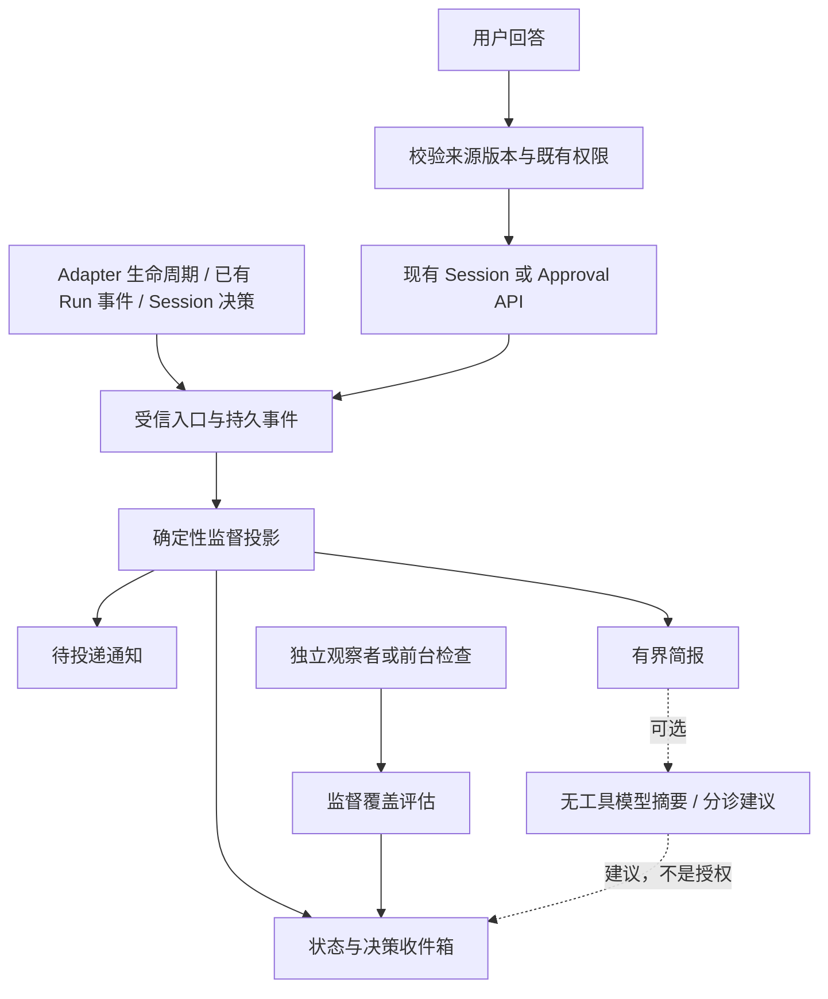

# Firstmate 能力借鉴：OSStack 持续监督与决策闭环设计

日期：2026-10-23（America/Los_Angeles）。状态：设计提案，未实施、未启用、未获得生产验收。

配套：[研究报告](../reports/2026-10-23-firstmate-analysis.md)、[实施计划](../plans/2026-10-23-firstmate-adoption-plan.md)、[审计与处置](../reports/2026-10-23-firstmate-claude-audit.md)、[证据目录](../reports/2026-10-23-firstmate-evidence/README.md)。

## 1. 设计目标与基线

把“任务已经交出去”升级为“可证明谁在监督、什么事件会推进、什么时候需要用户决定”。复用 OSStack 的执行、授权、审批、消息和证据系统；新增一个有界的监督投影及决策交互层。

基线是本地 HEAD `b476bcc3fbbfcc11953abd3d154e59f7f85c4660` 加研究开始时已存在的工作区变更，实际文件哈希见证据。不是 README 中版本号，也不是其他目录的已发布版本。

重要纠偏：当前 `packages/cli/src/graph-command.ts` 仅支持只读 `graph explain`；后续 Graph 文档和成本控制设计不是此 checkout 中可调用的执行 API。未来整合需做新的实际源码差异核对。本方案不把 Graph executor、candidate controller 或通用物理停止证明假定为已落地。

用户收益：

1. 关闭前台后知道任务是否有人接管；无法确认时直接显示监督缺口。
2. 等 CI、等用户与实际卡住分开显示，减少重复催问。
3. 一处处理待决策项，回答与实际执行结果可以追踪。
4. 重启后保留未决事项和不确定动作，避免凭对话记忆重复执行。
5. 机械等待不调用模型，模型建议不成为执行权限。

本轮交付止于研究、设计和模型审计。以下命令、表、接口和指标均是建议，不能当作现有产品能力。

## 2. 借鉴边界与分期

| 层次 | 借鉴 firstmate | OSStack 处理方式 |
| --- | --- | --- |
| 必须优先移植 | semantic busy、等待责任人、监督交接、未决事项、重启对账 | TypeScript 纯函数 + SQLite 投影 + 已有 daemon 接线 |
| 第二阶段 | attended/quiet/away、增量简报、明确交付模式、低成本判断 | 复用 daily/cockpit/policy/contract；新增受限视图 |
| 有条件移植 | 可见 worker、后端能力协商、记忆归档、上下文预算 | 有验证记录的 adapter；沿用 lesson draft/knowledge 审核 |
| 暂不移植 | 全套终端后端、跨机器 secondmate、公共社交 Relay、自动更新 | 单独立项；不进入首期依赖 |
| 不直接照搬 | Bash 状态文件群、正文正则作为授权、+yolo、终端 idle 作为停止证明 | 保留类型契约、签名权限和独立证据验证 |

首个可发布切片 S0（首轮审计后缩减）：**一条显式只读的 `osstack attention status --json`**，仅展示 run/session 的现有事实、最新决策和证据完整性。零新表、零后台循环、零网络、零模型、零自动启动 daemon；Loop 返回 `unsupported_in_slice_0`。它是可用的单次状态视图，不宣称持续监督。

后续 S1 才增加持久 observer和收件箱，S2增加简报、手动回答、通知和交接，S3再扩展Loop/CI及可选模型分诊。S1启用之前必须通过§13的daemon原子启动与保守恢复门禁；不能用“隔离环境试点”替代生产代码中的硬门禁。

## 3. 架构与依赖方向



- `@osstack/protocol`：仅跨进程公开输入输出的 Zod source of truth，生成 JSON Schema 和 conformance fixtures；内部归约类型留在实现包。
- `@osstack/core/state`：SQL 表、事务、来源游标、比较并交换（CAS）、投影存储；不依赖 agents/cli。
- **已有的** `@osstack/supervisor`：纯状态归约器、等待分类、事件合并、覆盖评估、简报结构。通过类型化数据输入，不开启 DB、不启动子进程。本方案不新增工作区包。
- `@osstack/agents`：结构化生命周期来源及能力声明；不写监督数据库，不发用户通知。
- `@osstack/cli`：daemon 装配、RPC、命令、接入既有权限与实际数据源。优先拆新模块，避免继续膨胀 daemon.ts。
- 现有 `@osstack/runtime` 为占位，不作为首期 backend API 宿主。

新增 observer 是现有 executor 的消费者。它不得调用 `invoke`、`resumeSession`、`mergeWorktree`、`cleanupWorktree`。回答路由单独封装，必须经过现有安全入口；纯投影不能得到这些能力对象。

## 4. 不可破坏的约束

| ID | 约束 |
| --- | --- |
| INV-01 | busy/idle/unknown/dead 是观测判断，均不直接授予执行或清理权限 |
| INV-02 | 回合结束、工具返回、进程消失、任务完成、验证通过、交付完成分别建模 |
| INV-03 | 每个来源事件绑定 scope、subject、instance、序号与可信来源；旧实例事件不能更新当前投影 |
| INV-04 | 缺失/过期/损坏/不支持的观测是 unknown，不伪装 idle、dead 或 completed |
| INV-05 | 等待必须有责任人、解除条件及来源；超时只改变提醒状态，不代替回答 |
| INV-06 | 通知送达、用户读到、用户回答、源系统接受、业务执行完成分别记录 |
| INV-07 | 每个可产生外部副作用的回答使用持久 action ID；未知结果不得换 ID 自动重发 |
| INV-08 | quiet/away 不改变 observe/propose/execute、R0–R4、签名批准或续跑授权 |
| INV-09 | supervisor 只能声明自己的观察责任，不能以租约过期夺取 executor 写锁 |
| INV-10 | 监督缺口不触发自动清理/重启；恢复先查已知事实，无法证明则保留 |
| INV-11 | DB 事务中只做有界本地状态操作，网络、模型、Git 和子进程都在事务外 |
| INV-12 | 摘要只消费结构化事实；模型产出的“完成/批准”不能反写权威业务状态 |
| INV-13 | 本地 0700 home/0600 socket 是本地信任边界，不声称阻止任意同 UID 恶意进程 |
| INV-14 | 任何“已被监督”的断言都有采样时间、截止时间及能力范围，不承诺未来永久在线 |

## 5. 四个正交状态维度

避免用一个巨大 enum 同时承载所有语义。

### 5.1 执行业务状态

继续采用已有 run/session/loop 状态；新系统只保留源引用和源版本，不复制成另一个可写真相。终态必须来自相应权威执行模块。第一版不合并来源冲突：显示冲突及各自时间。

### 5.2 可观测活跃状态

```ts
type ActivityVerdict = 'busy' | 'idle' | 'unknown' | 'dead';
type Observation = {
  schema_version: 1;
  scope_id: string;          // controller 建立的 home/repo/tenant 绑定
  subject_kind: 'run' | 'session' | 'loop';
  subject_id: string;
  instance_id: string;       // 每次实际启动/重建产生，新实例不沿用旧值
  source_id: string;         // 注册来源，不接受正文自由指定
  source_seq: number;        // 同 instance+source 严格递增
  state: ActivityVerdict;
  evidence_ref: string;
  observed_at_ms: number;    // controller 接收时间
  freshness_deadline_ms: number;
};
```

这是设计示意，实施时使用严格 Zod，拒绝未知字段、非有限时间和超长字符串。`source_id` 可读标签不是认证。来源注册绑定 adapter、传输、subject、实例及能力版本，禁止调用者自称已验证。

这里的 Observation 只表示活跃进程/回合的可观测性。持久业务终态、turn-ended事实、开放决策不会因时间流逝而失效：单列 `last_turn_state/idle_since`，与实时 `process_liveness` 并存。`busy` 声明和 coverage 有freshness；历史idle不等于此刻endpoint存活。

默认排序：不匹配实例→拒绝；不可读取→unknown；活跃声明过期→unknown；同实例已验证 endpoint exit→dead；否则读取该 adapter 的已验证生命周期。持久业务事实单独保留。并存证据矛盾→unknown + anomaly，不使用最后一句自然语言覆盖。S0没有进程探测，所有实时process_liveness均为unknown；S1的dead仅对daemon实际启动且观察到exit的run成立，持久session本身没有“进程死亡”语义，不能输出dead。

Codex 首选本项目已读取的 `exec --json` 事件，因为 OSStack 启动的是 headless 子进程。firstmate 的交互式 TUI “Codex 不可观测”结论不能直接套用。仍需分别验证取消、异常退出、事件丢失、子进程残留；`turn.completed` 不是所有后代已停止的证明。

### 5.3 等待状态

```ts
type WaitRecord = {
  kind: 'external' | 'owner_decision' | 'supervisor_decision'
      | 'authorization' | 'delivery_uncertain' | 'unclassified';
  owner: { kind: 'human' | 'system' | 'external'; id: string };
  source_ref: string;
  source_revision: string;
  clears_on: { kind: 'source_resolved' | 'event' | 'explicit_release'; ref: string };
  since_ms: number;
  recheck_at_ms: number;
};
```

第一期 `supervisor_decision` 仅表示责任归属，不表示具备自动回答权。existing `describeSessionWait` 已区分 delivery_uncertain、resume_unavailable 等原因，应在其语义上适配，不把它替换成新字符串解析器。

等待分类规则：先查询同session的continuation grant及attempt。仅当grant与当前turn/runtime/决策digest匹配、仍有效且checking/reserved或有调度证据时，显示system-owned（grant_id），不提示用户抢答；只有active行但没有调度/新鲜证据时显示system-owned/coverage_unknown，不伪装正在处理。blocked/expired/absent需要根据具体原因转人工，不自动等同于风险审批。

已确认源决策未答复优先于通用静默阈值；等待到期仅生成 recheck。S0/S1不访问CI API：Agent自报外部等待归为unclassified、明确reported，不进入可信静默豁免。S3复用现有GitHub adapter并通过独立有界网络任务验证check/run ID后才成为verified external wait。依赖已结束但任务未推进→单独的 stalled-after-dependency，不继续无限延长等待。

### 5.4 监督覆盖

`covered | degraded | uncovered | unknown`，包含 observer instance、subject coverage set/hash、scan revision、last successful scan、next due、依赖健康及返回原因。

只收到 timer heartbeat 不能视为 covered：必须完成该 subject 的有界扫描并持久提交。队列一直积压、读取失败或截止时间错过时降级。`delivered` 通知不修复覆盖缺口。

## 6. 数据模型与迁移

当前 schema 最高版本为 24。实施时重新读取 MIGRATIONS，使用后续空闲编号；不在设计中预占固定编号。所有新增表带 `schema_version` 或严格版本化 payload；scope 在查询和唯一键中显式出现。

| 表（建议名） | 关键字段/约束 | 用途 |
| --- | --- | --- |
| supervision_subjects | PK(scope_id,kind,id), binding_json, binding_hash, active_instance, revision | 权威注册来源；不凭标题或 task ID 猜关联 |
| supervision_sources | PK(scope_id,subject,instance,source), capability_version,last_seq | 来源注册、实例隔离、去重 |
| supervision_events | event_id PK; UNIQUE(scope,subject,instance,source,seq); payload_hash | 仅存没有既有持久事件源的新观测；run events只保存引用/cursor，不复制正文 |
| supervision_projection | PK(scope,subject); source_cursor,activity,wait_json,coverage_json,revision | 可重建的读模型 |
| attention_items | item_id PK; UNIQUE(scope,source_kind,source_object,episode_id); content_hash,source_cas_version,lifecycle | 决策身份稳定；CAS版本变化不生成新episode |
| attention_actions | action_id PK; item_id,expected_revision,request_hash,state,receipt_ref | 回答请求、接收/未知/确认生命周期 |
| attention_deliveries | delivery_id PK; UNIQUE(item_id,episode,channel,target); attempts,next_due | 新监督通知的投递队列 |
| daemon_owner | home PK; instance_id,generation,scan_cursor,deadline | 未来统一daemon/observer所有权记录；必须先通过原子启动门禁，不另加一套夺权锁 |
| operator_postures | PK(scope,actor); mode,revision,since,expires | attended/quiet/away，无执行授权字段 |
| brief_cursors | PK(scope,actor,view); watermark,revision | 用户确认查看的位置 |

S0不迁移、不写表；只读SQL查询已有权威表。attention_items对task/run/session仅保存逻辑引用，不建立会级联删除或阻断业务删除的外键；独立保存最小决策快照、原scope绑定和hash。源对象删除后保留source_missing，不允许同ID重建的源自动接续旧episode。S1按需上线subjects/sources/projection/attention_items及统一owner；只有实际接入没有durable原生来源的新观测时才增加events。actions/deliveries/postures/brief_cursors随S2对应功能迁移，不能提前依赖不存在的表。

Session决策identity：`(scope_id, session_id, origin_turn_id, decision_id)`；episode_id为这个规范化元组的digest。origin_turn_id取产生该决策的持久turn，绝不是每次收到入站消息后的session.version。content_hash取规范化SessionDecision内容；source_cas_version单独保存并在答复前重读。同tuple出现不同content_hash是源冲突，不静默开新item。后续turn再次提出同decision_id属于新episode；旧episode只有显式处置记录才能标answered，否则标superseded-unresolved并保留。S0仅展示latest turn，必须披露不是历史未决事项完整库存；历史回填到S1审计后开放。

`autonomy_notification_outbox` 的 kinds、payload 及 run FK 语义明确，不能直接拿 session ID 冒充 autonomy_run_id。新 deliveries 复用退避与 sender 接口模式；先保持两个表各自清晰，未来出现真正共同语义再抽象。

存储边界：supervision_subjects 必须由 controller 从当前 run/session 和 canonical repo 建立，绑定 home instance；legacy session 无 tenant 字段时只准入明确声明的本地默认 scope，有歧义就返回 unsupported_scope。绝不把空 tenant 自动扩展到全部租户。每个入口都检查完整 scope。

每次归约事务：校验 source/instance/seq → 引用已持久事实（仅新来源才插入事件）→ 更新投影 → upsert attention item → 更新游标。失败全部回滚，不推进游标。业务源与投影不能同事务时，以源的持久 cursor 幂等补读；不在内存事件发出后即视为投影已完成。被引用原生事件的保留必须受未决item pin约束；无法保证源保留时保存最小已验证决策快照和hash，不能声称仅cursor即可永久重建。

来源缺少可恢复游标时（例如现有 Loop 的 best-effort JSON）标记 snapshot_only，重启后重建当前快照并披露 gap；不能伪造完整事件历史。第一版不承诺此类来源零丢失。

保留策略：无正文 token 流，单 observation payload ≤8 KiB；未决项、未确认动作和所引用证据不按 TTL 删除。已解决事件默认保留30天后按 checkpoint 归档；涉及批准/交付的证据沿用现有更长策略。磁盘不足时拒绝写入、使覆盖降级，不假装投递或处理成功。

## 7. 监督循环、唤醒与容量

S0没有循环；以下适用于通过宿主前置门禁后的S1。采用“事件标脏 + 有界补扫”，不用模型轮询。单 daemon observer，不引入分布式队列。**补扫是正确性来源，标脏仅优化延迟**；漏掉任一标脏点也必须在一次完整扫描内补齐。任何分页截断都报告source gap/scan incomplete，不可把第一页当全量。

1. 适配已有持久 run events、session turn、approval/autonomy 事实；完成写入后标记相关 subject dirty。
2. 每 subject 合并一个待扫描槽，保存最大源 cursor；不要合并掉 decision/request 或 terminal 的不同 episode。
3. 单轮最多100个 subject/200个源事件；公平轮转，按 source cursor 分页；超过配额标明 backlog。
4. 正常事件立即调度，idle 保底30秒补扫，已声明等待按自己的 recheck_at；扫描错误指数退避，上限5分钟。
5. 读取和持久化完成后更新 coverage；模型摘要、通知网络投递独立并发池（初始各1），不阻塞读取。
6. 无变化时零模型调用。语义分诊是可选功能：只向无工具模型发送有界脱敏事实，输出建议/解释，不允许运行命令、答复批准或改业务状态。

公平性：单 subject 最多消费批次的25%，至少给普通 subject 一个轮转机会；超过容量时显式 degraded，不用“心跳还在”掩盖处理饥饿。建议先限定单 home ≤100 活跃 subject，超过时拒绝新增监督接管而保留已有观察。

实例与租约：复用通过§13门禁的新daemon owner generation，observer不独立抢占daemon。`BEGIN IMMEDIATE`下比较generation，续租和投影写入都检查当前generation；不能只在循环开始检查。原子进程所有权与SQLite投影fence是同一owner身份的两种检查，不是两个可独立接管的owner。租约只防旧observer污染投影，不使任何worker停止；过期不授权执行器接管或清理。

时间：进程内截止用 monotonic clock；持久记录用 epoch ms 和 boot/instance 标识。沿用 ClockJumpDetector 思路，发生跳变先降级并补查，不因墙钟倒退延长信任。重启后旧进程单调时间不复用。

## 8. 交接与 turn-end 检查

首期提供只读 coverage report。真正交接在 S2：

1. 前台提交显式 subject 列表和 expected source revisions。
2. daemon 事务登记观察责任，完成一次真实补扫。
3. 返回持久 handoff receipt：scope、subject set digest、owner instance、generation、last scan、覆盖截止及不支持项。
4. 前台在受支持的 turn-end hook 再查询；receipt 过期、实例变化、subject 缺失都不显示“已接管”。

OSStack没有firstmate的天然primary，不能用cwd或环境变量猜。S2先注册 `foreground_client`：本地owner socket握手产生随机client_id/secret（不写日志），绑定home、harness session ID、角色foreground及过期时间；hook通过受保护文件传递令牌并校验当前turn。worker注册只能拿worker角色，不能升级。未知client只获得普通状态，不获得交接/修复能力。同UID对抗仍在信任边界之外。

hook只在该已注册前台身份生效；每turn最多一次修复提示，repair超时后清楚报uncovered，不无限阻止退出，不自动启动新执行任务。用户明确要求停止必须停止；任务事实与未决项保留。注册协议及真实harness验证未完成前不开启hook。

重要限制：daemon 内的 heartbeat 无法在自身死亡后主动告警。独立观察者（例如明确安装的 launchd watchdog）是后续可选能力；只有实际完成身份核验与告警投递演练才能宣称“后台失联会通知”。未安装时，只能承诺最后采样覆盖和下次前台检查发现缺口，不能宣传全天候保障。

本设计不添加 Codex Desktop 专用后台控制依赖。CLI/headless、交互式 CLI、Desktop 必须分别声明并验证 capability。会话 hook 是前台接入层，不是 daemon 正确性的唯一来源。

## 9. 决策收件箱与回答协议

item state：`open → answering → resolved`，另有 `superseded | expired | delivery_uncertain`。源决策消失不等于 resolved；只有匹配源 revision 的 resolution receipt 可关闭。

通知 ACK 是 deliveries 字段；“稍后提醒”是 item snooze 字段；这两者均不生成业务 answer。

回答流程：

1. 查询 item 来源，检查当前 scope/actor、source revision、expected item revision、choice 是否仍有效。
2. 持久预留 action_id 与 request_hash。相同 ID 同内容返回同动作；同 ID 不同内容拒绝。
3. 对 `risk_approval/task_authorization` 仅跳转/生成现有签名审批请求，不能通过普通 session message 代答。
4. 对普通 session 问题映射到既有 message_id/version/turn_id入口。attention_actions保存完整绑定：episode_id、decision content_hash、origin_turn_id、message_id及规范化payload hash。现有`session_messages`不含decision_id列，不能凭相似text查询；按唯一message_id查询并核对session_id/turn_id/kind/payload，`applied`只证明源系统完成这次消息应用，不证明任务成功。phase_continue只有现有匹配签名grant可自动推进；收件箱不签发grant。
5. 调用前再次验证权限和源版本；外部调用不持有 DB 事务。
6. 收到上述精确持久回执后记answer_applied；只有显式绑定这次回答的源resolution或本地已确认answer处置才能关闭该episode的“待回答”，任务完成仍看业务源。如果worker新turn又问同问题，显示新episode并保留旧回答链接。
7. 调用超时、已提交但未得到回执→delivery_uncertain。重启只读查旧 action/message，无法证明则等待人工；禁止新 ID 重发。

若源系统不提供能按相同ID查询的回执，禁止该源的交互回答，只提供打开原系统的入口。用户换一个choice也不能绕过前一个unresolved action。S0/S1完全只读；S2回答路由还必须在同一事务入口校验active grant/active session send，拒绝用户与collaborator同时提交，不能仅靠最后一层CAS作为正常交互控制。

## 10. 通知、模式与简报

### 投递语义

新 deliveries 是至少一次通知；传输支持幂等时使用固定 delivery_id，无法保证远端恰好一次。网络超时可能“已送达但未确认”，因此重复消息不能再触发业务回答。

每个 item episode 只创建一个同目标通知，内容 revision 变化时合并待发版本；源未变化的重复扫描不生成新 episode。失败按30秒起指数退避、最多5次、1小时上限；进入 dead_letter 后在本地收件箱明确显示，不静默丢弃。

### 用户在场模式

| 模式 | 常规进展 | 决策/错误 | 授权 |
| --- | --- | --- | --- |
| attended | 当前视图聚合 | 立即可见 | 现有政策 |
| quiet | 合并到简报 | 高优先级按既定通知策略 | 完全相同 |
| away | 累积返回简报 | 已配置渠道提醒或本地保留；不自动猜答案 | 完全相同 |

模式按 scope+actor 存储；过期回 attended。安全/授权失效/交付不确定不能被当作普通进度无限 snooze；可以调整渠道但仍保留未决项。单机初版只有本地 owner，多用户偏好隔离留待后续。

### 增量简报

S2复用daily的结构和repo registry，但提供独立since-cursor视图，不改变现有UTC文件名规则。四段：已完成、正在等待、需你决定、监督/通知异常。最多显示3个高优先决策，并给出余项总数及分页入口。固定优先序：delivery_uncertain/证据完整性故障 → 必需风险批准 → 用户决策 → 普通阻塞/外部等待；同类按首次开放时间再按item_id排序，模型不得重排权限优先级。

读取不自动推进 last_seen；显式 mark-seen 才确认已查看。简报绑定源 watermark，使用分页 snapshot cursor；新事件不挤掉当前未读范围。默认确定性模板，模型润色输出不得增删来源引用或改变风险/状态。

## 11. 交付模式与完成定义

把 task shape、validation、publication、merge authority 分成独立轴，避免复制 `+yolo` 造成权限混淆。

| 字段 | 建议值 | 必须绑定 |
| --- | --- | --- |
| task_shape | investigate / implement | 调查报告或实现产物的类型 |
| validation_profile | explicit profile ID + version/hash | 必选评审/测试/证据，不允许缺省变宽松 |
| publication | none / draft_pr / review_pr | 目标 repo/base/head 和现有权限 |
| merge_authority | manual / existing_guarded_policy | 当前授权证据，不能由 worker 自报 |

task brief 与实际 runner options 从同一个规范化 contract 生成，并记录 digest；spawn、resume、promotion 均核对同一 digest。调查转实现必须生成新授权 contract；报告“建议修复”不会自动执行。

完成等级明确分开：`agent_finished`、`verified_local`、`published_for_review`、`merged`、`deployed_verified`。每级引用自己的证据和精确 candidate/head；branch 名字相同不代表同一结果。现有 guarded autonomy 负责合并和部署，本设计只展示结果。

## 12. 可见 worker、记忆与远程的后续设计

可见 worker 先做现有日志/会话链接和取消请求，不急于实现 tmux/Zellij 后端。未来拆分 ExecutionAdapter 与 PresentationBackend：前者执行并提供事件，后者 open/focus/read/archive 可见表面。没有可靠身份与状态证明的后端只提供 view，不提供 resume/recover。

记忆借鉴 `/stow` 的“上下文重置前沉淀”：交付后生成 lesson draft，按 task/project/operator 三层建议落点，已有条目 inspect-then-update，附来源、适用范围、过期检查和预算；不自动写 AGENTS.md、skill 或发布 Knowledge Cloud。现有 lesson promote 与治理审核是唯一晋升入口。对话摘要不是未完工作账本，必须和 pending action/decision 独立。

远程 secondmate 若未来立项：整 home 身份、主机绑定、能力协商、断连 unknown、不得失败后回退本地执行；控制传输与用户消息传输分开授权。首期无 SSH、公共 Relay、外部网络入口、自更新机制。

## 13. 源码整合点与已有风险

| 文件/模块 | 接线方式 | 不能误用的点 |
| --- | --- | --- |
| agents/session.ts + codex-cli.ts | 提供结构化观测与能力表 | Session state 不能证明所有进程停止 |
| core/state/sessions.ts | CAS、message_id、latestSnapshot | 现有 list 的 limit 不是全量库存，补扫需真正分页 |
| cli/session-wait.ts | 复用现有等待原因 | agent_reported continuation 不是授权 |
| cli/session-collaborator.ts | 保留唯一签名续跑路径 | 不建立监督层自己的无限 resume 循环 |
| core/state/run-store.ts | 持久事件补读 | task.observe 当前是 snapshot replay，不假定已有 live bus |
| cli/daily-command.ts | 复用结构化 owner decisions 和 delta | 不把日报文件当全量实时账本 |
| core/state/notification-outbox.ts | 复用设计/测试模式 | autonomy 专用 schema 不强行泛化 |
| cli/daemon.ts | 只装配启动、停止、源写入后的标脏 | 新逻辑放独立文件；shutdown 必须 await 已开始写入 |
| agents/worktree.ts | 本期不调用清理；后续资格门禁 | 当前 orphan cleanup 按路径+分支筛选并 force remove，没有本方案所需完整所有权/停止/成果保全证明 |
| cli/daemon-lock.ts | 不能直接用作监督 fencing | 当前 pidfile 检查后写入不是原子竞争协议，存在并发启动窗口 |

后两项是源码可见的风险边界，不是本次运行复现的事故。S0不调用startDaemon、guardedOpenDb/openDb或任何启动/恢复入口；使用现有graph explain的只读连接模式并单独审查路径/保护home检查，绝不复制打开DB会迁移的默认行为。只读查询在一个事务中完成；不支持schema就报告unsupported，不迁移。

S1后台接入有三个硬前置任务，必须先于任何真实home启用：

1. 原子daemon admission：在cleanupStaleSocket、DB迁移、restoreLoopSessions、executor恢复之前取得进程所有权。采用内核在进程退出时自动释放的advisory lock，持有固定owner文件的独占文件描述符锁直到shutdown完成，文件不unlink/replace，避免不同inode出现双锁。owner nonce/PID/启动身份只作为诊断，不能替代内核锁。锁获取失败立即拒绝，不按TTL偷锁；SIGKILL后操作系统释放进程锁，重启无需人工删文件。实现需选择并验证macOS/Linux可用的文件锁binding；Node没有所需内置API，不能假装`wx`等价。依赖成本只在daemon启动lazy加载，支持矩阵不通过则D1不放行，不回退check-then-write。D1只做内核admission；S1-B再迁移daemon_owner并在取得同一锁后登记SQLite generation，两者绑定同实例。
2. 保守恢复：撤销startup中的自动orphan force cleanup，改为只读inventory+retained anomaly；停止证据、成果保全和显式清理授权独立验证后才允许后续cleanup。对于进程/副作用未确认的中断Loop，启动时标记recovery_required，不自动runLoopSession重发。必须覆盖旧JSON快照的running/stopping两种状态，不能只对新增supervision binding生效。另一个调用点是loop-engine.ts的cleanupLoopWorktrees（cycle前/后）；D2同时关闭其按名称推断orphan的自动破坏性路径。recovery_required首先作为控制面恢复诊断保存，不强塞进未经迁移的Loop运行状态enum。
3. 无绕过整合验收：直接daemon启动、恢复、升级drain/restart、shutdown失败、并发启动均走相同owner与保留规则；验证旧行为的兼容影响并更新runbook。该改动不是本次研究已完成的修复。

在这些任务通过前，交付停在S0状态视图；S1开关不能安装/启用。Loop作为受监督subject仍延后到S3，不把修复恢复门禁当作Loop接入已验证。

## 14. 性能、成本与可观测性验收

以下是拟定验收目标，尚未测量：

- 100活跃 subject、每分钟1000个生命周期事件的固定合成负载，10分钟内队列收敛；无事件时模型调用数为0。
- 新监督读取 RPC p95 <10ms；磁盘写入路径另外报告，不能用只读结果代表全部 RPC。
- 无模型的纯归约 p95 <1ms/事件，非流式 handler 不执行全目录 Git/进程扫描。
- `--version` 保持本地150ms/CI250ms，`--help` 本地500ms/CI900ms；新增导入必须 lazy，超过20ms检查。
- duplicate notification rate、unknown observation rate、stale coverage count、oldest attention age、backlog age、source gap count、模型调用/任务、实际 usage（可能 unknown）必须可查询。
- 节省率只用同任务集、同完成/质量标准的 before/after 实测；不从“零 token watcher”推导整个任务零成本。

## 15. 故障测试矩阵

| ID | 故障/竞争 | 预期结果 |
| --- | --- | --- |
| F01 | 同事件重放 | 同内容幂等；不同内容冲突，不推进来源 |
| F02 | 旧实例迟到/乱序事件 | 拒绝旧实例，不回退新状态 |
| F03 | Stop 丢失、日志损坏、adapter 不支持 | unknown，不能产生 completed 或 resume |
| F04 | 源事务提交后投影前崩溃 | 重启按 cursor 补读一次，item 不重复 |
| F05 | observer 心跳存活但扫描挂起 | 截止后 degraded/uncovered |
| F06 | 两个 observer 同时启动 | 单 generation 成功；旧 owner 更新被拒绝 |
| F07 | 事件风暴/单任务刷屏 | 公平分页、显式积压，不饿死决策 |
| F08 | 用户等待或 CI 正常等待 | 不走 wedge 重试；依赖结束后重新判定 |
| F09 | 未解决回答超时/晚回执 | 保持旧 action ID，未知禁止重发 |
| F10 | 答案提交时源版本已变化 | 冲突，不把旧 choice 应用于新问题 |
| F11 | away 期间需要 R3 批准 | 保留待签名审批，不由摘要模型代答 |
| F12 | 通知成功但 ACK 丢失 | 允许同 delivery ID 重试；不重复业务动作 |
| F13 | 磁盘满/写失败 | 投影与游标都不提交，coverage 降级 |
| F14 | 时钟跳变/休眠恢复 | 重新验证 freshness，不延长旧覆盖 |
| F15 | scope/repo/tenant 交叉与同 ID | 拒绝跨 scope，不能关联错误任务 |
| F16 | 前台退出后 daemon 死亡 | 无独立 watchdog时披露检测边界；有时验证真实告警 |
| F17 | restart 中未确认 writer/残留 worktree | 不重启、不清理、不释放 executor 锁 |
| F18 | hook 位于 worker/重复 stop | 无效或最多一次提醒，可正常退出 |
| F19 | 分页超过单页/源文件丢失 | 标明 gap/unsupported，不显示全量无待办 |
| F20 | 交付 head 变化/brief digest 不符 | 拒绝旧完成证明，继续待验证 |

用真实 SQLite 事务、两个隔离进程、假 adapter/transport 和临时 Git fixture 验证；对网络/模型使用受限替身。合成测试通过不等于真实 CLI 生命周期和物理停止已验收。真实模型 pilot 要单独记录二进制版本、模型身份、输入范围、费用和可确认的停止能力。

## 16. 发布、关闭与回退

默认关闭，逐层开关：`observe` → `inbox_read` → `manual_answer` → `notifications` → `handoff`。quiet/away 仅在通知/交接合格后开放。不开启自动 execution recovery。

关闭新入口后停止领取新 action/delivery；已进行的动作持久化为 confirmed 或 uncertain，禁止因关功能清除记录。停止 observer 不改变已有执行器所有权。保留新增表以便新二进制读取和处置；旧版遇更高 schema 不能直接启动并继续写。

升级前验证支持的旧版本快照、迁移失败回滚和只读检查；真实 home 的备份/停机由后续实施发布流程执行。回退首选同 schema 的功能关闭版本；只有确认没有新动作且有一致快照时才考虑 DB 恢复，不能拿旧 DB 覆盖已产生外部副作用的事实。

## 17. 架构决策记录（本提案内，均为 Proposed）

| ID | 决策 | 替代方案与取舍 |
| --- | --- | --- |
| FM-ADR-01 | 采用 SQLite 投影和确定性归约 | 不复制 Bash sidecar mesh；减少并发写入者和解析分歧 |
| FM-ADR-02 | 业务、活跃、等待、覆盖分轴 | 不把所有语义塞入 SessionState；保持旧协议兼容 |
| FM-ADR-03 | 单本地 observer，事件+补扫 | 暂不引入分布式调度/远程 supervisor；先证明单机恢复 |
| FM-ADR-04 | Inbox 是跨源视图，权威决定留在源系统 | 不建立第二套 approval/grant；回答需路由并绑定回执 |
| FM-ADR-05 | 模型只用于可选摘要/分诊 | 不给监督模型任意 Bash；降低权限面与机械等待费用 |
| FM-ADR-06 | 接管必须出具有限期限 receipt | 不接受对话承诺或 PID 单信号作为持续监督证明 |
| FM-ADR-07 | 第一期无 Git/worker 自动恢复 | 以明确 unknown 换取不重放不确定副作用；后续独立资格认证 |
| FM-ADR-08 | 原创 TS 实现机制，按需逐文件复用 | 不 vendor 整个 firstmate 或安装其内部 skills；直接复用须保留 MIT 声明和来源记录 |

正式实施时把已接受决策迁入 docs/decisions 的下一个可用编号；不把本次模型评审等同于人类已批准实施。

## 18. 可实现的接口边界与示例

### 18.1 S0 单次查询

建议命令（尚未实现）：

```text
osstack attention status --db /absolute/isolated/state.db --task TASK_ID --repo /absolute/repo --default-tenant --json
```

S0初始只支持已核实的schema 24以及所读必需表/列/语义契约；后续schema只有经兼容fixture核实为加法变更后列入支持集合，不能仅凭版本≥24就假设安全，也不能自动迁移。migration 3已向tasks/runs添加tenant_id；缺列视为损坏或unsupported，不采用“缺列就无租户过滤”的降级。S0强制显式DB/task/repo和default tenant，不推断当前目录、不自动寻找生产home、不遍历所有租户。`tasks`与`runs`没有通用repo_path列；run只能由精确task_id及两表一致的NULL tenant限定，结果明确`repo_binding=unverified`，不声称任务属于指定repo。session还必须同时匹配该task、关联run、两表tenant，并校验自身持久repo_path的canonical路径；空路径或不可解析返回binding_unknown，计入omitted，不静默补成cwd。repo参数用于session过滤/检查，不能授权读取其他task。S0的scope标识是本次canonical DB路径+task+default tenant的本地摘要，非认证token、非跨迁移稳定ID；持久home instance在S1注册时另建，不能把S0摘要当全局主键。

公开结果示意（字段为提案，字符串示例不是实际任务）：

```json
{
  "schema_version": 1,
  "mode": "snapshot_only",
  "scope": { "task_id": "task-example", "tenant_id": null },
  "sampled_at_ms": 0,
  "coverage": { "state": "not_monitored" },
  "runs": [],
  "sessions": [],
  "completeness": {
    "latest_turn_only": true,
    "truncated": false,
    "omitted_binding_unknown": 0,
    "next_after": null
  },
  "limitations": ["loop_unsupported_in_slice_0", "live_process_state_unknown"]
}
```

每个session返回业务state/version、latest turn ID及状态、严格解析且有长度限制的decision、来源hash、wait owner及判定依据；不返回assistant全文、签名密钥或grant签名。仅DB见accepted消息时输出accepted_in_flight_or_uncertain及age；S0没有activeSessionSends证据，不能断言已投递失败或已被处理。S1同进程可用精确message绑定精化为in_flight；重启恢复或绑定丢失时降为delivery_uncertain，不触发重发。持久active grant仅证明责任登记；S0不能验证当前调度/运行时签名上下文时输出system-owned/coverage_unknown，不能称其正在工作。每个run返回源phase/outcome及repo_binding，不把phase等同process状态。`coverage=not_monitored`仅属于S0返回体，不混入S1的四态coverage枚举。

参数错误、scope不匹配、schema不支持、只读打开失败：非零退出，稳定reason，禁止降级到普通openDb。可读取但部分证据损坏/超额：成功返回结构化partial结果及具体limitations；损坏的决策内容不能当无待办。`LIMIT 101`识别每集合100条截断，按不可变ID排序；可选`--after-run`/`--after-session`是新快照的keyset，不承诺跨CLI调用一致全量快照。所有SQL读在单一短只读事务中；不设置会改变文件的journal pragmas。

隔离无writer fixture验证没有业务/DDL写入、迁移或文件创建；并发writer场景验证查询内一致快照与无写SQL，不能要求其他进程的WAL逐字节不变。SQLite只读访问可能依赖已存在的WAL/SHM，无法只读打开时明确失败，不切换immutable模式读取仍在变化的DB。

### 18.2 S1 持久观察接口

| 建议RPC | 必需参数 | 返回/限制 |
| --- | --- | --- |
| `attention.status` | scope、subject IDs或bounded cursor | 投影revision、原生事实版本、coverage截止、gap |
| `attention.list` | scope、filter、limit≤100、snapshot cursor | items、next cursor、omitted count；没有隐式确认 |
| `attention.get` | scope、item_id | decision episode、证据引用、源CAS版本；不带执行能力 |

上述名称需实施时加入现有method注册与schema生成，不假称已有方法。跨页列表读取投影revision固定快照；服务可生成有TTL的有界ID+revision列表，无法取回相应版本就返回snapshot_expired并要求重取，绝不拼接不同版本后称一致快照。scope不符统一not_found，防止从错误详情枚举其他scope。

session源没有全局变更序号，因此不能把updated_at或一次max ID当可靠增量watermark。S1每个cycle先取已准入subject的固定ID集合（≤100）并逐个重读权威事实：读过的session随后更新，会在下一个cycle再次读，不能永久跳过；本轮完成只声明各subject自己的sampled_at，不声明全home原子快照。新注册subject立即入下一轮；删除/缺失不关闭未决项，标source_missing。历史session turns按(session_id,ordinal)补读，同时每轮重读当前turn，因为当前turn可原地更新；事件源按各run的seq补读。无原生变更日志的中间瞬态可能不可恢复，报告snapshot_only/gap，不承诺抓住每一次瞬时变化。S1不得允许已开放决策在无resolution的情况下被覆盖删除；缺少源保留保证就只开放最新状态视图，不开放“历史完整inbox”能力。

### 18.3 S2 回答、简报、交接

| 建议RPC | 必需参数 | 关键响应 |
| --- | --- | --- |
| `attention.answer` | scope,item_id,expected_revision,action_id,choice_id或bounded text | accepted / answer_applied / delivery_uncertain / conflict，含receipt_ref |
| `attention.action.get` | scope,action_id | 精确映射的message及内容hash，不自动retry |
| `attention.brief` | scope,viewer,since_cursor,limit | 确定性摘要及source watermark；不移动已读位点 |
| `attention.mark_seen` | scope,viewer,expected_cursor,new_cursor | CAS确认；只改阅读状态 |
| `supervision.handoff` | 注册client身份、scope、subject IDs、expected versions | 有限期receipt或unsupported/degraded |

回答持久状态细分：reserved（未必调用）→dispatching（可能发生副作用）→answer_applied或delivery_uncertain；preflight拒绝且能证明从未调用才可failed_before_send。重启遇reserved也先查精确message与dispatch标记，无法证明未调用不自动重试。`activeSessionSends`只是内存状态，不能承担跨崩溃互斥；S2必须给人工answer与collaborator同一个持久reservation入口，并保留现有session version CAS及签名grant规则。新函数名/具体事务实现属于S2设计细化门禁，未通过竞争/崩溃测试前接口保持禁用。

标准错误原因包括source_changed、choice_invalid、idempotency_conflict、action_unresolved、grant_owned、snapshot_expired、unsupported_source、draining；这些是在现有响应envelope中新增原因的建议，实施前检查消费者兼容性。通用重试器不能自动重试任何answer方法。

## 19. 第二轮审计后的补充裁决

### 19.1 grant 的游标与人工接管

既有`SessionContinuationRepository.inspect`已校验expected turn/version并返回cursor_changed；beginCheck把该结果持久block，不能声称当前代码重启会无条件续跑旧grant。观察层仍需把异常说清楚。

分类顺序先识别同grant的checking/reserved attempt及精确message绑定：reserved会合法地令session.version变为reservation_version，不能因`grant.expected_version < session.version`就误判stale。没有匹配的在途attempt，且expected turn/version与当前源不匹配时才是stale_grant：显示责任需人工核对、当前源决策仍按事实列出；observer只读，不擅自block/revoke。pending receipt优先于任何新回答。

S2人工answer与现有直接session send都接入共用reservation入口。健康active grant默认返回grant_owned；用户显式takeover才能申请接管。接管先停止该grant领取新工作，若有checking/reserved/accepted或无法证明已静止则拒绝并返回原动作；不得取消已发生但未知结果的副作用后再发一次。确认没有在途动作后，在同一短事务验证源CAS、将grant置blocked(superseded_by_human)、预留人工message和action；外部send在事务后执行。发送失败也不自动重新激活旧grant；完成回执仍不恢复被block的grant。原beginCheck/finishCheck/completeAttempt游标校验保持，并通过人工/系统并发和重启测试。

### 19.2 从其他入口继续会话

新增`continued_externally`处置态。只有同scope/session/origin_turn、inbound instruction.send且applied的持久消息才证明该turn被外部指令推进；排除本item自身action，保存精确message ID。它不等于该问题已被正确回答，更不等于风险批准。一个turn存在多条候选消息或内容冲突时标ambiguous，不猜选一条。

普通自由提问可从“当前需回答”计数移至单独“外部继续、语义未确认”计数；简报必须显示这个计数与来源链接，不能藏成已解决。authorization/risk_approval及有独立resolution义务的项仍保留待办直到权威receipt；不能让任意普通message清除批准。源最新turn又出现决策则独立新episode，保留前后引用。历史上缺少准确绑定的项仍superseded-unresolved。

### 19.3 准入、容量与分页

S1-D新增session_id keyset inventory helper，run使用run_id，按明确scope过滤，不能复用updated_at DESC LIMIT 200当全量。每轮发现扫描保存after_id和计数，跨轮从头补扫，未完成时显示discovery_incomplete；不存在“第一页没有决策所以全home无待办”的结论。扫描期间新增的较小ID下一cycle发现，中间删除/瞬态仍披露gap。

自动准入先占用明确未决项/uncertain的subject，其余按首次发现时间再按ID；已接管且活跃的subject不因新任务到来而被静默驱逐。达到100容量后，新的高优先项仍进入只读发现结果并标uncovered，不能假装已接管；仅有明确终态且完成最终读取、没有未决动作的subject可以释放活跃槽。已保留未决历史不占进程扫描槽但继续在inbox可查。excess count、discovered count、未完成扫描标记始终输出；若需要提高覆盖，必须显式增容或结束已有接管。超过200条、决策处于最旧ID、100项全未决、并发新增/删除均是S1-D验收用例。

### 19.4 包边界与阶段归属

`@osstack/supervisor`已经存在，但activity/wait-classifier是拟新增模块，不声称当前文件存在。公开导出不得让S0 CLI eager加载loop/governance；S0读取只导入所需轻量类型/解析器，S1装配用lazy入口并测成本。agents用Zod 4、protocol/supervisor用Zod 3，跨包共享已解析数据与协议契约，不混用不同版本的schema类实例。

D1负责内核lock及实际OS资格；S1-B负责daemon_owner迁移/generation及旧observer fence。D2分两批移除daemon恢复和Loop cycle中的自动orphan破坏路径，D3负责所有入口扫描和恢复测试。Codex adapter已有resume实现（O24），仍须验证具体安装版本的真实行为，不能把方法存在当运行资格。

## 20. 第三轮细节收口与实施约束

1. **在途证据的真值表。** checking只有source_turn_id/source_version匹配当前源、grant有效且调度证据满足时才能显示“检查中”；reserved只有精确attempt.message_id指向同session/turn的accepted消息、reservation_version等于当前version，才显示已预留（本进程有匹配send时才进一步称在途）。其他组合为stale_attempt或delivery_uncertain，不称工作正常。超时、expired、failed、版本不符都不能独自证明未执行；这些异常仍阻止新answer/takeover，直到已知未发出的持久处置或权威回执完成对账。S1-A表驱动测试覆盖每个组合，S2-B覆盖人工与checking/reserved竞争，不能“转人工”就自动允许重发。
2. **消息身份。** requested_by是来源可填的显示字符串，绝不用于授权、来源认证或识别collaborator。识别本inbox动作看attention_actions.message_id；识别续跑动作看session_continuation_attempts.message_id及完整scope/session/turn/payload绑定。未知来源消息只能记录外部继续事实，不推断谁授权它。
3. **内核锁资格。** D1要求CLOEXEC及无子进程继承；adapter/Git等子进程不能持有owner锁fd。验证fork/exec与SIGKILL窗口，避免父进程退出后锁仍由子进程保留。支持矩阵包含OS、binding版本、文件系统（先仅经验证的本地文件系统）；未验证的网络文件系统拒绝daemon启动，不退回软pidfile。D3 runbook提供诊断、明确operator停止daemon、重新取得锁及保留未知worker的流程；绝不因锁卡住自动杀未知worker或清理其成果。
4. **未获覆盖的可操作信息。** S1发现结果至少给出scope、subject_kind/ID、源state、是否awaiting_decision、discovered_at、uncovered原因及是否存在未决回执；不用返回原始prompt。让用户能看到哪些任务未被接管，但不能根据发现快照宣称后续持续观察。

第三轮未再发现P0/P1；本节四项为其P2建议的作者落实，未声称另跑第四轮。所有运行测试和支持资格仍在未来实施任务中。
