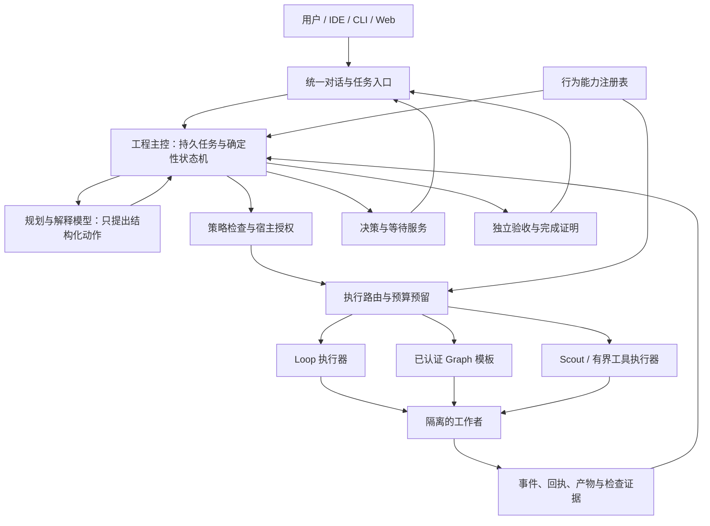

# OSStack Engineering Agent 架构设计

本版已结合 Fable 5.1 挑战修订。确定的事务、版本、派发与资格规则见 [V2 实施契约](runtime-contract-v2.md)。第一试点采纳已有 Session；从一句目标自动派发属于下一里程碑。

## 1. 决策摘要

推荐在现有 OSStack 控制平面上增加一个持久的工程任务主控层。用户只与 OSStack 沟通。主控层持有目标、范围、预算、决策责任和完成标准。Loop、Graph、Scout 和 Agent Adapter 是其执行工具。

不要把 Firstmate 作为又一个需要用户操作的子系统。把它的能力转化为 OSStack 的默认行为：自动接单、指派、监督、保留未决事项、汇总结果、验证交付、保全现场。

这需要两种不同的自动化：

- **开发时的能力移植**：原始源码 → 行为契约 → 回归场景 → OSStack 实现 → 证据 → 注册表资格更新。
- **运行时的工程执行**：用户目标 → 持久任务 → 受约束计划 → 执行器 → 监督 → 决策 → 验收。

注册表连接这两条路径。它说明一项行为从哪里来、由谁实现、何时需要、有什么证据。它不把“发现新代码”直接变成“允许在生产执行”。

## 2. 当前实现与真正缺口

基线见 [README](README.md)。下表是源码读取结论，不是运行时认证结果。

| 已有事实 | 对架构的影响 | 尚需补齐 |
|---|---|---|
| 能力完成账本第 1 项明确注明“没有新增全权主 Agent” | 当前入口聚合不等于有人持续负责目标 | 一个面向用户的持久主控会话与任务责任链 |
| `start-control-command.ts` 明确声明 approve 只输出 deliver 命令 | 授权与执行之间仍需外部操作者连接 | 由主控调用受控执行服务，持续跟踪回执 |
| `core/capability.ts` 已定义 Adapter 的能力类别 | 不能再造一套冲突的模型/技能能力目录 | 新行为注册表引用现有能力 ID，不替代它 |
| `AttentionActions.reserve` 已检查 revision、content hash、source version、turn、scope，并保留 action 幂等键 | 已有很好的回答安全底座 | 对话入口、决策解释、任务关联和恢复调度 |
| `attention-run-projection.ts` 明确禁止事件生成授权 | 事件是事实索引，不是权力来源 | 主控必须继续从原始审批表核实权限 |
| `classifyAttentionWait` 区分人、系统、未知责任 | “停止输出”不能被解释成“需要人回答” | 一致的等待责任和恢复条件协议 |
| 现有 deliver 接入 Loop；Graph 有固定注册表、预算和宿主边界 | 自动路由不能无条件选择更复杂的引擎 | 可执行能力范围登记与资格门槛 |
| DB 使用 WAL，默认 `synchronous=NORMAL` | 进程崩溃恢复与物理断电持久性不是同一承诺 | 对授权与外部副作用前的持久化强度做明确设计和实测 |

可直接复核：[主入口](https://github.com/osborn-studio/osstack/blob/14e7433b70f103499059c15fb9bf2ed87b0b0279/packages/cli/src/start-control-command.ts)、[能力模型](https://github.com/osborn-studio/osstack/blob/14e7433b70f103499059c15fb9bf2ed87b0b0279/packages/core/src/capability.ts)、[回答事务](https://github.com/osborn-studio/osstack/blob/14e7433b70f103499059c15fb9bf2ed87b0b0279/packages/core/src/state/attention-actions.ts)、[完成账本](https://github.com/osborn-studio/osstack/blob/14e7433b70f103499059c15fb9bf2ed87b0b0279/docs/reports/2026-10-24-firstmate-capability-completion-ledger.md)。

Firstmate 的核心价值包括“只有一个联络者”和“没有一个回合在工作仍进行时失去监督”。这些是 [原始运行契约](https://github.com/kunchenguid/firstmate/blob/af1c6817fc47589b162cbc361671c43cdb150933/AGENTS.md) 的要求。将脚本迁成 TypeScript 并不能自动得到这些用户体验。

## 3. 用户体验契约

### 3.1 正常路径

用户：“给支付接口增加幂等处理。补齐测试。开 PR，先不要合并。”

OSStack：识别仓库和目标；从仓库配置取得必要检查；冻结交付合同；在已有授权内选择执行方式；安排工作者；让独立检查者验证同一提交；在仓库已有具体授权范围内打开 PR；报告结果、证据和限制。

用户不需要回答“用几个 Agent”“用 Loop 还是 Graph”“哪个 Agent 卡住了”。这些属于 OSStack 的工作。用户可以查看这些细节，也可以明确指定执行方式。指定方式仍需通过资格与权限检查。

OSStack 必须区分三类问题：

1. 工程内部选择：已有约束足够时自主处理，例如先修类型错误还是先补测试。
2. 产品或范围决定：没有事实能推导时，向用户给出具体选项及影响，例如是否改变兼容性。
3. 权限决定：需要现有权限之外的副作用时，展示绑定到具体对象的授权请求。例如合并、发布、部署。

### 3.2 等待路径

OSStack：“接口兼容性需要你决定。A 保留旧字段。B 删除旧字段。建议 A，因为调用方仍在使用。请选择 A 或 B。”

用户选择 A。试点不把模型推测的自由文本含义自动转换成具有授权作用的选项。

系统将该回答绑定到当前显示的问题和版本。若目标或问题已变化，则展示变化，不把“继续”解释为新授权。用户离开后，只保留必要提醒。用户返回后，先展示仍未回答的问题和已完成的结果。

### 3.3 非正常路径

- 模型不可用：保留任务与等待记录；执行无需模型的监督和回执查询；不伪造进展。
- Worker 失联：报告执行状态未知；在确认原进程停止前不启动第二个写入者。
- 用户关闭终端：监督由已安装、健康的宿主服务继续。未安装服务时，明确提示当前只能前台运行。
- 用户要求停止：先持久化停止意图，再请求停止；只有停止证明有效后才报告已停止。
- 用户直接操作 Worker：该干预必须成为带来源的 steering 事件；使受影响计划版本失效并重新核对权限。

## 4. 系统结构与包边界

建议先沿用现有包，不立即引入新框架或新部署服务集群：

| 层 | 落点 | 责任 | 禁止事项 |
|---|---|---|---|
| 对话入口 | `packages/cli`，后续 IDE/Web 适配 | 请求身份、展示任务与问题、提交结构化回答 | 从聊天文字直接拼 shell |
| 工程规划 | `packages/supervisor/src/engineering/*`（新增） | 目标解释、分解、受约束行动建议、总结 | 写审批表、自行签发 grant |
| 持久主控 | `packages/core/src/state/engineering-*`（新增） | 任务版本、租约、事件消费、命令预留、恢复 | 将模型摘要当作事实权威 |
| 公共契约 | `packages/protocol/src/engineering-*`（新增） | 输入/输出 schema、错误、兼容版本 | 泄漏具体终端或模型 SDK |
| 策略与审批 | 现有 policy/governance/autonomy 与审批存储 | 行动准入、授权绑定、范围与预算 | 把注册表声明当作授权 |
| 执行器 | 现有 Loop/Graph/Agent Adapter | 执行冻结合同；发出状态和回执 | 代替主控判定整个用户任务完成 |
| 宿主 effect broker | 现有 CLI host 服务，逐步抽取共享接口 | 校验主体、一次性副作用、进程停止与回执 | 接收任意来自仓库的可执行路径 |

CLI handler 不应成为共享业务 API。先将现有 handler 内可复用的动作抽出，再让 CLI 与主控共同调用。禁止主控生成字符串并解析 CLI 的人类输出作为协议。

## 5. 领域对象与唯一权威

`EngineeringMission` 是新的用户目标对象。它与现有 `Session`、`Task`、`Run` 分开：Session 是一次工作者对话，Task 是执行工作单元，Run 是一次尝试。Mission 通过 ID 引用它们，不迁移其历史、不取代其权限模型。

| 对象 | 核心字段 | 唯一权威 |
|---|---|---|
| Mission | id、repo、goal、scope、contract_ref、revision、status、policy_digest、budget、completion_level | 新 mission 表 |
| MissionPlan | mission_id、plan_revision、steps、dependencies、executor_requirements、risk | 冻结的计划版本；变更需新版本 |
| ExecutorBinding | mission_id、task/run/session ID、executor ID/version、generation、checkpoint | 新关联表；现有执行器仍拥有自己的状态 |
| DecisionRef | authority_kind、authority_id、source_version、content_hash、subject | 已有 SessionDecision / approval / clarify / contract approval 各自的原始存储 |
| WaitObligation | wait_id、owner、blocked_steps、decision_ref 或 external_ref、clear_predicate、next_check_at | 新责任关系；不复制决策结果 |
| ActionIntent | action_id、mission_revision、payload_digest、authority_ref、effect_state、receipt_ref | 命令预留记录；具体发送仍由现有发送账本拥有 |
| CompletionProof | contract_digest、candidate_digest、checks、review、effect_receipts、limitations | 不可变证明，引用实际证据 |

决策权威采用带类型的引用：`session_decision`、`run_approval`、`run_clarify`、`contract_approval`。每种类型有明确 resolver。**禁止增加一个“所有问题都可用 text 回答”的通用写口。**普通选择不等于风险批准。

`WaitObligation` 负责“谁欠什么、哪些步骤受影响、什么证据可解除”。`DecisionRef` 负责“问题是什么、谁有权回答”。二者必须分开，否则一次回答会错误地清除整条任务链。

## 6. 主控运行方式

### 6.1 确定性控制器与模型的分工

控制器按持久事件推进。模型只返回严格校验的 `ProposedAction`，例如 `inspect`、`plan`、`start_executor`、`ask_decision`、`request_cancel`、`verify`、`report`。动作携带原因、证据引用、目标与预期结果。

控制器检查当前任务版本、权限、资源、执行器资格和预算，然后预留动作。模型输出非法、过期或越权时，记录拒绝原因，不执行副作用。模型无响应时，不反复无界重试。

重放使用已记录的模型结果和工具回执，不重新调用模型。随机 ID、时间、外部查询结果均作为输入记录。持久恢复借鉴 [Temporal 的事件历史与重放概念](https://docs.temporal.io/workflow-execution)，本阶段仍使用 OSStack 的 SQLite 和宿主服务。

### 6.2 状态与并行任务

完整 goal_dispatch 的 Mission 生命周期：`accepted → planning → executing → verifying → completed`；可进入 `paused`、`cancelling`、`cancelled`、`failed`、`needs_reconciliation`。

adopt_session 的成功级别仅为 observed_turn，依 [V2 ADR-14](runtime-contract-v2.md) 输出 ObservationProof；取消、失败和主动结束观察分别记录，不能复用为工程交付成功。

等待是一组独立 obligation，不是把整条 Mission 一律改成 `waiting`。若一个问题只阻塞步骤 B，独立步骤 A 可继续。若没有可运行步骤，用户视图显示“等待决定”。未知执行状态与业务状态分别展示。

试点主控位于现有 attention daemon 内，复用 home 级进程锁与 daemon_owner.generation，不新增 per-mission lease。Mission 用 revision 做 CAS；来源实例另有 source identity，不能与 daemon generation 混用。宿主拒绝旧控制者的新副作用；恢复控制权不证明旧 Worker 已停止。停止资格见 V2 ADR-07。

### 6.3 监督、节流与预算

事件接收、状态归并、定时重查不需要模型。仅在目标变化、有效决策、异常、检查失败或到达规划检查点时调用模型。

预算记录 token、费用、运行时长、总工具动作、并行数、修复轮次、外部副作用次数和用户打扰次数。试点仅将宿主能够控制的时间/调用/并发/提醒设为硬限额；token 与费用为 observed，除非 profile 提供可验证的上限。未知成本按 ADR-10 处理。禁止通过换执行器、重启任务或新建子任务重置总预算。

队列设置优先级与公平性。停止、权限撤销、决策回复优先于例行汇总。对子任务扇出、事件大小、队列长度和故障重试设上限。满队列要显示退化状态，不能丢弃停止或未决事项。

保持现有性能预算：本地 `--version` 小于 150ms、完整 `--help` 小于 500ms，CI 分别小于 250ms/900ms；本地非流式 RPC p95 小于 10ms；Loop tick 开销小于会话时长 1%。主控、模型 SDK 和 registry 大型索引采用按需加载。新增强持久事务单独测延迟，不能用放松正确性来维持旧数字。

## 7. 自动选择 Loop、Graph 与工作者

先做资格过滤，再比较质量、成本和延迟。不要采用“简单任务用 Loop，复杂任务用 Graph”的单一规则。

| 工作需求 | 首选候选 | 必要条件 |
|---|---|---|
| 读取事实、缩小未知 | Scout / 有界只读工具 | 工具范围可证明、无写授权需求 |
| 单一可验证交付，修复步骤依赖前一步结果 | Loop | 可运行的检查、限制迭代和写范围 |
| 已知阶段、独立分支、需要明确汇合与审查 | 注册并通过资格验证的 Graph 模板 | 模板支持该产物、节点、Provider、预算及副作用 |
| 路由置信度不足或能力不支持 | 继续调查或明确报告能力缺口 | 不静默退回更宽权限的执行器 |

当前 Graph 的产品入口仍有窄范围约束。固定模板并不等于任意 DAG 编程能力。路由需要查询 `ExecutorEnvelope`：支持的任务类别、产物类型与大小、文件数量、Provider、检查类型、取消/恢复语义、权限类别、通过验证的宿主版本。该 envelope 是受信构建产物，不是 Worker 自报。

候选评分是次级决策：历史成功率、同类检查通过率、预计费用、时间、资源占用。新模型、Provider 或模板先进入影子评估。不能仅凭一次模型自评更新默认路由。

执行器切换只能发生在安全检查点：旧进程停止已确认、候选与证据已冻结、剩余预算清楚、权限仍有效。新执行器继承同一 Mission 和剩余预算，创建新 binding generation。已产生的发布副作用不能回滚成“未发生”。

多人/多 Agent 并行先按写集合、资源、数据迁移和公共接口计算冲突。可并行读和独立 worktree 开发；集成由串行候选队列处理。每次候选合并后重新跑与候选绑定的检查。不要把各分支分别通过等同于合并后通过。

## 8. 机器可读注册表

详见 [capabilities.json](capabilities.json)。保留 24 个稳定 ID，并记录：

- 来源仓库、commit、文件与 SHA-256；来源材料性质。
- 中文/英文名称、用户行为、触发条件、责任组件。
- 现有实现路径、现有测试路径和现有入口。
- 原始语义、允许的严格化差异、安全不变量、目标默认流程。
- 实现状态、主 Agent 集成状态、验证状态，三个维度分别记录。
- 依赖、具体缺口、验收场景、资格门槛、故障与回退要求。

运行时资格按能力 × 宿主 × Provider × Adapter × 执行器版本保存，不能仅在能力层声明通过。签发者、证据摘要、撤销、有效期和派生启用条件见 V2 ADR-09；当前设计 JSON 不承担该验签工作。

注册表不替代现有 `CapabilitySchema`。后者描述 Adapter 能做什么；本注册表描述 OSStack 必须如何负责一个工程目标。名称建议为 `BehaviorCapabilityManifest`，避免语义冲突。

运行时只读取通过签名/构建摘要固定的注册表版本。一个 Mission 固定该版本；注册表更新不改变正在执行的任务契约。迁移需要显式兼容检查。

注册表权威顺序：主机策略与审批 > 冻结任务合同 > 已认证执行器范围 > 行为声明 > 模型建议。声明和源码文本都不能增加权限。

能力资格分层：`source_mapped → contract_tested → host_verified → journey_verified → default_enabled`。必须有对应证据才能升级；失败可降级。**24/24 文件存在，不能宣称 24/24 默认行为已融合。**

## 9. 权限与真实隔离

威胁模型包括恶意仓库文件、恶意测试、Worker prompt injection、伪造事件、旧 generation、跨仓库混淆、供应链变更和同 UID 越权。

运行不可信代码的 Worker 不得访问控制平面数据库、签名私钥、host registry、发布凭据或其他任务目录。生产写模式需要独立 UID、受限容器或具备等价约束的沙箱。仅 chmod、不同 worktree 或“不要读这个文件”的 prompt 不构成隔离。

宿主 broker 根据经过认证的会话和 OS 身份派生 actor。请求体里的 `actor: human` 不是身份证明。IDE/远程客户端必须有会话鉴权、仓库授权范围、重放保护和审计身份。

用户给出的目标授权可以覆盖其范围内的可逆实现步骤。不要为每次写文件重复询问。跨越范围、敏感数据、合并或部署边界时，调用相应既有授权流程。策略未知时采用只读/暂停，不能推断用户希望解除所有限制。

Firstmate 源码采用 MIT 许可。任何实际复制的代码或测试要保留来源和许可要求；在 `THIRD_PARTY_NOTICES` 中记录复制范围。行为重实现也应保留设计来源。此处登记来源，不作新的法律结论。

## 10. 持久性、恢复与完成证明

同一 DB 中可原子记录的动作，放在同一事务：决策有效性校验、版本 CAS、发送预留、关联记录与待处理事件。事务内禁止模型/网络调用。

跨执行器、跨 DB、跨主机操作使用持久意图与回执对账。不承诺端到端 exactly-once。对于不支持幂等查询的 transport，发送超时后状态保持 unknown，不能换一个 ID 重发。

当前 DB 默认 `synchronous=NORMAL`。试点决定将**实际写入授权/意图的 daemon 连接**配置为 FULL 并读回核实，提交后才调用外部服务；达不到则禁用自动继续。需要测试该改变对延迟与多连接行为的影响。不能只给读取连接加 FULL；该配置也不等于所有硬件断电行为已被证明。WAL 多数据库事务也不能当成整体原子事务。[SQLite WAL 约束](https://www.sqlite.org/wal.html)

完成证明绑定合同、候选提交/内容摘要、检查命令身份、检查结果、审查对象与所需外部回执。测试全绿、PR Ready、已合并、已部署分别是不同完成级别。任务中必须明示所需级别。

最终报告由证据生成：已完成事项、未完成事项、失败与未知、可重复验证命令、产物链接。模型可解释，但不能将缺少的检查写成通过。

清理规则先保全再删除：未交付 worktree、未决事项、未知发送、未确认停止、产物摘要不匹配时拒绝清理。回退先禁用新调度入口，再保留读取/回答/恢复旧任务的路径；不降低 DB schema 版本。

## 11. 24 项能力怎样“有存在感”

| 用户感受到的行为 | 参与能力 |
|---|---|
| 只需告诉 OSStack 要什么；由它组织工程工作 | FM-01、12、15、21、23 |
| 离开终端后任务仍有负责人；返回时能看到真实进度 | FM-02、03、05、06、07、10、11 |
| 只在真正需要用户决定时提问；回答后接着做 | FM-04、08、09、10 |
| 能查看 Worker 和远程执行，但不用管理它们 | FM-16、17、18、19 |
| 结果经过验证，工作不会被提前清理 | FM-13、14、19、23 |
| 经验可复用，承诺能追踪，升级有恢复路径 | FM-20、22、24 |

默认用户旅程、内部实现和外部证据三者必须同时覆盖。文档入口应先展示“描述目标 → 处理必要决定 → 获得已验证结果”。原有命令放在诊断与专家操作部分，保留兼容性。

## 12. “完美融合”的可验收定义

不把“完美”解释成任意任务、任意宿主、零故障。定义目标版本和支持矩阵，在该范围内验证：

1. 24 项能力均有原始来源、契约、责任组件、默认触发路径、检查与证据。
2. 支持范围内的任务可从单一入口完成；基准任务没有必须由用户选择 Agent/Loop/Graph 的步骤。
3. 所有安全关键负例均被拒绝：旧回答、伪授权、跨仓库回答、未知发送重发、旧 Worker 越权、检查对象漂移。
4. 控制器重启、模型退出、事件重复/丢失、断线后，未决问题与任务归属不会静默消失。
5. 完成声明均能映射到同一候选的机器检查和需要的真实回执。
6. 中文与英文表达保持同一行为含义，使用项目的 STE-inspired 写作规则，不宣称完整 ASD-STE100 合规。

建议试点门槛（目标值，尚未测得）：100 条独立保留场景；关键安全负例 100% 通过；有效回答至少 99% 在健康、已准入的合格宿主 5 秒内开始 dispatch（排队、Provider 与模型时间另报；不能把整个回合完成后才产生的 applied 用作该指标）；未变化的等待期间模型调用为 0；同一问题每个提醒窗口最多一次提醒。报告分母、环境、分位数和置信区间，不用平均值掩盖失败。

完整融合的发布门槛还包括：本地 macOS/Linux 实测、支持的 Provider 实测、至少一次长时恢复验证、独立人员完成无 Agent 管理的用户任务。未通过的组合在 registry 中保持禁用，不被总体通过率掩盖。

## 13. 专家会补做的工作

- 建立反事实基准：同一任务分别使用现有命令工作流、仅加统一 UI、加入主控后的完整路径。测量用户干预数、成功率、费用和时间，证明主控确实带来价值。
- 测试用户改口和撤销：不是只测首次下单，还要测“不要改 API”“暂停这个步骤”“撤销发布授权”“把目标改成调查”。
- 以任务责任为单位做故障模型，而不只检查进程存活。
- 建立命令与行为的可追溯关系，检查“有命令无默认流程”“有流程无实现”“有实现无证据”三种孤岛。
- 独立维护 holdout、恶意样本与变异测试；实施者不能自行删掉失败场景。
- 审计预算泄漏、上下文泄漏、数据保留、跨项目记忆污染与评价作弊。
- 把迁移、支持矩阵、弃用策略、可观测性和事故处置写进设计，而不是发布前补文档。
- 验证注册表的升级流程本身：上游恶意变更不能成为自动可信工具；生成的 PR 要保留原始差异与未解决分歧。

这些工作有具体工具与证据要求，见 [独立验证](evidence-and-methods.md) 和 [实施计划](implementation-plan.md)。
