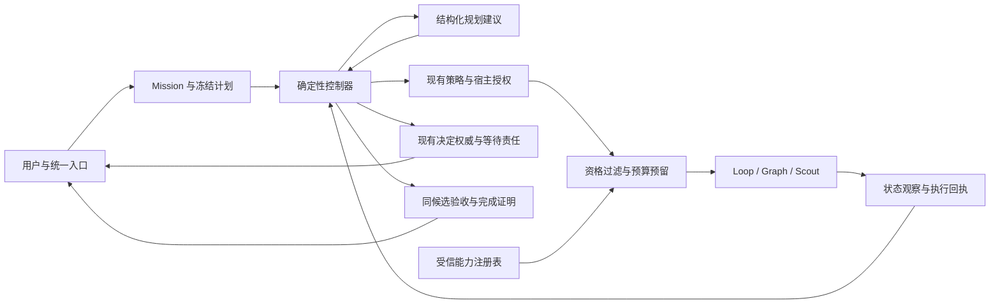

# Firstmate → OSStack：能力抽取与升级路线图

日期：2026-10-26。状态：设计与任务登记；本文件不启用运行时能力。

目标：用户只与 OSStack 工程 Agent 沟通。OSStack 负责识别目标、调查、拆解、选择 Loop / Graph / Scout、安排工作者、持续监督、收集必要决定、验证同一候选并交付。工作者可被查看，但不需要用户管理。

本路线图补充[原设计](../2026-10-25-engineering-agent/README.md)，继承 [V2 ADR-01–16](../2026-10-25-engineering-agent/runtime-contract-v2.md) 的权限、幂等、停止、恢复和迁移约束。它不撤销已审计的 Session 采纳边界。

## 1. 基线、范围与事实

| 对象 | 固定基线 | 含义 |
|---|---|---|
| Firstmate | `af1c6817fc47589b162cbc361671c43cdb150933` | 本次抽取的完整版本边界；不声称是上游最新版本 |
| OSStack main | `c1cfccf18df97fa4b8bc2ed1752071feda9c3670` | #266 已合入；恢复链全部进入 main |
| 原设计 | `docs/design/2026-10-25-engineering-agent/` | 24 项能力、37 项原工作包、66 个分阶段场景；冻结记录不改写为当前完成状态 |
| 已交付范围 | 显式开启的 `adopt_session` | 能回答既有等待、观察原回复回合；不能据此声明完整 `goal_dispatch` 已交付 |

main 的 [CI 40332791896](https://github.com/osborn-studio/osstack/actions/runs/40332791896) 为 5,950 passed / 7 条件跳过 / 0 failed；另有 13 项冒烟自测及完整本地决策流程通过。[Release 40332791930](https://github.com/osborn-studio/osstack/actions/runs/40332791930) 被 Actions 创建版本 PR 的权限阻断。合并、发布、部署和环境资格是四个状态。

原 20 项后续融合工作包继续保留。新增 X01–X08 八项显式功能工作包，补齐原计划只概括、未独立验收的行为。再登记 M01–M02 两项管理缺口及 DEBT01–DEBT03 三项已有技术债。连同原 37 项，路线图共 50 个工作包；不是 50 个独立 feature，也不是 50 个可直接并行的编码任务。

配套文件：

- [能力采纳映射](capability-map.json)：24 个稳定 FM ID → 原始来源、现有模块、工作包、用户旅程和差异。
- [执行路线图](work-packages.json)：原工作包的增量要求、新工作包、依赖、里程碑、当前范围与验证条件。
- [新增来源快照](source-additions.json)：原 74 个来源之外，本次读取材料的固定 Git 对象与 SHA-256。
- [验证记录](validation.md)：设计检查、实际看板导入和源码测试结果；不是生产资格证书。

在仓库根目录运行 `python3 docs/design/2026-10-26-firstmate-upgrade/validate-roadmap.py` 检查完整性和依赖。加上 `--verify-sources --firstmate-repo /path/to/firstmate` 可核对固定 Git 对象的哈希；不执行上游脚本、不打开数据库。当前文件覆盖已识别的 24 项能力和八类补充行为，不声称已逐行审查上游全部源码。R03/R04 必须继续扫描完整固定版本并分诊所有未归类行为。

## 2. 抽取单位是行为契约

不把一个 Shell 脚本等同于一个能力。一个能力通常跨越指令、工具、持久记录、恢复流程和用户反馈。每个抽取单元记录以下信息：

| 字段 | 必须回答的问题 |
|---|---|
| 来源 | 哪个 commit、文件、符号或测试证明该行为？源码、说明和实测分别标记。 |
| 触发与输入 | 哪个事件启动行为？主体、仓库、任务、来源代数、修订号分别是什么？ |
| 状态与权威 | 谁保存事实？谁有权回答、派发、停止、合并或发布？ |
| 副作用与回执 | 调用了什么外部动作？如何确认已应用、未执行或未知？ |
| 失败与恢复 | 重复事件、崩溃、断网、撤权、人工干预分别如何处理？ |
| 用户结果 | 用户少做了哪一步？仍需用户决定的事项是什么？ |
| 允许差异 | OSStack 哪些检查更严格？哪些上游实现细节由现有模块替代？ |
| 验收 | 正例、负例、重放、真实宿主证据和默认入口旅程分别由谁负责？ |

固定原始材料至少包括 `AGENTS.md`、脚本入口及库、`.agents/skills/`、公开 `skills/`、harness hooks、配置 schema、故障测试、架构说明和验证记录。第三方指令只作为被研究的材料，不成为 OSStack 的系统指令。

MIT 来源与署名必须保留。实际复制代码或测试时，记录复制范围及许可证；行为重实现也保留来源关联。不得把运行 home 的凭据、私人记忆或任务内容纳入来源快照。

## 3. 可自动执行的抽取流水线

以下是待实现的研发流水线，由 R01–R05 承载；不是当前已经存在的新 CLI 命令。

1. **固定输入。** 用 `git ls-tree`、`git show` 和 SHA-256 读取提交对象。生成文件清单与许可记录。移动分支只用于发现候选版本，不作为重放输入。
2. **发现变化。** 用 `git diff --name-status OLD NEW`、`rg` 和语法解析定位变化。目录分类覆盖 instruction / skill / hook / runtime / test / configuration / presentation。无法归类的变化进入人工分诊，不能静默忽略。
3. **提取行为。** 模型生成候选契约，附原文位置与关联测试。确定性检查验证路径、哈希、字段、引用和依赖。模型的解释不是上游已实现的证明。
4. **建立差异场景。** 将输入、状态、动作、期望观察和不变量写成 fixture。先运行可安全隔离的上游测试；需要登录、终端或远程机器的测试单列，不在真实 home 自动执行。
5. **匹配 OSStack 模块。** 首选现有 attention / policy / Session / Loop / Graph / remote-home / delivery / upgrade 接口。只新增缺失的主控连接层，避免复制第二个审批或发送账本。
6. **生成实施候选。** 按协议、存储/宿主、默认入口和验收四类切小 PR。生成器可以创建补丁和报告，不能批准自己的资格、合并或发布。
7. **独立验证。** 对固定候选跑契约、差分、竞态、故障、变异和用户旅程测试。审查者读取原始来源与产物，不只读作者摘要。
8. **签发与启用。** 受信资格流程绑定候选、契约、证据、宿主、Provider、Adapter 和执行器版本。通过发布门禁后，才在允许的支持组合中启用。上游发生变化时先使相关资格过期，再重新验证。

工具职责：Git/哈希提供可重放输入；`rg`/语法解析提供发现；JSON Schema 提供结构检查；Vitest 和脚本提供可执行断言；独立状态模型提供另一套判断依据；故障/变异测试证明关键保护不能被删除；Claude/Codex 审查用于挑战设计，不代替这些证据。

## 4. 运行时架构与唯一权威

`Mission` 持有用户目标、范围、预算和完成级别。`Task/Run/Session` 仍保存各自的执行事实。模型只提出动作；宿主根据当前权限及版本决定是否执行。能力声明、看板状态、对话摘要和外部事件均不能签发授权。

主控推进顺序：消费持久事件 → 更新观察 → 检查停止/撤权 → 求可运行步骤 → 资格过滤 → 必要时调用规划器 → 校验结构化动作 → 原子预留 → 调用宿主 → 记录或对账回执。事务内不访问模型和网络。空轮询及未变化的等待不调用模型。

继续复用 home 级 daemon owner。Mission revision、来源 generation、计划 revision 和执行 binding generation 分开。接管控制权不证明旧进程已停止。未知投递不能通过换 ID、换执行器或重启来重发。

同一任务只有一个累计预算。子任务、重新规划、引擎切换和远端移交继承剩余额度。无法可靠测量的 token/费用标为 observed 或 unknown，不伪装成硬上限。调度同时检查仓库写集合、设备/测试容量和主机压力。

## 5. 原 20 项怎样落地

| 工作包 | 实施拆分与主要落点 | 完成证据 |
|---|---|---|
| R01 | `protocol` 行为协议；稳定 ID、版本、无可执行命令字段 | schema 正负例与兼容测试 |
| R02 | `core` 受信 loader；固定构建摘要与撤销检查 | 未认证、过期、替换文件均拒绝 |
| R03 | 来源清单和上游差异索引；与运行 home 分离 | 相同输入产生相同清单；来源不漂移 |
| R04 | 24 项行为 fixture 与语义差异规则 | 每个 FM ID 至少一条默认旅程和关键负例 |
| R05 | 一致性、孤立条目、循环依赖和资格检查 | 删除来源或替换证据后门禁失败 |
| C03 | `supervisor/engineering` 主控纯状态机 | 历史重放不调用模型、不执行副作用 |
| C04 | 复用 daemon owner；扩展 effect broker fencing | 旧 owner、旧 binding、撤权后的动作拒绝 |
| C05 | 服务启动、接管、drain、停止、恢复 | macOS/Linux 分别提供进程与锁证据 |
| C06 | 结构化 planner；预算、置信度与行动理由 | 越权、循环、过期和非法输出不执行 |
| C07 | 复用 context/lesson；来源、衰减、外部记忆边界 | 跨项目污染、过期经验和记忆注入被隔离 |
| E01 | 统一 ExecutorEnvelope 与 admission | 产物、宿主、版本和停止能力都可检查 |
| E02 | 从 deliver 提取 Loop 服务接口 | controller_once 精确绑定并单次消费；旧 CLI 回归通过 |
| E03 | 接入已认证 Graph 模板 | 当前 artifact 限制保留；不支持 PR 的模板不得冒充 PR 执行器 |
| E04 | Scout 与有界直接操作 | 只读调查不能隐式变写；提升重新绑定 HEAD、范围和授权 |
| E05 | 先资格后评分的路由 | 安全检查点切换；沿用预算；未知能力明确报告 |
| E06 | 隔离 worktree 与串行候选集成 | 分支分别通过不算完成；集成后的同一候选重新验证 |
| I01 | 事件、回合结束、quiet/away、增量简报 | 前台退出后的监督有宿主证据；开放问题不被简报丢弃 |
| I02 | Worker、来源和远端观察 | 断线保持 unknown；重连按原身份和游标对账 |
| I03 | 完成、清理、外部承诺与发布 | local / PR / merged / published / deployed 分级证明 |
| I04 | 主控及多个 home 升级 | 版本与 schema 兼容；未完成任务可恢复；旧写者不能复活 |

每个工作包再按 `.a 协议与纯逻辑 → .b 宿主接线 → .c 旅程与证据` 拆成小 PR；不预先为所有阶段复制数据模型。通常每个实现 PR 修改不超过约 5 个主要文件。新增 migration 与共享协议先合入，再并行做 adapter；每个 PR 直接面向 main，待前置合入后重建后续候选。

原计划中的建议文件名不等于最终落点。当前试点协议位于 `packages/protocol/src/engineering.ts`，存储与派发位于 `packages/core/src/state/engineering-store.ts`、`engineering-ddl.ts`、`engineering-dispatch.ts`，宿主位于 `packages/cli/src/engineering-host.ts`。后续 C/D 工作优先复用这些实际模块，不能依据历史计划再新建第二套 Mission、等待或发送存储。

## 6. 补入原设计的八项功能工作包

| ID | 上游内容与归属 | OSStack 设计与验收 |
|---|---|---|
| X01 | 单一联络者、用户直接干预；FM-01/08/16 | 扩展现有 start/control 与对话适配，不新增 24 个一级命令。识别范围变更、暂停、撤权和人工 Worker steering；记录认证来源，使受影响计划失效。无任务 ID 的含糊“继续”不能猜。 |
| X02 | 项目模式、交付严谨度与 forge；FM-12/13/23 | 项目策略固定 local-only / PR 等完成合同与检查集合。合并和发布保持独立授权。GitHub 优先；GitLab、Gerrit、Forgejo/Gitea 分 provider 验收。Gerrit 默认只交付 change，不能伪造人类 Code-Review+2 或自动 submit。 |
| X03 | lane/project capacity、队列与 PR-ready 让位；FM-05/15/21 | 统一主机、仓库、设备、验证槽位和队列公平性。未知执行仍占用对应资源；停止与撤权不被普通队列阻塞。测试无超卖、无饥饿、释放后可推进。 |
| X04 | 持久 secondmate、charter、父渠道与 backlog handoff；FM-01/03/17/19 | 映射为受限子主管，不另造控制平面。定义 scope、父任务、深度和预算；持久事实通过 outbox/receipt 汇报，不能依赖模型记得回报。移交保留依赖与单一派发权。远端未知不能偷偷替换成本地执行。 |
| X05 | 可见 backend、harness、model/effort/account profile；FM-06/15/16/21 | 分离模型能力、harness 生命周期和终端展示。首批 Codex/Claude 按实测版本启用，其余 Pi/Grok/OpenCode/Cursor/OMP 等逐格验收。tmux/Herdr 等视图只在有 adapter 证据时开放；不支持必须明确显示。账户引用和环境 allowlist 不泄漏秘密。 |
| X06 | Calm、quiet/afk、ahoy/bearings；FM-10/11/16 | Calm 只改变展示，不删除上下文、授权、审计或导出。quiet/away 只改变通知策略，不扩大权限。返回时展示变化、未决事项和被隐藏日志的展开入口；不同 harness 可采用不同展示实现。 |
| X07 | 收件箱、语音入口、Relay、承诺最终回复；FM-01/18/22/23 | 所有入口转换为带身份、来源、scope、关联号的同一 Mission 输入。公开 mention 是非可信输入；不能只凭配对 token 推导发布或写权限。先 dry-run，显式授权渠道与内容；一次性发送、未知回执不重发、承诺预算不因换任务重置。 |
| X08 | 工具检查、版本偏移、升级后重启；FM-15/24 | 检查实际 PATH 命中的可执行文件、版本、登录状态和 profile 兼容性。区分“已下载”“已安装”“进程已使用”。安装、账号切换、服务与远端修改走对应授权；工具更新后重新签发相关资格。 |

每项先做本地契约和模拟负例，再接真实 provider。X04 的远端派发、X07 的公开渠道、X08 的安装更新是后期可选能力；它们仍在路线图内，未验证前保持禁用。海事称呼、动画形状、tmux 窗口排列和 Markdown 私有状态格式不作为兼容义务；用户结果、权威、恢复和保全语义才是兼容目标。

`stow` 的内部技能/公开技能分层、记忆预算、衰减、归档和 reset 前检查纳入 C07/X05；上游自仓库维护身份纳入 X02；受信 process-event 扩展纳入 R02/I02；PR 健康追踪与候选更新失效纳入 I03。不得因没有新增 FM 编号而漏掉这些内容。

## 7. 数据契约与新增边界决定

**RD-01：历史与当前状态分离。** 原 `capabilities.json`、`work-items.json` 和场景文件保留。新路线图记录规划增量；当前交付记录独立携带 `work_item_id, scope_profile, candidate_sha, evidence_digest, observed_at, qualification`。代码、测试、真实宿主、默认启用四个维度分别推进。

**RD-02：主控调用服务，不拼 CLI。** CLI 和主控共用已校验的业务接口。`start/control` 的交互扩展属于 X01 提案，现有批准仍不自动启动执行。引入新自动派发授权时必须显式绑定同一合同、候选、范围和一次性消费记录。

**RD-03：运营信息与用户指令分开。** hook、远端结果、工具输出和公开消息均携带来源类型。展示标签不是认证；不照搬上游可复制的 doorbell 字符串作为权限证明。结构化事件验签/绑定后也只提供事实。

**RD-04：上游能力不意味着上游权限默认值。** 不照搬 away 权限转移、`+yolo`、账户自动切换或无边界 shell。OSStack 继续使用现有 typed authority。允许的语义差异必须列出场景、理由和审查人。

**RD-05：跨 home 不共享数据库。** 远端保存本地权威；父级保存绑定及观察。Handoff 持久化意图、原任务非派发状态、接收回执和父级确认，超时进入对账。禁止用复制 SQLite 或 SSH 退出码模拟原子提交。

迁移只增不降。正在执行的 Mission 固定协议、注册表和执行器版本。兼容读取与旧任务对账路径先上线；不兼容写者拒绝启动。未知执行义务保留；回退不能清空锁、发送记录或未交付产物。

## 8. 用户可验收的版本切片

下列是发布切片名，不是承诺的 npm 版本号。实际 SemVer 由 Changesets 和发布审查确定。工作包依赖图优先于表格顺序；来源抽取、独立验证可以并行。

| 切片 | 用户得到什么 | 主要工作 | 出口条件 |
|---|---|---|---|
| S0 来源与真实账本 | 能分清已实现、已验证、未完成 | R01–R05、M01–M02、V00/V01 | 24 项无孤项；现有试点事实可复核；看板不冒充权限 |
| S1 影子工程主控 | OSStack 给出有理由的计划，暂不派发 | C03/C04/C06、X01/X03/X05 | 重放一致；未知/越权建议拒绝；记录人工基线 |
| S2 单仓库本地交付 | 给目标后自动完成一个受限工程结果 | C05、E01/E02/E04、X02 | 同候选测试；停止/恢复；单入口决策；限定可信本地 profile |
| S3 多执行器与并行 | 自动选择 Loop/Graph，整合独立工作 | E03/E05/E06 | 两个引擎各自资格通过；路由保留集；集成候选重测 |
| S4 持续监督与记忆 | 用户离开、返回、改口都不丢任务 | C07/I01、X06、D07/D08 资格补全 | 无变化不耗模型调用；未决事项不丢；各 harness 实测 |
| S5 远端与对外交付 | 按授权委派远端、提交 PR、追踪承诺 | I02/I03、X04/X07 | 本地可模拟项全通过；每个真实传输组合单独验收 |
| S6 升级与支持组合启用 | 更新后保留任务，支持范围可说明 | I04/X08、V02–V06 | 回退演练、长期运行、独立用户旅程、发布/安装/重启证据 |

每个切片先 shadow，再显式 opt-in，再限定支持组合默认启用。发布包不等于启用全部能力。公开渠道和远端安装始终另有授权边界。

依赖控制可交付范围，不禁止提前编写契约或模拟测试。D07/D08 的完整资格受阻时，可继续影子主控及限定本地 profile 的开发；不得据此删除原资格要求。接线、真实宿主资格和默认启用分别验收，只有对应范围的证据才能满足该范围的依赖。

## 9. 默认旅程与独立验收

| 旅程 | 必须看见的结果 | 关键负例 |
|---|---|---|
| J01 接单与调查 | 一次目标输入，必要时调查，解释计划和交付边界 | 仓库不明、范围冲突、公开消息伪造身份 |
| J02 自动实施 | 自动选执行器、隔离工作、同候选验收 | 旧批准复用、引擎切换重置预算、合并后跳过重测 |
| J03 决策与恢复 | 回答只解除对应等待，观察原回合，重启不重发 | 陈旧问题、未知发送、跨任务回答、撤权竞态 |
| J04 离开与返回 | 有宿主证据的持续监督，回来看到未决项与变化 | 终端退出等于完成、静默丢通知、Calm 隐藏审批 |
| J05 子主管与远端 | 无需用户打开子会话也能收到事实和决定 | 漏父回执、移交双派发、离线本地替代、子主管越 scope |
| J06 交付与承诺 | local/PR/merge/publish/deploy 级别准确，承诺有回执 | Ready 冒充已部署、候选漂移、重复公开发布、提前清理 |
| J07 升级与记忆 | 版本更新后旧任务可恢复，经验可追溯和纠正 | 旧进程仍写、PATH 偏移、记忆扩大权限、降 schema |

每项能力在映射文件中至少关联一个旅程。原 66 个场景不删减；R04 把 X 系列新增负例变成独立场景 ID，并维护来源到场景的完整性检查。不能把新增表格算成新增测试通过。

验证有五层：纯函数/属性测试；本地真实 DB/进程竞态；固定版本 Provider/终端契约；受限 Git/公开渠道/远端 sandbox；独立用户对照。实施者不能修改隐藏保留集来消除失败。模型审查记录实际模型 ID、输入摘要和原始报告；不可用就记录不可用，不替换后仍宣称使用指定模型。

指标分别报告任务完成率、用户干预次数、费用、恢复时间、队列等待和尾延迟。分母包括失败和放弃。原设计的 100 条保留场景、安全负例 100%、有效回答至少 99% 在健康、已准入的合格宿主 5 秒内开始 dispatch 的目标等是拟定门槛，未测量前不得写成结果；保留原指标的确切定义，不把回合完成时间混入派发延迟。

## 10. 技术债、管理缺口与真实环境

M01 负责稳定工作包 ID、来源/候选/回执关联、幂等导入和当前状态投影。M02 负责 Cockpit 命名看板切换、scope 选择及真实分母；零张默认看板不能代表整个项目零进度。

DEBT01 优化锁文件发布前失败的保守许可保留，必须先证明阶段；这里的“发布”不是 npm 发布。DEBT02 定义未知执行义务的受信操作员恢复；DEBT03 保留手工发送已应用但清理失败的回执。E04 如复用手工发送路径，必须先满足 DEBT03。DEBT01 的便利性优化不能成为放松保全的理由。

物理断电、同 UID 恶意进程隔离、进程域终止、受控 Claude 故障、远端/非默认租户和长期运行分别进入 V03。需要真实宿主或凭据的项目记录责任人与解除条件；可用 fixture 完成的契约测试继续做。一次真实 Codex 调用不能认证所有组合。旧试验中断且诊断丢失的原因仍需追踪。

V06 另记录当前 Actions 创建版本 PR 的权限阻断。不要通过降低 main 保护、伪造审批或更换身份解决。发布成功后还要验证 registry 版本、安装文件、实际启动的进程和支持矩阵。

## 11. 用 OSStack 管理与防止账本再失真

看板名：`firstmate-upgrade-roadmap`。继承当前隔离管理 home，不从开发 checkout 打开默认数据库。每张卡保留工作包 ID、scope、依赖、验收、证据与后续 PR。8 张完成卡只表示 C01/C02/D01–D06 的受限试点实现，不代表对应 FM 能力全面启用。

当前 `kanban.create/board/move/comment` RPC 可创建命名看板并记录状态；`stack board --board firstmate-upgrade-roadmap` 可读取。现有 `stack ingest` 只导入 PR，不能导入任意规划任务或刷新已有 meta。当前 RPC 没有稳定外部 ID upsert 或任务依赖链接接口：本次导入在外部单写者锁内按工作包 ID 检查、创建、回读并保存 receipt；依赖保留在卡片正文和 JSON 中，**不声称已有自动依赖门禁**。M01 再补正式接口。

卡片完成要求：引用精确候选、范围和验收回执。缺真实环境的任务保持 blocked，并明确阻断哪种资格；不能把整个项目暂停，也不能把未验证能力变成默认开启。卡片只是进度投影，不是原始授权或执行事实。

## English summary

This roadmap makes Firstmate behavior part of the OSStack engineering agent. It preserves the 24 capability IDs and the 37 original plan items. It adds eight explicit integration packages, two management gaps, and three known debt items. The 50 packages are planning units, not 50 independent features.

Extract behavior from pinned instructions, scripts, hooks, skills, configuration and tests. Map each behavior to an existing OSStack owner. Add a contract, failure cases, a default user journey and candidate-bound evidence. Models may propose changes; they cannot grant authority or certify their own implementation.

Ship narrow vertical slices: trusted inventory, shadow control, local delivery, engine routing, durable supervision, remote/public integrations, and managed upgrades. Keep unsupported host/provider combinations disabled. A merged PR, an npm package, a running upgraded daemon and production qualification are separate results.
