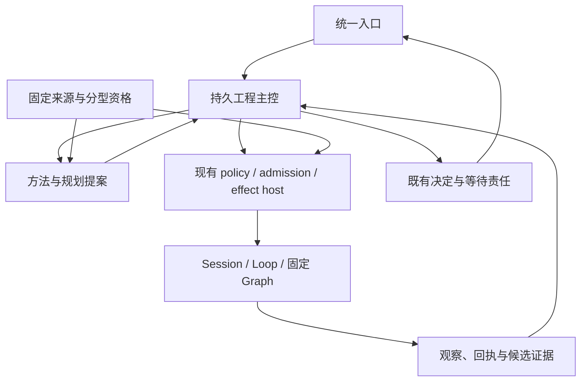

# 联合架构、取舍与不变量

## 1. 产品目标与边界

用户把一个工程结果交给 OSStack。OSStack 澄清真正改变实现的未知，调查原始证据，选择方法与执行器，保留等待责任，控制副作用，以同候选证据交付。进度展示必须区分“正在运行”“等待决定”“结果未知”“已通过何种验收”。

第一阶段仅默认租户、单仓库、可信开发环境、显式开启、`implement/local_verified`、无发布/合并。这个限制延续现有 Graph 合同，不得把调查模式静默转成写任务。读报告、画图、理解代码可以在独立只读任务中进行，不能虚构 Graph 已支持 scout 交付保证。

不纳入首个试点：任意 DAG、跨机器替代执行、多级长期子主管、公开渠道发送、全自动发布、同 UID 恶意 Worker 隔离、完整形式化平台。它们仍在能力表及后续原任务中，延期不是删除。

## 2. 推进策略比较

| 方案 | 收益 | 主要代价 | 选择 |
|---|---|---|---|
| Firstmate 全部结束后再做 pstack | 顺序简单 | 将方法价值验证绑定到远端、渠道等非必要工作 | 拒绝作为整体策略；具体前置仍按依赖等待 |
| 所有内容合成一个实现计划和大 PR | 表面一致 | 审查、回退和因果归因困难，价值反馈过晚 | 共享决策统一，实施按垂直切片拆分 |
| 两边独立实现再汇合 | 初期最快 | 重复主控、资格、上下文和完成语义 | 当前共享契约未固定，不采用 |
| 共享契约、分域并行、组合候选验证 | 保留推进速度，及早发现耦合 | 需要一个契约维护者和变更协调 | 采用 |

重新选择的条件：若原型证明方法接入无需持久状态且只作为离线文档，可进一步缩小方法子系统；若多个主控共享副作用无法在既有 host 内表达，应先修 host 契约而非另建发送系统；若试点没有可测价值，停止扩展 recipe 与动态编排。

## 3. 三种架构候选

### A：并列两个协调器

Firstmate 协调器拥有任务，pstack 协调器拥有方法执行，二者通过消息握手。调用形状是 `firstmate.start(goal) -> pstack.run(plan) -> firstmate.complete(report)`。

优点是贴近上游；代价是取消、预算、租约与未知结果跨两个权威传播。只返回报告无法证明哪一个候选被检查。拒绝：当前 OSStack 已有主控/host/state，重复权威成本高于复用收益。

### B：所有能力编译为统一动态 Graph

调用形状是 `compile(allCapabilities, goal) -> arbitraryProgram -> graph.run()`。表达统一，但需要新模板、动态拓扑、恢复语义与资格体系，不能修改冻结 v4 伪装兼容。适合未来有明确多路任务证据时评估；不作为首期前置。

### C：确定性主控 + 纯方法提案 + 既有执行 host

调用形状：`compileMethod(intent, source, repositoryChecks) -> proposal`；宿主再绑定合同、材料与环境，执行器调用后生成实际观察；主控消费状态与证据。方法编译不发消息、不运行命令、不授予权限。

采用 C。它允许 pstack 在既有 Graph 路径上先做受限试点，Firstmate 后续自动主控复用同一调用边界。维持一个任务事实来源和一个实际副作用执行路径。

这些是经源码约束筛选的设计决定，尚无本轮运行原型证明 C 的用户价值。J03/J06/J09 负责以实际调用证据验证；若失败，重做接口而不删安全不变量。

## 4. 职责与唯一权威

| 职责 | 权威与落点 | 来源贡献 | 禁止重复 |
|---|---|---|---|
| 目标、计划、范围、累计预算 | 现有 engineering store 增量；后续 C03 | Firstmate 单入口；pstack 意图模型 | 第二套 Mission 数据库 |
| 决定、发送、未知效果 | attention actions + engineering dispatch/host | Firstmate 决策持久化 | 方法包自己的审批、outbox |
| 方法选择与材料 | skill-registry 纯编译；host 受控绑定 | pstack playbook/architect/验证 | 自行执行上游命令 |
| 执行器选择 | Firstmate E 系列未来路由；已有 host 准入 | 两边的成本/并行思想 | 方法层自行 spawn 或切引擎 |
| 上下文 | 现有 execution-context 边界扩展 | 方法材料、记忆、功能地图 | 修改 frozen brief 或旁路 adapter |
| 验收与完成 | 既有合同检查 + host 产物读取/绑定 | pstack 验证；Firstmate 交付 | 报告文本、模型投票授予完成 |
| 资格 | 共同来源与证据身份；分型资格记录 | 两边来源/支持矩阵 | 一个 qualified 布尔值覆盖所有范围 |
| 用户进度 | 从上述事实投影 | 增量简报、how/why/teach | 看板卡片反向授予权限 |

`packages/protocol` 只拥有跨包形状；`core` 拥有持久事实和纯合同校验；`governance` 复用策略/评估；`skill-registry` 拥有来源与方法编译；`supervisor` 拥有未来主控；`cli` 保留适配与宿主装配。实施前通过真实引用检查落点，避免扩大 CLI 为第二业务核心。

## 5. 不变量

- INV01：每个任务范围只有一个当前控制权威；计划 revision、来源 generation、执行 binding 与 daemon owner 分开。
- INV02：方法、记忆、来源、模型建议和看板都不产生执行/发布授权。
- INV03：回答绑定精确问题、主体与版本；未知投递不能换 ID、换执行器或重启重发。
- INV04：完成证据绑定实际候选、合同、方法、检查和环境；Session `observed_turn` 不升级工程任务完成。
- INV05：所有必需材料要么在 invoke 前被证明完整装配，要么本次调用失败。回执只证明 AgentTask 边界，不证明 Provider wire 或模型理解。
- INV06：取消是写操作；取消请求不是停止证明；接管租约不是旧进程退出证明。
- INV07：同一任务累计预算不因重新规划、子任务或路由切换重置；未知执行保留预留，不重复释放。
- INV08：来源更新只生成候选，旧运行继续使用原快照；撤销阻止新启动，活动任务按既有停止/对账规则处理。
- INV09：输出产物声明不能自我证明通过；可信 host 检查绑定与完整性，语义判断另有独立证据。
- INV10：迁移前有目标 schema 的恢复入口和测试；旧二进制仍拒绝新版 DB，不能以“只读 cancel”绕过。
- INV11：组合、重放与故障验证有固定输入；新的合成候选不能继承旧候选的通过结论。
- INV12：设计、已实现、局部试点、宿主资格、默认启用、合并、发布分别记录，不能相互推导。

## 6. 决策记录

| ID | 决策 | 原因与后果 |
|---|---|---|
| JADR01 | 采用架构 C | 一个主控与副作用权威，方法先可独立试验 |
| JADR02 | 来源身份共用，行为/方法/环境资格分型 | 共用来源不意味着共用权限或验证范围 |
| JADR03 | 增加显式方法材料通道，保持 FrozenDeliveryContractV2 不变 | 现有 optional 检索无法保证完整性；brief 重写会失败 |
| JADR04 | 完成使用分层证据，不引入新的统一 done 布尔值 | 避免 observed_turn 冒充 local_verified |
| JADR05 | 先受限试验许可，再资格测量，再激活 | 消除“必须 active 才能测试、必须测试才能 active”的环 |
| JADR06 | 仅在可信 host 所有的目录保存验收回执 | 避免候选内产物改变 diff 身份的循环，也避免任意路径写入 |
| JADR07 | 恢复 schema 规格先于实现，按 home/broker 分层交付 | 解开 DEBT02/I04 的潜在循环，保留真实未知 hold 验收 |
| JADR08 | 共享文件按一个集成负责人串行合入 | 并行逻辑可开发，重叠写入与迁移必须协调 |
| JADR09 | 旧契约 strictness 不全局改变 | 新 v2 严格；现有 v1 按原兼容规则，显式迁移 |
| JADR10 | 首期不改变 Graph v4 程序拓扑 | 材料通过已存在 contextDigest 接口绑定；新的 host/receipt 仍须资格验证 |

以上均为本轮设计决定，待实施验收；不把它们标记为已部署 ADR。

## 7. 审计后新增决策

- **JADR11**：专用恢复构建可执行精确白名单的纯增量 recovery-ledger bootstrap；这是 ADR-16 普通升级 hold 阻断的命名例外。原 hold/phase 不改删，事务、owner、谱系与旧写者拒绝仍强制。详见 audit-specifications.md §2。
- **JADR12**：无 broker 的 local 切片仅使用目标 home 恢复 gate；保留原 I04.compat_recovery 的 home+broker 定义。开启 broker 前必须补 broker schema、恢复与完整门槛，不把窄切片升级为全量通过。
- **JADR13**：试验许可限制一个 root run，内部 adapter/actions/tokens/cost 分别预算，许可消费与 GraphRunStore.create 同事务；内部 action 沿用 graph_actions admission。
- **JADR14**：产物按 intent/baseline/candidate/cleanup 分相位；材料按 builder/reviewer/verifier 分角色。

- **INV13**：controller/planner 不冒充 owner 回答决定或批准授权；away 不转移权限，显式授权自动动作仍走原 host。
- **INV14**：远端子任务终态和父回执由持久 host 路径发布，缺父确认保全，不能依赖模型记得汇报。

- **JADR15**：按精确恢复后态表处置 hold；停止不冒充 applied，未知财务预留继续保留；升级 fence 单独核验。详见 closeout-specifications.md §1。
