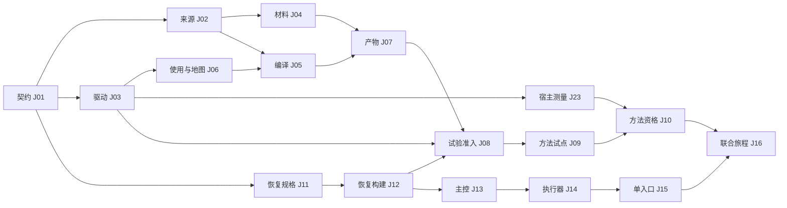

# 分阶段实施、依赖与 PR 计划

本文件的依赖与职责是设计基线；执行阶段以 [联合执行账本](execution-ledger.json) 为当前状态入口。设计冻结当轮没有创建产品分支、实施产品代码、导入看板、发送跨会话消息或创建 PR。`JP-*` 是未来 PR 规划键，不是真实 PR 号。具体任务事实以 work-packages.json 为准；角色是待实施时分配的职责，不代表已委派某个 Agent。

## 1. 开始实施前的共同基线

1. 重新观察 main 与 #271；本版固定来源不会自动随分支移动。main 改变时做原接口与证据影响分析。
2. #271 的设计可以独立评审合入。联合设计引用其固定候选，不能把 Draft 当作主干实现。本目录可独立评审；实际产品接线使用已合并契约，或明确以固定待合并合同为依赖。
3. 当前工作区旧且脏，不从它直接开发控制面。每项实施在 `~/Developer/CodeX/.worktrees/osstack/<task>`，分支 `codex/<task>`；不得创建仓库旁 sibling worktree。
4. 每个运行测试的 OSSTACK_HOME 必须在 `$OSSTACK_SCRATCH_ROOT` 中显式隔离。不得从开发 checkout 打开默认或 reserved home。
5. 本轮的证据、schema 与 fixture 都是设计输入，不能作为 production qualification 的已通过结果。

## 2. 先交付两条最小路径

### P0-A：命名场景 session-answer-receipt

调用者：开发/验证操作者。起点：隔离 home、固定仓库夹具、已存在的合格本地 Session、一个明确问题 Q1；能力不足时 doctor 给出 unsupported，不悄悄换 Provider。

JP-03a 的拟议 driver 有三个首批动作：doctor、drive、observe；cleanup 是明确的资源生命周期操作。doctor 无副作用；drive 只允许 registry 中已声明动作，输入含 task/session/question 与幂等 key；observe 返回现有回执和观察状态。dry-run 不创建 run、Session、DB 或进程。

成功终点：原 host 的回答投递/回复观察可查，应用事实不被清理错误覆盖；资源已清理或有明确保全理由。失败分类：产品断言失败、工具故障、环境缺失、超时/停止未知分别记录。

夹具故意注入“applied 后 cleanup 报错”，用于验证回执保全。这是对 DEBT03 的受控反例要求，本轮没有声称复现真实现网故障。若现有 host 无法驱动该场景，J03 必须报告具体 seam 缺口；不得用全 mock 结果代替真实路径。

### P0-B：pstack 单方法 bug-fix

J01 → J03 → J06；J01 → J02 → J04；J02+J06 → J05；J04+J05 → J07；J01 → J11 → J12；J03+J07+J12 → J08 → J09。每个存储 PR 还必须先通过自己的 schema_spec/recovery 子门槛。

J25 与工具开发同时冻结指标并采集未来基线；JP-03b 补 bug-fix-fixture 的注册 driver，J09 必须复用它。J25.e0 在方法产品接线前给出可行性决定；J25.e1 在 J09 后形成独立结果，不能以整个 J25 作为编译器的前置而形成循环。J09 的第一任务修复可重放的合成故障夹具，明确它不是已有 OSStack bug。必须从同一原表面观察红→绿，另有相邻负例。若选取真实项目缺陷，先保存未经修改的复现与初始提交，换成新的实验登记。

J08 使用精确受限试验许可，正常 admission 完整保留。J09 无需完整自动主控、完整 registry 平台、四种 recipe、动态 Graph 或远端 supervisor。合格生产环境/激活由 J23/J10 后续负责。

## 3. Firstmate 与联合路径

J11 先冻结恢复存储规格；J12 交付目标 schema 恢复构建和真实未知 hold 验收；J13 才落主控/预算存储与 reducer。J14 将 Loop/Graph 的实际执行接到既有授权，J15 完成单入口与有范围路由。该顺序保留原 Firstmate 的 startup、operator、schema 和资格要求。

J16 联合旅程的前置是 J15、J10、J07：目标→方法→执行→Q1 等待→回答继续→候选修复与检查→独立评审→报告。Session 的 observed_turn 与任务的 local_verified 必须分别记录，并通过绑定关系组合展示。不能仅因为 Session 恢复成功就将工程任务置为已验收。

J17/J18 的并行、多候选和新 Graph tuple 属于后续扩展。J21/J22 的远端、公开渠道分别启用，第一版 local 功能不等待所有渠道完成；每个新增支持格都必须补自己的测试与资格。J24 的完整升级治理后续实施，但目标 schema 恢复子集 J11/J12 是主控迁移的前置。

## 4. PR 队列

图仅突出关键路径，完整依赖以机器任务表为准。比如 J14 还依赖 J23 的精确支持组合，不能从简图省略推断免验。

| 首批 PR | 内容 | 可并行关系 | 合并前证据 |
|---|---|---|---|
| 文档整合 PR（单独规划） | 本目录、来源索引与旧报告增量入口 | 可以与 #271 设计评审并行 | 文档验证与固定来源；不宣告产品支持 |
| JP-01 | 共享协议/schema/fixture | 合同先明确 | 正负例、兼容与无隐式权限 |
| JP-02 / JP-03 / JP-11 | 来源、驱动、恢复 schema 规格 | 共享契约后可并行 | 各自独立输入输出和必要检查 |
| JP-04 / JP-06 / JP-12 | 方法材料、使用地图、恢复构建 | 按依赖；共享源文件串行 | 真实边界探针、冷调用、真实 hold |
| JP-05 → JP-07 → JP-08 → JP-09 | 编译、产物、首次试验、方法旅程 | 依赖顺序；不做一个大 PR | 同候选原表面验证和关键反例 |
| JP-13 → JP-14 → JP-15 | 主控、执行器、用户入口 | 与方法路径在契约后并行 | 预算、未知效果、启动/取消/权限 |
| JP-23 / JP-25 | 精确环境测量、早期产品实验 | 可前置准备；证据绑定相应候选 | 逐格支持、固定分母与隐藏判定 |
| JP-10 → JP-16 → JP-32 | 方法资格、联合旅程、四组对照 | 各前置通过后推进 | 组合功能正确且有明确价值结果 |

J17–J22/J24/J28–J31 是保留范围的后续工作，复杂里程碑必须再按 `protocol → host → default journey` 拆小 PR；机器表的 `requires_further_pr_slicing` 明示这一点，不能直接把一整项大型里程碑当作单次编码任务。原 Firstmate 细化合同和工作包继续适用。

每次前置 PR 更新或合入后，重新基于实际 main 构造候选，检查 diff，运行要求的 CI。使用 merge queue 时确认仓库支持及 `merge_group` 触发；否则串行合并并对更新后的后继候选重测。不得复用旧 base 上的 green。

## 5. 写入所有权与并行

- `execution-context`/`graph-execution-context` 的契约与回执由 context-owner 维护。Firstmate C07 与 pstack W05 在这里统一；记忆与方法字段分别分型。
- `engineering-store/ddl` 由 state-owner 持有迁移队列；controller-owner 提交接口需求，不在另一个 session 自行创建同名表。
- `graph-contract-host` 被 J04/J14 使用：两者都推进时前者先合材料接线，后者基于其候选接执行器；J04 被 E0 停止时 J14 按实际 main 独立推进并复核共享路径。可以并行做纯逻辑与测试，装配修改串行。
- 任务表分别保存 depends_on 与 merge_after；J14 在 J04 后、J17 在 J15 后、J19 在 J10 后合入，明确共享文件顺序。校验器检查两种边的组合无环；merge_after 是两者都存在时的顺序，取消前者不构成功能前置。
- `method-admission` 的 J05/J08、`recipe-qualification` 的 J08/J10 已有顺序依赖。
- 跨分支同文件但不同行仍可能冲突；零文本冲突不能代替语义检查。由集成负责人维护组合候选和接口变更日志。
- 后续扩展与既有模块相同职责时，合并原位扩展；任务表路径为建议落点，实施 PR 必须登记实际路径及重新验证。

## 6. 发布、回退与完成

首期只允许显式开发试验；方法 qualified 后才允许支持组合内 opt-in。J27 的 local 发布只评价其声明功能，不能将未启用 remote/channel 标为已支持。后续启用它们要增加相应前置与资格，不修改旧证据范围。

回退触发：重复副作用、错误完成、未授权动作、丢未决事项、不可恢复状态或预算失控。先阻止新自动启动，保留查询、决定、取消与合格恢复路径；取消是否成功仍以停止证明为准。保留旧快照、证据与未决义务，不能强删 DB、锁或未知 Worker。

实现候选运行适当的包测试及仓库要求的 build/typecheck/test、启动预算和相关 smoke。不得把现有 lint 包装脚本退出 0 当作实际 lint 覆盖。没有产品改动的本轮只做文档与 schema 验证。

## 7. 审计收口后的推进门槛

完整阶段图见 execution-gates.json；开放 O01–O06 按 unknowns.json 指定阶段阻断，不能因为 blocked_by 原来为空就跳过。J23 先测原 adapter 能力，J14 接线完成后再测确切组合；J10 还要求 J23.method_context 和 J25.e1。J11/J12 的恢复账本 bootstrap 是 JADR11 限定的例外。J17 拆 broker schema/recovery/storage 三个 PR 子阶段；local_without_broker 的 JADR12 不改变原全量恢复门槛。

新 DB/迁移写入 J08/J12/J13/J17 共用 control_plane_schema 队列。顺序由实际就绪候选决定，每次基于最新 main 重新分配编号、核对谱系并重测；队列不是免除功能依赖。实际 PR diff 必须落入经审查的路径 manifest，变更声明前不得合入。工作包汇总由 integration-owner 单独更新。

复审修订 3 的精确 PR 挂点、逐迁移恢复门槛、local opt-in/default-enable 和原 gate 消费边见 [closeout-specifications.md](closeout-specifications.md)。
