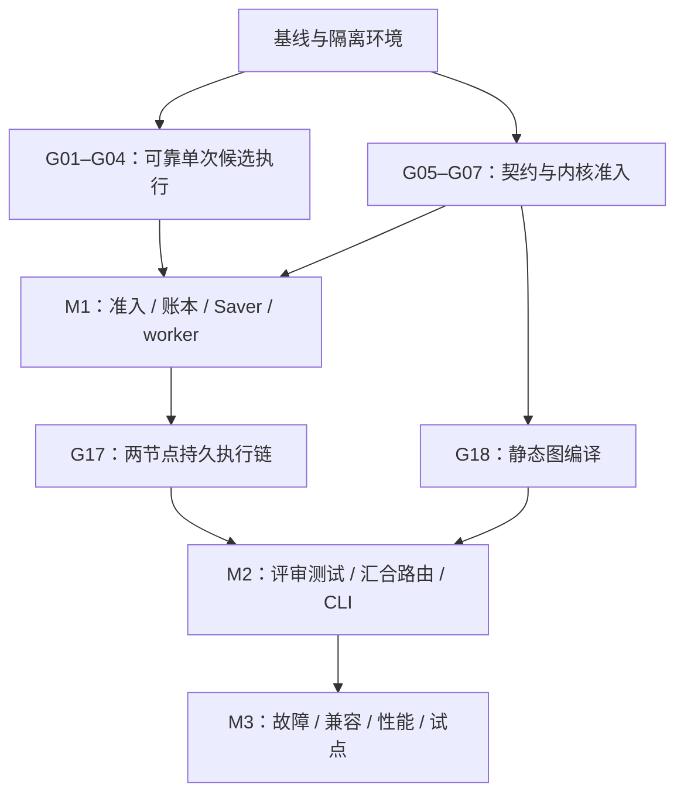

# OSStack 升级改造实施计划：Loop 强化与可执行 Graph v1

日期：2026-09-13；更新：2026-09-18。**状态：G00–G24 已完成，25/30；G25 与 G26 实施中。已新增不支持 executor 的执行前拒绝及动态新图准入开关；真实后端停止证明、公开对账与完整故障/兼容验收尚未完成。** G26 独立实现可提前推进，最终验收仍依赖 G25。

实际实施分支：`codex/graph-runtime-foundation`；工作区：`/Volumes/AIMATE_WORK/Developer/CodeX/osstack-graph-runtime-foundation`。本轮源码提交 `f263062731f678f6835ac76546227fcd85f54b43`；见 [Claude Fable 解阻与准入报告](../reports/graph-admission-unblock-validation.md)和[有限任务接续上下文](2026-09-18-graph-unblock-next-context.md)；历史限定验收保留。

本计划将 [架构设计](../design/2026-09-13-executable-graph-plan.md) 转成可逐项执行的任务，产品边界遵循 [三产品定义](../design/2026-09-13-os-products-definition.md)。OSBot 功能在 [独立 handoff](../handoffs/osbot/handoff.md) 交接；本计划只改造 OSStack，不部署 Rakazo，不修改 OStag 产品。

已完成一次 Claude Fable 5.1 可执行性审查，并修订迁移责任、IPC 客户端、候选冻结和早期取消依赖；见 [审查与处理记录](2026-09-13-upgrade-plan-review/README.md)。这是计划审查，不是运行实现验收。

## 1. 本次升级的完成定义

在单个受管仓库中执行：

**有范围的目标 → 一次实现 → 冻结候选 commit/产物 → 并行独立评审与隔离测试 → 严格汇合 → ready / 最多两轮代码修复 / 分支有限重试 / 明确停止。**

必须能取消、暂停并恢复；重启不丢失已确认结果；未知外部执行不自动重发；撤权后不启动下一动作。ready 只表示有通过质量门的候选包，**不自动 merge、push 或部署**。

Loop 与 Graph 都获得具体提升：Loop 的终态、取消和候选执行接口被修正；Graph 负责外层任务结构与质量门。图模式只调用一次实现迭代，避免完整 Loop 内评审与图评审重复。旧 Loop 模式保持清楚的兼容路径。

## 2. 已核实基线和工程差距

下表描述 `b476bcc` 实施前事实；G00–G24 的已交付变化以任务状态和验收报告为准。

| 位置 | 当前事实 | 升级责任 |
|---|---|---|
| `packages/agents/src/base.ts` | 实际契约为 invoke(task, signal)，没有注释所称的 cancel 方法 | G01–G03 依据实际接口验证 |
| `packages/loop/src/executor.ts` | 默认 completed；无外部 signal；命令超时当前只向子进程发 TERM | G01–G03 补失败与取消语义 |
| `packages/loop/src/loop-engine.ts` | private runTask；cycle 顺序任务且末尾落状态；成功自动 commit/ff-only merge | G04 提炼候选执行；G16 管产物；不用 LOOP-STATE 当 checkpoint |
| `packages/cli/src/daemon.ts` | 已有门控、读写信号量、私有 acquireDaemonRunSlot；一处锁标识来自 context.repo_id | G09–G12 可信规范化并共享准入 |
| `packages/autonomy/src/repo-lock.ts` | 已有跨进程仓库写锁 | 扩展复用，不另起互不识别的图锁 |
| `packages/core/src/state/migrations.ts` | 此次检查最后编号 24 | 新迁移取实施时最新编号，不能长期写死 25 |
| `packages/protocol/package.json` | Zod 3 + JSON Schema 生成；core/loop 也有 Zod 3 | 边界保持 JSON，不将研究用 Zod 4 混成全库升级 |
| `packages/core/package.json` | 已依赖 better-sqlite3 12.x，声明 Node ≥20 | 验证实际 Node 最低 minor 与原生构建 |
| `.github/workflows/ci.yml` | 当前 CI Node 22 | G27 增加有证据的兼容验证 |
| CLI graph | 已有只读 explain | G22 保留已有命令；新增执行能力另走 daemon |

之前的 ADK/LangGraph 10+2 项离线实验只证明被测试的 SDK 行为，不证明本计划任何任务已完成。Node 26 的实验不能代替 Node 20/22 集成验证。

## 3. 锁定的设计决定

1. **产品范围**：内部编程强化；Graph 是 OSStack 模块，不创建 OSGraph 产品。
2. **内核**：先用一个 LangGraph.js 后端；初始候选为研究验证的 1.4.15 及其依赖闭包，G06 已固定 lock；G07 发现 StateGraph partial-abort 汇合恢复缺陷；C2 改用公开 Functional entrypoint/task + sync，通过限定内核准入。静态图仍由确定性编译器生成，详见 [Functional 决策](../design/2026-09-13-graph-functional-runtime.md)。不会自动切换到 latest，也不做多引擎通用层。
3. **进程**：独立 graph worker；daemon 主线程不加载 LangGraph 重入口，包括 checkpoint 服务也不能暗中引入它。
4. **包依赖**：graph → protocol + LangGraph；core → protocol；loop → 既有 core/agents/governance；cli 组装它们。graph 不 import loop/core/cli，动作通过 broker。
5. **图结构**：注册节点和确定性路由，最多三 epoch 静态展开；第一版不接受任意 JS 或无限动态拓扑。
6. **候选结果**：实现步骤只发 implementation_complete；后续 freeze 确认独立 commit + 可恢复产物才发 candidate_ready。review/tests 固定同一 SHA；不由模型自行证明路径/摘要/测试结果。
7. **两类权威**：checkpoint 负责图调度与数据；ledger 负责动作、权限与资源；展示状态为投影。
8. **动作粒度**：v1 账本跟踪受控 adapter invocation、命令、工作区生命周期等动作。未支持逐工具拦截的 adapter，其内部命令不会凭空获得逐工具账本；整个 invocation 结果未知时隔离并对账。
9. **恢复**：intent 先写，confirmed 可复用，unknown 不盲重发；effectKey 不含 generation，logicalAttempt 由 ledger 分配。
10. **权限**：执行时验有效范围与撤销；receipt、checkpoint、模型输出和 resume true 都不能自行授予权限。
11. **发布**：保护分支 merge/自动部署按实际效果登记执行 owner。初期只 artifact_only；保持 OStag 现有发布责任。
12. **外部集成**：只在 OSStack 稳定 v1 契约；OSBot/OStag 自身 connector、UI、部署在各自任务中进行。

## 4. 状态、数据与存储的实施约束

### 4.1 建议新增对象

| 对象 | 必需内容 | 实施任务 |
|---|---|---|
| graph_runs | run/source scope、idempotency、inputDigest、specHash、模板/版本、展示投影、revision | G08 |
| graph worker lease | run、generation、lease owner/expiry、状态、接管历史 | G08/G14 |
| graph_actions | effectKey、slot/attempt、intent、执行引用、confirmed/unknown/取消状态、结果摘要、预算 | G11 |
| graph checkpoints / pending writes | thread namespace、checkpoint/parent、metadata、版本、pending writes、request/generation | G07/G13 |
| graph artifacts / workspace leases | scope、commit、内容摘要、对象引用、资源 owner、generation、保留/回收状态 | G16 |

表名为建议，具体 DDL 随任务设计测试确定。避免将图节点同时写入一套独立可调度的 node FSM，从而与引擎 checkpoint 争夺下一步执行权。

checkpoint 通过受控 Saver RPC 存储。G07 必须确认所有公开方法、编码和 pending-write 语义；不能因为只跑通 put/get 就标完成。**v1 选择控制面同一 SQLite 内的独立 graph_* 表**，由同一迁移负责人按 G08→G11→G13→G16 顺序落 DDL；这是前期设计“同库或专库”选项的具体收敛。daemon 同一 run 的代际检查、写入与切代串行，并用短事务绑定校验与存储。仍不宣称数据库事务覆盖外部 agent/文件系统副作用。将来拆专库需要另外验证故障和性能，不能在本轮随意换存储位置。

### 4.2 稳定动作身份

同一次 API 重投保持 idempotency key；相同 key 不同规范化输入拒绝。动作身份绑定 scope/run/spec/epoch/node/attempt/slot，不含 worker generation。trace、请求时间不进入业务摘要。自动恢复不能通过换 attempt 逃离 unknown。

node 成功是交付合法结果，不代表代码通过。合法测试失败报告可以进入 join 再 repair；输出缺失/格式错误是分支执行问题，共用有限 maxBranchAttempts，不消耗代码修复 epoch。

### 4.3 权限与身份的 v1 范围

首个可用版本以已认证本地 CLI/daemon 和单工作区为实施入口。公司/个人、未来跨产品 caller 的字段保留在协议中，但字段存在不等于已实现联合身份认证。无法验证的 caller 拒绝；不得将任意 remote tenant/principal 默认映射为本地 owner。G24 用模拟身份检验协议，不宣称外部生产接入完成。

## 5. 里程碑与交付检查点

| 里程碑 | 范围 | 可验证产物 | 禁止提前宣称 |
|---|---|---|---|
| M0：基础接缝与内核准入 | G00–G07 | 可靠单次实现、明确取消、契约、公开 Saver 可行性 | 已有持久图集成 |
| M1：最小可恢复纵向链 | G08–G17 | daemon→worker→broker→动作→结果→恢复完整两节点链 | 已支持完整代码交付 |
| M2：工程图产品入口 | G18–G24 | code-delivery-v1 与 validate/run/status/cancel/resume | 已通过所有故障/平台验收 |
| M3：可靠性与内部试点 | G25–G29 | 故障矩阵、兼容/性能、真实授权试点、操作手册 | 未支持的平台或多产品自动部署 |

检查点安排：

- C0：G00–G02 后，终态/取消测试清楚，不把历史失败归咎于新实现。
- C1：G03–G04 后，一次候选实现不合并、不重复评审。
- **C2：限定通过。** 准入 langgraph-functional-v1 + durability:sync 供 M1 集成；StateGraph partial-abort 反例仍保留。42 场景/96 子进程/26 实际强杀及多版本复验见 [C2 验收](2026-09-13-graph-c2-completion.md)。探针 admitted:false 表示实验自身不授权生产；真实生产链仍须 G17/G25 验收。
- C3：G08–G10 后，run 身份、仓库锁和准入可复用。
- C4：G11–G13 后，账本/预算和受控 checkpoint 能解释每个崩溃窗口。
- **C5：限定通过。** G14–G17 的真实两节点链、候选恢复、可信对账与资源释放义务已验收。daemon 重启案例先持久保存已观察到的 worker 停止证据；未观察停止的故障矩阵仍须 G25。见 [C5 报告](2026-09-14-graph-chain-completion.md)。
- C6：G18–G20 后，类型/汇合/路由和失败分类验证。
- C7：G21–G24 后，完整模板与用户入口、外部契约可演示。
- C8：G25–G26 后，故障与旧模式共存验证。
- C9：G27–G29 后，支持的平台、性能和真实内部试点证据齐备。

检查点是验收门，不是自动要求用户每两步确认。按已授权的范围推进；出现新的产品取舍或真实扩大权限时，才向相应责任方提出具体问题。

## 6. 任务总表

任务状态以本文件和机器清单的实际验收记录为准；目前 G00–G21 完成，G22–G29 pending。预计每卡一个 S/M 范围；若实施发现超过一个聚焦会话或约 5 个实质源文件，应拆成后缀任务并更新依赖，不能以表内估计硬塞大型改造。

| ID | 阶段 | 任务 | 依赖 |
|---|---|---|---|
| G00 | M0 | 冻结基线和升级边界 | — |
| G01 | M0 | 校验 adapter 终态事件 | G00 |
| G02 | M0 | 贯通图级取消信号 | G01 |
| G03 | M0 | 确认命令进程退出 | G02 |
| G04 | M0 | 提炼一次候选实现 | G03 |
| G05 | M0 | 定义图边界契约 | G00 |
| G06 | M0 | 建立独立图包入口 | G05 |
| G07 | M0 | 验证公共 Saver 与序列化扩展 | G06 |
| G08 | M1 | 保存图身份和 worker 代际 | G05, G07 |
| G09 | M1 | 统一仓库身份和写者租约 | G00, G05 |
| G10 | M1 | 提炼共享执行准入 | G09, G02 |
| G11 | M1 | 实现动作账本与预算预留 | G08 |
| G12 | M1 | 接通受控动作 broker | G04, G10, G11 |
| G13 | M1 | 实现 daemon 持有的检查点存储 | G07, G08, G11 |
| G14 | M1 | 管理独立 worker 生命周期 | G12, G13 |
| G15 | M1 | 恢复未知动作与暂停点 | G14 |
| G16 | M1 | 冻结并保存可恢复候选产物 | G04, G09, G12, G13 |
| G17 | M1 | 验收第一条可恢复执行链 | G15, G16 |
| G18 | M2 | 编译静态工程图规格 | G05, G06, G07 |
| G19 | M2 | 执行独立评审与隔离测试 | G12, G16, G18, G14 |
| G20 | M2 | 实现严格汇合与有界路由 | G18, G19 |
| G21 | M2 | 组合代码交付 v1 模板 | G17, G20 |
| G22 | M2 | 交付 validate/run/status 命令 | G21 |
| G23 | M2 | 交付 cancel/resume 与授权请求 | G15, G22 |
| G24 | M2 | 稳定外部委托结果契约 | G23 |
| G25 | M3 | 完成故障窗口和并发验收 | G24 |
| G26 | M3 | 验证旧模式与回滚共存 | G25 |
| G27 | M3 | 验证运行时与发行构建 | G26 |
| G28 | M3 | 验证 CLI 与 daemon 性能预算 | G27 |
| G29 | M3 | 交付受控内部试点与操作手册 | G28 |

任务机器可读版本：[升级任务清单](2026-09-13-osstack-graph-upgrade.tasks.json)。下面列出的新文件是拟新增位置，不表示已经存在；验证命令中新增脚本也只有在对应任务实现后才可执行。

## 7. 逐任务执行卡

### G00 · 冻结基线和升级边界

**依赖：** 无。**规模：** S。**状态：** 已完成，见 [验收报告](2026-09-13-graph-foundation-completion.md)。

**预计改动位置：**

- `docs/implementation/graph-baseline.md`
- `scripts/graph-test-env.mjs`
- `scripts/graph-test-env.test.mjs`（实际新增隔离夹具回归）

**验收：**

- [x] 记录 HEAD、用户改动、迁移版本、Node/原生依赖和现有性能；逐卡核实现有文件与命令，历史失败单列。
- [x] 生成显式隔离 OSSTACK_HOME 的测试夹具，拒绝默认和保留 serving home。
- [x] 确认代码交付 v1 为 artifact_only，并登记受管仓库的合并/部署触发边界。

**验证：** 记录 `git status --short` / `git rev-parse HEAD` / `node -v`；在隔离环境运行现有相关包测试与 `node scripts/bench-cli-startup.mjs`，保存基线。

### G01 · 校验 adapter 终态事件

**依赖：** G00。**规模：** S。**状态：** 已完成，见 [验收报告](2026-09-13-graph-foundation-completion.md)。

**预计改动位置：**

- `packages/loop/src/executor.ts`
- `packages/loop/src/executor.test.ts`

**验收：**

- [x] 无 done 且无明确失败的流不能 completed；终态 error 保持失败。
- [x] 冲突终态、终态后非法事件和不合法 done payload 有确定失败分类。
- [x] 正常完成、明确失败及现有用量累计行为保持兼容。

**验证：** `pnpm --filter @osstack/loop exec vitest run src/executor.test.ts src/loop-engine.test.ts`；新增 candidate 测试后同时运行；涉及 agents 时跑对应包测试。

### G02 · 贯通图级取消信号

**依赖：** G01。**规模：** M。**状态：** 已完成，见 [验收报告](2026-09-13-graph-foundation-completion.md)。

**预计改动位置：**

- `packages/loop/src/executor.ts`
- `packages/loop/src/executor.test.ts`
- `packages/agents/src/base.ts`

**验收：**

- [x] LocalExecutorOptions 接收外部 signal，并与内部 timeout 合并且清理 listener。
- [x] 开始前已取消不启动 adapter；运行中取消向真实 invoke(signal) 传递。
- [x] signal 已发出与执行已停止分开记录，晚到 done 不抹掉未确认取消。

**验证：** `pnpm --filter @osstack/loop exec vitest run src/executor.test.ts src/loop-engine.test.ts`；新增 candidate 测试后同时运行；涉及 agents 时跑对应包测试。

### G03 · 确认命令进程退出

**依赖：** G02。**规模：** S。**状态：** 已完成，见 [验收报告](2026-09-13-graph-foundation-completion.md)。

**预计改动位置：**

- `packages/loop/src/executor.ts`
- `packages/loop/src/executor.test.ts`

**验收：**

- [x] 命令超时/取消终止受控进程组，支持 TERM 宽限和必要的 KILL。
- [x] 测试包含子孙进程、忽略 TERM、关闭管道但进程仍存活及晚到退出。
- [x] 不能确认退出时返回明确未确认信息，不伪报 completed/cancelled。

**验证：** `pnpm --filter @osstack/loop exec vitest run src/executor.test.ts src/loop-engine.test.ts`；新增 candidate 测试后同时运行；涉及 agents 时跑对应包测试。

### G04 · 提炼一次候选实现

**依赖：** G03。**规模：** M。**状态：** 已完成，见 [验收报告](2026-09-13-graph-foundation-completion.md)。

**预计改动位置：**

- `packages/loop/src/candidate-execution.ts`
- `packages/loop/src/candidate-execution.test.ts`
- `packages/loop/src/loop-engine.ts`
- `packages/loop/src/index.ts`
- `packages/loop/src/types.ts`（审查后新增结构化未确认停止标记）
- `packages/loop/src/loop-engine.test.ts`（旧 Loop 执行身份与角色回归）

**验收：**

- [x] 新入口只执行一次已授权实现，返回 implementation_complete、执行证据与工作区引用；不 commit，也不等于 candidate_ready 或任务成功。
- [x] 不执行 discovery、archive、cycle 状态写回、内置重复评审、merge 或未登记清理。
- [x] 旧 Loop 通过明确 legacy 路径维持行为，治理/agent 选择和角色约束有回归测试。

**验证：** `pnpm --filter @osstack/loop exec vitest run src/executor.test.ts src/loop-engine.test.ts`；新增 candidate 测试后同时运行；涉及 agents 时跑对应包测试。

### G05 · 定义图边界契约

**依赖：** G00。**规模：** M。**状态：** 已完成；见 [执行证据](graph-kernel-evidence/G05-executor.md) 和 [审查处理](graph-kernel-evidence/review-adjudication.md)。

**预计改动位置：**

- `packages/protocol/src/graph.ts`
- `packages/protocol/src/graph.test.ts`
- `packages/protocol/src/index.ts`
- `packages/protocol/src/generate.ts`
- `packages/protocol/schemas/graph.schema.json`

**验收：**

- [x] 定义 GraphSpec、范围、结果、错误、状态、预算及 WorkerActionRequest/Response，拒绝未知字段及未认证身份。
- [x] canonical inputDigest 排除 trace/time；idempotency 与 expectedRevision 语义固定。
- [x] 保持 protocol 的现有 Zod 3 和 JSON Schema 生成路线，不要求跨进程传 Zod/SDK 实例。

**验证：** `pnpm --filter @osstack/protocol test`；build 后 `pnpm --filter @osstack/protocol generate:schemas` 和 `check:schemas`。

### G06 · 建立独立图包入口

**依赖：** G05。**规模：** M。**状态：** 已完成，见 [执行与验证证据](graph-kernel-evidence/G06-executor.md)。

**预计改动位置：**

- `packages/graph/package.json`
- `packages/graph/tsconfig.json`
- `packages/graph/src/index.ts`
- `packages/graph/src/worker-entry.ts`
- `pnpm-lock.yaml`

**验收：**

- [x] 只引入一套 LangGraph 内核，显式 worker 子入口；轻入口不导入重运行时。
- [x] 固定已研究的包版本后验证依赖闭包，记录 Node 20/22 与原生 SQLite 兼容性。
- [x] graph 不依赖 loop/core/cli；通过 protocol 与受控 RPC 交互，避免反向包依赖。

**验证：** `pnpm --filter @osstack/graph build` 与 `typecheck`；记录根入口/worker 入口分别的模块加载链。

### G07 · 验证公共 Saver 与序列化扩展

**依赖：** G06。**规模：** M。**状态：** 已完成可行性验证（后续 C2 已限定准入 Functional + sync）。

**预计改动位置：**

- `packages/graph/src/checkpoint-codec.ts`
- `packages/graph/src/checkpoint-codec.test.ts`
- `scripts/probe-graph-saver.mjs`
- `docs/implementation/graph-saver-decision.md`

**验收：**

- [x] 覆盖 getTuple/list/put/putWrites 的完整字段、parent config、版本、pending writes 和错误通道。
- [x] 纯 JSON/受限字节编码不依赖引擎私有类；在独立临时进程验证持久恢复与 pending-write 语义。
- [x] 记录公开接口能否满足需求；失败须给最小反例和替代评估，禁止靠修改引擎内部掩盖。

**验证：** `pnpm --filter @osstack/graph test`；运行新 `node scripts/probe-graph-saver.mjs`，必须在显式临时目录跨进程验证。

**验收限定：** 公共 Saver、受限编码与跨进程恢复实验已交付；完整兄弟节点恢复成功，部分写入后中止可漏掉 join。本卡保留原始反例；后续 C2 已验证替代 Functional 执行模型并独立限定准入，见 C2 验收报告；不表示 StateGraph 缺陷修复。

### G08 · 保存图身份和 worker 代际

**依赖：** G05, G07。**规模：** M。**状态：** 已完成，见 [C3 验收](2026-09-14-graph-admission-completion.md)。

**预计改动位置：**

- `packages/core/src/state/migrations.ts`
- `packages/core/src/state/graph-runs.ts`
- `packages/core/src/state/graph-runs.test.ts`
- `packages/core/src/state/db.test.ts`

**验收：**

- [x] 新增 graph run、请求摘要、scope、spec/version、lease/generation 和引用索引，迁移使用实施时最新编号。
- [x] 同请求同内容返回原 run，不同内容拒绝；CAS/唯一约束覆盖并发与陈旧版本。
- [x] 全新 DB、旧版夹具升级、重复打开和未来版本拒绝行为明确。

- [x] 保存不可变 spec/input digest、executionModel、engine/checkpoint/template/registry/compiler/schema 版本及 compiledProgramDigest；恢复前拒绝程序身份和固定调用顺序不匹配。

**验证：** `pnpm --filter @osstack/core test`；迁移/状态测试只使用临时数据库夹具。

### G09 · 统一仓库身份和写者租约

**依赖：** G00, G05。**规模：** M。**状态：** 已完成，见 [C3 验收](2026-09-14-graph-admission-completion.md)。

**预计改动位置：**

- `packages/core/src/graph/repository-scope.ts`
- `packages/core/src/graph/repository-scope.test.ts`
- `packages/autonomy/src/repo-lock.ts`
- `packages/autonomy/src/repo-lock.test.ts`

**验收：**

- [x] 从可信注册/实际 git common dir 规范化仓库身份，拒绝 caller 伪造/遗漏标识绕锁。
- [x] 不同 worktree 的共享 git 元数据操作遵守同一锁范围；无锁标识的受管写操作拒绝。
- [x] 租约续期、释放、过期与跨进程竞争有可观察结果，不以纯内存 semaphore 当完整保护。

**验证：** `pnpm --filter @osstack/autonomy test`；`pnpm --filter @osstack/core test` 中仓库身份夹具覆盖同仓多 worktree。

### G10 · 提炼共享执行准入

**依赖：** G09, G02。**规模：** M。**状态：** 已完成，见 [C3 验收](2026-09-14-graph-admission-completion.md)。

**预计改动位置：**

- `packages/cli/src/governed-execution.ts`
- `packages/cli/src/governed-execution.test.ts`
- `packages/cli/src/daemon.ts`
- `packages/loop/src/policy-gate.ts`
- `packages/loop/src/policy-gate.test.ts`

**验收：**

- [x] 迁移 daemon 私有门控为共享服务，保留健康检查、scope、grant、预算和锁顺序。
- [x] graph/daemon 直接执行/受管 Loop 使用同一准入；不能接入的旧写路径在受管冲突时明确拒绝。
- [x] 身份来自可信本地连接/已验证委托；worker 传来的 tenant/principal 不自授权限。

**验证：** `pnpm --filter @osstack/cli exec vitest run src/governed-execution.test.ts src/daemon-policy-gate.test.ts src/daemon-loop.test.ts`；并跑 Loop policy-gate 测试。

### G11 · 实现动作账本与预算预留

**依赖：** G08。**规模：** M。**状态：** 已完成；见 [C4 验收](2026-09-14-graph-effects-completion.md)。

**预计改动位置：**

- `packages/core/src/state/migrations.ts`
- `packages/core/src/state/graph-actions.ts`
- `packages/core/src/state/graph-actions.test.ts`

**验收：**

- [x] intent 先落库，逻辑 attempt 仅由 ledger 分配，effectKey 不含 worker generation。
- [x] 同一 key 结果确认唯一；pending/unknown/cancel_pending 禁止凭新 attempt 绕过。
- [x] 预留、确认、失败和未知用量原子计数；图/分支/epoch/动作预算共享权威。

**验证：** `pnpm --filter @osstack/core test`；迁移/状态测试只使用临时数据库夹具。

### G12 · 接通受控动作 broker

**依赖：** G04, G10, G11。**规模：** M。**状态：** 已完成；见 [C4 验收](2026-09-14-graph-effects-completion.md)。

**预计改动位置：**

- `packages/cli/src/graph-action-broker.ts`
- `packages/cli/src/graph-action-broker.test.ts`
- `packages/cli/src/daemon.ts`
- `packages/protocol/src/graph.ts`

**验收：**

- [x] 节点调用受控实现/命令/工作区操作，confirmed 重放返回旧结果，不再 invoke。
- [x] 每次实际动作重新检查当前授权与代际；过期、撤销、scope 扩张返回结构化原因。
- [x] 账本粒度明确为受控 invocation/command 等，不伪称已逐工具截获所有 agent 内部副作用。

**验证：** `pnpm --filter @osstack/cli exec vitest run src/graph-action-broker.test.ts`，配合 core graph-actions 测试和 fake adapter 调用计数。

### G13 · 实现 daemon 持有的检查点存储

**依赖：** G07, G08, G11。**规模：** M。**状态：** 已完成；见 [C4 验收](2026-09-14-graph-effects-completion.md)。

**预计改动位置：**

- `packages/core/src/state/graph-checkpoints.ts`
- `packages/core/src/state/graph-checkpoints.test.ts`
- `packages/graph/src/remote-checkpointer.ts`
- `packages/graph/src/remote-checkpointer.test.ts`
- `packages/core/src/state/migrations.ts`

**验收：**

- [x] 存储协议保留 G07 验证的全部语义；daemon 不导入 LangGraph 重入口或执行任意反序列化代码。
- [x] put/putWrites 均校验 scope/generation，幂等缓存先检查代际；同 run 串行写入和切代。
- [x] v1 checkpoints/pending writes 与 run/action 同属控制面 SQLite，由同一迁移负责人建表；短事务绑定代际检查与写入，重启先核对 lease。

- [x] 覆盖 Functional task RETURN、工作流结束批次、错误和 resume 值；保持 codec/整批写入/fencing，不能把测试 JournalSaver 当生产实现。

- [x] sync 模式下必须等待 daemon 持久事务提交后确认写入；延迟 RPC/失败/崩溃验证不能由同步文件夹具代替。

**验证：** 分别跑 core `graph-checkpoints.test.ts` 与 graph `remote-checkpointer.test.ts`；fixture 必须包括 pending writes 和陈旧 generation。

### G14 · 管理独立 worker 生命周期

**依赖：** G12, G13。**规模：** M。**状态：** 已完成，C5 通过。

**预计改动位置：**

- `packages/cli/src/graph-worker-manager.ts`
- `packages/cli/src/graph-worker-manager.test.ts`
- `packages/graph/src/worker-entry.ts`
- `packages/graph/src/worker-entry.test.ts`

**验收：**

- [x] worker-entry 实现 protocol 动作请求/响应的 IPC 客户端，供节点注入调用；run/generation 绑定、日志隔离、帧限长、背压明确。
- [x] 每 run 单有效 worker；daemon 内部取消经 worker/broker 传至 executor，超时转待确认；心跳/接管禁止陈旧 checkpoint 和动作。
- [x] worker 不持控制面 DB 写通路，启动不阻塞 daemon 主事件循环。

- [x] invoke abort 拒绝不等于停止：停止新动作后确认 worker 退出才可接管；独立 agent/命令仍由 broker 取消与对账，旧代写入拒绝。

- [x] v1 固定 executionModel=langgraph-functional-v1 与 durability=sync；恢复前验证不可变程序/input 身份，拒绝 async/exit 或身份不符。

**验证：** 分别跑 cli `graph-worker-manager.test.ts` 与 graph `worker-entry.test.ts`；实际创建实验子进程，检查 IPC/退出行为。

**实现记录：** 以 [C5 报告](2026-09-14-graph-chain-completion.md)和机器清单中的后缀步骤/实际文件为准；同批五个源码提交，验收源 `50133c0eec518add33f556bfa95b746de350cc35`。

### G15 · 恢复未知动作与暂停点

**依赖：** G14。**规模：** M。**状态：** 已完成，C5 通过。

**预计改动位置：**

- `packages/cli/src/graph-reconciler.ts`
- `packages/cli/src/graph-reconciler.test.ts`
- `packages/core/src/state/graph-actions.ts`
- `packages/core/src/state/graph-actions.test.ts`

**验收：**

- [x] 覆盖 intent/effect/result/checkpoint 窗口；unknown 不盲重发，confirmed 返回同一证据。
- [x] 对账请求有稳定 interruptId/动作引用；有证据的已生效、未生效和仍未知裁定有不同出口。
- [x] cancelled 终态不能 resume 复活；恢复每个新动作前重新检查权限和资源。

**验证：** cli `graph-reconciler.test.ts` + core `graph-actions.test.ts`；确认无自动重发的外部动作日志。

**实现记录：** 以 [C5 报告](2026-09-14-graph-chain-completion.md)和机器清单中的后缀步骤/实际文件为准；同批五个源码提交，验收源 `50133c0eec518add33f556bfa95b746de350cc35`。

### G16 · 冻结并保存可恢复候选产物

**依赖：** G04, G09, G12, G13。**规模：** M。**状态：** 已完成，C5 通过。

**预计改动位置：**

- `packages/core/src/graph/artifact-store.ts`
- `packages/core/src/graph/artifact-store.test.ts`
- `packages/agents/src/worktree.ts`
- `packages/agents/src/worktree.test.ts`
- `packages/core/src/state/migrations.ts`

**验收：**

- [x] 只有本卡的 freeze 服务发 candidate_ready：可信 commit 与产物先持久化；清理原 worktree 后可重建并核对 tree，覆盖二进制/删除/文件模式。
- [x] 旧进程未确认退出时隔离旧工作区；新写动作不复用其目录。
- [x] 成功/失败保留与 GC 独立，活进程或未导出结果不被 finally/前缀扫描误删。

**验证：** core `artifact-store.test.ts` + agents `worktree.test.ts`；用临时 git 仓库验证 commit/产物/GC。

**实现记录：** 以 [C5 报告](2026-09-14-graph-chain-completion.md)和机器清单中的后缀步骤/实际文件为准；同批五个源码提交，验收源 `50133c0eec518add33f556bfa95b746de350cc35`。

### G17 · 验收第一条可恢复执行链

**依赖：** G15, G16。**规模：** M。**状态：** 已完成，C5 通过。

**预计改动位置：**

- `packages/cli/src/graph-chain.integration.test.ts`
- `packages/cli/src/graph-runtime.ts`
- `scripts/fixtures/graph-chain-host.ts`
- `packages/cli/src/daemon.ts`

**验收：**

- [x] 通过 daemon→worker IPC action client→broker→一次命令→持久结果贯穿两节点链；内部取消可停止后续节点并核对进程退出。
- [x] 随机故障之外确定性击中三个落库窗口，重启后检查外部日志与账本。
- [x] 仅实验/测试开启，不公开真实仓库写入；不能用 MemorySaver 替代集成持久化。

- [x] 用真实 daemon/worker/broker 接口重跑 C2 的已确认效果到 RETURN、最终 checkpoint、恢复再次崩溃及不响应取消窗口。

**验证：** `pnpm --filter @osstack/cli exec vitest run src/graph-chain.integration.test.ts`；fixture 必须启动 daemon/worker，显式临时 OSSTACK_HOME。

**实现记录：** 以 [C5 报告](2026-09-14-graph-chain-completion.md)和机器清单中的后缀步骤/实际文件为准；同批五个源码提交，验收源 `50133c0eec518add33f556bfa95b746de350cc35`。

### G18 · 编译静态工程图规格

**依赖：** G05, G06, G07。**规模：** M。**状态：** 已完成，C6 通过，见 [验收报告](2026-09-14-graph-verification-completion.md)。

**预计改动位置：**

- `packages/graph/src/spec-compiler.ts`
- `packages/graph/src/spec-compiler.test.ts`
- `packages/graph/src/registry.ts`
- `packages/graph/src/registry.test.ts`

**验收：**

- [x] 仅注册节点/schema/路由；拒绝任意 JS、不可达依赖、缺输入及未授权工具。
- [x] 最多三 epoch 静态展开，计算最坏动作预算并拒绝不可能满足的规格。
- [x] 图、节点注册表和 schema 版本固定，输入映射类型与输出存在性运行时校验。

- [x] 编译目标采用公开 entrypoint/task；固定 task 名称、顺序、输入映射及有限重试展开，生成 compiledProgramDigest；编排函数无 I/O/随机/时钟依赖。

**验证：** `pnpm --filter @osstack/graph test`；增加可观察的分支调用计数、版本与预算断言。

### G19 · 执行独立评审与隔离测试

**依赖：** G12, G16, G18, G14。**规模：** M。**状态：** 已完成，C6 通过，见 [验收报告](2026-09-14-graph-verification-completion.md)。

**预计改动位置：**

- `packages/graph/src/nodes/review.ts`
- `packages/graph/src/nodes/review.test.ts`
- `packages/graph/src/nodes/tests.ts`
- `packages/graph/src/nodes/tests.test.ts`

**验收：**

- [x] review/tests 基于同一 candidate SHA 的独立工作区，评审身份满足独立性约束。
- [x] 测试命令来自允许的验收规格，真实收据含退出状态和报告摘要。
- [x] 合法代码失败与输出格式/基础设施错误分开；后二者不消耗代码修复 epoch。

**验证：** `pnpm --filter @osstack/graph test`；增加可观察的分支调用计数、版本与预算断言。

### G20 · 实现严格汇合与有界路由

**依赖：** G18, G19。**规模：** M。**状态：** 已完成，C6 通过，见 [验收报告](2026-09-14-graph-verification-completion.md)。

**预计改动位置：**

- `packages/graph/src/join.ts`
- `packages/graph/src/join.test.ts`
- `packages/graph/src/route.ts`
- `packages/graph/src/route.test.ts`

**验收：**

- [x] 按 run/spec/epoch/candidate 绑定两个必需前驱，拒绝旧轮、空输出和跨 scope 结果。
- [x] 节点成功产出合法失败报告可进入 join 再 repair；failed/skipped 分支不制造永久等待。
- [x] 分支 retry 共用有限 attempt，代码 repair 最多两轮；达到任一预算停止新动作。

**验证：** `pnpm --filter @osstack/graph test`；增加可观察的分支调用计数、版本与预算断言。

### G21 · 组合代码交付 v1 模板

**依赖：** G17, G20。**规模：** M。**状态：** 已完成。

**实际改动：** 完整编排跨 19 个文件，详见准入记录的 sourceHashes；以下是最初预计位置。按实施规模拆为 G21a（轮次/注册，依赖 G17/G20）、G21b（模板/host/回执，依赖 G21a）、G21c（集成/反例/验收，依赖 G21b）；三项已完成，G22 仍依赖聚合任务 G21。

**最初预计位置：**

- `packages/graph/src/templates/code-delivery-v1.ts`
- `packages/graph/src/templates/code-delivery-v1.test.ts`
- `packages/cli/src/graph-delivery.integration.test.ts`

**验收：**

- [x] 实现→freeze→并行 review/tests→join→ready/repair/stop 全路径真实可执行。
- [x] ready 只交付候选包；无隐式 merge/push/deploy，无 task FSM 自动完成。
- [x] 覆盖直接成功、修复后成功、分支错误、预算停止和不同先后顺序，只有一个质量门 owner。

**验证：** graph 模板测试 + cli `graph-delivery.integration.test.ts`；真实临时仓库和确定性 fake model/命令。

**验收记录：** 源 `ab988b32649c9eef084e997bb92d31c0108436fc`；真实 Loop 全库 3201 项测试与 6 个 verifier 通过。Claude 两轮审查后的修复与额度限制详见 [G21 报告](2026-09-15-graph-delivery-completion.md)。

### G22 · 交付 validate/run/status 命令

**依赖：** G21。**规模：** M。**状态：** 已完成（C7 本地限定准入）。

**预计改动位置：**

- `packages/cli/src/graph-command.ts`
- `packages/cli/src/graph-command.test.ts`
- `packages/cli/src/graph-rpc.ts`
- `packages/cli/src/bin.ts`
- `packages/cli/src/graph-rpc.test.ts`

**验收：**

- [x] validate 离线且不打开控制面 DB；run 经 daemon，status 为权威结果投影。
- [x] 保留 graph explain，支持稳定 JSON、run id、阶段、候选版本、预算和错误。
- [x] 幂等重投和不同 payload 冲突从用户入口可验证；重依赖不进入 help/version eager 路径。

**验证：** `pnpm --filter @osstack/cli exec vitest run src/graph-command.test.ts src/graph-rpc.test.ts`；旧 explain 测试保留。

**验收记录：** 源 `7da1be9ef70770bbdea5c52f6453764f6b4ba317`；真实 Loop 全库 3236 项测试、六项 verifier 和独立复审通过。详见 [G22–G24 报告](2026-09-15-graph-public-completion.md)。

### G23 · 交付 cancel/resume 与授权请求

**依赖：** G15, G22。**规模：** M。**状态：** 已完成（C7 本地限定准入）。

**预计改动位置：**

- `packages/cli/src/graph-command.ts`
- `packages/cli/src/graph-command.test.ts`
- `packages/cli/src/graph-rpc.ts`
- `packages/cli/src/graph-rpc.test.ts`

**验收：**

- [x] CLI/RPC 暴露 M1 已验证的取消链，区分请求/确认；过程超时进入 cancel_pending/reconciliation_required，不在此卡补造底层取消。
- [x] resume 绑定 interruptId、expectedRevision、scope 和当前授权；过期/跨域/旧输入拒绝。
- [x] needs_authorization 回原授权域，布尔输入/模型说 approved 不能作为 grant。

**验证：** `pnpm --filter @osstack/cli exec vitest run src/graph-command.test.ts src/graph-rpc.test.ts`；旧 explain 测试保留。

**验收记录：** 源 `7da1be9ef70770bbdea5c52f6453764f6b4ba317`；真实 Loop 全库 3236 项测试、六项 verifier 和独立复审通过。详见 [G22–G24 报告](2026-09-15-graph-public-completion.md)。

### G24 · 稳定外部委托结果契约

**依赖：** G23。**规模：** M。**状态：** 已完成（C7 本地限定准入）。

**预计改动位置：**

- `packages/protocol/src/graph.ts`
- `packages/protocol/src/graph.test.ts`
- `packages/cli/src/graph-rpc.test.ts`
- `docs/guides/graph-delegation.md`

**验收：**

- [x] 冻结 submit/status/cancel/result 的 v1 行为，保留父子引用、业务 inputDigest 和 delivery_unknown。
- [x] 用模拟 OStag/OSBot caller 验证重复请求、来源隔离及结果引用；未支持身份的远程 caller 明确拒绝。
- [x] 只交付 OSStack 服务契约，不在本任务实现 Rakazo connector、OStag UI 或新公网 API。

**验证：** protocol 测试与 schema freshness；cli graph RPC caller 契约测试；不调用真实 OStag/OSBot。

**验收记录：** 源 `7da1be9ef70770bbdea5c52f6453764f6b4ba317`；真实 Loop 全库 3236 项测试、六项 verifier 和独立复审通过。详见 [G22–G24 报告](2026-09-15-graph-public-completion.md)。

### G25 · 完成故障窗口和并发验收

**依赖：** G24。**规模：** M。**状态：** 实施中（进程诊断与并发基础；完整 G25 未验收）。

**预计改动位置：**

- `packages/cli/src/graph-faults.integration.test.ts`
- `packages/cli/src/graph-concurrency.integration.test.ts`
- `scripts/verify-graph-runtime.mjs`
- `docs/reports/graph-runtime-fault-validation.md`

**验收：**

- [ ] 逐项覆盖 F01–F12 确定性窗口，再做固定 seed 的重复运行。
- [ ] 旧 worker checkpoint/action 被拒，旧子进程写旧目录不污染新 candidate。
- [ ] 撤权、同 key 并发、pending writes 丢失与 cancel race 有可复核日志；不承诺外部物理恰好一次。

- [ ] 覆盖已确认外部效果与缓存 RETURN 的不同崩溃边界，区分函数重入次数、确认效果次数和逻辑 join 次数；错误程序身份不得恢复。

- [ ] 补齐 daemon 在未观察 worker 退出时崩溃的持久 PID/PGID/启动标识与独立执行器证明；覆盖已消耗启动权后注册失败、PID 重用和 artifact 临时锁残留，不以超时或租约过期推断可接管。

**验证：** 新 `node scripts/verify-graph-runtime.mjs` 与 graph fault/concurrency 集成测试，输出 JSON 证据和固定 seed。

**阶段进展：** 已实现 host-only 全量动作停止检查和精确 contained 清理，含 released 只读与异步边界复验。Kimi K3 和真实 Loop 限定验收通过。报告不授权恢复；非容器执行器、workspace/未登记后代/无动作中间代证明、G15 对账释放及 artifact 锁仍待完成。见 [最新报告](../reports/graph-quiescence-sweep-validation.md)与[接续上下文](2026-09-18-graph-binding-next-context.md)。

**2026-09-18 解阻：** Claude CLI Fable 5.1 确认真实 adapter 缺少停止确认、公开对账入口缺失。本轮 G25-A 执行前支持检查落地；其余按 G25-B（真实后端范围与停止）、G25-C（公开对账）、G25-D（原故障矩阵）推进，禁止把未完成物理证明改成已完成。详见[切片验收条件](2026-09-18-graph-unblock-next-context.md)。

### G26 · 验证旧模式与回滚共存

**验收依赖：** G25。**规模：** M。**状态：** 实施中；G26-A 新图准入开关已实现。可提前实施独立兼容工作，关闭父卡仍须 G25 及本卡全部验收。

**预计改动位置：**

- `packages/cli/src/daemon-loop.test.ts`
- `packages/cli/src/session-rpc.test.ts`
- `packages/loop/src/loop-engine.test.ts`
- `packages/cli/src/graph-compatibility.integration.test.ts`

**验收：**

- [ ] 旧 Loop/session/graph explain 语义回归通过，受管模式统一仓库租约，无第二条绕行 writer。
- [ ] 关闭新图准入后仍可查、取消、对账旧 run；不能靠删除 DB 实现回滚。
- [ ] 旧 checkpoint 不兼容时明确拒绝；备份恢复不会忽略尚存外部动作和未知结果。

**验证：** 相关旧 Loop/session/daemon 测试和新 graph compatibility 集成测试；禁止默认控制面 DB。

### G27 · 验证运行时与发行构建

**依赖：** G26。**规模：** M。**状态：** 未开始。

**预计改动位置：**

- `.github/workflows/ci.yml`
- `scripts/build-single-binary.mjs`
- `scripts/verify-graph-runtime.mjs`
- `docs/implementation/graph-runtime-compatibility.md`

**验收：**

- [ ] 验证声明支持的 Node 20 范围与现有 CI Node 22，确认实际最低 minor 而非只看包标签。
- [ ] 原生 SQLite、worker 入口解析、协议 schema、新包依赖和单文件分发路径有验证记录。
- [ ] 若某分发形式暂不支持 graph，明确拒绝且保留旧功能；不静默改成 daemon 内嵌执行。

- [ ] 核验旧版本或外部锁获取路径不会回收仍有未知 graph 动作的保留锁；验证 full-history bundle 的仓库格式与大小边界。

**验证：** `pnpm build`、`pnpm typecheck`、`pnpm test`、protocol `check:schemas`，按现有发行脚本验证包含 worker 的构建；只用临时打包产物。

### G28 · 验证 CLI 与 daemon 性能预算

**依赖：** G27。**规模：** M。**状态：** 未开始。

**预计改动位置：**

- `scripts/bench-cli-startup.mjs`
- `packages/cli/src/daemon-rpc-latency.test.ts`
- `scripts/bench-graph-runtime.mjs`
- `docs/reports/graph-runtime-performance.md`

**验收：**

- [ ] version/help 继续满足既有预算，graph 首次启动不把重模块求值放在 daemon 主线程。
- [ ] 同时测非图 RPC p95、worker 启动、checkpoint/broker 开销，区分冷启动与热缓存。
- [ ] Loop tick 开销预算与原有行为不回退；真实性能失败先修，不能只放宽阈值。

- [ ] 在事件循环阻塞与并行负载下验证 heartbeat、停止及 checkpoint 开销；区分保守超时和真正停止证明。

**验证：** `node scripts/bench-cli-startup.mjs` + 新 `node scripts/bench-graph-runtime.mjs` + 既有 RPC 测试；按本地/CI 原预算分别验收。

### G29 · 交付受控内部试点与操作手册

**依赖：** G28。**规模：** M。**状态：** 未开始。

**预计改动位置：**

- `docs/guides/graph-runtime.md`
- `docs/runbooks/graph-runtime.md`
- `docs/reports/graph-runtime-pilot.md`
- `docs/implementation/2026-09-13-osstack-graph-upgrade.tasks.json`

**验收：**

- [ ] 在明确授权的单仓库任务中验证一条真实交付图，留下 candidate/评审/测试/停止与成本证据。
- [ ] 记录功能开关、迁移备份、启动、对账、取消、回收和禁用新准入的操作步骤。
- [ ] 全部发布门槛有证据后才标 beta 可用；未验证项保持未完成，默认不自动 merge 或部署。

**验证：** 运行 G29 操作手册中的已授权试点；关联 G25/G27/G28 证据。不得以本次历史离线探针替代。

## 8. 依赖、分支和交接纪律

- G00–G24 与 C2–C7 已完成本地限定准入；下一批按有限切片推进 G25-B/C/D，并继续 G26-B 兼容准备。
- G08、G09 在约束明确后可分别处理。G10–G17 涉及 daemon/核心存储，按依赖串行整合，避免多个任务同时改 migrations.ts 或 daemon.ts；DDL 严格按 G08→G11→G13→G16 单负责人推进。
- M1 的真实 broker/产物接口已通过 C5，G18–G20 已通过 C6；G21 已补齐动态 host 注册、完整模板和 epoch 推进；G22–G24 已交付用户入口与外部契约；继续 G25 故障验收。
- G22/G23 共用 graph-command 和 RPC；G25/G26 故障验证依赖完整业务路径，不提前用 stub 结果充数。
- 真正并行时，每人只处理一个有明确文件边界的任务。此计划的依赖图不代表本次已经启动 agent 或其他 session。

工作流建议：从经确认的基线新建 `codex/graph-runtime-foundation` 工作分支或 worktree；后续按里程碑衔接，不提前从不存在的未来分支创建工作。开始实施前重新核对主分支差异和已存在的用户改动，不 stash/reset 或覆盖它们。

当前 `AGENTS.md` 是用户修改；此前研究/产品文档尚有未跟踪文件。记录并保护这些内容。新 worktree 不会自动带上未跟踪计划，因此应先把计划和上下文安全纳入实现工作区，不能读到缺文件就重新猜设计。

每张卡交接记录：实现 commit、改动摘要、实际测试命令/结果、关键失败证据、剩余问题、下一卡依赖。机器清单状态只在证据存在后更新。生成 schema 和 migrations 为单一负责人串行整合；绝不预占同一个迁移编号。

## 9. 故障矩阵：G25 的最少覆盖

| 编号 | 注入点 | 必须观察到的结果 |
|---|---|---|
| F01 | 无 done、冲突终态、abort 后迟到成功 | 不能形成合法成功候选 |
| F02 | intent 已落、执行是否发出不明 | 对账/unknown，不未经证据重发 |
| F03 | 外部动作完成、ledger 未确认 | 不宣称物理恰好一次，保留足够核对引用 |
| F04 | ledger confirmed、checkpoint 未写 | 重放返回原结果，不启动第二次动作 |
| F05 | 并行 pending writes 尚未完整 checkpoint，含输出已写但 barrier 未写 | 已持久 RETURN 的任务不重入；仅效果确认时可重入查询账本，逻辑 join 效果一次；部分任务不得误判完成。G07 的 StateGraph 反例保留，C2 已通过 Functional + sync 替代模型；生产链在 G17/G25 重跑 |
| F06 | 旧 worker 在切代后 put/putWrites/action | 三条路径均拒绝；不能命中旧成功缓存绕过 |
| F07 | 旧子进程继续写旧 worktree | 新代候选不污染；旧目录隔离保留 |
| F08 | 运行中撤权、过期、跨 scope resume | 下一新动作不启动，授权请求定位正确 |
| F09 | 同 key 并发/同 key 不同输入/恢复换新 attempt | 前两者去重或冲突；unknown 不因换号绕过 |
| F10 | 评审/测试先后顺序、旧 epoch 迟到、schema 错误 | join 一次且同版本；业务失败与格式失败分路 |
| F11 | cancel/timeout/进程忽略 TERM/晚到 done | 区分 cancel_pending、已确认退出和 terminal，资源不误删 |
| F12 | 旧 checkpoint、功能禁用、DB 恢复与仍在运行外部动作 | 兼容处理明确，仍能对账；不得重新执行未知副作用 |

每个确定性窗口有稳定测试，再补固定 seed 的多轮 kill/并发。重复次数是覆盖补充，不替代故障位置定义。不得只比较最终 UI status，还要核对实际文件/进程/调用计数与账本。

## 10. 测试、性能和兼容门槛

每张卡运行针对性测试。涉及共享协议/core 接缝时跑受影响包；PR 前按项目规则运行 `pnpm test`。发布候选运行 `pnpm build`、`pnpm typecheck`、schema freshness 和必要发行检查。通过后不无理由反复全量跑；有新改动、失败或未解疑点才扩大验证。

| 指标 | 既有门槛 |
|---|---|
| CLI --version | <150 ms 本地 /250 ms CI |
| CLI 完整 --help | <500 ms 本地 /900 ms CI |
| 非流式本地 daemon RPC | p95 <10 ms |
| Loop tick | <会话墙钟 1% |

graph worker 启动、冷/热执行、checkpoint/IPC 和并行工作区准备成本单独展示，不隐藏在 CLI/daemon 延迟中。任一入口新增重依赖先按项目要求测加载成本，超过约 20 ms 且非全命令必需则隔离到使用点或 worker。

运行时验收包括当前声明的 Node 20 与 CI Node 22，记录实际最低 minor；不能在新需求中顺手抬高全库 engines 掩盖兼容失败。单文件发行若暂未支持 worker，必须明确限定内部 beta 的安装形式，并阻止该形式误启功能；不能标“所有现有发行形式均支持”。

## 11. 灰度、迁移和回滚

建议新增 `OSSTACK_GRAPH_ENABLED` 作为运行准入开关（拟新增，当前不存在），默认关闭。离线 validate 与已有 explain 不需要开启；run 必须同时满足开关、有效授权、范围、健康与预算。功能开关不是写权限。

灰度顺序：确定性临时仓库 → 已授权单仓库真实任务 → 小范围内部 beta。配置与 schema 升级不是同一件事：新增表的迁移可随 daemon 版本发生，即使图准入关闭，也必须走正常迁移备份流程。

回滚优先**关闭新图准入，保留当前兼容 daemon 的查询、取消和对账能力**。对正在运行的动作 drain/确认停止；保留 checkpoint、ledger、artifact 与资源标识。不得删除新表或仅恢复旧 DB 来“撤销”已发生的外部效果。

降级到旧二进制只能在 schema/checkpoint 兼容有证据、所有活跃/未知动作已处置后进行。恢复历史备份必须同时核对真实外部执行状态，避免数据库回到“尚未执行”而外部动作实际已生效。开发测试禁止使用默认或保留 serving home；不要从 checkout 运行 CLI 指向现用 DB。

## 12. 实施期间的决策门

| 未知项 | 验证任务 | 不满足时的行动 |
|---|---|---|
| 公共 Saver 是否完整支持所需持久语义 | G07/G13 | 记录最小反例，评估 ADK 或有限静态调度器；不无限加内部 monkey patch |
| adapter 是否可确认停止 | G02/G03/G15 | 能力分级，不能确认则对账/隔离，不支持该 adapter 的自动恢复写任务 |
| 非 daemon 旧 Loop 是否能共用写者租约 | G09/G10/G26 | 接入共享服务或显式拒绝受管并发；不能只保护新图路径 |
| native/Node/单文件发行是否兼容 | G06/G27 | 明确支持矩阵；不暗改语言或运行时地板 |
| 初始化/存储是否阻塞 RPC | G13/G14/G28 | 调整存储/IPC边界并复测，不放宽既有预算 |
| 实际并行是否值得准备独立 worktree | G19/G28/G29 | 测量真实成本，允许减少并行；不牺牲证据版本和隔离 |

## 13. 下一轮实施的明确起点

G00–G24 已完成，**25/30；M0–M2 完成，M3 实施中**。G25 单容器证明、G15同步复核及binding读取边界限定阶段已验收；按 [最新上下文](2026-09-18-graph-binding-next-context.md) 继续独立 host/adapter/workspace 证明及 G15 对账释放，随后完成 artifact 锁、兼容、发行、性能与试点。
