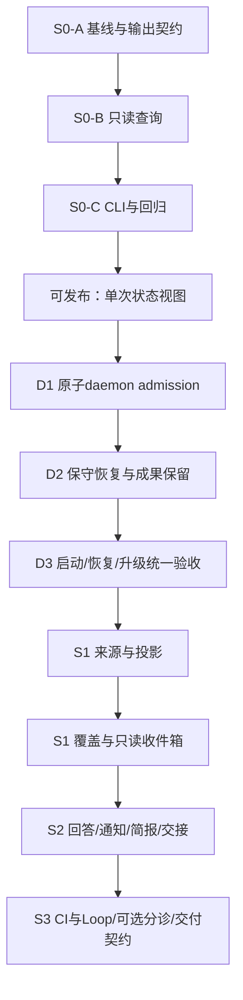

# Firstmate 能力借鉴实施计划

日期：2026-10-23。研究提案随后进入本地开发，25 个条目均已建立真实 OSStack 验证任务。当前实现、审计、回执及验证资格见[开发报告](../reports/2026-10-23-firstmate-development.md)。下方原始条目保留作验收设计，不把测试任务成功等同于所有平台/性能/生产资格已满足。

实施调整：S0/S1/S2 本地能力已经实现；S3 提供显式只读或离线 helper。完整 run event-seq replay、长期吞吐 soak、Linux 实机资格、真实 GitHub 远程验证、默认路由切换和交付管线统一不在已验证范围内，详见开发报告逐项边界。未来远程能力仍未实施。

依据：[设计](../design/2026-10-23-firstmate-capability-adoption.md)、[研究](../reports/2026-10-23-firstmate-analysis.md)、[审计处置](../reports/2026-10-23-firstmate-claude-audit.md)。文件名为建议落点，实施前重新核对实际基线。S/M为预计改动范围，不是交付工期保证。

## 1. 分期及依赖

首个release只含S0，不承诺后台监督。D1–D3是S1的硬依赖；若未通过，S0仍可独立交付，不以补文档方式跳过。

总体优先级：状态可信度与无重复动作 > 决策体验 > 通知体验 > 自动分诊 > 可见后端/远程。实现只做当前阶段，避免为了远程或多用户提前增加抽象。

## 2. S0：零迁移的只读状态视图

### [ ] S0-A 固定基线和公开返回体（M）

- 文件：`packages/protocol/src/attention.ts`、对应test、`packages/protocol/src/index.ts`、基线核对文档（最多4处）。只定义对外状态结果；内部观察类型不强塞protocol。
- 行为：给出scope、业务事实、last turn、latest decision、live_liveness=unknown、coverage=not_monitored、truncated/source limitations。保留已有envelope错误码与consumer兼容语义。
- 验收：旧consumer能读取未改变的envelope；新producer严格；unsupported schema/Loop不会伪装empty。验证protocol定向测试。依赖：无。

### [ ] S0-B 单事务只读查询与scope绑定（M）

- 文件：`packages/cli/src/attention-read-model.ts`及test、必要的只读路径辅助文件与test（≤4）。
- 行为：显式DB/task/canonical repo/default tenant；run精确task与两表tenant一致并披露repo未验证，session额外校验持久repo_path；读取现有schema，不迁移、不调用daemon。最多100条，每页标明是否截断；初版多页是新快照，不伪称同一次全量快照。
- 验收：无writer fixture中无业务/DDL写入、迁移和新文件；并发writer时验证读事务一致性而非要求WAL不变；malformed/cross-scope/unsupported schema拒绝；超过100条保留truncated且输出数量准确。验证真实临时SQLite fixture。依赖：S0-A。

### [ ] S0-C 命令接线与使用文档（M）

- 文件：`packages/cli/src/attention-command.ts`及test、`bin.ts` lazy入口、`docs/guides/attention.md`（4）。
- 行为：`attention status --db ... --task ... --repo ... --default-tenant --json`；默认模板只显示事实/限制，明确“单次快照，未后台接管”。不要借用现有`supervise`命令名覆盖portfolio语义。
- 验收：无spawn、无网络、无daemon start；已有help/version预算不回退；CLI只读黑盒用例通过。依赖：S0-B。

### [ ] S0-D Schema产物、conformance与发布说明（M）

- 文件：生成JSON Schema、有效/无效fixture、conformance测试或既有生成入口、changeset（最多5；生成批次单独提交）。
- 行为：仅声明新增读取能力，不用“持续监督已上线”的标题。
- 验收：官方schema生成/新鲜度检查、protocol/conformance定向测试、全仓build/typecheck/test及CLI startup budget；保留精确源码hash和日志。依赖：S0-C。

**检查点 S0**：交付可用只读命令；新表=0，模型调用=0，后台循环=0；无生产home读写与自动清理。性能不合格先查lazy导入，不删正确性校验。

## 3. D1–D3：后台接入前的宿主修复

### [ ] D1 原子daemon进程所有权（M）

- 文件：`daemon-lock.ts`及test、`daemon.ts`、`daemon-drain-recovery.test.ts`（4）。
- 行为：在socket清理/DB打开/恢复前取得内核独占advisory lock；固定owner文件不unlink/replace，锁随进程退出释放；选定并验证macOS/Linux binding，daemon-only lazy依赖。D1不迁移DB，generation归S1-B。
- 验收：两个真实子进程竞争只有一个进入启动副作用；SIGKILL后锁由内核释放且可重启；PID重用与旧诊断文件不能改变锁owner；固定inode/同进程二次启动及OS不支持路径都有测试。依赖接线及OS/文件系统资格按独立小批提交；CLOEXEC、fork/exec无继承、父进程SIGKILL后子进程不能保留owner锁。依赖：S0，源码baseline重核。

### [ ] D2 把自动破坏性orphan恢复改为保留（两批M）

- 文件：`agents/src/worktree.ts`及test、`cli/src/daemon.ts`、`daemon-loop.test.ts`、恢复runbook（第一批5处）；第二批修改loop-engine.ts的cycle前/后cleanup调用及对应test，避免旁路。
- 行为：startup只枚举残留，禁止force removal和branch deletion；无法证明旧writer停止/动作结果的running或stopping快照均recovery_required，不重新执行。人工清理入口也必须明确列出具体资源和成果状态。
- 验收：临时Git仓库的dirty/untracked/unmerged成果保持逐字节一致；对活跃/未知worker不发信号、不重跑；正常新任务路径保留。依赖：D1。

### [ ] D3 恢复门禁整合与兼容说明（M）

- 文件：恢复集成测试、升级/drain集成测试、source inventory、guide、changeset（≤5）。
- 行为：覆盖direct start、restart、升级、恢复失败、旧JSON快照；本次保守行为变更明确披露“中断任务可能需人工处置”。
- 验收：F06/F17及磁盘失败路径；无误删、无重复执行；全仓checks和后续clean-base审计通过才准入S1。依赖：D2。

**检查点 Host**：不是“测试时隔离就安全”；真实生产入口必须持有相同原子owner并保留未知工作。未通过时不开observer。

## 4. S1：确定性监督与只读收件箱

### [ ] S1-A 观测与等待纯函数（M）

- 文件：已有supervisor包中拟新增`src/activity.ts`、`wait-classifier.ts`及两份test（4）。
- 行为：业务/活跃/等待/coverage分轴；持久事实不TTL衰减；grant-owned continuation不提示人类抢答；先识别reserved version再判stale_grant；纯DB accepted标in_flight_or_uncertain；未知和冲突显式。
- 验收：表驱动truth table，F02/F03/F08；模型依赖为零，不读取文件或DB；checking/reserved精确源版本与message匹配、expired/failed仍不等于未执行，stale_attempt阻止新动作。依赖：D3。

### [ ] S1-B 来源与scope持久绑定（M）

- 文件：`core/state/supervision-subjects.ts`及test、migration及migration test（4）。
- 行为：subject canonical binding、instance、source capability、generation、cursor；本批含daemon_owner迁移，取D1内核锁后才登记；run原生事件只引用不复制。
- 验收：重复/冲突/F15、跨home/tenant、旧实例、来源伪称；迁移失败不留下半张表。依赖：S1-A。

### [ ] S1-C 决策episode与投影事务（M）

- 文件：`core/state/attention-items.ts`及test、projection实现及test、migration（5）。
- 行为：稳定scope/session/origin-turn/decision identity；版本独立CAS；保存最小必要决策快照、源hash与生命周期；原生事件引用有保留pin；对业务源无删除级联FK，source_missing保留；continued_externally有独立计数且不能清除授权义务。
- 验收：同决策经历无关session.version增长仍一项；内容冲突拒绝；新turn新episode；缺失源保留unresolved。依赖：S1-B。

### [ ] S1-D 全量分页补扫与游标（M）

- 文件：core必要分页read helpers及test、cli source-reader及test（≤4）。
- 行为：run事件按seq、session按每cycle固定准入ID集合逐个重读，turn按ordinal补读并重读当前turn；标脏只是优化；读取失败不推进cursor；snapshot source披露gap；明确新增session_id/run_id keyset发现扫描，容量满的项仍发现并标uncovered/omitted；不静默驱逐已有接管。
- 验收：>200 sessions、扫描中新增/更新/删除、分页断点重启；无永久漏项、旧页不覆盖新状态；无变更日志的中间瞬态披露gap，不承诺完整历史。依赖：S1-C。

### [ ] S1-E observer循环与coverage（M）

- 文件：`cli/src/supervision-service.ts`及test、`daemon.ts`、双进程fault test（4）。
- 行为：启动只在D3后注册；单并发、标脏+30秒补扫、容量上限、同daemon generation fence；成功完成扫描才刷新coverage。
- 验收：F04–F07/F13/F14；timer活着但扫描挂住不covered；停止时不漏提交、不调用executor。依赖：S1-D。

### [ ] S1-F 只读收件箱与库存完整性（M）

- 文件：attention RPC/command及test、guide、协议输出增量（≤5，生成另批）。
- 行为：item list/status，包含source/cursor/gap/owner/uncertain；已知最新问题与历史未决问题分栏，无法证明已回答的历史项不自动关闭。
- 验收：首期最多100活跃subject溢出degraded；列出total/returned/truncated，不显示虚假的“没有待办”；uncovered最少给出scope/ID/state/awaiting_decision/discovered_at/原因/未决回执。依赖：S1-E。

### [ ] S1-G 入口导出与整体资格（M）

- 文件：core/supervisor显式index、protocol生成批次、性能验证脚本（按批控制≤5）。
- 行为：无eager重依赖、feature默认关闭；只在隔离home做实测。
- 验收：100subject/1000事件每分钟、RPC p95、源gap、zero model call；全仓checks及独立源码审计。依赖：S1-F。

**检查点 S1**：可持续观察并重建未决事项，但没有answer/send/resume能力；模型预算为零；未达覆盖时必须降级。

## 5. S2：用户动作、通知和交接（分开发布）

### [ ] S2-A 手动回答的持久action ledger（M）

- 文件：`core/state/attention-actions.ts`及test、migration、source receipt resolver及test（5）。
- 行为：episode→message_id完整映射；reservation/confirmed/uncertain；不把applied当task完成；来源按actions/attempts.message_id绑定，requested_by只是显示文本。
- 验收：F09/F10，动作前/后每个崩溃窗口；同key同payload幂等，不同payload冲突；未知禁止新key替代。依赖：S1-G。

### [ ] S2-B 既有Session/Approval安全路由（M）

- 文件：daemon共用reservation helper及test、attention回答adapter、RPC测试（≤5）。
- 行为：提交时原子验证grant/active send/source revision，复用session原入口；健康grant默认拒绝，显式takeover需无在途动作，并在同事务block旧grant+预留人工message；直接session send也走此入口；R3只导向签名审批，禁止普通message代答。
- 验收：用户与collaborator并发只有一个reservation；所有授权门禁保留；不支持回执的source仍只读；异常/过期attempt不自动允许重发，必须有未发出证明或回执对账。依赖：S2-A。

### [ ] S2-C 通知delivery与transport（M）

- 文件：attention deliveries及test、sender/drain及test、migration（5）。
- 行为：独立于autonomy FK的新表，固定delivery ID、至少一次、5次有限重试、dead letter。
- 验收：F12、late success、timeout sender、重复扫描不多发；无远程消息网络真发送的fixture。依赖：S1-G，可与S2-A顺序独立实现。

### [ ] S2-D posture和增量简报（M）

- 文件：posture/cursor store及test、brief renderer及test、migration（5）。
- 行为：attended/quiet/away不改权限；mark-seen显式；固定优先级，3条摘要+完整数目。
- 验收：F11、分页、跨actor/scope、用户离开/返回、通知死信可见；不是“读取即已处理”。依赖：S2-C。

### [ ] S2-E foreground身份与handoff receipt（M）

- 文件：foreground registry及test、handoff service及test、migration（5）。
- 行为：显式foreground注册与nonce、精确subject set和source revisions、完成扫描后receipt；不推断primary。
- 验收：F05/F16/F18，过期/实例替换/错误角色/缺项，所有情况不能虚报接管。依赖：S1-G。

### [ ] S2-F 一个harness的可选turn-end hook（M）

- 文件：一个已验证harness桥接、集成test、guide、capability record（≤4）。
- 行为：最多一次提醒，不自动重启/无限续轮；独立watchdog未安装时明说离线检测边界。
- 验收：真实harness版本下的normal stop、cancel、worker角色、重复hook及人为退出；无真实验证则feature不可选。依赖：S2-E。

### [ ] S2-G Cockpit与文档收口（M）

- 文件：实际cockpit渲染路径、对应test、attention guide、release notes、public inventory（≤5，实施前核定具体路径）。
- 行为：把收件箱/brief/coverage整合到现有视图；`delivered`、`answered`、`applied`、`completed`有清晰区分。
- 验收：模拟崩溃/待批/unknown/死信四场景人工查看与无障碍可读性；所有状态都有来源和下一步。依赖：S2-B/D/F。

**检查点 S2**：先人工回答闭环，再接入配置过的通知transport；用户批准可见结果之后走既有发布流程。没有通用“自动干到结束”开关。

## 6. S3及后续：按证据开放，不合并成一个大PR

### [ ] S3-A Loop与外部CI适配（两个M任务）

Loop任务：对best-effort snapshot采用明确gap/identity绑定，未知running不自动复用；文件≤5，测试源丢失、冲突、恢复保留。依赖D3/S1；真实Loop来源准入单独验收。

CI任务：复用GitHub读取adapter，有界独立队列、缓存/退避/缺凭证unknown；不在SQL事务内联网、不覆盖required check授权。测试缺失check、head变化、429/网络失败。依赖S2通知闭环。

### [ ] S3-B 交付契约统一（两个M任务）

先contract digest/brief/effective option单一来源，再做scout→implement显式新contract。分别≤5文件与≤3类验收：mode不符拒绝、必选验证不被省略、精确head完成级别不串用。依赖现有verifier/autonomy资格，不新增no-mistakes依赖。

### [ ] S3-C 可选分诊与路由评估（两个S/M任务）

分诊：无工具模型只输出允许的解释/分类，预算耗尽或格式错误回确定性视图；输出不能发answer/merge。路由：在已有policy上做纯任务意图与整prompt对照，保存golden set、准确率/误升级/漏review/usage。未测到收益不默认启用。

### [ ] S3-D 知识沉淀与启动上下文预算（M）

借用stow的分层/证据刷新/过期规则，输出既有lesson draft；测试不覆盖用户记忆、不自动改AGENTS、不自动promote。依赖已有知识治理；不启用Vault整理或外部memory副作用。

### [ ] Future 可见worker/远程home/公共Relay（各自新设计）

每一项都先定义小的支持矩阵和故障行为：可见不等于可控；远程失联不本地替换；公共请求不能等于可信控制指令。需要单独scope、预算、transport、身份和运行验证，不是S2的“顺手扩展”。

## 7. 测试和验收的证据规则

- 单元：归约、优先级、scope、identity与episode；必须覆盖反例，不写镜像实现的测试。
- 存储：真实SQLite、竞争事务、每个intent/receipt提交窗口的故障注入。
- 集成：真实CLI/RPC入口配假adapter，严格禁止假transport漏到真网络；真实临时Git仅验证保留。
- 运行资格：一个具体harness版本的事件、取消、返回、重启观测，与mock结果分开记录。
- 性能：新进程version/help、已有startup脚本、100subject固定工作负载；声明机器/Node/源hash及冷/热缓存条件。
- 全仓：`pnpm build`、`pnpm typecheck`、`pnpm test`；root lint不等于有效包级lint，使用实际存在的检查，不伪称运行空脚本。
- 每个阶段source review只绑定当时的实际diff和证据。研究中的Fable审计不是未来代码批准，也不是CI或生产验收。

研发worktree统一放 `~/Developer/CodeX/.worktrees/osstack/<task>`，分支`codex/<task>`；完成PR/合并/放弃后按用户规则移除并prune。测试/实验home统一放 `$OSSTACK_SCRATCH_ROOT`；任何开发CLI均显式隔离OSSTACK_HOME。本次文档研究未创建开发worktree。

## 8. 开始实现前的核对项

1. 重新识别实际工作分支、已发布版本及未整合Graph/candidate工作；不能在旧基线直接实现再声称已覆盖最新能力。
2. 固定S0接口与schema兼容列表（初始24，迁移3已有tenant字段；缺列失败，后续版本须兼容fixture）；D1/D2作为独立行为变更审查，不能混进“纯展示”PR。
3. 确认首个真实harness选择、pilot workload与可测量成功标准。建议先OSStack已拥有JSONL生命周期的headless Codex；这个选择不构成真实兼容已验证。
4. 只有实际需要复制代码时建立逐文件来源记录和MIT声明；当前生产实现无上游代码复制。

这些是未来实现的入口检查，本次研究与设计无需等待它们完成。下一步建议执行S0-A至S0-D；不同时启动后台接管和远程扩展。
