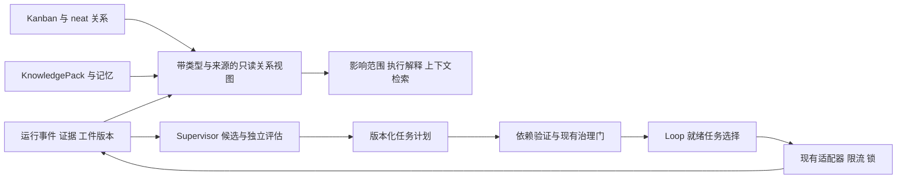

# Graph Engineering 与 OSStack 集成研究

**结论：值得加入，但应先把 OSStack 已有的依赖、执行、证据与治理关系连接起来。首个试点应是只读关系联查、影响提示与既有阻塞原因转述；下一步才是受约束的任务图调度。暂不建议替换运行时、默认部署图数据库或启动在线图自进化。**

## 1. 决策摘要

OSStack 的核心优势是把任务执行、验证、权限、状态和交付证据放进同一控制面。Graph Engineering 最有价值的贡献，是把这些对象之间的关系变成机器可检查的契约：哪些任务能开始，哪个产物被谁消费，一项证据失效会影响什么，以及恢复时哪些结果仍然有效。

当前已有四组基础：Kanban 依赖与拓扑排序；neat 的依赖候选和确认生命周期；Autonomy 的事务状态转换；带来源的知识与反馈资产。新工作应围绕这些基础补齐跨模块查询、关系语义和执行绑定。不能把“已有图相关结构”夸大为“已有完整图执行引擎”，也不能把新增一个通用 GraphStore 当作必需前提。

建议按以下顺序投资。下表全部是拟议能力与目标；这里的优先级是工程判断，收益尚待真实任务验证。

| 优先级 | 能力 | 可见结果 | 初期实施方式 |
|---|---|---|---|
| P0 | 关系联查与影响提示 | 提示潜在下游，并引用既有阻塞原因 | 读取已有数据，先验证跨源查询需求 |
| P1 | 有类型的任务依赖与验证门 | 上游有效完成后才放行下游，正确处理汇合和失败 | 扩展 Loop 的计划契约，保留现有执行和权限边界 |
| P1 | 执行与证据来源关系 | 指向具体版本、运行、验证结果，生成局部恢复建议 | 复用事件／状态存储，补必要引用 |
| P2 | 按任务组织上下文 | 只取相关的决定、工件和经验，解释检索路径 | BM25 加确定性关系扩展，保留回退 |
| P2 | 能力与通信关系 | 按角色、能力、预算组织少量协作者 | 在现有路由与评分基础上做离线比较 |
| P3 | 图模板自动优化 | 在新任务上证实更好的工作流，再版本化晋升 | 有独立验收的候选实验；不直接修改活动控制图 |

本报告与已有的[Loop/Harness 研究](2026-09-08-loop-papers-and-harness-research.md)一致：先修复真实等待和状态真实性，再验证一个可复现改进，最后扩展演化。Graph Engineering 是对这条路线的结构补充，不构成推迟现有协作者交付的理由。

## 2. 仓库是什么，能直接拿到什么

本地克隆位于 `/Volumes/AIMATE_WORK/Developer/CodeX/Awesome-Graph-Engineering`。研究快照为 `d30a601e5ded64a595985e182b2b962519122ed3`，提交时间为 2026-09-09，核查日期为 2026-09-11。OSStack 对照快照为 `59eafa0c8f008a36a9769630cb1119319985b9f6`。

目标仓库共有 **8 个跟踪文件**：README、MIT LICENSE 和 6 张图片；没有可运行的图引擎、安装清单、API 或测试。690 行 README 是综述的资源索引。按带外部链接的列表项统计，包含 16 项相关综述、304 项研究论文、65 项基准／环境、30 项开源库、28 项应用。此处是**列表项数量，未去重，不是独立论文数**。同一论文可能跨类别出现。[^1]

直接可复用的是分类方法、研究入口和评估维度。实际实现要到 LangGraph、Graphiti、Mastra、GPTSwarm 等上游项目核查；索引自身的 MIT 许可不能代表这些项目或论文的许可。不能对这个仓库执行一条安装命令就获得所谓 Graph Engineering 能力。

配套综述为 Feng 等人的 *Graph Engineering in the Era of LLM Agents: From Individual Intelligence to System Intelligence*，arXiv `2608.21156`。已核实最新版为 **v2，2026-08-26**；其核心是用明确的任务、协作与运行状态关系组织系统，并将本体与持续结构演化列为进一步方向。它是一份研究综述和概念框架，不是证明某个统一引擎已在生产胜出的实验报告。[^2]

索引的使用边界也很明显：有些条目指向 Scholar 搜索页；部分标为 Paper 的条目实际指向软件仓库或产品文档；会议和年份标签不能代替原始论文元数据。本报告对决定架构的候选另查作者论文与官方文档，没有逐篇精读全部 304 个研究条目。

## 3. 把“图”拆成可实施的问题

以下是面向 OSStack 的设计分解，而非要求采用统一图数据库。

| 关系视图 | 节点示例 | 边与语义 | OSStack 的用途 |
|---|---|---|---|
| 任务图 | 计划、任务、验证门 | `requires_success`：前驱有效成功才可开始 | 就绪判断、依赖解释、汇合、取消传播 |
| 协作图 | 角色、适配器、能力 | `assigned_to`、允许的消息通路 | 选谁执行，谁独立验证，谁接收结果 |
| 来源图 | 输入版本、attempt、产物、证据 | `consumes`、`produces`、`verified_by` | 解释结果、追踪失效、建议局部恢复 |
| 知识关系 | 文档、决定、经验、概念 | `references`、`supersedes`、适用版本 | 历史查询、检索扩展、避免旧经验误用 |
| 语义约束 | 上述对象与规则 | 类型、作用域、生命周期、权限条件 | 阻止把“引用”错当“必须等待”，把“评审意见”错当“批准” |

GraphRAG 是知识检索的一种方法；工作流图负责执行关系。二者可以结合，但解决的问题不同。知识检索得到“建议先审阅”不应直接生成具有授权效力的调度边。任务依赖一般可以保持 DAG；包含重试的运行状态机则可以有环。把所有边放在一个图上统一检查无环，会同时损害这两类语义。

“本体工程”在首版可具体化为少量 Zod 契约、边方向和版本规则。例如，`verified_by` 必须指向实际执行的验证结果，结果还须绑定相同工件 digest；`supersedes` 不等于删除历史；`assigned_to` 不等于赋予执行权限。现阶段没有充分理由引入完整 RDF/OWL 推理栈。

## 4. 最值得借鉴的研究与实现

### 4.1 LLMCompiler：把计划、就绪判断与执行分开

LLMCompiler 明确分离函数调用规划、任务派发和并行执行；论文在其基准上报告最高 3.7 倍延迟加速、6.7 倍成本节省。[^3] 对 OSStack 有价值的是这种职责划分：计划产出明确依赖，就绪判断不靠下一轮提示词重述，执行器专注受控调用。

这些数字不能用于预测 OSStack。函数调用基准与真实代码任务的时长、共享资源、验证、合并冲突差异很大。OSStack 的试点应先验证“下游绝不提前执行”，再评估能够并行的读任务是否减少总耗时。简单独立调用的对照必须包括普通队列与 `Promise.all`；图的额外价值在可解释依赖和恢复边界。

### 4.2 LangGraph：状态持久化与节点容错

LangGraph 的 JavaScript 文档把线程内 checkpoint 与跨线程 store 分开，并提供节点重试、超时与错误处理。所查容错文档明确部分节点能力要求 `@langchain/langgraph >= 1.4.0`，实际集成应锁定版本。[^4][^5]

可借鉴 checkpoint 命名空间、attempt 标识、局部重试和恢复结果的契约；不宜让 OSStack 同时拥有两套相互竞争的任务状态权威。若未来某个产品流程需要 LangGraph，可先作为受 OSStack 约束的适配器：OSStack 管委托和交付，LangGraph 管内部子流程。此方式仍需验证取消、重放、权限和证据映射，不能把安装框架视为集成完成。

### 4.3 GPTSwarm 与 AFlow：把工作流当成可比较候选

GPTSwarm 把操作建模为节点、信息传递建模为边，并分别优化节点提示和连接结构；AFlow 把代码表达的工作流搜索与执行反馈结合，使用 Monte Carlo Tree Search。[^6][^7]

借鉴点是可版本化工作流模板，以及“只改变一种因素”的实验：固定模型比较拓扑，固定拓扑比较提示。AFlow 报告的 5.7% 平均提升来自六个基准，不构成对仓库交付或长期自治的承诺。搜索、失败候选和裁判的成本必须计入；把运行成本降低与离线搜索成本分开披露。[^7]

OSStack 已有 supervisor proposal/gate，可扩展候选种类和验证方式；不应另建不受 gate 管理的自进化控制器。活动计划不能被模型直接重写以删除独立验证或降低权限要求。

### 4.4 AgentPrune 与反面证据：关系更少也可能更好

AgentPrune 研究消息传递图中的冗余，报告在其基准上减少 28.1%–72.8% token。[^8] 可借鉴“只传播必要证据和结论”的通信边界，不必先引入图神经网络。对 OSStack，独立 reviewer 不应默认读取作者全部自我论证；它首先需要需求、实际 diff、失败证据和验收约束。

反面证据同样重要。*Multi-Agent Teams Hold Experts Back* 发现其研究设定中的团队会过度折中专家与非专家意见；MAST 从多框架轨迹中归纳系统设计、协作错位和验证等失败。[^9][^10] 因而必须保留单一强 agent 和固定少量协作者的基线。更多节点、更多轮对话或两模型意见一致，都不是质量提升的证明。

### 4.5 Graphiti 与 GraphRAG：放在知识侧进行独立评测

Graphiti 支持实体、时效关系和 episode 来源，可以表达事实何时有效以及来自哪里。当前官方仓库列出 Python 与外部图存储等部署依赖，并区分 Graphiti 自管实现和 Zep 托管服务；不能把 Zep 的服务指标归到本地 Graphiti。[^11][^12]

GraphRAG 针对文档集合的全局总结，通过实体关系和社区摘要帮助回答跨文档问题。[^13][^14] 这适合较大的资料库，但 OSStack 当前 KnowledgePack 已有本地 BM25。只有实际问题需要跨文档连接、时间切片或关系路径时，才值得比较图检索。普通按标题／符号查找不应默认多一次 LLM 抽取和图数据库查询。

第一步应比较：现有 BM25、BM25 加显式引用扩展、Graphiti 或 GraphRAG 独立后端。固定检索语料版本、上下文预算与回答模型，测相关证据覆盖、错误引用和过期事实使用；不能用不同模型与更长上下文制造表面优势。

### 4.6 工程选型

| 候选 | 已核实适配信息 | 对 OSStack 的建议 | 采用前仍需验证 |
|---|---|---|---|
| 原生 TypeScript + 已有 SQLite | 当前技术栈与状态存储 | **P0/P1 首选**，先做窄契约与读视图 | 来源完整性、事件游标、图规模和重建成本 |
| LangGraph JS | 有独立 JS 仓库和持久化／容错文档 | 参考设计；复杂子流程可作插件候选 | 双层状态、取消、重试副作用、依赖加载成本 |
| Mastra | TypeScript；workflow 文档提供组合能力 | 备选对照，不为图能力整体替换系统 | 当前核心 Apache-2.0，`ee/` 有单独许可；按实际模块核查 |
| Microsoft Agent Framework | 官方仓库面向 Python/.NET | 跨运行时的特定代理适配，不放默认 CLI 热路径 | 进程管理、协议映射、部署和故障边界 |
| Graphiti | 时间知识图；Python 与外部存储 | 可选知识后端 | 相对 gbrain/BM25 的增益、运维和抽取成本 |
| GraphRAG | 文档全局问答与摘要 | 大型知识语料实验 | 索引更新成本、评测代表性、引用质量 |
| GPTSwarm / AFlow | 研究级图与工作流优化方法 | 离线模板实验 | 任务泛化、搜索成本、受保护验收 |

框架、许可证与文档依据见 [^4][^5][^11][^14][^15][^16][^17][^18]。以上是适配判断，不是横向性能排名；本报告未安装并运行这些第三方框架。Awesome 仓库的收录也不是生产成熟度认证。

## 5. OSStack 源码对照：已有能力与真实缺口

以下源码锚点统一基于本次 OSStack 快照。`Sxx` 对应报告末尾的源码索引。

| 领域 | 已有实现 | 确认的缺口／限制 | 集成含义 |
|---|---|---|---|
| Kanban 依赖 | `link`、board 内边、Kahn 拓扑排序 [S1] | link 时仅拒自环；多节点环在 topoOrder 才报错；跨 board 边不参与 board 排序 | 导入执行计划时另行校验，不把原始链接直接当调度事实 |
| 现有图消费者 | runbook、stack retro 使用 topoOrder [S2] | 此用途是排列和展示，不是通用任务执行调度 | 保留现有行为，新增明确消费契约 |
| Loop 计划 | 一个 Task 配 agent、worktree、迭代上限 [S3] | 无一等依赖字段；`context` 虽可放任意数据，不提供依赖执行保证 | 设计版本化 WorkflowPlan，明确与旧 Task 的适配 |
| Loop 执行 | `for` + `await runTask` [S4] | 所查循环按发现／治理后任务列表串行执行，没有按图选 ready set | 缺口是结构化就绪判定，不等于整个 daemon 不能并发 |
| 并发控制 | daemon 读 semaphore、全局写 semaphore、repo 写锁 [S5] | 有意限制写并发，工作树并不自动解除同 repo 写限制 | 先并行读与隔离任务；继续复用现有限流和锁 |
| 依赖治理 | neat 类型、证据 hash、候选／advisory／promoted、confirmed／review_due／revoked [S6] | 这是跨仓库知识治理关系，不能直接等同任务的前驱条件 | 高复用价值；用适配读视图保留原始语义 |
| 依赖持久化 | 事件幂等、版本检查、事务投影 [S7] | 生命周期已经存在，无需再造平行关系权威 | 新图引用 edge ID、revision 和 scope |
| Autonomy 状态 | transition 日志、projection、expected_revision [S8] | 已有可靠状态机制，但不是统一的任务／产物来源图 | 借鉴并复用 CAS 和事务，不声称当前所有路径可完整重放 |
| 通用事件／证据 | seq、run/session、开放 payload；EvidenceRef 可带 SHA [S9] | 已查路径不足以统一回答输入消费版本；未逐一核查全部事件族 | 按需要添加严格的事件族与引用 |
| Loop 文件状态 | 原子写 JSON 与 Markdown [S10] | 原子改名不等于跨任务事务；两个文件也是分别写入 | 不把新增调度状态只塞进 Markdown |
| 知识 | Pack 版本、来源、BM25、local/cloud 回退 [S11] | 不是多跳或时间事实图；元数据 engine 当前固定为 bm25 | 保留强基线，后续修改检索契约时显式表达实际引擎 |
| 记忆 | subject facts、confidence、supersede/archive [S12] | 是事实记录，非完整双时间关系历史 | 新历史查询要保留来源版本，不倒推不存在的历史 |
| gbrain | 可选、默认关闭，daemon 终态后 best-effort 写 run page [S13] | 所查适配器提供写入，未提供读侧图查询／调度能力 | 保留知识导出角色，不把它当任务状态权威 |
| 路由／演化 | 能力选择、scorecard、proposal、gate [S14][S15] | 评分不是图优化；成功数可能受任务组合影响 | 从分层统计与少量固定模板开始 |
| runtime 包 | `RUNTIME_VERSION` 占位 [S16] | 名字容易造成架构误判 | 不把执行图职责凭名称放入 runtime |

还有两点必须保留。第一，gbrain 文件头关于上游能力的描述是 OSStack 的设计注释，本报告没有据此验证外部 gbrain 的完整行为。第二，neat 的关系生命周期比 Kanban 链接成熟，但它治理的是另一类边；“统一”应发生在查询与类型层，而不是把生命周期强行合并。

## 6. 本地验证能证明什么

### 6.1 现有基础行为

在显式临时 `OSSTACK_HOME` 下运行了五个现有测试文件，总计 **80 项通过**：Kanban 42、memory 8、router 19、Autonomy state 9、dependency obligation store 2。测试各自使用临时数据库；没有运行指向默认 home 的开发 CLI。

这些测试支撑“相关基础行为已有并通过检查”，不证明新图引擎、图查询、局部恢复或新调度器已经实现。没有修改运行源码，没有将新能力启用到服务端。测试日志保存在配套 evidence 目录。

### 6.2 静态工作区依赖提取

从当前 21 个 `packages/*/package.json` 提取内部依赖，合并 dependencies、devDependencies、optionalDependencies、peerDependencies 并去重，得到 **45 条 provider → consumer 边**。这个统计不使用模型推断，不读取运行数据库。

补充保留边类型后，44 条来自 `dependencies`，1 条来自 `devDependencies`，另外两类为 0。仅沿 `dependencies` 遍历，两组下游数仍为 12 和 2；仅沿 dev/optional/peer 各类遍历，这两个起点的下游均为 0。分类闭包仅回答“每一步都属于该类别”的路径，混合路径仍需保留逐边类别。原始 45 条无类型边用于粗粒度统计，不能作为执行语义；开发依赖影响构建／测试，亦可能经构建产物间接影响交付，但不因此自动成为运行时导入关系。详见 typed-probe JSON。

传递闭包显示：`@osstack/protocol` 有 **12 个下游包**，`@osstack/knowledge` 有 **2 个下游包**（cli、knowledge-cloud）。这说明一部分有用图结构已经存在于确定性工程元数据中，无需先用 LLM 生成关系。原始节点、边和完整下游清单已保存。

其局限同样明确：它不分析 symbol/import 的实际使用、不覆盖动态加载、工作区根脚本和所有生成文件依赖，也没有测试覆盖映射。因此只能给出包级影响提示，不能据此跳过其他测试。pnpm 已有依赖感知机制；如果只是得到下游包列表，直接使用已有 workspace 工具即可。新图能力必须在“依赖 + 证据版本 + 任务阻塞解释”上体现额外价值。

## 7. 推荐架构：先用关系视图贯通已有权威



图中的最后一条是受控候选晋升路径，不是允许 supervisor 自动修改正在执行的计划。P0 只有上半部分读视图；下半部分属于后续试点。

### 7.1 所有权

- `@osstack/protocol`：仅承载真正跨进程的最小契约；先避免在公共 index 加重依赖。
- `@osstack/core`：拥有可持久化状态和关系读取适配；优先复用已有表和事务语义。查询缓存可重建，不反向成为权威。
- `@osstack/loop`：拥有计划验证、就绪计算、结果汇合与受约束重试；最终调用既有 executor。
- `@osstack/governance`：拥有边／图变更的约束评估；复用现有依赖和风险流程。
- `@osstack/knowledge`：拥有知识检索与证据装配；可选图后端不得增加执行权限。
- `@osstack/supervisor`：拥有候选、实验与晋升判定。
- `@osstack/cli`：负责输入输出、展示和 daemon wiring。

首版不新增 `@osstack/graph` 大包。等到至少两个真实消费者共享稳定算法时，再评估提取纯函数模块。

### 7.2 最小关系契约

P0 的 `blocked` 只能来自具有阻塞语义的权威记录，例如现有治理判定或任务状态。Kanban 普通链接、neat 关系或文档引用仅显示 `linked`／影响提示，不能推导任务正在等待。没有相应运行记录时，回答“未记录任务级前驱条件”，不编造原因。

G1 不新增控制面 schema，不写已有业务表，也不依赖打开可自动迁移的 DB 来完成所谓只读检查；读取入口须使用现有无迁移查询路径或明确 readonly 的快照访问。派生缓存限定为进程内或专用研究／工作区目录的独立可删除文件，附来源版本；不进入 daemon 启动路径。后续阶段需要持久化时，另走正常迁移流程。


建议读视图返回 `node_id`、对象类型、作用域、来源权威、来源版本、可用／缺失状态；边返回类型、起终点、证据引用、确认状态、有效时间与观测时间（后两者仅在源数据确实提供时填写）。

对单个 run 的事件可使用现有 seq；跨 run、Kanban、neat 等来源不能把一个局部 seq 冒充全局时钟。快照记录每个源的 watermark／版本与抓取时间，并返回 `coverage` 和 `staleness`。某个源不可读时显示不完整，而不是返回“无影响”。

每条关系按其断言标明 `source_authority` 与 `derivation`。例如 package.json 是“声明依赖”的权威，但不是“实际运行消费”的权威；由声明计算的传递闭包是派生结果。两源冲突时并列返回、标记冲突，不自动覆盖；时间历史只来自源记录，视图不能从今天的状态合成过去。

关系读取默认限定 repo／tenant／workspace。现有 memory API 在 tenant 参数省略时允许跨租户读取，因此新查询入口必须显式传 scope；不能把旧单租户默认直接暴露给图遍历。[S12]

### 7.3 任务图契约

拟议 `WorkflowPlan` 至少包含 plan ID、revision、goal/task 绑定、节点、带类型依赖、验收与预算引用。每条执行依赖明确规定“前驱 succeeded 且其指定输出通过指定验证”。边方向统一为前驱 → 后继；已有 neat `depends_on` 等方向要在适配时转换并保留原始语义。

首版仅支持显式静态依赖、AND 汇合和有上限的节点内部重试。循环不以“向祖先补一条依赖边”表示。OR 分支、动态增图、子图替换在有实际用例后再引入。取消、失败、等待输入和跳过必须有不同结果，不能都算成功放行。

plan 保存／执行入口检查：重复 ID、悬空边、非法类型、自环与环路、作用域、验证门完整性、预算和工具适配。P0 可以把历史 Kanban 环报告为诊断；P1 不能启动包含非法依赖的计划。

### 7.4 与现有会话、发现循环的衔接

现有 `SessionContinuationRequest` 已区分 phase_continue、task_authorization、risk_approval、external_input，并标明它是代理请求而非授权；协作者使用带范围的签名接续。[S17] G2 以现有状态真实性与接续契约为前置，复用 task/run/session/turn/version、attempt 和终态，不建立第二套阶段成功字段。图节点引用现有会话或验证动作；图依赖满足不代表 phase 请求获准，更不能替代风险授权。跨进程新字段须同步检查 strict 生产者、消费者、mapper 与版本兼容，不能只改 Loop Task。

静态计划冻结节点集合与输入基线，每轮新发现任务留在原队列，不自动塞入活动计划。同 repo 计划外写任务在该试点的自动调度中延后；读任务仍通过既有准入与锁。不能在等人工输入时长期持有物理写锁。每次领取节点前重新核验 repo 基线与工件 digest；检测到人工／其他路径改动则暂停受影响部分并重新验证或生成新计划 revision，而非假定冻结计划使外部世界也被冻结。最小用例不支持两个有写动作的活动图共同拥有同一 repo。

### 7.5 来源、失效与恢复

每个 attempt 绑定计划 revision、输入 refs/digest、执行代理与适配器版本、权限／策略引用、输出 digest、验证结果、终态和成本。不记录模型的私有思维过程作为必须依赖；采用可观测动作、结构化摘要和工具结果即可。

失效分析沿 **实际消费关系** 展开。任务 A 的一个产物变化，只标记真正消费该版本的节点；仅同属一个 workflow 不足以让所有节点失效。首先产生“需要复核”的建议，不把依赖路径写成已证实的根因。

恢复时区分三类动作：纯计算可按输入重算；有幂等键或可对账的动作先查外部结果；不可逆或需要补偿的动作按既有治理处理。checkpoint 只能恢复内部状态，不能撤销已发生的合并、部署或通知。首个局部恢复试点限定在可重放的读取／验证节点，不复跑未知状态的外部写入。

### 7.6 单次提交与副作用边界

节点领取、状态变更与证据登记要复用或明确扩展事务和 revision 校验。将来多 worker 时再设计 owner/lease/fencing；不能只在内存里维护 ready 集合就宣称可重启安全。

外部副作用与 SQLite 通常不能处在同一事务中。用稳定操作 ID、提交意图与外部回执对账处理不确定窗口；本地重放不自动保证 exactly-once。任务图只决定“具备依赖条件”，真正执行仍须经过权限、预算和锁检查。

## 8. 一个具体的 OSStack 用例

以“修改 protocol 并验证下游兼容”为例，当前包级图已经能列出可能受影响的包。P0 先输出受影响包来自哪条 manifest 依赖，并联查已存在且可明确绑定的任务／证据。没有绑定时显示缺失。任务是否具备前驱条件属于 G2；验证结果与消费版本的完整绑定属于 G3，不应在 P0 提前承诺。

计划可表达为：冻结接口契约 → 实现变更 → 分别执行下游验证 → 汇总当前版本的通过证据 → 按既有交付流程处理。独立验证节点可以在资源允许时并行；实现与发布仍服从既有写锁和授权。

若 knowledge-cloud 验证失败，系统先展示具体失败证据与消费版本；只有确认失败与输入变化的关系后，才建议重跑受影响验证。不能根据“下游”两个字自动撤销所有结果。代码修复改变输入 digest 时，旧通过证据也不能无条件沿用。

以下是**拟议体验，当前 CLI 不存在这些新命令**：

```text
osstack graph impact --ref <versioned-object-ref>
osstack graph explain --task <task-id>
osstack graph validate --plan <plan-artifact>
```

回答应附来源、路径、缺失信息与所用版本。P0 的 impact 是提示，不替代全量回归；explain 只转述已有权威阻塞记录，不从普通链接推断阻塞，也不触发执行。validate 属于后续 G2。

## 9. 实验、门槛与停止条件

### 9.1 P0：先证明值得做

先选取少量真实、已知结果的变更与阻塞任务构成开发集；加入跨 board、缺失证据、过期边、循环、撤销、同名不同作用域、失败后仍有旧通过证据等反例。对比现有 runbook／CLI 查询与新关系解释，记录答案正确率、完整证据覆盖、错误“无影响”、人工诊断时间和查询成本。

G1 实现前冻结问题、案例、真值来源、失败定义和停止条件。至少一个问题须跨越两个现有来源且现有单源查询不能充分回答，否则直接使用 SQL／现有命令。真值以冻结快照中的明示关系、实际验证结果及返工记录为准；无法确认根因的案例标注未知，不用作者意见补成真值。独立留出未用于设计的案例；人工诊断时间由未参与构建者在随机顺序下测量。收益不足或现有查询同样有效时停止 G1，不自动推进 G2。

试点可以从约 20–30 个案例起步以发现工程问题；**这只是工作量建议，不能作为统计充分性的声明**。未覆盖的源与关系必须显示 coverage 缺口。输出减少手工查证且不隐藏缺口时，才值得产品化。

### 9.2 P1：任务图调度

在相同任务、模型、工具、权限、预算与验收下，比较当前串行循环、简单依赖队列与图计划。包含链式、分叉汇合、上游失败、重复事件、崩溃恢复、取消、审批过期和同 repo 写冲突。先测确定性 fake adapter，再进入真实任务；在隔离 workspace 和显式 OSSTACK_HOME 中执行。

硬性正确性门槛：不能发生已测试场景中的依赖越过、跨作用域泄漏、旧证据放行或不确定副作用盲目重试。测试零失败只表示覆盖用例通过，不证明总体事故概率为零。

收益指标包括验收通过率、完整交付耗时、成功交付总成本、返工和恢复成功率。必须把失败、超时、裁判、检索与图维护成本计入；不能只比较最后成功的节点。用任务级配对与随机顺序减少难度和环境偏差，按任务类型报告。

### 9.3 知识与演化分开实验

知识实验固定 corpus snapshot、token 预算、回答模型和人工标注，单独比较关系扩展的增益；时间相关问题另外标注有效时间。模板演化固定开发集与独立晋升集，分别改节点提示、边结构和代理配置，防止一次改完后无法归因。

正式最低收益、成本容忍度和样本量要根据基线与产品目标预先冻结。本报告不凭空规定提升百分比、成本倍率或固定天数即通过；在真实收益实验前未冻结这些条件，就不能宣称达到上线门槛。

### 9.4 性能约束与退路

沿用项目预算：`--version` 本地小于 150 ms／CI 小于 250 ms，完整 `--help` 本地小于 500 ms／CI 小于 900 ms，非流式本地 RPC p95 小于 10 ms，Loop tick 开销低于会话时间 1%。这些是项目要求，不是此次实测结果。

P0 遍历必须有深度、节点数、时间和返回体上限；截断要明确显示。重建放在按需命令或后台，不能阻塞默认 CLI 启动。跨多源复杂查询如果无法满足既有 RPC 预算，应采用异步任务与进度，而不是默默放宽全局 SLA。

如果简单 SQL／现有 CLI 就能同样快且准确地回答试点问题，停止扩展通用图层。如果 BM25 加显式链接与大型图后端效果相当，选前者。如果图调度收益主要来自普通并发，就保留更简单的队列方案。暂不引入图库和在线演化，也可以是正确研究结论。

## 10. 分阶段落地与投入边界

| 阶段 | 产物 | 依赖与退出条件 | 暂不包含 |
|---|---|---|---|
| G0 关系审计 | 对象／边词典、来源覆盖、固定案例 | 明确真实问题，现有数据能解释相当一部分案例 | 新 DB、生产启用 |
| G1 只读解释 | 跨源关系／影响提示、已有阻塞转述、来源版本 | 冻结案例并独立测量；无增益即停，不误报完整 | 自动跳测、自动重试、新 schema |
| G2 静态任务图 | WorkflowPlan、验证器、ready set、AND 汇合 | 状态真实性交付先行；复用会话与执行契约；错误与恢复测试通过 | 任意动态改图、同 repo 多写 |
| G3 来源与有限恢复 | attempt/产物版本关联、失效建议、读节点恢复 | 真实消费关系可证明，外部结果可对账 | “依赖即根因”、通用事务回滚 |
| G4 可选上下文增强 | BM25 关系扩展及外部后端比较 | 固定 corpus 对照有收益 | 默认索引全部资料 |
| G5 模板演化 | 有版本候选、独立评测、受控晋升／撤销 | 多次新任务收益与旧能力保留 | 活动控制图自行提权和降低验收 |

最小投资单位是 G0+G1 的一个纵向用例。没有真实基线前，不给整套系统的可信交付日期。G2 是控制行为变更，成本主要在失败语义、权限和恢复测试，不在拓扑排序算法本身。

**推荐决策：开展原生、只读、证据驱动的窄试点；把任务图执行列为通过试点后的增量，把 Graphiti／GraphRAG 与图演化列为独立可选实验。** 这是一项集成建议；本报告本身没有创建执行计划、修改配置或启用新控制行为。

## 11. 证据边界

已完成：克隆与快照固定、目标索引全量结构盘点、关键论文／官方文档核查、OSStack 源码与调用路径对照、80 项现有测试、工作区包依赖提取。

尚未完成且不能暗示已完成：全部论文独立复现、外部框架生产验证、真实 OSStack 工作负载 A/B、新图引擎实施、用户收益和成本证明。综述及框架文档提供可行性与设计依据，本地测试提供既有行为依据，二者都不是未来集成收益的替代物。

## 12. 来源索引

### 外部一手资料

所有动态网页核查于 2026-09-11；代码与文档选型需在实施时固定版本。

1. DEEP-JLU. [Awesome-Graph-Engineering，固定 README](https://github.com/DEEP-JLU/Awesome-Graph-Engineering/blob/d30a601e5ded64a595985e182b2b962519122ed3/README.md)，2026-09-09 快照；[LICENSE](https://github.com/DEEP-JLU/Awesome-Graph-Engineering/blob/d30a601e5ded64a595985e182b2b962519122ed3/LICENSE)。用于索引定位和统计。
2. Feng et al. [Graph Engineering in the Era of LLM Agents](https://arxiv.org/html/2608.21156v2)，2026-08-26，重点 §4–8。用于问题分类和研究边界。
3. Kim et al. [An LLM Compiler for Parallel Function Calling](https://arxiv.org/abs/2312.04511v3)，ICML 2024。用于调度职责划分；数字为作者结果。
4. LangChain. [LangGraph JavaScript Persistence](https://docs.langchain.com/oss/javascript/langgraph/persistence)。用于状态与 store 区分。
5. LangChain. [LangGraph JavaScript Fault tolerance](https://docs.langchain.com/oss/javascript/langgraph/fault-tolerance)。用于节点容错及版本限制。
6. Zhuge et al. [GPTSwarm: Language Agents as Optimizable Graphs](https://proceedings.mlr.press/v235/zhuge24a.html)，ICML 2024。用于节点／边分别优化。
7. Zhang et al. [AFlow: Automating Agentic Workflow Generation](https://arxiv.org/abs/2410.10762v4)，2025-04-15。OpenReview 入口受验证页阻挡，改查 arXiv 作者版本。
8. Zhang et al. [Cut the Crap: An Economical Communication Pipeline for LLM-based Multi-Agent Systems](https://arxiv.org/abs/2410.02506)，2024-10-03。用于通信裁剪及作者实验口径。
9. Pappu et al. [Multi-Agent Teams Hold Experts Back](https://arxiv.org/abs/2602.01011v4)，2026-05-28，页面标注 ICML 2026。用于团队协作反例。
10. Cemri et al. [Why Do Multi-Agent LLM Systems Fail?](https://arxiv.org/abs/2503.13657v3)，2025-10-26。用于失败模式及评测设计。
11. Zep. [Graphiti 官方仓库](https://github.com/getzep/graphiti)。用于时间关系、来源、部署和托管产品区别。
12. Rasmussen et al. [Zep: A Temporal Knowledge Graph Architecture for Agent Memory](https://arxiv.org/abs/2501.13956v1)，2025-01-20。用于时间记忆研究入口；不外推其指标。
13. Edge et al. [From Local to Global: A Graph RAG Approach to Query-Focused Summarization](https://arxiv.org/abs/2404.16130v2)，首发 2024，修订 2025-02-19。用于知识侧适用问题。
14. Microsoft. [GraphRAG 官方仓库](https://github.com/microsoft/graphrag)及[文档](https://microsoft.github.io/graphrag/)。用于实现定位。
15. LangChain. [LangGraph JS 官方仓库](https://github.com/langchain-ai/langgraphjs)。用于 JavaScript 选型入口。
16. Mastra. [官方仓库与许可说明](https://github.com/mastra-ai/mastra#licensing)及[Workflows](https://mastra.ai/docs/workflows/overview)。用于 TypeScript 适配与许可边界。
17. Microsoft. [Agent Framework](https://github.com/microsoft/agent-framework)。用于 Python/.NET 运行时定位。
18. metauto-ai. [GPTSwarm 官方实现](https://github.com/metauto-ai/GPTSwarm)。用于研究代码入口，不作为生产性能证明。

### OSStack 源码索引

链接固定到本次 commit。行号对应源文件锚点，部分能力跨多个函数。

- S1：[KanbanRepository](https://github.com/osborn-studio/osstack/blob/59eafa0c8f008a36a9769630cb1119319985b9f6/packages/core/src/kanban/repository.ts#L298)：链接、board 边与拓扑排序。
- S2：[stack CLI](https://github.com/osborn-studio/osstack/blob/59eafa0c8f008a36a9769630cb1119319985b9f6/packages/cli/src/stack-cli.ts#L455)：runbook；同文件 stackRetro。
- S3：[Loop types](https://github.com/osborn-studio/osstack/blob/59eafa0c8f008a36a9769630cb1119319985b9f6/packages/loop/src/types.ts#L27)与[planner](https://github.com/osborn-studio/osstack/blob/59eafa0c8f008a36a9769630cb1119319985b9f6/packages/loop/src/planner.ts#L11)。
- S4：[LoopEngine runCycle](https://github.com/osborn-studio/osstack/blob/59eafa0c8f008a36a9769630cb1119319985b9f6/packages/loop/src/loop-engine.ts#L467)：发现、筛选与逐项执行。
- S5：[daemon run slots](https://github.com/osborn-studio/osstack/blob/59eafa0c8f008a36a9769630cb1119319985b9f6/packages/cli/src/daemon.ts#L2952)：读写限流与 repo 锁。
- S6：[neat dependency](https://github.com/osborn-studio/osstack/blob/59eafa0c8f008a36a9769630cb1119319985b9f6/packages/governance/src/knowledge-hygiene/dependency.ts#L27)与[确认流程](https://github.com/osborn-studio/osstack/blob/59eafa0c8f008a36a9769630cb1119319985b9f6/packages/cli/src/neat-dependency-command.ts#L970)。
- S7：[dependency obligation store](https://github.com/osborn-studio/osstack/blob/59eafa0c8f008a36a9769630cb1119319985b9f6/packages/core/src/state/dependency-obligation-store.ts#L178)。
- S8：[Autonomy CAS transition](https://github.com/osborn-studio/osstack/blob/59eafa0c8f008a36a9769630cb1119319985b9f6/packages/core/src/state/autonomy-runs.ts#L279)。
- S9：[EventEnvelope](https://github.com/osborn-studio/osstack/blob/59eafa0c8f008a36a9769630cb1119319985b9f6/packages/protocol/src/event.ts#L13)与[EvidenceRef](https://github.com/osborn-studio/osstack/blob/59eafa0c8f008a36a9769630cb1119319985b9f6/packages/protocol/src/evidence.ts#L19)。
- S10：[Loop state-file](https://github.com/osborn-studio/osstack/blob/59eafa0c8f008a36a9769630cb1119319985b9f6/packages/loop/src/state-file.ts#L39)。
- S11：[Knowledge types](https://github.com/osborn-studio/osstack/blob/59eafa0c8f008a36a9769630cb1119319985b9f6/packages/knowledge/src/types.ts#L14)与[BM25 search](https://github.com/osborn-studio/osstack/blob/59eafa0c8f008a36a9769630cb1119319985b9f6/packages/knowledge/src/pack.ts#L857)。
- S12：[memory facts](https://github.com/osborn-studio/osstack/blob/59eafa0c8f008a36a9769630cb1119319985b9f6/packages/core/src/state/memory.ts#L71)。
- S13：[gbrain adapter](https://github.com/osborn-studio/osstack/blob/59eafa0c8f008a36a9769630cb1119319985b9f6/packages/core/src/kg/gbrain.ts#L82)与[daemon 写入](https://github.com/osborn-studio/osstack/blob/59eafa0c8f008a36a9769630cb1119319985b9f6/packages/cli/src/daemon.ts#L3388)。
- S14：[router](https://github.com/osborn-studio/osstack/blob/59eafa0c8f008a36a9769630cb1119319985b9f6/packages/core/src/orchestrator/router.ts#L70)与[scorecard](https://github.com/osborn-studio/osstack/blob/59eafa0c8f008a36a9769630cb1119319985b9f6/packages/core/src/policy/agent-scorecard.ts#L27)。
- S15：[supervisor proposal](https://github.com/osborn-studio/osstack/blob/59eafa0c8f008a36a9769630cb1119319985b9f6/packages/supervisor/src/proposal.ts#L25)与[gate](https://github.com/osborn-studio/osstack/blob/59eafa0c8f008a36a9769630cb1119319985b9f6/packages/supervisor/src/gate.ts#L14)。
- S16：[runtime 占位](https://github.com/osborn-studio/osstack/blob/59eafa0c8f008a36a9769630cb1119319985b9f6/packages/runtime/src/index.ts#L1)。

- S17：[SessionContinuationRequest](https://github.com/osborn-studio/osstack/blob/59eafa0c8f008a36a9769630cb1119319985b9f6/packages/protocol/src/session-continuation.ts#L5)与[协作者](https://github.com/osborn-studio/osstack/blob/59eafa0c8f008a36a9769630cb1119319985b9f6/packages/cli/src/session-collaborator.ts#L45)。

原始本地验证记录见[验证清单](2026-09-11-graph-engineering-evidence/README.md)；独立模型审阅与最终取舍见[联合审阅记录](2026-09-11-graph-engineering-fable-review.md)。

[^1]: [Awesome-Graph-Engineering，固定 README](https://github.com/DEEP-JLU/Awesome-Graph-Engineering/blob/d30a601e5ded64a595985e182b2b962519122ed3/README.md)。完整出处见来源索引。
[^2]: [Graph Engineering in the Era of LLM Agents](https://arxiv.org/html/2608.21156v2)。完整出处见来源索引。
[^3]: [An LLM Compiler for Parallel Function Calling](https://arxiv.org/abs/2312.04511v3)。完整出处见来源索引。
[^4]: [LangGraph JavaScript Persistence](https://docs.langchain.com/oss/javascript/langgraph/persistence)。完整出处见来源索引。
[^5]: [LangGraph JavaScript Fault tolerance](https://docs.langchain.com/oss/javascript/langgraph/fault-tolerance)。完整出处见来源索引。
[^6]: [GPTSwarm: Language Agents as Optimizable Graphs](https://proceedings.mlr.press/v235/zhuge24a.html)。完整出处见来源索引。
[^7]: [AFlow: Automating Agentic Workflow Generation](https://arxiv.org/abs/2410.10762v4)。完整出处见来源索引。
[^8]: [Cut the Crap: An Economical Communication Pipeline for LLM-based Multi-Agent Systems](https://arxiv.org/abs/2410.02506)。完整出处见来源索引。
[^9]: [Multi-Agent Teams Hold Experts Back](https://arxiv.org/abs/2602.01011v4)。完整出处见来源索引。
[^10]: [Why Do Multi-Agent LLM Systems Fail?](https://arxiv.org/abs/2503.13657v3)。完整出处见来源索引。
[^11]: [Graphiti 官方仓库](https://github.com/getzep/graphiti)。完整出处见来源索引。
[^12]: [Zep: A Temporal Knowledge Graph Architecture for Agent Memory](https://arxiv.org/abs/2501.13956)。完整出处见来源索引。
[^13]: [From Local to Global: A Graph RAG Approach to Query-Focused Summarization](https://arxiv.org/abs/2404.16130)。完整出处见来源索引。
[^14]: [GraphRAG 官方仓库](https://github.com/microsoft/graphrag)。完整出处见来源索引。
[^15]: [LangGraph JS 官方仓库](https://github.com/langchain-ai/langgraphjs)。完整出处见来源索引。
[^16]: [官方仓库与许可说明](https://github.com/mastra-ai/mastra#licensing)。完整出处见来源索引。
[^17]: [Agent Framework](https://github.com/microsoft/agent-framework)。完整出处见来源索引。
[^18]: [GPTSwarm 官方实现](https://github.com/metauto-ai/GPTSwarm)。完整出处见来源索引。
