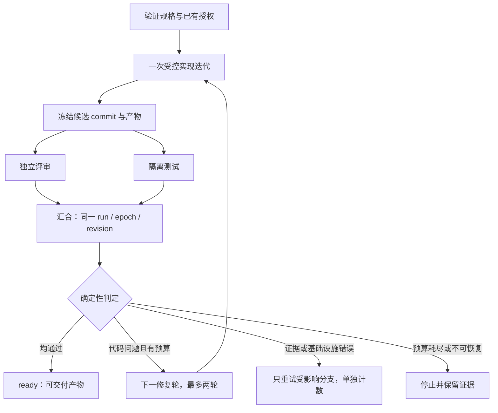

# OSStack 可执行图编排：开源选型与产品演进

日期：2026-09-13。源码基线：osstack `b476bcc`。状态：研究结论与待实施设计；没有把现有 `graph explain` 视为执行引擎。

**建议在 osstack 中增加独立的 `@osstack/graph` 模块，首个执行内核采用 LangGraph.js 验证和实现；Google ADK 2.0 TypeScript 作为直接参照与候选替代。现阶段不建立独立 osgraph 产品，也不从零编写持久化调度器。** 第一版交付一条真正执行的代码工作流：实现候选版本 → 并行评审与测试 → 严格汇合 → 有界修复或交付。执行内核的最终准入取决于权限、恢复、隔离和性能门槛，不以演示能跑完为准。

开源版本已经存在，而且 Google 自己的 ADK 就是其中之一。问题已经从“有没有 graph engineering 开源实现”转成“选哪个执行内核，以及 osstack 如何保留执行权威”。[^1][^2]

## 1. 目标的准确含义

本方案中的图是**任务与控制流图**。节点有显式输入、输出和终止条件；边表示数据依赖或条件路由；并行分支在明确的屏障处汇合。模型承担判断、生成、评审，代码承担数据转换、分支选择、预算检查和状态迁移。Google 的相关教程同时讨论图式、协作式和动态编排，不能把所有多智能体协作统一当成可执行图。[^1]

| 形态 | 主要解决的问题 | 在 OSStack 中的位置 |
|---|---|---|
| 关系图 / 知识图谱 | 哪些对象相关、证据在哪里、如何检索 | 现有 `graph explain` 及未来可选知识上下文 |
| 可执行任务图 | 下一步执行谁、需要什么输入、何时等待、失败去哪里 | 本次新增目标 |
| 蜂群 / 多智能体团队 | 如何分工、委派、讨论、协同产生结果 | 可以运行在某个图节点里，也可以参与多个节点 |

“蜂群”本身不规定持久化、AND-join、权限与终止语义。一个 coordinator 可以动态委派任务；一个图也可以把若干 agent 固定到不同分支。两者可以组合，不能仅用机器人数量区分。这里不对未提供确切项目链接的“Grok bot”实现作推断。[^3]

Graph Engineering 是一组工程方法，并非必须通过某个同名 SDK 获得的认证或产品。采用 LangGraph 实现相同的显式执行约束，仍满足这里的“Google 式”目标；使用 Google ADK 也不会自动获得 osstack 的权限、进程隔离和业务成功标准。

## 2. 用户提供的三个项目，分别有什么价值

| 项目 | 核实到的内容 | 对本目标的用途 | 不应据此推断 |
|---|---|---|---|
| Awesome-Graph-Engineering | MIT 资源索引；所克隆版本共有 README、LICENSE 和六张图片，包含论文、应用及框架链接 | 建立知识图与任务图的全景，继续追踪资料 | 仓库自身提供可运行调度器，或已附带独立交互地图应用 |
| graph-engineering-playbook | MIT；方法论、任务图章节，以及 Python `extract → validate → fuse → serve` 示例 | 借鉴节点契约、真正的数据依赖、独立验证者、证据来源和汇合责任 | Python 示例就是 agent 图执行运行时 |
| GraphGen | Apache-2.0；知识图谱驱动的合成数据 / QA / SFT 数据生产项目，旧地址转至 InternScience | 以后作为一个可选的数据生产工作流 | 能直接提供本需求的 agent 编排内核 |

这三者都值得保留，但不能承担相同职责。Awesome 的本地克隆已经位于 `/Volumes/AIMATE_WORK/Developer/CodeX/Awesome-Graph-Engineering`，固定提交 `d30a601e5ded64a595985e182b2b962519122ed3`。[^4][^5][^6]

Playbook 的无密钥 mock 示例实际运行结果是：3 篇文档产生 15 个实体提及和 13 个关系候选，拒绝 2 个类型不合法的关系，最终得到 7 个规范实体、9 条边。它验证了知识处理流程可以运行，不能作为持久化任务图、取消或失败恢复的证据。[本地输出](2026-09-13-executable-graph-evidence/playbook-mock.txt)

对 osstack 最值得吸收的四点是：边必须有真实数据依赖；简单转换用代码；评审使用独立上下文；所有结论携带可追溯的来源。Playbook 的任务图文档支持这些方法，但初版执行内核应来自真正的工作流库。[^5]

## 3. 开源执行框架比较

以下版本来自本次 npm 查询或固定源码，不代表永远最新。许可按对应仓库和包核实；商业托管服务与开源库分开看待。[版本与提交证据](2026-09-13-executable-graph-evidence/upstream-metadata.json)

| 候选 | 开源与语言 | 与需求直接相关的能力 | OSStack 适配判断 |
|---|---|---|---|
| **Google ADK JS 2.0.0** | Apache-2.0，TypeScript | `Workflow`、函数节点、`JoinNode`、路由、schema、节点重试、请求输入；实际发布包可运行 | 最直接的 Google 参照；本次运行 `Workflow` 仍发 experimental 提示；不能沿用“只有 Python”的旧判断 |
| **LangGraph.js 1.4.15** | MIT，TypeScript/JavaScript | 状态图、显式 AND 边、条件路由、重试、interrupt、checkpoint、循环上限 | **首选实施内核**；已有可用的公开 checkpointer 扩展点，纯函数节点可桥接现有 agents；不要求改用它的模型客户端 |
| Mastra Core 1.66.0 | TypeScript；非 `ee` 目录 Apache-2.0，`ee` 另有企业许可 | typed workflow、parallel、branch、suspend/resume 等工作流接口 | 易用性值得参考，但包声明 Node ≥22.13，osstack 声明 ≥20；会引入较多重叠 agent/harness 能力 |
| Google ADK Python | Apache-2.0，Python | Google 原生图及协作编排路径 | 若团队决定 Python worker 可评估；当前 TS 已有实现，无须为“Google 式”额外加 Python 服务 |
| Microsoft Agent Framework | MIT；主要仓库 Python/.NET，README 另提供 Go 实现入口 | 工作流、多智能体编排及人机交互 | 是真实候选，当前没有核实到与现有 TS 包同等直接的嵌入路径，初版会增加语言边界 |
| Temporal TypeScript SDK | MIT SDK，需 Temporal 服务和 worker | 持久化工作流、活动执行与重试等可靠执行基础 | 若发展到多机、长周期、跨服务流程可重估；当前引入服务端部署成本偏高，不是 agent 图的即装模板 |

依据：Google SDK 源码与发布包；LangGraph 官方仓库与持久化文档；Mastra 控制流文档和实际许可文件；Microsoft 与 Temporal 官方仓库。[^2][^7][^8][^9][^10][^11]

### 为什么暂选 LangGraph，而不是直接 ADK 或自研

1. **与现有栈相容。** 节点可直接调用 OSStack 的受控动作接口，不必替换已有模型适配器。开源执行库可独立于 LangSmith 托管服务使用。[^7]
2. **恢复机制有直接证据。** 本次完成内存中断、SQLite 跨进程恢复及崩溃窗口探针。ADK 的并行、路由、校验和重试已测；没有对 ADK 做等量持久恢复验证，因此不能声称 ADK 不支持这些能力。
3. **接口稳定性风险更清楚。** ADK 2.0.0 的 `Workflow` 在此次实跑明确标为 experimental。此点降低当前首选优先级，不等于整个 ADK 不可用。
4. **避免重复承担调度器维护。** 不论采用哪种内核，OSStack 都需要动作账本、权限和隔离；这部分共同成本不能作为“现成引擎没有价值”的理由。自研还要额外负责检查点、并发恢复、迁移和中断语义。

这是一次有准入条件的工程选择，不是全面性能排名。若 LangGraph 的公开 `BaseCheckpointSaver` 接口无法完成带 fencing 的写入，或与受控动作桥接后仍无法满足恢复门槛，才根据失败证据评估 ADK 或有限静态 DAG 调度器。第一版只做一种后端，不建立三引擎兼容层。

## 4. 已验证的运行语义与局限

实验环境：macOS arm64、Node **26.5.0**；ADK 2.0.0、LangGraph 1.4.15、LangChain Core 1.2.11、Zod 4.6.4；SQLite checkpointer 1.0.4。全部为离线函数节点，没有模型调用。**最低 Node 20、真实 adapter、daemon 集成尚未验证。**

| 实验 | 实际观察 | 产品约束 |
|---|---|---|
| ADK 并行和汇合 | 两个分支同时活跃，汇合执行一次 | 可以表达真实 fan-out/fan-in |
| ADK 条件路由 | 只执行指定 repair 分支 | 控制流可以由代码决定 |
| ADK 空输出 | 分支返回 `undefined`，即使声明 `outputSchema`，JoinNode 仍释放并给出缺失值 | “结束”不等于“交付了合格结果”；必须强制结果封装并检查存在性 |
| ADK 非空非法输出 | Zod 类型错误阻断下游 | 声明 schema 有价值，但应验证具体边界情况 |
| ADK / LangGraph 重试 | 显式设置后均恰好尝试 3 次 | 不依赖框架默认重试数；业务重试与动作重试分开 |
| LangGraph AND-join | 两个分支同时活跃，下游只进入一次 | 使用数组前驱 AND 边，而非误用两条独立触发边 |
| LangGraph `ok:false` | 分支正常返回，join 仍进入；显式检查后路由 repair | 引擎不会替业务解释成功 |
| LangGraph 中断恢复 | 前一个节点运行 1 次；中断节点的中断前代码运行 2 次 | 中断前的动作不能依赖“只执行一次”假设 |
| LangGraph 循环上限 | 4 次循环后 `GraphRecursionError` | 这是兜底保护；业务停止条件仍须单独定义 |
| SQLite 新进程恢复 | A 进程暂停，B 进程恢复成功；已完成前置节点没有重做 | 持久检查点可复用；不只是 MemorySaver 演示 |
| 动作后、检查点前 SIGKILL | 恢复后模拟外部动作出现 **2 次** | 检查点不保证外部副作用恰好一次 |

共 10 项语义探针和 2 项持久化/重放探针通过各自断言。空输出与重复副作用是**成功复现风险**，不是对应风险已经修复。测试源代码、锁文件与输出见[证据目录说明](2026-09-13-executable-graph-evidence/README.md)。LangGraph 官方文档同样明确 MemorySaver 不跨重启持久化；interrupt 恢复需要考虑节点重执行。[^8][^12]

新进程、文件系统缓存已热的 5 次模块加载中位数：ADK 约 **308 ms**，LangGraph 约 **135 ms**。这不是 CLI 端到端基准，也不是公允框架速度排名，但足以说明两者都不能进入 osstack CLI 的 eager import 路径。[测量原始值](2026-09-13-executable-graph-evidence/import-cost.json)

图内核应放在按需启动的独立 worker 进程。单纯在 daemon 内 `await import()` 仍可能因模块求值阻塞事件循环，影响现有 RPC 延迟。

## 5. OSStack 现状与必须补齐的接缝

| 现有位置 | 源码事实 | 本次应如何复用 |
|---|---|---|
| `agents/src/base.ts` | 实际契约是 `invoke(task, AbortSignal)` 返回事件流；接口没有文件头注释所称的 `cancel(runId)` | 沿用 adapter；将图取消传至实际 signal，并验证进程退出 |
| `loop/src/executor.ts` | 只有内部超时控制器，没有外部 signal 参数 | 增加明确取消链；不能假设现成具备图级取消 |
| 同上 | adapter 流初始 outcome 为 completed；流无 `done` 且无错误也会完成 | 必须补终态事件校验，避免 AND-join 接纳伪成功 |
| `loop/src/loop-engine.ts` | `runCycle` 顺序 await 任务，cycle 末写 LOOP-STATE.json | 不能作为图检查点或并行节点状态存储；其他审计存储不因此被否定 |
| 同上 | `runTask` 是 private；成功时提交并自动 ff-only 合并 worktree，最后清理 | 提炼仅产出候选版本的单次执行服务；不要直接把现有 runTask 包成图节点 |
| `cli/src/daemon.ts` | 已有权限相关上下文、写健康检查、读写信号量、repo 写锁 | 由 daemon 提供受控动作 broker；不能让 worker 直接绕过它调用 adapter |
| 同上 | 一处 adapter dispatch 从 `params.context.repo_id` 取锁标识 | 图路径须由可信仓库注册/解析得到 repo 标识，不接受模型自报或遗漏来决定锁范围 |
| `protocol/src/session-continuation.ts` 及 grant 契约 | continuation 请求、任务授权、风险审批属于不同门 | 恢复输入不是新授权；复用校验与签名思想，不把图规格当 grant |
| `runtime/src/index.ts` | 当前是占位入口 | 包名存在不代表已有可复用执行引擎 |

依据为当前本地源码；关键定位见设计文档的接缝清单。[^13]

还有一个行为边界要明确：图层安排外部评审以后，写节点不能再默认执行一整套 Loop 自评审与全流程重试。建议提炼**一次受控实现迭代**，输出 `candidate_ready`，由图安排独立质量门。旧 Loop 的默认行为保持独立；新的图路径必须保留治理约束，不能把“关闭重复评审”变成跳过最终质量门。

## 6. 产品形态：为什么先进入 OSStack

用户需要的是“现有 agent 和 Loop 能按明确流程协同交付”，不是再维护一套运行凭据、动作状态和仓库锁。因此产品入口建议为 `osstack graph`，内部边界为 `@osstack/graph`，而不是把图逻辑继续塞进关系查询命令。

| 路线 | 得到的收益 | 主要代价 | 决策 |
|---|---|---|---|
| OSStack 内模块 + 现成图内核 | 复用权限、agents、证据、worktree；图状态独立演进 | 需要清晰 broker 与 Loop 接缝 | **首选** |
| 单独 osgraph 产品 | 可定位通用任务编排，发布周期独立 | 容易复制控制面、权限和恢复账本；当前没有第二宿主需求证据 | 暂不启动 |
| OSStack 自研小 DAG 调度器 | 语义完全由自己定义，依赖少 | 一旦加入恢复、中断、失败并发就不再“小” | 作为有证据触发的后备路线 |
| 引入完整 agent 平台替代 OSStack | 可获得成熟平台界面和生态 | 迁移现有控制面与产品心智，任务范围扩大 | 当前不建议 |

未来可以把“OSGraph”作为能力名称，甚至做薄 CLI。拆产品的触发条件建议是：至少一个真实的第二宿主；不依赖 osstack 内部私有状态的稳定执行协议；独立安装和迁移需求；明确维护者。品牌决定与控制面拆分分开进行。

## 7. 首条工作流的产品契约

图中的回边是概念表示；首版编译为最多三轮的有限静态图，不实现任意动态循环。重试某分支时必须保留同一候选 revision，不能重用前一轮的评审结果。

输入至少包括任务目标、验收条件、仓库身份、基础 commit、允许的执行范围及预算。实现节点只生成候选结果；评审与测试读取同一个固定 commit，各自使用独立工作区。测试可以在自己的隔离目录产生缓存和报告，“只读评审”标签不等于操作系统级隔离。

输出是候选 commit、可独立保存的 patch/内容包、评审和测试证据、完成或停止原因。首版 `ready` 只表示结果已通过本图质量门；merge、push、部署属于将来独立的受控发布动作，按已有授权执行，无须人为增加每一步确认。

停止规则明确包含：deadline、动作预算、修复轮次、分支尝试上限、失败分类、取消、撤权、不可判定的副作用。预算未知时不得当成零成本继续调度。已经在外部运行的动作是否可立即停止，取决于 adapter/provider，不能承诺绝对即时的花费上限。

## 8. 控制面和恢复的核心设计

**两类真相分别归属，不能双写同一含义的状态：** LangGraph checkpoint 是调度位置与图数据的权威；OSStack ledger 是权限、动作 intent、结果确认与资源所有权的权威；用户看到的 graph-run 状态是两者的投影。不能把 checkpoint 误称为完全可由动作账本重建，因为其中还可能含纯函数结果和待执行分支。

worker 中的节点只通过 daemon broker 发起受控动作。broker 先登记 intent，再执行；若同一逻辑动作重放，查询已有结果。confirmed 返回原有结果引用；unknown、cancel_pending 或 reconciliation_required 阻止自动重发。对不支持幂等的 provider，不承诺物理执行或计费“恰好一次”。

每个 worker 代际有 lease 与 fencing generation。持久检查点的 `put` 和 `putWrites` 都要受当前代际约束；仅拦截完整 checkpoint 会遗漏并行 pending writes。外部 worker 不直接持有控制面数据库写权限，持久写入通过 daemon 的受控 saver/存储服务完成。检查点与动作 ledger 的落库不假装跨库原子；重放与对账桥接崩溃窗口。[^14]

**fencing 不能阻止已经启动的旧子进程继续改文件。** 新代际不得复用尚未确认停止的旧工作区；每次写动作使用独立租约工作区，冻结结果后以不可变 commit 分发。旧工作区隔离保留，经过进程与产物核对后再回收。

恢复时及每个动作启动前重新检查当前身份、tenant/workspace、scope、grant、过期时间和撤销状态。保存的“之前允许”不构成现在的许可。程序输入 true、模型评语“approved”、签名 continuation 都不能替代所需的动作授权。

## 9. 交付顺序与发布门槛

实施细节、接口草案、状态机、动作键、测试清单和任务依赖见 [可执行图设计与实施计划](../design/2026-09-13-executable-graph-plan.md)。

| 阶段 | 可验收产物 | 进入下一阶段的条件 |
|---|---|---|
| P0：补接缝与锁定内核 | 单次候选执行接口；终态校验；取消穿透；受控 saver / broker 的最小恢复切片 | 真实控制面集成通过，不以本次离线探针替代 |
| P1：单条完整工作流 | validate/run/status/cancel/resume；固定代码交付图；明确节点输入输出与停止原因 | 同版本评审/测试汇合，坏 schema 不触发代码修复，预算真正截止 |
| P2：可靠性准入 | 重启、未知副作用、陈旧 worker、撤权、取消、工作区隔离、兼容性与性能证据 | 所有关键故障窗口通过，才开放真实写入的 graph beta |
| P3：产品化 | 可视化执行轨迹、可复用模板、比较延迟/成本/人工介入 | 真实任务显示收益，再评估更多模板和 osgraph 外壳 |

关键发布门槛包括：不存在无 `done` 的伪成功；旧 revision 无法进入新一轮 join；重复请求不制造第二份已确认动作结果；未知执行不得盲目重发；旧进程污染不会进入新候选版本；撤权后后续节点不启动；取消未确认时不谎报 cancelled；Node 20 与当前 CI 运行时可用；CLI 启动和 daemon RPC 预算不回退。

第一版不需要 Neo4j、GraphRAG、GraphGen、可视化拖拽编辑器、动态生成拓扑或多 writer 并行修改同一仓库。它们不在这条产品验证的关键路径上。

## 10. 结论的边界与后续判断

当前证据足以确认：开源执行内核存在，TS 内嵌路线可行，OSStack 有值得复用的治理和 agent 资产，并且当前 Loop 接缝需要显式改造。证据尚不足以宣称任一候选已经在 OSStack 上达到生产可靠性，或图编排必然提升真实任务成功率。

收益应对同类任务比较：成功验收率、端到端耗时、模型成本、无效重试次数、恢复后重复动作数、人工介入次数。并行优化的理论收益来自评审和测试可重叠；实际收益还需扣除 worktree/依赖准备、检查点和治理开销。先交付完整流程并收集基线，再扩大图的规模。

## 来源

[^1]: Google AI，[Graph Engineering 101 / systems architecture discussion](https://dev.to/googleai/is-graph-engineering-just-reinventing-systems-architecture-for-the-ai-age-2427)；Google Codelab，[ADK2 Orchestration](https://codelabs.developers.google.com/adk2/instructions?hl=en)。
[^2]: Google，[adk-js](https://github.com/google/adk-js)，固定源码 `fbd7f5aa8133ed25df33ddb46fc37ae65ff69c72`；[Graph routes](https://adk.dev/graphs/routes/)；本次发布包版本见证据锁文件。
[^3]: Google ADK，[Collaborative workflows](https://adk.dev/workflows/collaboration/)。
[^4]: DEEP-JLU，[Awesome-Graph-Engineering](https://github.com/DEEP-JLU/Awesome-Graph-Engineering/tree/d30a601e5ded64a595985e182b2b962519122ed3)。
[^5]: PO-VINCENT，[graph-engineering-playbook](https://github.com/PO-VINCENT/graph-engineering-playbook/tree/692d161587099adda5945982ff3db9213c343ee4)，尤其 [task-graphs.md](https://github.com/PO-VINCENT/graph-engineering-playbook/blob/692d161587099adda5945982ff3db9213c343ee4/references/task-graphs.md) 和 `pipeline/run_demo.py`。
[^6]: InternScience，[GraphGen](https://github.com/InternScience/GraphGen/tree/3a3eb097318d34b07f6f31cb60de5b20712d65ce)。
[^7]: LangChain，[LangGraph.js](https://github.com/langchain-ai/langgraphjs/tree/592fd0cab0fd9287fab1b7c7fcfd4abc44675700)。
[^8]: LangChain，[Persistence](https://docs.langchain.com/oss/javascript/langgraph/persistence)；[Fault tolerance](https://docs.langchain.com/oss/javascript/langgraph/fault-tolerance)。
[^9]: Mastra，[Workflow control flow](https://mastra.ai/docs/workflows/control-flow)；[LICENSE.md](https://github.com/mastra-ai/mastra/blob/76cec9be889c0a6ae7f51fbf25356d5a06019351/LICENSE.md)。不能把 GitHub 元数据的 NOASSERTION 解读为没有许可。
[^10]: Microsoft，[Agent Framework](https://github.com/microsoft/agent-framework/tree/1cd06c5a2058a172eebadf5d9d7c3fa45c519520)。
[^11]: Temporal，[TypeScript SDK](https://github.com/temporalio/sdk-typescript/tree/e37ed88b7c71dc35c022464d095bca69a9b2dcd3)。
[^12]: LangChain，[Interrupts](https://docs.langchain.com/oss/javascript/langgraph/interrupts)。
[^13]: 本地源码：[adapter](../../packages/agents/src/base.ts)、[executor](../../packages/loop/src/executor.ts)、[LoopEngine](../../packages/loop/src/loop-engine.ts)、[daemon](../../packages/cli/src/daemon.ts)、[session continuation](../../packages/protocol/src/session-continuation.ts)、[runtime](../../packages/runtime/src/index.ts)。固定检查基线 `b476bcc`，详细定位在实施计划。
[^14]: LangGraph，[BaseCheckpointSaver 公共契约](https://github.com/langchain-ai/langgraphjs/blob/592fd0cab0fd9287fab1b7c7fcfd4abc44675700/libs/checkpoint/src/base.ts)。fencing saver 与 OSStack broker 是本方案待开发的集成，不是此库自带的 OSStack 能力。
