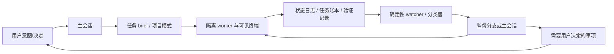

# Firstmate 深度拆解与 OSStack 借鉴地图

日期：2026-10-23（America/Los_Angeles）。研究结论：最应借鉴的是“执行之外的持续监督与用户决策闭环”；实现宜保留 OSStack 的类型、数据库、授权和证据内核，以行为契约移植为主，避免整体引入 firstmate 的 Shell 运行时。

阅读入口：[详细设计](../design/2026-10-23-firstmate-capability-adoption.md) · [分阶段实施计划](../plans/2026-10-23-firstmate-adoption-plan.md) · [Fable 审计及处置](2026-10-23-firstmate-claude-audit.md) · [研究证据](2026-10-23-firstmate-evidence/README.md)。

## 1. 已完成的研究与可信边界

- 原项目：https://github.com/kunchenguid/firstmate。
- 独立 checkout：`/Volumes/AIMATE_WORK/Developer/CodeX/firstmate`；浅克隆，固定提交 `af1c6817fc47589b162cbc361671c43cdb150933`，工作区干净。最初完整历史拉取较慢而中止，随后成功浅克隆；未伪称取得全部历史。
- OSStack：当前 HEAD `b476bcc3fbbfcc11953abd3d154e59f7f85c4660`，存在用户先前的修改和未跟踪文件。只新增本次研究材料，原变更保留。证据记录了研究起点状态及关键源码 SHA256。
- 方法：全仓文件清单与大小/哈希统计；重点阅读监督、忙碌状态、决策、交付、回收、后端、远程、记忆、路由等路径；核对 OSStack 的实际实现；运行选定上游隔离测试；让 Fable 5.1完成三轮固定上下文挑战，保留原始输出并逐项处置。
- 没有做完整逐行安全审计、全量 firstmate 测试、真实终端/远程/模型执行试点；未调用 osstack 打开持久控制面 DB。

源码证据引用使用 F/O 编号，具体文件、行号、固定 URL 和 SHA256 在 [source-index.json](2026-10-23-firstmate-evidence/source-index.json)；摘录在 [source-excerpts.md](2026-10-23-firstmate-evidence/source-excerpts.md)。F 表示 firstmate，O 表示当前 OSStack。

## 2. 这个项目实际是什么

Firstmate 是一套“主监督 Agent + 终端 worker + 机械守卫 + 项目约定”的发行模板。用户只向一个主会话表达意图，主会话编制 brief、派 worker、监测、处理门禁、向用户交付结果。终端/后端承载可见工作进程，worktree 隔离变更，状态和任务账本跨对话保留。

它的优势来自大量真实交接与恢复边界的显式化，而不只是 AGENTS.md 中的角色扮演。其 Bash 工具承担判定、锁、回执、状态折叠、守卫；模型承担需要语义的编排和解释。

项目规模（排除符号链接后的 tracked regular files，不能等同于模块数）：728个文件；bin下235个文件；277个 `.test.sh` 行为测试；docs下75个文件。`fm-spawn.sh` 6985行、`fm-watch.sh` 4106行、`fm-teardown.sh` 4058行、`fm-classify-lib.sh` 2829行。见 [manifest](2026-10-23-firstmate-evidence/firstmate-source-manifest.json)。

含义：它已经是一个覆盖多 harness、多终端、多 forge 和恢复边界的操作系统式工具集合。直接 vendor 会把维护成本一起引入；OSStack 应选择其稳定行为，而不是复制其全部分支。

## 3. 能力地图：哪些值得拿、如何拿

“现有”只指此 checkout 中看到的能力，不代表全部生产场景已验收。优先级是本研究建议。

| 能力 | firstmate 实现锚点 | OSStack 现有/缺口 | 迁移方式 | 优先级 |
| --- | --- | --- | --- | --- |
| 单一用户联络入口 | README、AGENTS.md、supervision-host | deliver/daily/cockpit入口分散 | 产品入口聚合；不新增全权 Agent | P1 |
| 语义 busy/idle/unknown/dead | busy-lib + busy-event，F01–03 | session state已有，观测可信度不独立 | 引入 observation contract | P0 |
| 旧实例事件隔离 | busy-gen、seq | message/version已有，启动实例观测需补 | controller铸造instance，来源CAS | P0 |
| 等待责任与解除条件 | classify、captain hold，F06–07 | session-wait已有有限分类 | 扩展有来源的WaitRecord | P0 |
| 事件驱动监督 | watch + backend push/fallback，F11 | daemon/持久事件已有，task.observe仅快照 | 标脏、补读、有界归约 | P0 |
| 回合结束交接检查 | turnend-guard + wake-lib，F04–05 | 尚无统一交接证明 | coverage report后再做receipt/hook | P1 |
| 主会话与监督分支分工 | supervision-host、lease-lib，F09/F16 | 签名受限续跑已有 | 先复用controller；模型只分诊 | P1 |
| 决策持久化和来源绑定 | captain-hold-lifecycle，F06 | SessionDecision/approval/probe分散 | Inbox投影，不替代源账本 | P0/P1 |
| 回答幂等与未知投递 | answer digest、correlation | message_id/CAS/receipt已有，O03–04 | 复用源消息通道及唯一action ID | P1 |
| 低打扰/离开模式 | afk/quiet、supervision-host | 未见统一用户在场模式 | 通知偏好层，不迁移授权解释器 | P1 |
| 增量返回简报 | bearings snapshot、afk-return | daily已有delta/owner decisions，O11 | 增加scope+viewer cursor | P0 |
| 调查与交付分型 | scout/ship | research adapter与delivery已有 | 任务类型、产物、权限分别声明 | P1 |
| 统一交付完成标准 | dod-lib，F10 | verifier/proof/autonomy已有 | contract digest驱动brief和runner | P1 |
| 清理前成果与决策保全 | teardown，F15 | 旧worktree helper语义更粗，O08 | 移植拒绝条件与测试，禁止直接启用自动清理 | 独立门禁 |
| 有界能力协商 | backend events / extension bindings | Adapter接口已有，runtime占位 | 适配器能力矩阵，不一次实现所有后端 | P2 |
| 可见工作进程 | tmux/herdr/cmux等 | CLI/TUI/日志已有 | 先日志跳转、再展示后端 | P2 |
| 远程home与断线unknown | remote-secondmates，F13 | 无此次已核实的通用远程home等价物 | 单独协议项目，不纳入MVP | P3 |
| 外部事件扩展 | extension-bindings | plugins包已有，不等于此能力 | 小能力manifest+pin+handshake，先只读 | P2 |
| 状态对外ledger | fleet-ledger，F08 | events/kanban订阅更结构化 | 复用现有事件，不能降级成无序号JSONL | P1 |
| 记忆预算与衰减 | stow、startup-memory-budget，F14 | lesson draft/knowledge hygiene已有 | 借鉴保留策略和来源，不另建记忆库 | P2 |
| 轻量任务路由 | dispatch-resolve、quota profiles | routing policy/scorecard已有 | 分离任务实质与模板噪声，先离线评估 | P2 |
| 对外承诺持久化 | public-followup | 通知已有，但完成承诺非统一对象 | 若做消息网关，先建obligation，不先接社交平台 | P3 |
| 自仓库发布边界 | role-lib/self-repo | R0–R4与contract已有 | 显式repo publication scope，保留已有批准 | P1 |
| 自更新/多home收敛 | update/restart路径 | upgrade/drain已有 | 只借鉴“更新后确认实际运行版本”，不另造更新器 | P3 |

## 4. 最有价值的机制拆解

### 4.1 状态必须带来源，并绑定实际启动实例

`fm-busy-event.sh` 是 busy记录的唯一写者；arm生成gen，apply必须携带正确gen，并在锁内递增seq和替换记录。reader拒绝格式错误和gen mismatch，classifier还检查source是否属于对应harness。即便终端显示类似忙碌文字，也不允许另一个harness的规则越权解释。F01–03。

这里值得迁移的是**身份、时序、来源和保守的unknown**，不是其文件编码。OSStack已经有Zod、SQLite和消息CAS，直接把这些机制写成有限的结构化事件更自然。

限定：上游busy reader里的stale既涉及实例不一致，运行时忙碌时长与wedge阈值又由其他层处理；不能笼统宣称“每条busy都有通用TTL验证”。新设计显式增加freshness，属于OSStack的设计选择。

### 4.2 “没有新输出”不是一个足够好的故障定义

Firstmate区分worker声明paused、用户持有决策、监督分支待答、验证正在运行、工作树仍有写入，以及真正疑似卡死。重检查有节流，死掉的endpoint与还活着但无进展的endpoint也分别处理。`fm-classify-lib.sh` 对未决decision做fold：开放的问题不会被随后无关done行覆盖。F07。

OSStack应借用这套分类问题，而不是复制pane hash。headless执行可以取得更好的来源，直接使用已登记的run、turn、CI check和审批对象。文件活动只能作为诊断补充，绝不能当业务成功证明。

### 4.3 监督本身也需要健康检查

F04显示watcher健康不是单看PID：还要检查home/进程身份与新鲜beacon。F05把这个条件接到主会话结束边界，并限制修复续轮次数。

更深的一层：Firstmate不同harness的arm机制不同，Claude stop、Pi extension、Codex前台checkpoint不能被一句“都支持后台”掩盖。OSStack应把support拆成明确能力，验证成功才开放对应入口；首期coverage是最后观测结果，不做永久在线承诺。

### 4.4 待用户决定的事情不能随worker清理一起消失

Firstmate当前captain call是原backlog中被hold的任务，不另造一个任务数据库；来源worker可以清理，但持久决定仍须有对应记录。`answer`保留用户原话及digest；中断重试匹配同一答案和关闭模式；`complete/verify`验证待决策清单。F06/F15。

OSStack有多个权威源：SessionDecision、风险批准、probe义务。这种情况下直接把全部决策改造成kanban task会损失类型和权限。应该建立统一只读收件箱，以source_ref链接源系统，回答经原系统生效。**复制用户体验，保留OSStack的权威数据模型。**

### 4.5 “已经处理唤醒”与“已经通知用户”有不同回执

watcher-continuity区分队列、交接、actor acknowledgement与主会话消费；supervision-host将routine outcome留在后台，需要用户关注的outcome进入主会话。F16及[固定文档](https://github.com/kunchenguid/firstmate/blob/af1c6817fc47589b162cbc361671c43cdb150933/docs/watcher-continuity.md)。

OSStack的outbox已经处理投递重试，但投递成功不能关闭风险批准或待答问题。新设计将item lifecycle、delivery lifecycle和业务action receipt分开，使“消息已发”不被当成“用户已经解决”。

### 4.6 交付标准必须从一个地方生成

`fm-dod-lib.sh`同时供brief、scout promotion和当前状态判断使用，校验具名HEAD是否在可丢弃worker copy之外可达。它避免了“直接spawn要求严格、scout升级却漏了规则”的分叉。F10。

OSStack应统一normalized contract→prompt/rendered brief→effective options→verification的绑定。直接搬`no-mistakes`会和已有verifier、guarded autonomy重复；真正值得搬的是单一规范和多个入口的一致性测试。

上游forge规则存在不同证据标准，例如external review模式可以只校验特定URL形态，不能据此宣称其所有done都是OSStack proof等级。我们的完成级别应继续绑定精确产物、评审与发布证据。

### 4.7 前台对话与机械监督分开，才有低打扰体验

Firstmate在Pi中用独立conversation branch，在其他受支持primary旁用headless supervision host。其角色和租约是confused-agent-grade防误用，源码明确不声称阻挡同UID恶意Shell。F09/F16。

OSStack的“分离”首先是职责和数据流，不必再起一个长期全权大模型。确定性处理完成大多数等待和状态变化；只有含糊异常才给无工具模型分诊。已有controlled session和签名grant保留独立权限边界。

### 4.8 记忆管理的好处是控制输入，不是不断增加规则

stow区分pinned、aging、perishable；独立证据才能刷新知识日期，未验证内容不能靠“看起来正确”续命。部分知识按需加载，常驻上下文有预算，开放工作另行保存。F14。

对OSStack：把lesson draft的“是否晋升、适用哪些repo、何时复查”做清楚，比增加第二套memory文件更有价值。监督错误形成lesson draft，人工或既有治理审核后晋升；模型不得把一次临时异常写成永久规则。

### 4.9 路由模型应看到任务实质，不应被模板的安全措辞误导

上游dispatch-resolve记录了只提取Captain intent和Firstmate spec的试验。其历史报告中，ship输入从约4350 tokens降到约600，但没有提高那组任务的路由准确率，某些边界case还降为ambiguous；把mode/no-mistakes标签塞进输入会影响难度分类。[固定验证记录](https://github.com/kunchenguid/firstmate/blob/af1c6817fc47589b162cbc361671c43cdb150933/docs/verification/dispatch-resolve.md)。

这些是上游记录的样本结果，非本次测量，不能转换成OSStack的节省承诺。建议先用自己的历史任务做离线消融：完整prompt与纯任务意图、准确率、升级率、漏配review、实际输入量同时比较，再考虑更廉价模型。

## 5. 不应照抄的地方

1. **文件分散状态与超大Shell模块。** 原生终端生态需要大量兼容分支；OSStack已是TS控制面，复制会制造两套真相和更多运维接口。
2. **终端可见等于可恢复。** 可见pane不是可靠实例身份，idle也不是取消完成。Desktop host tools与通用shell bridge不同，F12明确承认其Codex App backend尚不可选。
3. **watcher零token等于整体免费。** 监测不用模型，但supervision engine、worker、模型路由与摘要仍有费用。应测端到端同质量交付成本。
4. **离开模式解释自然语言成为OSStack授权。** Firstmate可在既有守卫下解释away words；OSStack应继续使用明确的批准、scope与签名grant。
5. **activity ledger当作权威账本。** 上游文档明确无序号、无gap detection、无fsync强制落盘、无轮转、正文不脱敏，F08。它适合展示集成，不能取代OSStack事务事件。
6. **过期锁自动接管执行器。** Firstmate租约服务于监督actor防误用；OSStack需保留执行锁和副作用证明。监督lease过期不构成外部进程已停止。
7. **远程失联就本地重试。** Firstmate自身拒绝该行为，F13；应保留unknown及原host身份，这条值得原样采用。
8. **把所有内置skills装进OSStack。** 上游明确区分home内部skills与独立public skill；内部skill依赖路径、工具、角色和状态，移植前必须抽离契约。

## 6. OSStack 当前实现的真实差异

| 已有事实 | 源码证据 | 对本方案的约束 |
| --- | --- | --- |
| Session状态、decision事件和resume能力是结构化的 | O01 | 增加观察维度，保留旧协议 |
| 同message ID不同payload拒绝，CAS保护session version | O03 | Inbox回答不能另造无幂等发送器 |
| 签名grant有runtime fingerprint、过期、步骤和次数限制 | O04、core/state/session-continuations.ts | 首期不扩大controlled session自动权限 |
| waiting已有delivery_uncertain等诊断 | O02 | 扩展可解释性，不能抹掉既有unknown |
| autonomy outbox有dedupe、retry、dead letter、ack | O05 | 可复用模式，但它不是通用跨源inbox |
| task.observe是snapshot replay | O06 | 需要明确新增live dirty hook和持久补读 |
| Loop恢复基于best-effort JSON snapshot | O07 | 不宣传所有来源可靠事件重放 |
| worktree orphan清理按路径与branch prefix筛选 | O08 | 在更强恢复之前先解决保留与所有权门禁 |
| daemon pidfile非原子check-then-write | O09 | 新owner不能直接依赖该实现作为fencing |
| graph命令仍只读explain | O10 | 后续Graph文档独立列出，不能虚构依赖 |
| daily已有有限owner decisions | O11 | 利用现成结构做“自上次查看以来” |
| Codex是headless JSONL模式 | O12 | 不套用firstmate TUI观测限制 |

对已有worktree和pidfile风险的判断来自源码，未在真实daemon上复现。它们作为将来自动接管的前置门禁记录，不在本次研究任务中擅自修复。

另读了本地未提交的成本控制状态索引（`2026-10-08-cost-reduction-status.md`，不作为本 PR 的可用文档依赖）指向的persistent candidate controller v3提案；该提案强调固定任务批次、有限权限和未知副作用保留。与本方案相容的整合方向是只消费其receipt/status，不接管它的执行。该外部工作目录和本checkout基线不同，实施前必须重新绑定当前源码，不宣称已合并。

## 7. 本次实际验证

执行firstmate自己的测试入口，在独立scratch TMPDIR中运行，未启动真实coding agent或连接远程后端：

| 测试 | 结果 | 说明 |
| --- | --- | --- |
| fm-busy-state.test.sh | exit 0 | arm/apply/retire、来源与实例隔离、unknown与后端分类 |
| fm-classify-decision-key.test.sh | exit 0 | decision key折叠、未决项、增量语义 |
| fm-dod-lib.test.sh | exit 0 | 交付contract、promotion、具名HEAD与forge分支 |
| bin下216个Shell脚本的`bash -n` | 全部通过 | 仅语法检查，非行为正确性或漏洞证明 |

三组suite共81条`ok -`断言报告、0失败、0gate skip，总耗时约17秒。原始日志与机器结果见[upstream-validation.json](2026-10-23-firstmate-evidence/upstream-validation.json)。不能把这三组通过等同于277组全通过，也不是OSStack新能力的测试。

## 8. 具体借鉴策略与代码来源

建议使用“机制移植 + 测试语义移植 + 产品流程借鉴”三条路线：

- **机制移植**：busy/gen/source、等待解除条件、cover receipt、decision episode，用原创TS/Zod/SQLite实现。
- **测试语义移植**：把上游已遇到的事故情景转成OSStack fixture：旧实例迟到、无关done不能清除问题、answer ACK丢失、正常等待误报、brief与promotion分叉。
- **产品流程借鉴**：brief/quiet/away/inbox的清晰交互，沿用OSStack命令命名和权限模型。
- **逐文件代码复用**：仅在具体实现确有收益时选取小纯函数，记录原仓库、固定SHA、原路径、许可证、改动和测试映射。不要直接执行上游脚本操作OSStack home。

仓库LICENSE为MIT，Copyright (c) 2026 Kun Chen；若复制代码或实质性文档片段，保留版权和许可文本，并在THIRD_PARTY_NOTICES/所复制文件记录来源。证据目录已经随源码摘录保留[原许可证](2026-10-23-firstmate-evidence/firstmate-LICENSE.txt)。外部treehouse/no-mistakes/tasks-axi等依赖应单独核对版本和许可证；本方案不引入这些依赖。

这次没有把firstmate的实现代码放入OSStack生产包；源码摘录只是带许可的研究证据。

## 9. 建议的投入顺序

1. 先做当前源的只读状态与决策聚合，补足观察来源、scope和gap披露。
2. 用真实SQLite崩溃/重复/乱序测试证明不会丢未决事项或重复动作。
3. 再做手动回答、通知及有限期限的接管回执。
4. 接入一种已验证headless Agent并做隔离pilot。
5. 有实际误报/漏报/成本数据后，再加模型分诊、visible worker和路由优化。

详细接口、数据表、故障矩阵、性能目标和迁移/回退策略见[设计](../design/2026-10-23-firstmate-capability-adoption.md)。任务拆分见[实施计划](../plans/2026-10-23-firstmate-adoption-plan.md)，未完成项保持未勾选。

## 10. 用户体验应该怎样变化

用同一个例子检验借鉴是否有价值：用户让OSStack修复一个问题，worker完成第一步后需要选择兼容策略，同时另一项验证还在等待。

| 时刻 | 建议呈现 | 背后的约束 |
| --- | --- | --- |
| 用户准备离开 | “有2项工作；1项需你选择；后台观察覆盖截至某时刻” | 没有真实扫描回执就不能称已接管 |
| worker没有输出 | “等待兼容策略选择，责任人：你” | 沉默不等于卡死，不自动催worker重做 |
| collaborator已有有效续跑责任 | “系统负责下一步；执行状态待确认”或有证据的“处理中” | 不制造人与系统同时回答的问题 |
| 用户回来 | “自上次查看以来：完成1项，待选1项，另有1项监督缺口” | 已读位置独立于业务完成，最多3个重点但保留总数 |
| 用户提交答案后连接超时 | “答案是否应用尚未确认；正在查询原回执” | 不生成新的message ID盲目再发 |
| 重启发现旧worker/worktree | “工作保留，恢复需要确认” | 不把残留当垃圾删除，也不重放未知动作 |

S0只提供上述事实的单次查询；S1提供有界后台观察与只读未决视图；回答、通知、离开返回体验到S2才成立。这个例子同时是后续演示脚本与验收路径。

投入取舍：优先做能减少“漏掉决策、重复动作、误报卡死”的能力，成功标准是更低的漏项/重复率和更短的人工发现时间。可见终端与远程编排的展示效果更明显，但目前会引入更多身份、断连与控制面问题；在监督闭环没有实测前，不把它们放在同一发布批次。

最终设计审计结果：第三轮未发现剩余P0/P1，认可S0作为实现起点；新增4项P2已写入设计与任务验收。持续监督与回答能力仍待宿主修复、并发/恢复测试和真实harness资格验证，见[完整处置](2026-10-23-firstmate-claude-audit.md)。
