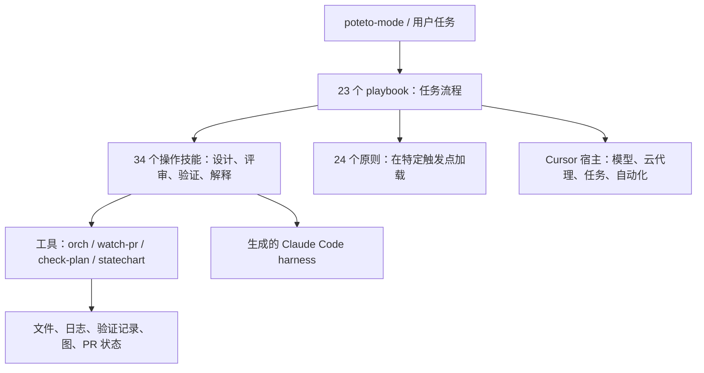
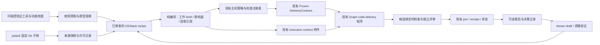

# pstack 深度研究与 OSStack 能力集成报告

> **2026-10-27 联合设计增补：** 当前实施契约、能力映射和 PR 顺序请先读 [Firstmate × pstack 联合设计](../../design/2026-10-27-joint-engineering/README.md)。下文保留修订 2 的研究与历史验证；重叠设计按联合规格收敛，产品仍未实施。历史审计只适用于当时输入，不代表本次增补已获模型复审。

**研究日期：2026-10-26｜修订 2：已结合作者两篇原文更新｜状态：研究与设计，尚未实施产品集成**

本轮交付范围按你的选择确定为：详细报告、能力抽取清单、可执行集成规格。已将上游 clone 到本地、固定版本、阅读重点源码、运行工具测试和针对性语义探针。本报告中的“建议”“拟新增”“阶段”均表示设计，不能视为 OSStack 已上线的功能。

## 1. 核心判断

**OSStack 应先拥有可被 agent 熟练操作的验证工具和产品地图，再把 pstack 方法接入现有执行、权限与证据体系。** 这次学习作者原文后，最重要的修正是实施次序：验证工具必须先能帮助 agent 闭合真实工作循环，随后再固定方法模板与编译接口。

第一篇把自验证工具视为基础设施；第二篇把问题理解、调用体验和原型证据放在战术计划之前。这补足了上一版偏重控制面、低估开发过程中验证与认知循环的地方。详见 [作者文章学习与设计修订](author-reading.md)，原文为 [第一篇](https://x.com/poteto/article/2094457600259842065) 和 [第二篇](https://x.com/poteto/article/2097732320606507506)。

修订后的产品价值路径：

1. **建立可操控的验证基础设施**：从空隔离环境启动，驱动 CLI/RPC 的真实用户路径，观察副作用，诊断失败并恢复；接口应易组合、可机器读取。
2. **建立可检索的功能地图**：把用户入口、前提、可观察终点、陷阱与恢复方式沉淀为共享产品知识；按任务加载，并持续核对源码和真实行为。
3. **先校准问题，再形成设计**：区分用户目标、症状、根因猜测和未知；调用相关历史与机制证据，让用户及时纠偏，也让 agent 暴露自己的知识缺口。
4. **从使用方式倒推接口，用原型解决未知**：先写调用样例和最小教程；对会改变实现的技术问题做有预算的实验，再收敛架构与执行计划。
5. **开发者自验证与独立交付验证分层**：前者支持快速试改，后者沿用 OSStack 现有合同、候选绑定和可信判定。

方法包仍值得建设：上游提供工程方法，本地审查后的 recipe 将其转成任务材料与验收要求，现有主机负责授权和最终证据。变化在于，接口规格不能先于调用与实验被当成定论；本报告中的新增 API 均须经过 W17 的实际使用验证。

保留上一版的重要取舍：不照搬固定十条 live lane、默认模型和云宿主、TSV 权威状态、以 `ready` 作为合并许可、只凭 patch-id 继承验证。原文对使用方法的解释，不改变这些已验证的源码边界。

## 2. 阅读路径与交付物

| 文件 | 用途 |
|---|---|
| 本报告 | 理解价值、局限、取舍与总体架构 |
| [作者文章学习与设计修订](author-reading.md) | 两篇原文如何改变优先级、产品体验、接口与验收 |
| [完整能力目录](capability-catalog.md) | 58 个顶层技能、23 个 playbook、辅助工具与自动化逐项映射 |
| [可执行集成规格](integration-spec.md) | 新接口、状态语义、模块落点、实施工作包和验收矩阵 |
| [机器可读能力清单](capability-map.json) | 24 组抽取能力、来源、优先级、依赖与验收要求 |
| [验收场景清单](acceptance-cases.json) | 后续实施可以直接据此编写 conformance tests 的输入与预期 |
| [验证记录与限制](validation.md) | 本轮实际执行了什么、发现什么、没有验证什么 |
| [版本锁](evidence/source-lock.json) | 上游与 OSStack 基线身份 |
| [上游文件清单](evidence/pstack-inventory.json) | 200 个文件的哈希、行数、固定版本链接 |
| [OSStack 来源索引](evidence/osstack-source-index.json) | 用于对照的 main 源码及哈希 |

本报告中的几个术语：**recipe** 是经审查的工程方法模板；**host** 是负责执行与授权的可信主机侧代码；**receipt** 是绑定到具体执行和产物的证据回执；**harness** 是可重复启动、驱动和检查目标行为的验证工具链。它们分别对应“方法”“执行权威”“证据”“验证手段”，不能相互替代。

## 3. 研究基线：避免比较错版本

### 3.1 已 clone 的内容

本地目录：`/Volumes/AIMATE_WORK/Developer/CodeX/cursor-plugins`。

这是 `cursor/plugins` 的 Git partial clone + sparse checkout，不是网页下载。`pstack/` 完整保留，同时检出了生成脚本、跨宿主 harness、相关 manifests 和 CI workflow。未安装到全局 skills，也未执行 pstack 的自动化任务。

| 项目 | 固定值 |
|---|---|
| 上游仓库 | `https://github.com/cursor/plugins.git` |
| 仓库提交 | `99b609a72323b70204eab407c622f436e858e112` |
| pstack 子树 | `880564357e051d7c7802da1cb5d8df1d0b008299` |
| manifest 版本 | `0.15.32` |
| 文件数量 | 200 个 Git 跟踪文件 |
| 顶层技能 | 58，其中 24 个为 principle 技能，34 个为其他技能 |
| playbook | 23 |
| agent 定义 | 2 |
| Benny 自动化技能 | 3，单独目录，不计入 58 个顶层技能 |
| 许可证 | MIT，复制相关实现或实质文本时保留其许可与署名 |

版本号不是充分的审计身份；需要同时记录 Git commit、子目录、文件内容哈希和本地转换版本。`cursor/plugins` 是多插件仓库，其根提交变化可能来自其他插件，因此更新检测应同时比较 `pstack` 子树。固定来源：[pstack](https://github.com/cursor/plugins/tree/99b609a72323b70204eab407c622f436e858e112/pstack)、[LICENSE](https://github.com/cursor/plugins/blob/99b609a72323b70204eab407c622f436e858e112/pstack/LICENSE)。

### 3.2 OSStack 采用 main 作为集成基线

当前工作区在 `codex/firstmate-supervision`，HEAD 为 `0a61d278a6cede4fa7b3142fae3e7ab13cc4ed41`，存在本来就有的修改。研究中发现它落后于 main，因此不能仅扫描当前目录就断言“OSStack 缺少 Graph 执行器”。

通过 `git ls-remote origin refs/heads/main` 核实，研究时 main 为 **`c1cfccf18df97fa4b8bc2ed1752071feda9c3670`**。本报告以本地 Git 对象中这一提交的源码为主，通过 `git show <sha>:<path>` 阅读；没有切换、重置或修改现有工作分支。

main 已包含真实 Graph 执行路径以及 Engineering Session 采纳试点。当前工作区的 `docs/design/2026-10-25-engineering-agent/` 作为设计背景参考，但未把设计中的全部未来能力算作已实现。

### 3.3 结论的证据等级

- **源码事实**：当前固定提交中存在的结构或逻辑，可按链接复查。
- **本地观察**：本轮实际运行工具、测试或探针得到的行为，保留命令和日志。
- **设计推论**：根据源码和 OSStack 边界作出的集成建议，尚未通过产品试点证明收益。
- **未验证事项**：模型是否持续遵守流程、实际项目缺陷率变化、成本收益、真实 Cursor 云端体验等。

本轮补读两篇作者原文，来源和阅读范围记录在 [author-articles.json](evidence/author-articles.json)，与固定 Git 源码分别归档。文章中的版本示例不替换本次源码基线，作者个人吞吐不作为本产品效果证据。

本轮对重点流程和边界做了精读，对全部文件做了结构与哈希盘点；**不是对全部 200 个文件逐行完成安全审计**。

## 4. pstack 到底是什么

它有四层，而不是一个单一 agent framework。

**入口层** `poteto-mode` 负责识别任务类型、加载 playbook、组织 TODO 和按需调用原则。优点是避免每个任务携带全部方法；成本是路由和“不适用则说明”的约束仍依赖模型执行。[入口源码](https://github.com/cursor/plugins/blob/99b609a72323b70204eab407c622f436e858e112/pstack/skills/poteto-mode/SKILL.md)

**方法层** 把架构探索、竞争候选、对抗评审、真实验证、长任务恢复等拆成技能。技能之间有引用，playbook 负责时序；同一原则可以在多个流程复用。这比“一个超级提示词覆盖所有工作”更容易维护。

**工具层** 已有实际代码：`orch` 维护本地运行资料；`watch-pr` 读取 forge 并分类；`check-plan` 检查固定计划格式；`statechart` 执行形式模型与可视化辅助。因此不能把 pstack 简化成纯提示词库。但这些工具的保证范围各不相同，并没有共同组成一个完整的持久权限控制平面。

**宿主层** 对 Cursor 的 Task、cloud agent、模型选择、store、routines、UI 控制技能有明显依赖。Claude Code harness 由脚本生成，体现了内容与宿主转换的分离，但文本工具映射并不自动带来行为等价。[生成脚本](https://github.com/cursor/plugins/blob/99b609a72323b70204eab407c622f436e858e112/scripts/generate-pstack-harness-trees.mjs)

## 5. 最值得学习的工程方法

### 5.1 先问“怎样证明完成”，再派发工作

`figure-it-out` 要求给出可证伪的 done predicate、风险等级和验证基线；`orchestrate` 的 brief 包含 GOAL、SCOPE、CONTEXT、ACCEPTANCE、VERIFY、TIMEBOX、FORBIDDEN、REPORT 等字段。一个没有聊天历史的执行者也应能完成任务。

这能降低“任务被成功发送，但完成标准未明确传递”的风险。建议先生成可纠正的问题模型：分离目标、观察、假设、非目标与未知，再由 recipe 生成结构化工作 brief，其中验收引用必须进入现有 DeliveryContract，而不只留在自然语言中。目标说明、验收要求、可执行权限分开建模；自然语言中的“必要时发布”不能改变 `requested_actions`。

它的价值在于减少隐式前提，不能据此推断 agent 已理解目标。主机仍需核对真正送给 adapter 的任务及产生的证据。来源：[figure-it-out](https://github.com/cursor/plugins/blob/99b609a72323b70204eab407c622f436e858e112/pstack/skills/figure-it-out/SKILL.md)、[orchestrate](https://github.com/cursor/plugins/blob/99b609a72323b70204eab407c622f436e858e112/pstack/skills/poteto-mode/playbooks/orchestrate.md)。

### 5.2 竞争方案、覆盖任务、交叉审查是三件事

`arena` 给多个候选相同问题，隔离实现，再选一个基底并移植其他方案的优点；选择 rubric 不应提前泄漏给候选。`swarm` 可用于覆盖拆分、竞赛或混合，要求提前声明 done predicate 和选胜规则。`interrogate` 则让评审者从独立角度质疑一个现有产物，再由主导者处理意见。

OSStack 不应把三者统一成“启动 N 个模型，最后总结”。它们的输入、聚合方式和失败条件不同：

| 机制 | 有效输出 | 正确聚合 | 常见错误 |
|---|---|---|---|
| arena | 互不串扰的备选 artifact | 选基底、记录理由、合成后重验 | 把所有方案拼接，却沿用单个候选的通过证据 |
| swarm | 每个覆盖单元的结果与缺口 | 覆盖矩阵或预先声明的竞赛规则 | 丢失 worker 被算作没有问题 |
| interrogate | 有定位、证据、影响的 finding | Act on / Consider / Noted / Dismissed 逐条裁决 | 多数意见自动等于事实；少数安全问题被投票掉 |

修订后，第一阶段前置调用草图、少量备选和最小原型，可以在现有边界下顺序完成。完整动态 fan-out 仍需单独的 Graph 程序资格验证；设计探索不必等待新的调度能力。[arena](https://github.com/cursor/plugins/blob/99b609a72323b70204eab407c622f436e858e112/pstack/skills/arena/SKILL.md)、[swarm](https://github.com/cursor/plugins/blob/99b609a72323b70204eab407c622f436e858e112/pstack/skills/swarm/SKILL.md)、[interrogate](https://github.com/cursor/plugins/blob/99b609a72323b70204eab407c622f436e858e112/pstack/skills/interrogate/SKILL.md)

### 5.3 blast-radius 把评审从“看 diff”推进到“证明关键前提”

小改动可能影响序列化格式、数据库状态、配置、旧调用方、依赖锁版本、生命周期和异步交错。`blast-radius` 要求找出“这项修改之所以安全，依赖的那个关键事实”，并尽量通过真实代码证明。

建议把影响面记录设计为：受影响消费者、关键前提、证明方式、证据引用、仍未覆盖的边界。比如“重试不会重复执行外部副作用”不能只用局部单测证明；需要指向 effect identity、持久化顺序、崩溃窗口和外部 readback。只看到定义不同于跑通真实调用链。

这是非常适合 OSStack 的能力，因为它会主动寻找 control-plane 变更中最昂贵的错误：旧证据误用、取消后仍写入、恢复时重复副作用。应与现有 probe 的未知项、EvaluationSpec 和 Graph receipt 结合，而非另建一份没有状态关联的评审文档。[blast-radius](https://github.com/cursor/plugins/blob/99b609a72323b70204eab407c622f436e858e112/pstack/skills/blast-radius/SKILL.md)

### 5.4 验证技能是一项应维护的产品能力

`create-verification-skill` 不止教 agent “跑一下测试”。它要求找到实际表面，建立启动、驱动、观察、隔离、清理方法，给出 feature map，并真正运行一次生成的验证流程。没跑过的流程应保留 draft 状态。

对 OSStack 最合适的第一个实践，是为 CLI/daemon 建立稳定的控制工具，而不止是一个临时 smoke 脚本。它要有分层帮助、结构化输出、可操作的错误、可观察的 dry-run 和恢复入口。可从空目录启动的验证 harness 需要：显式 `OSSTACK_HOME`、独立 socket、固定 fixture、真实 CLI/RPC 调用、观察最终数据或产物、失败时保留证据、清理仅自己拥有的进程。不能把 `--help` 成功当成任务交付成功，也不能触碰用户默认控制面数据库。

`maintain-verification-skill` 更有长期价值：源代码变化后复查 feature map，并区分三种失败：文档漂移、harness 能力缺口、产品缺陷。维护者不能通过删除失败用例或降低谓词来“恢复绿色”。OSStack 应为验证工具设置维护归属、健康状态和变更触发巡检，并把修复纳入候选版本资格验证；每次普通任务只运行相关场景。周期执行由用户明确配置，本轮不创建任何定时任务。

来源：[创建](https://github.com/cursor/plugins/blob/99b609a72323b70204eab407c622f436e858e112/pstack/skills/create-verification-skill/SKILL.md)、[维护](https://github.com/cursor/plugins/blob/99b609a72323b70204eab407c622f436e858e112/pstack/skills/maintain-verification-skill/SKILL.md)。

### 5.5 形式化验证最有价值的是“模型与代码之间的证据链”

创建 formal verification skill 时，上游要求优先选择后果大、普通测试覆盖弱的不变量，并选择适合问题的工具，而不是一律使用 TLA+。模型必须映射到真实代码动作，还要通过破坏性变体证明检查确实能够发现错误。维护技能要求代码变化后更新模型，再判断失败属于模型漂移还是产品缺陷。

`statechart` 把模型检查轨迹转成可读状态图，尤其适合解释取消、重试、恢复、等待与外部副作用的交错。但模型通过仅说明指定模型和边界内未找到反例；不能宣传成“OSStack 已被证明正确”。应记录状态空间上界、建模抽象、源码基线、检查器版本、结果，以及反例能否在实际代码重现。

首选试点不是所有业务，而是一个狭窄而高风险的流程，例如“取消和恢复交错时，同一外部效果最多提交一次”。工具运行成本、Java/TLC 与渲染依赖应隔离，不能进入 CLI 启动热路径。[formal 创建](https://github.com/cursor/plugins/blob/99b609a72323b70204eab407c622f436e858e112/pstack/skills/create-formal-verification-skill/SKILL.md)、[statechart](https://github.com/cursor/plugins/blob/99b609a72323b70204eab407c622f436e858e112/pstack/skills/statechart/SKILL.md)

### 5.6 反思不应永久停在提示词层

`correct` 的改进顺序很值得复制：架构约束 → 类型 → 有明确修复信息的 lint/CI → 行为测试 → 最后才是文档。并要求新约束能抓到真实历史错误。相比每次纠正都追加一条 AGENTS.md，这种方式更容易验证，也不会持续膨胀上下文。

OSStack 已有 lesson draft 和 evaluator 相关机制。可以把反思变为结构化“失败类别 → 证据 → 候选修复 → 历史反例 → 新检查”，进入现有晋升流程。全局技能、权限策略、评分标准的修改不由反思任务自行批准。检查器升级后，旧分数应按评价版本处理，避免把评分尺度变化当成能力提升。[correct](https://github.com/cursor/plugins/blob/99b609a72323b70204eab407c622f436e858e112/pstack/skills/correct/SKILL.md)、[reflect](https://github.com/cursor/plugins/blob/99b609a72323b70204eab407c622f436e858e112/pstack/skills/reflect/SKILL.md)

### 5.7 性能与评测：解释数字比收集数字更重要

`benchmark-checklist` 要检查瓶颈、调参是否公平、理论界限、错误率、重复性、端到端相关性，以及工作是否真的发生。建议至少五次交错样本并报告中位数和范围，是实用的方法建议；不是任何场景下都有统计保证的充分条件。

`hillclimb` 固定敏感的评测 harness，一次改变一个因素，以明确指标和接受规则决定保留或回退。`eval` 强调隐藏模型/变体标签、隔离 judge、查看实际 transcript。对 OSStack 应复用现有 evaluator epoch 与 adversarial pool；优化预算必须有限，不能为追求更好指标无限重试或悄悄换 gate。

第一轮成功指标应是：验收绑定是否正确、无依据通过是否减少、重复工作是否下降；不是先声称“提升 30% 效率”。作者文章中的个人 PR 数和高倍数收益属于其经验陈述，不是本研究的测量。没有实测数据时，任何 OSStack ROI 数字都只是猜测。[benchmark-checklist](https://github.com/cursor/plugins/blob/99b609a72323b70204eab407c622f436e858e112/pstack/skills/benchmark-checklist/SKILL.md)、[hillclimb](https://github.com/cursor/plugins/blob/99b609a72323b70204eab407c622f436e858e112/pstack/skills/poteto-mode/playbooks/hillclimb.md)

### 5.8 功能地图应成为可操作的共享知识

原先把 feature map 写成验收清单还不够。修订方案要求每个 feature 关联用户如何到达、运行前提、可用的控制动作、应观察的状态、外部副作用、失败恢复和来源版本。索引只给出最小导航，叶子页按需展开；多个入口或跨表面旅程必须明确覆盖范围。

第一期先做 3–5 个主要场景，例如隔离启动、任务执行与观察、取消/恢复、交付证据查看。种子目录注明未覆盖能力，不使用“所有功能已验证”之类说法。缺少 auth、数据或必要运行条件属于受阻，不能把 required 场景悄悄跳过。

地图是由当前产品行为支撑的共享知识，不能覆盖源码事实或权限；当其版本过期、入口走不通时，系统应报告漂移。未来检索层还应将已结束的战术计划从默认结果移除，避免历史意图污染当前运行。

### 5.9 用调用草图和小实验约束计划

第二篇促使我前移设计探索：先写“一个新使用者如何完成命名场景”的教程，再推导调用签名。对重要结构至少比较不同方案，但无需为机械小改强制启动竞赛。

需要区分三类问题：可以用实验回答的技术未知、只能由用户选择的产品偏好，以及已经确定必须满足的安全不变量。第一类进入有预算的可丢弃实验；第二类保留决定权；第三类继续强制执行。观察结果与来源绑定，不能靠长篇推理把第一类直接宣称为已知。

对抗评审仍有价值，但应针对具体草图、代码、约束或实验结果。没有依据的推测先登记为未知；不能因为模型列出很多可能风险就把实现膨胀。实现若反复需要同类额外参数、状态或类型逃生口，应回到草图修订，而不是把文档当不可更改承诺。

### 5.10 人的角色与完成证据

开发阶段允许 agent 在同一授权与预算内自行复验、诊断、再尝试，减少用户不断点击“继续”。这一循环的输出只是开发观察，不能替代最终独立验证，也不能自行放宽检查。

面向人的说明应聚焦目标是否被正确理解、方案为何可用、哪些关键取舍尚待选择，以及实际证据是什么。解释应保留不确定性；语言顺畅不会使一个猜测成为事实。用户不需要记住 58 个技能名称，一个任务入口应能选择合适流程，并显示可纠正的选择理由。

上述三项是 OSStack 的设计要求；完整字段、限制与验收见 [集成规格](integration-spec.md) 第 0 节和第 12 节。

## 6. 可执行工具的实际保证与缺口

### 6.1 orch 是轻量工作资料库，不是新的运行时

`orchestrate` 明说：CLI 不负责 spawn、wait、wake。它把复杂工作的记忆外化为 units、frontier、ledger、inbox、status、decisions 等文件。单写者、原子替换、PID 锁和派生状态对单宿主协作有用；人类还可以直接读取 TSV/JSON。

但它没有给 OSStack 替换 SQLite 持久状态的理由。多文件更新不能据此视为完整事务；字段记录也不等于身份、权限与证据认证。

本轮探针实际观察到：同一个 PR/SHA key 先记录 `verifier-failed`，后由字符串身份 `worker` 记录 `live-ui-verified`，后写记录覆盖前者；`not-a-commit` 和不存在的 evidence 字符串也能保存。**这证明该 store 没有强制这些权限语义，不等于已经发现真实部署中的越权攻击。** 上游 playbook 说“verifier overrides worker”，但这一优先级没有由该存储层保证。

应抽取 brief、状态视图和判定概念；不搬运该账本作为 authority。来源：[store.ts](https://github.com/cursor/plugins/blob/99b609a72323b70204eab407c622f436e858e112/pstack/skills/poteto-mode/scripts/orch/store.ts#L1404)、[探针](evidence/semantic-probes.ts)。

### 6.2 watch-pr 的 ready 必须重新命名和限权

它的优点是把外部读取与分类逻辑分离，使用可测试的状态分支和注入式依赖，适合抽取为纯 observation classifier。

但当前 `assessGitHubMerge` 对 `BLOCKED` 的拒绝只覆盖特定失败状态，`readyContribution` 并不把所有 GitHub 合并限制当作必须拒绝的条件。本轮合成输入验证：

| 输入摘要 | 本轮得到的输出 | 集成含义 |
|---|---|---|
| checks 通过，`BLOCKED`，`REVIEW_REQUIRED` | `ready` | 不能据此判定 review / branch policy 已允许 |
| checks 通过，merge state / mergeable 为 `UNKNOWN` | `ready` | 不能把未确定状态升级成许可 |

这些探针测试纯分类语义，没有真实 merge，也没有证明 GitHub 会接受合并。OSStack 应将其改为“未发现所支持阻塞项”的观察结果，保留 unknown 原因；合并仍经过当前授权、策略和证据校验。对于缺少信息、过期信息、分页失败，结果必须是不确定或受阻，而不是成功。

来源：[policy.ts](https://github.com/cursor/plugins/blob/99b609a72323b70204eab407c622f436e858e112/pstack/skills/poteto-mode/scripts/watch-pr/policy.ts#L8)。

### 6.3 check-plan 适合学“机械检查”，不适合照搬模板

上游把计划的固定结构写成检查器，是把原则变成工具的一次具体实现。但 `multi-phase-plan` 要求每个 PR 十条 live lane、固定截图/perf 区块和特定英文写作约束，容易把“模板填满”误当作“计划合理”。

OSStack 应检查结构化计划是否具备：可执行验收、明确依赖、范围、证据、预算、未知项；验证数量由风险与表面决定。纯文档变更无需为满足格式启动十个云环境。涉及 RPC/CLI 的行为变更则必须有对应的真实表面验证，不能被格式豁免。[模板](https://github.com/cursor/plugins/blob/99b609a72323b70204eab407c622f436e858e112/pstack/skills/poteto-mode/playbooks/multi-phase-plan.md#L13)

### 6.4 测试健康与可移植性

本轮实际结果为 **82 项上游 Bun 测试通过、6 项语义探针通过、watch-pr TypeScript 检查通过、生成 harness 一致性检查通过**。其中探针“通过”表示预期现象被复现，包含上面两类不适合直接作为权限判断的行为。

已检查的 `.github/workflows/validate-plugins.yml` 会验证 manifests、生成树一致性并运行 `*.test.mjs`；它没有调用本轮执行的 Bun `orch/watch-pr/check-plan.test.ts` 测试命令。只能说明这个已检查 workflow 的覆盖范围，不能断言上游所有外部 CI 均未运行这些测试。[workflow](https://github.com/cursor/plugins/blob/99b609a72323b70204eab407c622f436e858e112/.github/workflows/validate-plugins.yml)

移植时应复用纯逻辑，将 Bun 运行时调用、宿主工具名和 Cursor 环境语义隔离；按 OSStack 的 Node/TypeScript/pnpm/Vitest 规范建立 conformance。完整 TLC/Java/渲染套件本轮没有运行，不能以解析器探针代替形式验证完成。

## 7. 与 OSStack 现有能力的真实关系

| 领域 | main 已有事实 | pstack 可补充 | 不应重复建设 |
|---|---|---|---|
| 技能来源 | skill-registry 有 source manifest 与远端更新检测；不是完整 ingest/compiler | subdir 固定、按需选内容、来源和转换版本 | 不把“注册来源”说成“执行能力已安装” |
| Agent 能力路由 | core Capability/adapter 表达粗粒度执行能力 | recipe 需要哪些宿主工具与角色 | 不为 58 个技能都新增一种 adapter capability kind |
| 执行 | `@osstack/graph`、CLI host、core state 已形成真实持久执行路径 | 前置方法产物、验收选择、上下文附件 | 不以占位 `packages/runtime` 为依据另造 DAG 引擎 |
| Graph 程序 | 当前 code-delivery v4 是固定且可校验的程序身份 | 在现有路径前准备合法输入 | 不向历史 frozen v4 塞任意节点 |
| 交付 | DeliveryContractV2、冻结摘要、候选身份、receipt、检查注册 | 让方法要求落到正式验收条件 | 不再建一个平行任务权限合同 |
| Loop / Probe | EvaluationSpec、多轮反馈、未知项编译、lesson draft | 验证方法、失败前提攻击、结构化经验 | 不把 property 标签当成 formal checker 已存在 |
| Engineering | Session adopt/observe/decide/defer/cancel/reconcile 试点，完成级别 observed_turn | 解释与决策材料、未来派工方法包 | 不把会话观察完成宣称为代码交付完成 |
| GitHub | stack、delivery/readback、CI attention | watcher 状态展示、连续已验证前缀概念 | 不建第二个能自主合并的 watcher |
| Supervisor | attention、评估版本与 adversarial pool | 评审归因、盲评、改进候选 | 不让模型直接晋升自己的新规则 |

几个必须说清的边界：

- Graph join 校验绑定、预期分支与尝试身份，并调用受信任证据校验器；“有个 digest”本身并不代表来源可信。[join](https://github.com/osborn-studio/osstack/blob/c1cfccf18df97fa4b8bc2ed1752071feda9c3670/packages/graph/src/join.ts)
- Graph contract 的当前 host 路径限制为 `implement` + `local_verified` + 无发布、无合并授权。协议能描述更多完成级别，不代表这个 Graph host 路径已经执行它们。[graph-delivery-contract](https://github.com/osborn-studio/osstack/blob/c1cfccf18df97fa4b8bc2ed1752071feda9c3670/packages/cli/src/graph-delivery-contract.ts)
- Engineering RPC 当前是会话采纳试点，`observed_turn` 不能作为自动交付目标的终点。[engineering protocol](https://github.com/osborn-studio/osstack/blob/c1cfccf18df97fa4b8bc2ed1752071feda9c3670/packages/protocol/src/engineering.ts)
- context receipt 的证据边界是 `agent_task_prompt_not_provider_wire`：证明主机组装并交给 adapter 的内容，不证明 provider wire 或模型实际服从。[graph-execution-context](https://github.com/osborn-studio/osstack/blob/c1cfccf18df97fa4b8bc2ed1752071feda9c3670/packages/cli/src/graph-execution-context.ts)
- delivery receipt 中 builder/reviewer 的 model/provider identity 标注 `reported`。可以据此记录多样性，但不应宣传成已认证的跨模型独立性。[delivery protocol](https://github.com/osborn-studio/osstack/blob/c1cfccf18df97fa4b8bc2ed1752071feda9c3670/packages/protocol/src/delivery-contract.ts#L75)

## 8. 推荐的集成结构

修订后的新增工作包括验证控制工具、功能地图，以及一个**窄的转换层**。前两者先证明可用性；转换层再把经过审查的方法转成 OSStack 能识别的输入，而不是把上游 Markdown 当代码解释执行。它不能增加权限、创建任意 shell、改变 Graph 程序身份，不能签发验证成功。

推荐落点：验证控制工具先以复用现有 host 的内部薄入口试点，功能地图放在项目可维护文档；source/recipe 工具放在 `packages/skill-registry`；共享 artifact schema 放在 `packages/protocol`；host admission 与 context 连接放在 CLI 现有相关模块；长期效果或状态沿用 core 持久化路径。暂不创建新的 `pstack-runtime` 包，也不在占位 plugins/runtime 下新设权威。

对现有 Firstmate / engineering-agent 方向，应共享来源快照、资格验证和执行上下文方案。pstack 方法包是上层工程能力材料，不成为另一套第一代理、通知发件器或派工数据库。

## 9. 优先级、成本与取舍

以下是相对设计判断，不是实测收益或工期承诺。修订 2 保留 PS 编号，前移 PS08/09 的验证基础设施以及 PS04/23 的使用与设计探索；PS24 中的历史恢复/解释也进入第一期，可选视频与个性化仍后置。

| 阶段 | 核心交付 | 实施入口 | 退出条件 |
|---|---|---|---|
| P0-A：先让工作可验证 | 稳定控制工具、功能地图、维护归属、调用草图与原型 | W06 → W18 / W19 / W17 | 冷启动能观察真实终点；关键接口有使用与实验依据 |
| P0-B：收敛受控集成 | 来源快照、recipe、上下文、合同连接与独立验收 | W01 → W02 → W03–W11；W03 等待 W17/W18 | 方法带来实际价值，不能扩权、误用旧证据或静默省略材料 |
| P1：扩大协作 | 覆盖/竞赛合同、forge 观察、改进与评测 | W12–W15 | 环境和容量明确，缺结果/重启/预算耗尽不虚假完成 |
| P2：专门试点 | formal/statechart、事件 intake | W16 独立后续项目 | 每项有实际证据和独立资格测试 |

W 编号是稳定引用，不代表执行顺序；完整依赖 DAG 已更新为 19 项实施安排、48 个验收场景。第一阶段的设计探索可以顺序执行，不要求先开发任意多代理编排；扩展并行前必须验证运行隔离，worktree 只解决文件分离。

首批 recipe 仍为 `bug-fix`、`feature`、`investigation`、`refactoring`。先用真实使用经验修订其具体字段，调查仍保持只读材料路径，当前不支持的 scout Graph 绑定仍返回不支持。

## 10. 怎样证明集成值得继续

建立固定、版本化的任务集，建议初始覆盖 12 个任务：4 个故障修复、4 个小功能、2 个行为保持重构、2 个调查。这个数量是试点规模建议，不保证统计显著性。任务在隔离仓库中运行，固定起点、环境和验收。

对照组使用当前 OSStack 路径，实验组只增加 recipe 方法包；模型、预算、主机权限相同。记录顺序并交错执行；盲化评审时隐藏实验标签。核心指标：

- **无依据通过率**：缺少必需证据、证据过期或结果 unknown 时仍宣告通过的比例。确定性的资格测试中必须为零。
- **真实任务完成率**：独立验收通过的任务数 / 所有尝试任务数；失败和环境受阻分别报告，不能从分母删除困难任务。
- **返工与耗时**：从第一次提交到独立通过的轮次、墙钟时间；同时报告任务类别与长尾。
- **成本**：模型开销、worker 时间、验证环境启动次数、证据存储；不能只报告 token 降幅。
- **人工介入与验证工具可靠性**：每任务因工具故障/理解错误引发的人工介入次数，首次环境就绪耗时、harness 故障率与恢复耗时，和真实产品失败分开。
- **新使用者成功率**：不了解内部架构的使用者或冷启动 agent 是否能按最小教程到达真实终点；不能仅验证 API 类型能编译。
- **方法命中率**：触发条件确实存在时，是否产出了指定的影响面、review disposition 或验证材料。
- **维护成本**：一次上游升级引发多少需要重审的本地 recipe、多少未知能力降级。

接受条件分两层：确定性 conformance 必须全部通过；产品试点不预设虚假的提升百分比，先报告原始结果和不确定性，再确定有意义的收益阈值。若只是报告更漂亮，实际任务完成率不变且成本上升，应缩减 recipe。

## 11. 最终建议

第一笔投入应放在可诊断的验证工具、可操作的功能地图和最小使用教程上。先让 agent 可以独立重现问题、尝试改进并观察结果，再将成熟做法接入 OSStack 现有的状态、权限与证据系统。

来源固定与交付契约依然必要，但其接口设计需要由实际调用和小实验校准。将原型、候选设计、执行计划和正式交付证据明确分层，才能同时获得探索自由和可信完成。

修订已经落实到 [完整能力目录](capability-catalog.md)、[机器清单](capability-map.json)、[集成规格](integration-spec.md) 和 [验收场景](acceptance-cases.json)。所有新增产品能力仍待实施；原有 82 项上游测试与 6 项探针只证明此前记录的工具行为。
