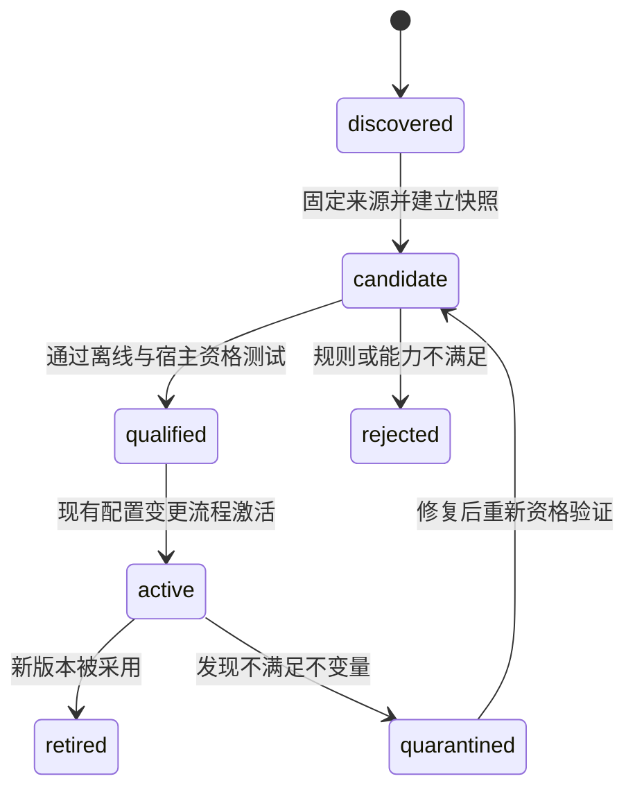

# pstack → OSStack 可执行集成规格

> **2026-10-27 联合设计增补：** 当前实施契约、能力映射和 PR 顺序请先读 [Firstmate × pstack 联合设计](../../design/2026-10-27-joint-engineering/README.md)。下文保留修订 2 的研究与历史验证；重叠设计按联合规格收敛，产品仍未实施。历史审计只适用于当时输入，不代表本次增补已获模型复审。

**规格版本：2｜状态：经作者原文校准的待实施设计｜主基线：`c1cfccf18df97fa4b8bc2ed1752071feda9c3670`**

本文件定义后续实现的输入、输出、拒绝条件、状态语义、工作包与验收。**本文所有新类型、函数、路径、错误码和工作包均为拟议接口，不是目前可调用的产品 API。** 本轮仅创建研究文档和验证研究结论的工具，没有安装方法包或改变 OSStack 运行行为。

## 0. 修订后的产品路径：验证先行，接口由使用校准

本次依据两篇作者原文调整了**实施次序与产物合同**，详见 [学习与修订说明](author-reading.md)。原始源码基线与权限约束不变。以下新增 TypeScript 形状仍是候选设计，必须经过 W17 使用草图与原型验证；稳定的是权限、证据和版本不变量，不是某个尚未经实际使用的字段名。

### 0.1 用户旅程

`目标 → 可纠正的问题模型 → 相关功能地图与证据 → 在隔离环境复现 → 必要的小实验 → 实现/自验证 → 现有独立交付验证 → 解释结果与维护知识`。

已授权的可逆工作持续推进；用户只需处理真实产品偏好、信息缺口或明确要求的设计检查点。一个任务入口按任务类型选择 playbook，不要求用户逐个记住技能名称。方法路由可见且可纠正，不得隐式扩大范围。

### 0.2 第一条可用路径与固定顺序

- **先 W06**：稳定的验证控制工具在空隔离环境中实际驱动一个 CLI/RPC 场景。
- **再 W18 / W19 / W17**：补齐分层功能地图、维护归属以及调用体验/关键接口原型；这些可共享证据，不重复搭建环境。
- **随后 W01–W05、W07–W11**：将经使用校准的方法绑定到来源、recipe、context 和现有交付合同。W01/W02 可独立做固定来源，但不能以注册完成替代产品价值验证。
- **最后 W12–W16**：在环境、接口、验收稳定后扩展协作与专门工具。P0 的少量方案探索可顺序完成，动态跨模型调度不是其前置条件。

W06 复用既有授权、scratch 与控制面隔离，不需要先安装 pstack、创建新调度器或绕过 admission。第一条路径成功之后再将 smoke 固化为可维护控制工具，而不是一次性脚本。

### 0.3 三类输出不能混用

| 层级 | 可报告什么 | 不可推导什么 |
|---|---|---|
| 原型观察 | 对某个技术问题的实验结果、边界和推荐 | 生产实现正确、完整回归通过 |
| 开发自验证 | 本轮在给定工作区/场景中观察到的结果 | 独立 reviewer 已批准、local_verified |
| 正式交付证据 | 现有可信 host 对最终候选的检查与 review/join | 未授权的 PR/merge/deploy 已完成 |

在同一授权和预算内，开发者可以持续复验、诊断、试改。只有最后一层使用现有交付协议；前两层作为方法 artifact，不能自行签发或覆盖正式 receipt。

## 1. 目标与明确边界

目标：用户选择一种工程工作方法后，OSStack 可以固定其来源，检查宿主能力，产生有证据要求的任务材料，把验收绑定到现有 DeliveryContract / Graph 路径，并在执行后输出可复查的结果。

第一阶段只支持：

- 联合首期仅 `pstack.bug-fix.v1`；`pstack.feature.v1`、`pstack.investigation.v1`、`pstack.refactoring.v1` 保留为后续范围，不作为首次资格取得的前置。
- 本地、单仓库、显式配置；默认关闭；没有远端副作用。
- `investigation` 先提供只读调查材料。当前 Graph contract host 不接受 scout，不能强行映射成 implement；该 recipe 的执行绑定返回不支持，但离线准备仍可用。
- implement 类只绑定现有 Graph 支持的 `local_verified`，publication 与 merge authority 都为 none。
- 现有 review/tests 双分支与闭合程序；本期不新增动态 fan-out。

不包含：整包自动安装、自动跟随 main 激活、自动通知或发消息、合并与发布、第二套调度器、替代 core DB、任意 Markdown-to-shell、全局风格替换、自动修改用户既有技能。

## 2. 架构决策记录

| 决策 | 选择 | 理由与代价 |
|---|---|---|
| ADR-01：上游身份 | repository + subdir + commit + content digest | 单凭版本号无法判断多插件仓库的子树变化；需维护快照索引 |
| ADR-02：执行模式 | 本地审查的 recipe 编译为 proposal；主机再 admission | 来源内容与执行权限分开；增加一个小的转换层 |
| ADR-03：权威状态 | 复用 Graph/core/DeliveryContract 和 host record | 避免 TSV 与 DB 各自说任务完成；可读台账只导出 |
| ADR-04：Graph 兼容 | v4 固定拓扑不变；未来新拓扑采用新程序身份 | 保留旧 run 重放；动态 arena/swarm 延后 |
| ADR-05：验证 | 现有检查注册表 + 候选绑定 receipt | 上游正文与 worker self-report 都不能签发通过 |
| ADR-06：上下文 | 原始材料为不可信引用；本地 recipe 方法由主机受控构建 | 安装来源不等于提升来源的指令优先级 |
| ADR-07：升级 | discovered → candidate → qualified → active | 更新慢于直接 git pull，但可以复现、回退和比较 |
| ADR-08：发布 | 第一阶段只 local_verified | 符合当前 Graph host 边界；将来独立评审发布能力 |
| ADR-09：价值次序 | 验证工具/功能地图先于完整 recipe 集成 | 先验证可用性；source pin 与既有权限仍先验保持 |
| ADR-10：设计输入 | 从调用样例与实验推导接口 | API 草图可能被实证推翻，避免预先冻结错误抽象 |
| ADR-11：评审对象 | 具体源码、草图、不变量、实验材料 | 无依据的抽象风险进入未知项，不自动扩张实现 |
| ADR-12：知识时效 | 当前功能地图优先，战术计划有生命周期 | 结束计划退出当前检索，历史/回执仍可审计 |

现有来源：[`spec-compiler`](https://github.com/osborn-studio/osstack/blob/c1cfccf18df97fa4b8bc2ed1752071feda9c3670/packages/graph/src/spec-compiler.ts)、[`program-resolver`](https://github.com/osborn-studio/osstack/blob/c1cfccf18df97fa4b8bc2ed1752071feda9c3670/packages/graph/src/program-resolver.ts)、[`graph-delivery-contract`](https://github.com/osborn-studio/osstack/blob/c1cfccf18df97fa4b8bc2ed1752071feda9c3670/packages/cli/src/graph-delivery-contract.ts)。

## 3. 包边界与数据所有权

| 现有包 | 拟新增职责 | 禁止拥有的职责 |
|---|---|---|
| `@osstack/protocol` | 来源快照、recipe proposal、方法产物、关联记录的严格 schema | 文件系统、进程、连接器、模型调用 |
| `@osstack/skill-registry` | 子目录 source pin、快照构建、已审查 recipe 注册、纯 proposal 编译、资格状态 | 直接运行 agent、签发权限、改 Graph 拓扑 |
| `@osstack/knowledge` | 复用已有 pack/context 数据模型承载引用材料 | 把 untrusted 内容自动升级为主机指令 |
| `@osstack/cli` 现有 host | 读取配置、范围校验、check registry 解析、contract admission、context fence、host record | 以 recipe 声明替代当前授权 |
| `@osstack/graph` | 继续执行已注册闭合程序、验证 join | 从外部 recipe 动态解释任意 DAG |
| `@osstack/core` | 现有状态与恢复；需要时增加最小版本化引用 | 再建一个独立 pstack task/approval 表体系 |
| `@osstack/github` | 后续只读观察分类与既有交付读回 | watcher 自己发起 merge/push |
| `@osstack/loop` / supervisor | 反馈、lesson draft、资格评价版本 | 自行晋升修改自身评价标准 |

避免在 `cli-entry.ts`、`bin.ts` 或包 index 引入工具依赖。新 CLI handler 延迟加载；若必须新增顶层 import，按仓库规则测量，超过约 20ms 且非每次调用必需则移到使用点。维持 `--version` 与 `--help` 已有预算。

## 4. 规格合同

### 4.1 统一编码与边界规则

以下类型展示语义。实现须用项目一致的严格 runtime schema 校验，不接受未知字段；不能以 TypeScript 接口代替边界解析。

- `Digest`：64 位小写 hex SHA-256。Git commit 采用现有 Commit 规则，不把普通字符串当 SHA。
- `ArtifactRef`：使用既有 artifact/host record 引用模式；path/ref 由受信任 resolver 解释，客户端提供摘要不代表可信来源。
- 相对路径只接受规范 POSIX 形式，拒绝绝对路径、空段、`.`/`..`、反斜杠、控制字符；snapshot 根目录允许专门的 `.` 值。
- 输入长度/数组规模/字节预算在解析时限制，随后进行语义检查。
- 纯编译阶段不访问文件、网络、时钟、随机源或模型；外部事实必须作为固定输入注入。
- 摘要采用项目 `workerCanonical` 对象规范化，数组顺序具有语义；在哈希前包含明确 domain separator，避免不同类型共享摘要命名空间。

### 4.2 来源快照 `MethodSourceSnapshotV1`

```typescript
type MethodSourceSnapshotV1 = {
  schema_version: 1;
  source_id: string;
  repository: string;
  subdir: string;
  commit: string;
  tree_id: string;
  files: readonly {
    path: string;
    bytes: number;
    sha256: string;
    role: "method" | "reference" | "tool_source" | "license";
  }[];
  license_artifact: string;
  content_digest: string;
};
```

主机快照构建器从指定 Git 对象读取 tracked blobs，只接受常规文件 mode `100644`/`100755`，拒绝 symlink `120000` 和 submodule `160000`，不读取 checkout 中任意未跟踪文件；不执行仓库 hooks、安装脚本或上游命令。对于这个来源，默认允许 `pstack/skills/**`、必要引用文件、manifest、license；工具源码可以归档但不自动执行。跨出 `pstack` 的生成脚本作为另一条显式文件记录，而不是开启任意递归引用权限。

建议初始限制：最多 512 文件、单个文本最多 512KiB、总文本最多 8MiB。二进制资源只记录元数据或通过专门 artifact resolver 获取，不塞入 prompt。限制是本规格的产品初值，可经资格测试修改，不是当前 OSStack 的既有常量。

文件按规范路径排序，`content_digest = sha256(utf8("osstack.method-source.v1") + 0x0A + utf8(canonical({repository, subdir, commit, tree_id, files, license_artifact})))`。其中 `0x0A` 是单个换行字节，`+` 表示字节拼接；实现不得散用不同字符串编码。文件内容哈希以原始 bytes 计算，不做换行归一化。

`SkillSource` 可加可选 `subdir`，缺省 `.`，保留旧 manifest 读取；不要把正在跟踪的 branch/ref 当成执行时的 pin。上游变化只生成 candidate。现有 `auto_minor` 不能跳过方法包资格验证。

### 4.3 本地 recipe 定义 `EngineeringRecipeV1`

```typescript
type EngineeringRecipeV1 = {
  schema_version: 1;
  id: string;
  source_digest: string;
  recipe_digest: string;
  adapter_version: "osstack-methods-v1";
  intent: "bug_fix" | "feature" | "investigation" | "refactoring";
  required_artifacts: readonly MethodArtifactKind[];
  required_host_features: readonly string[];
  optional_host_features: readonly string[];
  checks: readonly { id: string; required: boolean }[];
  steps: readonly {
    id: string;
    kind: "ground" | "frame" | "design" | "implement" | "verify" | "review" | "explain";
    inputs: readonly string[];
    outputs: readonly string[];
    required: boolean;
  }[];
};
```

`steps` 是工作说明的顺序，不是 Graph 节点或 shell 指令。`recipe_digest` 对去掉自身字段后的规范对象哈希；recipe 必须来自本地已审查注册表。candidate 可以离线编译；首次运行通过精确的 trial permit 和正常 admission，不要求已有 qualified/active。独立测量后才能 qualified，active 只影响后续新启动；详见联合 contracts.md 的资格流程。用户不能上传这个 JSON 就获得执行权。

`required_host_features` 由小型封闭注册表解释，例如 `cli-surface-verification`、`candidate-bound-review`、`isolated-workspace`。不要复用粗粒度 `CapabilityKind` 枚举来表示每个技能。缺 required feature 返回 unsupported；optional 缺失只影响可选材料并写明降级。不得把必需验收降级成可选。

### 4.4 编译输入与输出

```typescript
type RecipeCompileBaseV1 = {
  schema_version: 1;
  recipe_id: string;
  recipe_digest: string;
  goal: string;
  scope_paths: readonly string[];
  facts: readonly ArtifactRef[];
  risk: "low" | "normal" | "high";
};
type RecipeCompileInputV1 = RecipeCompileBaseV1 & (
  | { mode: "execute"; desired_completion: "local_verified" }
  | { mode: "prepare_analysis" }
);

type RecipeProposalV1 = {
  schema_version: 1;
  recipe_id: string;
  recipe_digest: string;
  source_digest: string;
  input_digest: string;
  proposal_digest: string;
  goal: string;
  scope_paths: readonly string[];
  method_brief: string;
  required_checks: readonly { id: string; registry_ref: string }[];
  required_artifacts: readonly MethodArtifactKind[];
  evidence_requirements: readonly {
    claim_id: string;
    predicate: string;
    check_ids: readonly string[];
  }[];
  degraded_optional_features: readonly string[];
};
```

```typescript
type AnalysisPreparationV1 = {
  schema_version: 1;
  recipe_id: "pstack.investigation.v1";
  recipe_digest: string;
  source_digest: string;
  input_digest: string;
  goal: string;
  scope_paths: readonly string[];
  facts: readonly ArtifactRef[];
  method_brief: string;
  required_artifacts: readonly ["intent_frame", "grounding"];
};

type RecipeCompileResultV1 =
  | { kind: "execution_proposal"; proposal: RecipeProposalV1 }
  | { kind: "analysis_preparation"; preparation: AnalysisPreparationV1 };

function compileEngineeringRecipe(
  input: unknown,
  context: {
    recipe: ParsedRegisteredRecipe;
    host_features: readonly string[];
    allowed_check_catalog: readonly CheckReference[];
  }
): RecipeCompileResultV1;
```

`ParsedRegisteredRecipe` 与 `CheckReference` 表示**由主机加载并验证的内部对象**；离线编译 candidate 不赋予执行权，外部请求不能自行设置 qualified 或伪造 registry。`registry_ref` 采用当前 DeliveryContract check reference 的格式，不另发明 shell 字符串解析器。

`investigation` 只接受 `prepare_analysis`，其他三类只接受 `execute`；模式与 recipe 不匹配时严格拒绝。纯编译器只选择已登记检查；找不到则 `METHOD_CHECK_UNREGISTERED`。它不自动运行 skill 文本中的命令。一个 required predicate 没有可执行检查时，必须产生明确 unsupported / unresolved 状态，不能把一句自然语言悄悄标成检查通过。

有些语义判断由独立 reviewer 承担，其结果通过当前 review policy 与 receipt 进入 join；语义判断仍可能不确定，不能用模型一句 PASS 替代受信任 resolver 的校验。

#### 摘要和规模的精确规则

三个摘要的 domain separator 分别是 `osstack.engineering-recipe.v1`、`osstack.recipe-input.v1`、`osstack.recipe-proposal.v1`；之后连接单个 `0x0A` 和规范 JSON 的 UTF-8 bytes。recipe/proposal 摘要均排除自身 digest 字段，其他所有字段参与；输入摘要覆盖完整解析后的输入。计算前不静默修剪 goal 或改变 scope 顺序；调用方若需要规范化，应先形成明确的新输入。

下表为本规格的新增初始上限；与现有 host 更严格限制冲突时采用较小值。实现不得通过拆成多个未授权任务绕过预算。

| 字段 | 上限/语义 |
|---|---|
| id / feature ID / step ID | 96 个 ASCII 字符，`[a-z0-9][a-z0-9._-]*`；同集合唯一 |
| goal | 非空，UTF-8 不超过 8KiB |
| scope_paths | 1–128 个规范相对路径，去重不得静默改变输入；拒绝重复 |
| facts | 最多 64 个已解析 artifact 引用，来源范围由主机校验 |
| steps | 1–32 个；输入/输出 ID 必须存在且依赖前序，不允许环 |
| required_artifacts | 1–8 个封闭 kind，不重复 |
| checks | 1–16 个；不能重复 ID 或 registry_ref；满足现有 primaryRef 选择规则 |
| method_brief | UTF-8 不超过 16KiB；这不是最终 prompt 预算 |
| evidence_requirements | 1–64 个；check_ids 必须指向 proposal 选择的检查 |
| 整体 proposal | UTF-8 JSON 不超过 64KiB |

调查方法返回 `analysis_preparation` 分支，表示离线调查 brief，并不表示调查已经执行或事实已验证。它不需要可执行 checks，也不能传入本执行合同。`AnalysisPreparationV1` 同样受 goal/scope/facts/brief 上限约束，整体不超过 64KiB；其 artifact digest 由现有 artifact 存储层生成。

### 4.5 主机 admission 与关联记录

主机仅接收 `execution_proposal` 分支；`analysis_preparation` 在本执行边界返回 `METHOD_HOST_UNSUPPORTED`。执行顺序固定：

1. 校验 source、recipe、proposal 身份，确认仍为当前允许的资格版本。
2. 验证仓库根、base、目标、scope 与已有授权一致；proposal 只能缩窄范围或增加同一授权内的验证要求，不能扩大路径、动作或完成级别。
3. 从主机 registry 精确解析 checks，核对引用和 command digest，调用既有 DeliveryContract admission；构造最终合同后再 freeze。
4. 通过现有 Graph contract 连接，保留当前 `local_verified`、最多 16 个 required checks 和命令总字节等 host 限制。超过限制拒绝，不拼 shell 绕过。
5. 构建受控的 task/contract brief 与来源引用，注册 execution context。所有内容进入既有摘要和 receipt 机制。
6. 记录只用于审计关联的 `RecipeAdmissionLinkV1`，使用现有 host record 持久化路径；再进入当前 Graph 启动流程。

```typescript
type RecipeAdmissionLinkV1 = {
  schema_version: 1;
  source: "osstack_method_host";
  proposal_digest: string;
  recipe_digest: string;
  source_digest: string;
  contract_digest: string;
  context_config_digest: string;
};
```

这个 link 不包含 `approved: true`、权限 token 或自封的验证 verdict，不是第二个合同。run/task/effect 的关联由现有主机记录补充，不能由 worker 输入。旧 run 继续引用其原合同与 source snapshot；新的 active recipe 不得改变正在运行的工作。

**冻结边界**：任何改变了 goal、检查集合、scope、方法执行输入的修改，都必须先形成新 proposal，并重新完成 admission；不能在原 frozen contract 下偷偷更新。保留原记录用于恢复和审计。

### 4.6 上下文放置与遗漏处理

main 的 `createExecutionContextAdapters` 已有 mandatory host entries、optional source entries、字节预算、两阶段 receipt 和 dispatch fence。其 source snapshot 被明确标为 untrusted reference。

集成必须保留这一边界：

- 原始 pstack 文本、来源链接和引用例子作为来源资料，不提升为系统指令。
- 已审查 recipe 的方法摘要由本地受控 renderer 构建，在主机任务材料生成阶段确定；不能从上游直接复制“忽略限制”“自动发信”等命令。
- 必需方法材料不能只放进普通知识搜索，期待它恰好被选中。用确定的材料选择与 `validateContextSync` 类 dispatch fence 核对所需 ID/digest；缺失或被预算裁剪时，在 adapter.invoke 前拒绝。
- 可选说明可以被裁剪，但 receipt 必须记录 omitted 原因；不能丢掉 mandatory host 安全/合同内容来腾空间。
- receipt 继续明确 `agent_task_prompt_not_provider_wire`。不得把它说成 provider 收到或模型遵从的证明。

第一阶段保持单 default tenant 的现有限制。若涉及新租户、远端来源或新的 evidence kind，单独扩展 schema 与资格测试，不能在 strict parser 下塞未经声明字段。

### 4.7 方法产物

```typescript
type MethodArtifactKind =
  | "intent_frame" | "grounding" | "impact_map"
  | "verification_plan" | "review_dispositions"
  | "decision_trail" | "feature_map" | "experiment_result"
  | "usage_sketch" | "prototype_decision";
```

| 产物 | 必需字段 | 关键拒绝条件 |
|---|---|---|
| intent_frame | 原目标、用户观察、独立重述、根因假设、完成谓词、非目标、未知/待决偏好 | 假设当事实、改写扩大授权或遗漏关键未知项 |
| grounding | claim、fact/inference/unknown、来源定位 | fact 无可解析来源 |
| impact_map | 消费者/格式/生命周期、关键前提、检查引用、缺口 | 声称 verified 却没有当前候选证据 |
| verification_plan | 表面、启动/驱动/观察/隔离/清理、feature ID、通过谓词 | 只写“测试通过”，没有实际行为判断 |
| review_dispositions | finding ID、定位、影响、证据、四类裁决及原因 | blocking finding 没有处理；dismiss 无依据 |
| decision_trail | run 引用、决策、原因、证据、结果、可选 supersedes | 修改旧记录或引用不存在证据 |
| feature_map | feature ID、用户入口、前提、drive/observe、陷阱/恢复、覆盖缺口、资格版本 | 未运行却标 qualified，单入口通过冒充多入口覆盖 |
| experiment_result | 版本、原始样本、环境、指标、判定、预算消耗 | 省略失败样本；更改 gate 却沿用旧 epoch |
| usage_sketch | 命名场景、调用方、输入/输出、可见终点、错误恢复、推导接口 | 只有内部类型没有调用过程，或教程无法达到终点 |
| prototype_decision | 技术问题、假设、备选、实验/观察、取舍、剩余未知、适用边界 | 没有观察却宣称问题已解决，或把 prototype 当交付证据 |

这些记录是领域材料，不是新的通过票据。最终通过仍由 Graph/current host 现有协议产生。

### 4.8 错误合同

沿用项目现有边界错误风格，新增稳定 code，不把外部异常字符串直接当用户结论。拟议错误：

| code | 语义 | 可否重试 |
|---|---|---|
| `METHOD_SOURCE_INVALID` | 来源、路径、blob、许可引用不合法 | 修正输入后新编译 |
| `METHOD_SOURCE_CHANGED` | 固定来源与请求不一致 | 重新候选化/资格验证 |
| `METHOD_RECIPE_UNQUALIFIED` | recipe 尚未获当前资格 | 完成资格流程 |
| `METHOD_HOST_UNSUPPORTED` | 缺必需工具或当前 Graph 路径不支持 | 换已授权宿主或缩小任务 |
| `METHOD_CHECK_UNREGISTERED` | 检查引用不存在或有歧义 | 主机登记后新 admission |
| `METHOD_AUTHORITY_EXPANSION` | proposal 增加未获授权动作/路径 | 不能自动重试以绕过 |
| `METHOD_CONTEXT_OMITTED` | 必需方法材料未进入最终上下文 | 缩减可选材料再新编译 |
| `METHOD_EVIDENCE_STALE` | 候选、环境或验收身份已变化 | 重新验证 |
| `METHOD_EVIDENCE_UNTRUSTED` | 仅 worker 自报、伪造身份或引用不可信 | 需要受信任主机证据 |
| `METHOD_BUDGET_EXCEEDED` | 超过资源/上下文/检查预算 | 停止或新授权预算 |

新 code 是语义合同；是否映射为 exception/RPC error，按现有边界适配。不得在不同模块混用 null、成功空列表和 exception 表示同一个失败。

## 5. 运行与状态语义

### 5.1 方法包生命周期



active 只是允许新任务选择，不自动启动任务。资格记录必须绑定 source digest、recipe digest、adapter version、host profile、验证集合/版本。quarantined 阻止新启动；已调用的任务按现有取消与停止证明机制处理，不能立刻宣布已停。

首期没有驻留后台刷新服务。使用现有 watcher 做显式检查；查看更新不触发激活。

### 5.2 验证有效性

沿用现有 binding 与 receipt，方法附件额外记录以下相关身份，不能缺省推断为相同：

- canonical repository 与 task/run/scope；
- base、candidate head/tree/diff；
- contract / policy / acceptance 或 check registry digest；
- 执行环境/工具与验证配置；
- recipe/source/adapter 版本；
- reviewer/test 分支与 expected attempt。

`head` 不同即默认失效；即使 patch-id 相同，也不能证明新基线、依赖或配置下行为相同。未来如果要缓存验证，必须专门定义等价关系并证明其健全性，不能由 worker 临场宣称。

### 5.3 成功、失败、不确定

使用现有状态表示，不另造一个会覆盖 Graph status 的字符串：

- **confirmed**：所需主机证据存在、可信、绑定正确，检查与 review 均满足合同。
- **failed**：实际检查发现目标行为不成立。
- **unknown / blocked**：信息不足、环境失败、工具不支持、进程终止未确认、输出缺失等；不能统计成成功。
- **cancel_pending**：已经请求停止但尚缺必要停止证明；不是 cancelled。

一个 task 没有 findings 不等于已执行 review；一个 PR CI 全绿不等于独立验收完成；一次 Engineering observed_turn 完成不等于 local_verified。

### 5.4 决策记录与恢复

保留现有持久状态为唯一权威；决策材料按不可变 artifact 或 append/supersedes 记录。可输出 TSV/Markdown，但不从用户编辑的导出文件恢复权威状态。

恢复步骤：先载入原程序/合同/recipe 身份，再核对现有任务、candidate、分支、外部效果；只有对账通过的执行才继续。未知副作用不得自动重试造成重复。worker/session ID 只是定位信息，不是完成证据。清理仅限当前 run 所有资源。

## 6. 四个首批 recipe 的行为规格

| recipe | 必需前置产物 | 方法步骤 | 必需结束证据 |
|---|---|---|---|
| bug-fix | intent_frame、grounding、verification_plan | 原表面复现 → 根因假设 → 最小改动 → 同表面复验 → 影响面评审 | 原故障证据、候选修复检查、独立 review；廉价明确测试路径追加回归检查 |
| feature | intent_frame、impact_map、verification_plan | 用户可观察目标 → 结构/接口选择 → 实现 → 驱动真实行为 → review | 合同中 required checks、实际用户终点、相邻回归场景 |
| investigation | intent_frame、grounding | 假设 → 原始证据 → 反证 → 分清事实/推论/未知 | 可追溯调查报告；不生成代码交付成功 |
| refactoring | impact_map、verification_plan | 列出应保持行为 → 调用方迁移 → 小单元变更 → 相同场景比较 | 行为等价证据、受影响调用方/格式检查、review |

风险级别不能代替表面判断。high 风险可能需要额外不变量/故障恢复验证，但不得为凑数量启动固定十条 lane；low 风险可减少可选材料，却不能删掉合同中的 required check。

## 7. 实施工作包与依赖

修订 2 共 19 项实施安排，编号保持可追溯；**不要按编号顺序直接执行**，优先顺序见第 0 节及各项依赖。W17–W19 是本次补入的前置能力。

每包目标是一个可评审垂直切片，建议 1–5 个直接相关文件；出现跨多个子系统的大改应继续拆包。下列文件均为**建议落点**，若实施时已有同等模块应原位扩展。验收编号来自 [acceptance-cases.json](acceptance-cases.json)。

### W01：来源身份与 subdir 兼容

依赖：无。范围：S/M。

建议文件：`packages/skill-registry/src/manifest.ts`、`manifest.test.ts`、`packages/protocol/src/method-source.ts`（新增）、必要 export。

验收：①旧 manifest 不变可读，缺 subdir 为 `.`；②非法路径和未知字段失败；③commit 与版本不被互相代替。测试 A01、A02；运行相关包测试与 typecheck。

### W02：离线快照构建与候选记录

依赖：W01。范围：M。

建议文件：`packages/skill-registry/src/source-snapshot.ts`、同名测试、`watcher.ts`、`watcher.test.ts`。

验收：①只从固定 Git blobs 生成稳定快照；②来源变化只生成 candidate；③超限、symlink/路径越界失败且无脚本执行。测试 A02–A04；对本报告固定 clone 复算来源摘要。

### W03：一个 bug-fix recipe 的纯编译

依赖：W02、W17、W18。范围：M。

建议文件：`packages/protocol/src/engineering-recipe.ts`、`packages/skill-registry/src/recipe-compiler.ts`、同名测试、`recipes/bug-fix-v1.json`（新增，所在包内）。

验收：①同输入产生相同 proposal；②只接受已审查注册定义，candidate 离线输出不具备执行权；③未注册检查与缺失 required feature 被拒绝；④问题模型保留观察、假设及历史证据的区别。测试 A05–A07、A37、A38。

**检查点 C1**：先有 W06/W17/W18 的真实工具与使用依据，再确认离线链路可读、无副作用、schema 与负例通过；展示真实 proposal，再继续运行接入。若来源模型无法支持本项目既有知识包设计，先统一方案，不能再建平行来源表。

### W04：合同 admission 连接

依赖：W03。范围：M。

建议文件：`packages/cli/src/method-admission.ts`、同名测试、`graph-delivery-contract.ts`、`graph-delivery-contract.test.ts`。

验收：①无法扩大动作/路径；②先完成检查映射再 freeze；③继续遵守 local_verified、check 数量与预算边界。测试 A08–A10。保持 v4 编译输出未变。

### W05：上下文选择与实际调用证据

依赖：W04。范围：M。

建议文件：`packages/cli/src/method-context.ts`、同名测试、`graph-execution-context.ts`、对应测试。

验收：①必需方法被裁剪时在 invoke 前失败；②源码内容继续为 untrusted reference；③两阶段 receipt 对应真实 adapter task 的摘要；④相关功能路径按需加载，路由可解释、可纠正。测试 A11、A12、A35、A48；用测试 adapter 检查实际收到的 prompt，不能只测 renderer。

### W06：先交付稳定的隔离验证控制工具

依赖：无。范围：M；先一个命名场景，扩展驱动另拆包。

建议文件：`scripts/method-control.mjs`（新增；薄 CLI 入口）、`scripts/lib/method-control-driver.mjs`（新增；复用现有主机接口）、一个 fixture 和对应测试。功能地图移至 W18。

验收：①空 fixture 可经 doctor/drive/observe 跑通真实路径并保留证据；②机器输出、渐进 help、可行动错误和 dry-run 语义符合第 12 节；③显式 OSSTACK_HOME 与资源所有权，失败后可恢复并只清理自有资源。测试 A13、A14、A33、A34、A43、A44。不得运行开发 CLI 触及默认 DB；不新增发送/发布权限。

### W07：候选绑定的 review 产物

依赖：W05、W06、W17。范围：M。

建议文件：`packages/protocol/src/method-artifacts.ts`、`packages/cli/src/method-review.ts`、对应测试，复用现有 review host。

验收：①finding 与 disposition 完整且有证据；②worker 自报和旧 head 不能通过；③blocking finding 的无依据 dismiss 不能成为 approved。测试 A15–A17、A42、A43。评审必须绑定具体对象；保留强制不变量，但不把无依据猜测自动变成产品修改。

### W08：第一个端到端 local_verified 试点

依赖：W07。范围：M。

建议文件：既有 delivery/Graph CLI 接入模块、lazy handler、一个端到端 fixture 与测试、用户说明。

验收：①recipe→proposal→合同→实际执行→独立验证→最终状态完整；②recipe 关闭时现有路径保持；③未发生发布/合并。测试 A18、A19。记录启动预算；执行相关包测试及拟开 PR 前的仓库要求检查。

**检查点 C2**：只有 W08 实际试点通过，才能称“首个能力已集成”。文档齐全或 unit tests 通过不满足这一条件。检查候选身份、日志、实际副作用及清理结果。

### W09：扩展另外三类 recipe

依赖：W08。范围：M，可按 recipe 拆成三个小提交。

建议文件：三份 recipe 定义、recipe 参数化测试、用户说明。

验收：①feature/refactoring 有不同材料要求；②investigation 只产出材料且 Graph 执行绑定明确 unsupported；③不增加权限。测试 A05、A08、A20、A48。用户通过同一任务入口使用方法，路由结果与纠正记录可见。

### W10：决策轨迹与恢复对账

依赖：W08。范围：M。

建议文件：`packages/cli/src/method-report.ts`、同名测试、现有 host record 关联读取、文档。

验收：①报告从真实状态派生；②supersedes 保留历史；③重启/过期材料不被当成完成。测试 A21、A22、A46。结束/被替代的战术计划退出当前检索但历史不删；TSV 导出单元格需处理公式前缀。

### W11：验证流程的漂移资格检查

依赖：W08、W10、W19。

联合修订：首次试验准入由 J08 在 W08/J09 前提供；本包对应 J10 的后续测量/激活与漂移。W09 的其他方法扩展不再是资格前置。范围：M。

建议文件：`packages/skill-registry/src/recipe-qualification.ts`、对应测试、feature map fixture、资格说明。

验收：①区分 doc/harness/product 失败；②不能弱化 predicate 自动晋升；③新 active 不修改旧 run。测试 A23、A24、A45。维护失败时区分工具健康与产品结果；周期执行需显式配置。

**检查点 C3**：四类方法边界清楚、升级可回退；才进入多角色与自动化扩展。此时已可评估 P0 的实际价值。

### W12：arena/swarm 先做产物合同

依赖：W11。范围：M。

建议文件：`packages/protocol/src/method-candidates.ts`、同名测试、`packages/skill-registry/src/candidate-selection.ts`、同名测试。

验收：①竞争与覆盖显式不同；②覆盖缺口阻止完成；③合成结果使原候选证据失效。测试 A25、A26、A44。此包只做 artifact 和纯聚合，不假称已支持动态调度。

如需运行级 fan-out，创建独立后续设计：新的 Graph template/compiler/registry/program tuple、容量预留、恢复/取消与旧 run 回放资格测试。不得编辑 frozen v4 来实现。

### W13：只读 PR observation classifier

依赖：W10。范围：M。

建议文件：`packages/github/src/pr-observation.ts`、同名测试、现有 attention 读取接线与测试。

验收：①复现本报告 BLOCKED/UNKNOWN 探针并改为非许可结果；②缺页/超时标 unknown；③观察没有 push/merge 接口依赖。测试 A27、A28。

### W14：结构化教训与历史反例

依赖：W11。范围：M。

建议文件：`packages/loop/src/lesson-draft.ts`、对应测试、`packages/skill-registry/src/method-improvement.ts`、对应测试。

验收：①重复错误产生有出处的改进 draft；②新 gate 抓历史坏例且不误伤正常例；③未走现有晋升流程不生效。测试 A29。

### W15：性能/盲评与有限改进试点

依赖：W14。范围：M，工具扩展另拆包。

建议文件：评测 fixture、benchmark report parser、对应测试、试点报告。

验收：①保留交错原始样本与失败；②隐藏实验标签且固定 evaluator 版本；③预算耗尽不继续搜索。测试 A30、A47。补充首次环境就绪时间、人工介入、验证工具故障/恢复与冷使用者场景成功率；PR 数不是质量或收益证明。首次试点报告不预设收益百分比。

### W16：形式化与事件 intake 各做独立可行性试点

依赖：W11。此项是两个独立后续小项目的入口，**不得作为一个大实现 PR**。

Formal 试点：只选一个高后果不变量，建立模型/源码映射、坏变体和代码复现；运行完整工具链后再进入资格注册（A31）。

Intake 试点：只做固定事件坐标、幂等去重与模拟 readback/补偿；先用 fake connector，后续外部写入能力单独接入已有授权（A32）。不默认连接 Slack 或通知任何人。

### W17：使用草图、问题模型与最小设计实验

依赖：W06。范围：M；先一个调用边界，不实现完整 arena。

建议文件：`docs/verification/method-control-tutorial.md`（新增）、一份调用草图 fixture、一个可复跑原型入口、实验决定记录模板及对应 focused test（检查结构，不镜像生产实现）。

验收：①从用户场景推导使用样例并区分目标/观察/假设；②对改变实现的未知做有预算实验，备选选择有实际观察；③接口偏差重复出现时返回设计，原型不产生正式通过票据。测试 A37–A42、A47。可以顺序比较备选，不以多代理可用性为前提。

### W18：分层功能地图与相关场景检索

依赖：W06。范围：M；先 3–5 个主要场景。

建议文件：`docs/verification/features/README.md`、少量 feature 页、`scripts/lib/method-feature-map.mjs`、其 focused tests。若直接文件超过五个，按 feature 垂直拆包。

验收：①冷读者能找到用户入口、前提、动作、可观察终点与恢复；②仅加载相关叶子，明确跨入口覆盖；③过期/缺前提不得冒充通过。测试 A35、A36、A48。索引不是新的事实权威，来源与运行结果仍可核查。

### W19：验证基础设施健康与维护归属

依赖：W06、W18。范围：M。

建议文件：`docs/verification/maintenance.md`、`scripts/method-control-health.mjs`（新增）、对应测试和一个健康记录 schema（优先复用现有 artifact 形状）。

验收：①owner/健康/版本/最近实际驱动可查询；②变更触发只检查相关漂移，工具失败与产品失败分开；③未配置周期维护时没有后台任务或通知。测试 A45。维护修复后重驱场景，不能通过删除功能或降级谓词晋升。

**检查点 C0（按执行顺序位于 C1 前）**：W06/W17/W18 已给出可运行工具、使用场景和接口证据；W19 确定维护边界。未达到该条件前，source registry 的完成只能报告为接入准备，不能报告为产品能力已可用。

## 8. 验收矩阵与最低发布门槛

机器清单 [acceptance-cases.json](acceptance-cases.json) 中的 48 个场景均是**待实现要求**，不是已经通过的产品测试。关键优先级：

| 维度 | 必须证明 |
|---|---|
| 来源 | pin、subdir、内容哈希和转换版本稳定；路径不能越界 |
| 权限 | 文本与 proposal 不能新增动作；默认无发布 |
| 编译 | 纯确定性；未知检查与不支持宿主拒绝 |
| 上下文 | 必需材料缺失在 invoke 前失败；证据边界准确 |
| 执行 | 真实 CLI/RPC 验证；空 fixture 可重跑；停止证明正确 |
| 证据 | exact candidate、当前验收、可信 host；unknown 不通过 |
| 恢复 | 固定程序身份，旧 run 不受新 recipe 改动影响 |
| 升级 | candidate 不自动 active；失败版本可隔离 |
| 成本 | 不引入强制十 worker；上下文与检查预算有界 |
| 可用性 | 冷启动调用能完成真实场景，错误指导有用，dry-run 没有隐藏写入 |
| 认知 | 目标/事实/假设分离，历史经当前证据校准，说明能暴露误解 |
| 设计 | 使用草图和最小实验先于接口冻结；原型不冒充交付 |
| 记忆 | 功能地图可检索、可纠错；结束计划不污染当前上下文 |
| 兼容 | 关闭能力时旧路径保持；CLI 启动预算不退化 |

没有充分执行证据时，报告只能写“材料已生成”“方法已编译”“本地验证受阻”等具体状态。不能统一输出“任务完成”。

## 9. 试点配置与回退

首期使用一个 repository-scoped 显式配置开关，默认 false。最终配置键应与现有 engineering/knowledge 配置设计对齐后确定；本规格不创建未注册的实际 CLI flag。

只允许固定 source + recipe + adapter + qualification profile 组合。回退切换新启动使用的 active 指针，保留老快照与资格证据；不覆盖运行中合同。若隔离当前方法包，停止新启动，并按已有取消流程处理已开始任务。

工作区操作遵守本仓库规则：代码实施在合适隔离分支进行；worktree 位于 `~/Developer/CodeX/.worktrees/osstack/<task>`；scratch 走 `createScratchDir` / `scripts/lib/scratch.mjs`，不放仓库同级。测试/开发命令始终显式 OSSTACK_HOME。

## 10. 实施时必须再确认的有限未知项

1. **目标分支状态**：从 main 开始实施前重新确认 revision 与相关 Firstmate/engineering 变更，不能直接把旧工作分支当基线。
2. **资格与来源已有合并进度**：若其他工作已实现 snapshot/qualification，复用并缩减 W01–W03，而不是另建结构。
3. **方法摘要最佳放置点**：用当前 host/context 的真实 smoke 确认必需材料不会在检索/裁剪中消失；不能仅依据类型接口判断。
4. **模型/宿主独立性**：当前 reported identity 不足以证明多模型独立；先如实记录，未来需要更强保证再扩展。
5. **Formal 工具运行环境**：本轮未运行完整 Java/TLC/渲染，W16 必须单独锁依赖和实测，不借用本报告的解析器探针成绩。

6. **使用与原型证据**：W17 尚未执行，本文新接口不可宣称已被证明优于其他形状；若调用体验与真实驱动反证它们，修改候选接口而不改安全不变量。

这些未知项已被约束为具体实施检查，不阻止完成研究报告；也不能在后续执行时被默认视为已经解决。

## 11. 一条具体链路：把方法要求转成运行证据

下面是**合成的验收 fixture**，不表示在当前 OSStack 发现了这个产品缺陷。假设任务是“修复测试服务在取消与重试交错时重复写入一条记录”，用户仅授权隔离仓库中的本地实现与验证。

1. 选择固定 `pstack.bug-fix.v1`。`intent_frame` 写明终点：同一 operation ID 在该交错场景中最多提交一次；范围只含 fixture 的 service/test。recipe 不能把目标扩展为部署服务。
2. `grounding` 记录观察到的重复行和触发顺序，把“取消是否真的终止执行”列为待验证前提。`impact_map` 列出重试入口、状态提交与恢复读取，不能只引用发生重复的那一行。
3. 主机已有检查注册表中的 `cancel-retry-behavior`、`restart-recovery`、`adjacent-regression` 被选入 proposal。名称在这里仅作示例，实施前必须存在真实受信任注册项；绝不从示例名称猜 shell 命令。
4. 主机检查现有授权，构造最终 local_verified 合同并冻结，保留 source/recipe/proposal/contract/context 关联。Graph 按原固定程序生成候选，不增加新的动态节点。
5. 验证 harness 在独立 OSSTACK_HOME/fixture 服务中驱动取消、重试、重启，并读取真实记录。检查没有启动时不能因为输出为空而通过；超时或不能确认进程已停必须记录 unknown。
6. 独立 reviewer 检查关键前提和实际证据，处理 findings；tests 分支与 review 分支都必须绑定同一候选和验收身份，join 才能完成。
7. 若随后只做 rebase，即使 patch-id 相同，旧 candidate 证据默认不能覆盖新 base。新候选重验。用户看到的结果应写“此候选在这些场景下达到 local_verified”，而不是“已合并/上线”。
8. 若这个错误在多个任务反复发生，生成 lesson draft：候选改进是 operation ID 的结构约束或持久检查。先用历史坏例验证新 gate 的敏感性，再进入现有晋升路径；不能由本次 worker 自行修改全局 gate。

这条链路的验收价值是：每个方法步骤要么产出可检查材料，要么成为主机验证的前置条件；它没有创建新的发布权限，也没有用更长的叙事替代真实行为证据。

## 12. 面向使用的产品合同（修订 2 新增）

本节将作者方法转成 OSStack 的具体设计，字段与命令名称是**拟议合同，尚未实现**。W17 可以基于实际调用证据调整形状；下面的安全语义、观测边界和失败分类必须保留。

### 12.1 验证控制接口：让 agent 直接操作，而不是反复临时编脚本

首期采用内部薄 CLI + driver，复用已授权的 OSStack 主机接口。CLI 面向任务场景隐藏环境细节，不要求调用方懂内部 socket/DB/进程树。未来 UI/远端 adapter 可复用相同语义，但本期只实现本地 CLI/RPC 表面。

| 拟议操作 | 输入/输出合同 | 失败与副作用 |
|---|---|---|
| `doctor` | 指定隔离 scope，输出工具/依赖/数据/运行入口的健康与缺口 | 默认只读；不能隐式安装、登录或启动服务 |
| `setup` | 引用主机登记的 fixture/environment profile，生成本 run 所有的资源与句柄 | 只在已有授权与 scratch 内执行；无默认 DB；支持 dry-run |
| `drive` | 场景 ID、登记动作、显式参数；输出 action 与 observation 引用 | 不接受上游 Markdown 中任意 shell/eval；需要健康状态和资源所有权 |
| `observe` | scope + scene 的观察窗口，返回状态/副作用/错误与证据位置 | 最终截图或退出码不能单独代表动作链完成 |
| `wait-settle` | 明确稳定谓词和超时预算 | 有界等待；超时保留最后状态并报 unknown/blocked，不当通过 |
| `trace` | 已支持表面、采样范围与预算 | 记录 trace 的环境与版本；不支持时明确返回，不伪造空成功 |
| `cleanup` | 本 run 的资源句柄与可选 dry-run | 仅清理自有资源，保留 evidence；没有停止证明时不宣称已完全终止 |

统一输出候选形状：

```typescript
type ControlObservationV1 = {
  schema_version: 1;
  operation: "doctor" | "setup" | "drive" | "observe" | "wait_settle" | "trace" | "cleanup";
  scope_ref: string;
  scenario_id: string | null;
  environment_ref: string;
  result: "observed" | "failed" | "blocked" | "unsupported";
  evidence_refs: readonly ArtifactRef[];
  missing_preconditions: readonly string[];
  recovery: { code: string; suggested_registered_action: string | null } | null;
  dry_run: boolean;
};
```

此对象不包含 `authorized`、`verified`、`merged` 等扩大语义的字段。其 `observed` 只表示工具完成本次观测；正式评判通过既有注册检查解释实际内容。

接口性质必须有真实验证：JSON 走 stdout、诊断走 stderr；错误 code 稳定且建议下一步；基础 help 只给常用动作，子命令展开细节。dry-run 保证不写目标资源、不启动相关服务、不改变 git refs、不产生外部业务调用；必要读取的目标和限制明确列出，不能只相信名字。帮助描述与实际行为冲突时以失败处理。

`--help`、dry-run、doctor 都不能暗中触发新环境权限或安装程序。材料字节、观察超时、证据数量受主机现有预算限制；禁止无限拉取日志。每次意外失败后重新 doctor，进程健康而场景状态坏掉时恢复已知场景或重启自有实例，不能盲目继续驱动。

### 12.2 Feature Map：产品路径索引而非函数目录

一级索引给出 feature ID、用户目的、关键词、入口表面、叶子文件引用；二级叶子包含：

```typescript
type FeatureJourneyV1 = {
  schema_version: 1;
  feature_id: string;
  user_outcome: string;
  source_revision: string;
  driver_version: string;
  entries: readonly { id: string; surface: "cli" | "rpc" | "ui"; user_route: string }[];
  preconditions: readonly { id: string; kind: "data" | "auth" | "entitlement" | "runtime"; description: string }[];
  drive_refs: readonly string[];
  observations: readonly { predicate_id: string; observable: string; side_effects: readonly string[] }[];
  gotchas: readonly string[];
  recovery_refs: readonly string[];
  covered_entry_ids: readonly string[];
  known_gaps: readonly string[];
  last_live_evidence: readonly ArtifactRef[];
};
```

该结构是地图内容的 schema，不表示所有叶子都已验证。只有 `last_live_evidence` 经既有 resolver 校验后才能用于说明对应场景；缺失证据保持 draft。

检索流程：问题模型 → 高层索引 → 相关 feature 叶子 → 必需跨表面旅程。记录选中理由与被省略范围，不能把全部功能文档塞进上下文。必要叶子仍受第 4.6 节的不可静默省略约束。

一个场景有两个用户入口时，只跑其中一个只证明一个入口；合同需要两者则另一项缺失会阻止正式完成。缺数据/账号权限属于 `blocked`；只有主机合同明确允许的非适用场景才可排除，且不得算作通过。测试环境替代真实目标时记录差异，本地成功不能宣称远端已验证。

地图过期判断至少检查 source revision、driver version、引用路径和最近实际驱动证据。功能变化触发相关叶子维护；没有变化无需每次全量扫描。工具维护 owner 由项目配置指定，不从 article 作者、worker 名或模型自述推断。

### 12.3 理解缺口应成为可以处理的输入

`intent_frame` 保留：原始任务引用、用户直接观察、agent 独立重述、目标/非目标、待检验假设、完成谓词、证据缺口与需要用户选择的偏好。`grounding` 则承载当前机制和历史动机，不把过去对话当源码事实。

路由规则：

- **意图不清**：先给出最小可纠正的问题模型。不能把用户提供的根因猜测直接当事实；不能在已有足够信息时机械要求用户确认每个步骤。
- **机制或证据不清**：读取相关当前源码/运行结果与有限历史。找不到则保留 unknown，给出下一项有价值的观察。
- **技术方案未知**：进入最小原型问题；只有会改变实现的未知才值得投入实验。
- **产品偏好未定**：说明可见差异和取舍，让用户选择；实验数据不能替用户决定偏好。

解释产物必须保持 fact/inference/unknown 的置信语言，不能在更易读的改写中删除不确定性。任务相关历史有明确时间/项目范围，优先当前事实；不得遍历无关私人聊天或连接器数据。

### 12.4 使用驱动设计与原型决定

先提交 usage sketch：谁调用、从什么状态开始、想达成什么、调用哪些操作、得到什么结果、失败如何恢复。然后推导类型与模块边界。一个接口若只有作者知道的隐式规则，教程与冷读者实验会暴露它；不能用更多内部文档替代调用体验修复。

`prototype_decision` 最低包含：问题 ID、为什么改变实现、可比较备选、初始假设、实验方法、预算、环境、实际观察、推荐与残留未知、明确的非生产标记。视觉比较可用切换器与真实交互；CLI/RPC 比较优先观察输入输出、时序和副作用。没有明确决策就不创建原型。

不要求为可丢弃原型建立完整产品测试工程；观察本身可以回答设计问题。进入真实实现后重新执行生产适用的验收，不复用原型观测作为正式通过。

对关键新接口至少考虑结构不同的选择；机械修改可以跳过并说明依据。单模型顺序实验不宣称跨模型独立；跨模型结果在身份只有 reported 时继续如实标注。执行中发现两处以上同类偏差是重审信号，不是自动判错阈值；必须结合证据判断，不强行把所有合理复杂性削平。

当前第 4 节的 compiler/driver schema 是这个过程的输入候选，不是不能改变的最终答案。W17 至少回答：冷调用者能否使用、方法必需材料能否稳定进入上下文、控制工具与现有 host 的边界是否比新增公共命令更简单。若答案不支持当前设计，更新规格后再实现 W03。

### 12.5 评审与维护的范围

评审输入标注对象类型（代码、调用草图、实验结果、明确协议不变量），每条 finding 给出依据或可检验路径。抽象猜测进入未知项/实验 backlog；不能直接要求实现大量保护代码。相反，已知授权、恢复、候选证据不变量无需先制造事故才能成为 gate。

验证基础设施记录 owner、工具/地图版本、最近健康检查、最近真实场景驱动、已知缺口与维护状态。区分：产品行为失败、控制工具故障、地图漂移、环境前提不足。工具故障阻止相关验证结论，但不直接推断产品有 bug。

维护触发首先是显式操作和相关代码/接口变更；周期检查是可选配置，默认没有运行。owner 处理的是验证基础设施可靠性，不能趁维护改变产品行为。每次修复后重新驱动受影响场景，并确认 evidence 在 cleanup 后仍存在。

### 12.6 文档用途与计划生命周期

教程解决第一次成功，操作指南解决指定问题，参考描述精确接口，解释说明机制与取舍。四者可相互链接，但不要让一份上手教程同时承担完整 API 与架构论证。

战术执行计划在设计有足够证据后产生，绑定 design decision / source / acceptance 身份。建议状态为 draft、active、completed、superseded。completed/superseded 默认退出 agent 的当前执行上下文；历史仍可显式检索。用于恢复的合同、决定和 receipt 按既有保留策略保存。

本轮不会删除之前的报告。未来若清理临时计划，应先保留必要归因并遵循项目文档策略；作者偏好不构成删除用户文件的授权。
