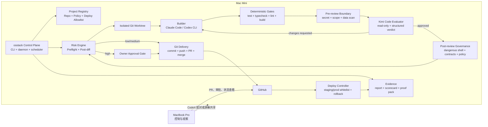
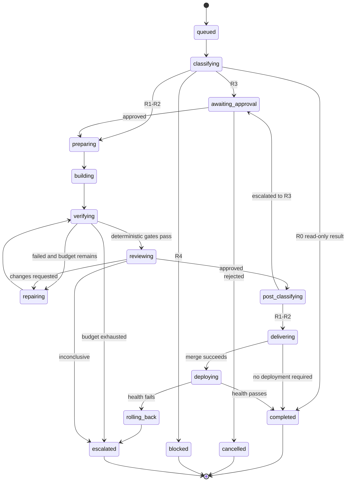

# osstack × Kimi Code × Mac Mini 自治开发系统设计

> 状态：设计评审中  
> 日期：2026-07-27  
> 目标读者：Owner、osstack 维护者、实现 Agent、审查 Agent、运维人员  
> 设计范围：个人多项目自治运行优先，稳定后产品化为 osstack 公共能力  
> 实施状态：未开始；本文不授权修改产品代码、推送、合并或部署

## 1. 执行摘要

本设计把 Mac Mini 定义为唯一的开发执行节点，把 MacBook Pro 定义为远程控制与观察终端。Claude Code、Codex CLI、Kimi Code CLI、测试命令、治理扫描器和部署工具全部在 Mac Mini 本地运行，共享原生文件系统、Git 仓库、认证状态和 osstack daemon。

osstack 是控制平面，不是另一个编码模型。它负责：

1. 接收任务并形成可验收的 Execution Contract。
2. 用确定性规则对任务和最终 diff 分别做风险分类。
3. 为 Builder、Evaluator 和 Designer 选择不同 Agent。
4. 在隔离 worktree 中执行编码、测试、Kimi 审查和修复循环。
5. 对中低风险任务自动提交、推送、开 PR、合并和部署。
6. 对高风险任务停在明确 gate，等待 Owner 批准。
7. 生成 report、scorecard、proof pack、风险决策和部署证据。
8. 在进程、机器或网络故障后从持久化状态恢复。

Kimi Code CLI 作为一等 `AgentAdapter` 接入，默认承担 `test-verify` 和 `code.review`，而不是仅作为 Claude Code 或 Codex 的底层 K3 Provider。Claude Code/Codex 使用 K3 Provider 是可选的 Builder 模型配置，与独立 Kimi 审查器分开建模。

第一阶段成功标准不是“能调用 Kimi”，而是：

> 在 Mac Mini 上提交一个中低风险任务后，系统可以无人值守地完成 worktree 创建、实现、确定性测试、Kimi 独立审查、自动修复、PR、CI、合并、白名单部署、健康检查、必要时回滚，并留下可审计证据；任何高风险变化必须在首次不可逆动作前停下等待 Owner。

## 2. 已批准决策

| ID | 决策 | 结果 |
|---|---|---|
| KD-01 | 服务对象 | 先服务 Owner 的多个项目，之后产品化 |
| KD-02 | 自治等级 | 中低风险全自动，高风险人工确认 |
| KD-03 | 生产部署 | 测试环境全自动；生产仅预登记项目与变更类型可自动部署 |
| KD-04 | Kimi 集成 | 独立 Kimi Code CLI Adapter 是默认审查路径 |
| KD-05 | K3 Provider | 作为 Claude/Codex 的可选 Builder 模型配置，不代替独立审查 |
| KD-06 | 机器职责 | Mac Mini 执行，MacBook Pro 仅远程控制与观察 |
| KD-07 | 文件事实源 | Mac Mini 本地 Git checkout 是执行期事实源，GitHub 是跨设备协作与交付事实源 |
| KD-08 | 验证原则 | LLM 审查不能替代测试、类型检查、lint、构建和治理规则 |

## 3. 当前能力基线

### 3.1 已有能力

当前 osstack 已具备：

- `AgentAdapter` 接口与默认 Agent registry；
- Claude Code、Claude CLI、Codex CLI、OpenCode Adapter；
- DeepSeek review/verify Adapter；
- coding、test-verify、design 三类角色；
- Mac Mini 与 MacBook Pro profile；
- task queue、Loop Engineering 和 daemon polling；
- git worktree 隔离；
- shell verify、artifact verification 和 governance；
- report、scorecard、proof pack；
- Agent 可用性探测与 fallback；
- 部分 Execution Contract、approval 与 control 命令；
- 运行状态、事件、任务历史和基本恢复机制。

### 3.2 已确认缺口

| 缺口 | 影响 |
|---|---|
| 已安装 CLI 为 0.12.0，当前仓库发布基线仍主要显示 0.8.1 | 实施前必须对齐源码、已安装产物和目标分支 |
| Kimi Code 未注册 | 不能参与能力路由、profile、proof 或 scorecard |
| Claude Design / Google Stitch 执行仍为 scaffold | design 角色不能当作真实自动设计 gate |
| `deliver` 未自动解析 profile evaluator | 推荐入口无法保证 Builder/Evaluator 分离 |
| 通用 subprocess Adapter 只依据进程完成状态 | 文本审查发现问题时可能无法阻断 |
| adapter/provider/model 未分层记录 | Codex+K3 和 Kimi Code+K3 会被误认为不同模型审查 |
| 风险分类、自动 PR/合并、部署白名单未形成单一闭环 | 尚不能满足 C 级自治目标 |
| reviewer 只读边界不够强 | 非交互 Kimi 可能修改被审查 worktree |
| 当前 `start/control` 更接近审批记录，不是完整自治执行器 | 高风险 gate 与低风险直通需要统一 |

### 3.3 版本对齐规则

实施开始前必须选择唯一代码基线：

1. 以包含 0.12.0 功能的可追溯 Git commit 为目标分支。
2. 验证全局 CLI 的 package digest、版本和源 commit。
3. 禁止直接修改全局安装目录中的 `dist` 文件。
4. 所有变更从 Git 仓库构建、测试并安装到隔离前缀。
5. 冒烟通过后才切换 Mac Mini 的全局 `osstack`。

## 4. 方案比较

### 4.1 方案 A：旁路 shell wrapper

```text
osstack --verify
  -> tooling/kimi-review.sh
  -> kimi -p
  -> 用 exit code 表示 pass/fail
```

优点：

- 最快形成 demo；
- 对 osstack 核心代码改动小；
- 可先验证 Mac Mini 上的 Kimi 登录与稳定性。

缺点：

- Kimi 不进入 Agent registry；
- 无法记录 provider/model、token、事件和细粒度 finding；
- 依赖 prompt 和 shell 脚本约定退出码；
- 不适合作为公共产品能力；
- 难以复用 role fallback、Agent scorecard 和策略学习。

结论：只允许作为 P0 探针，不作为交付架构。

### 4.2 方案 B：一等 Kimi Code AgentAdapter

```text
osstack LoopEngine
  -> KimiCodeAdapter
  -> kimi -p --output-format stream-json
  -> Hermes events
  -> structured evaluation_judgments
  -> Verdict / report / proof
```

优点：

- 与 Claude/Codex Adapter 同级；
- 可以成为 `test-verify.primary`；
- 支持可用性探测、fallback、timeout、cancel 和 scorecard；
- 能输出结构化 verdict 和 evidence；
- 可产品化给其他用户；
- 可以逐步增加 code.write、code.test 和 release.verify。

缺点：

- 需要专用 stream-json parser；
- 需要 reviewer 只读隔离；
- 需要扩展 Agent 元数据和 verifier 协议；
- 需要端到端 conformance 测试。

结论：批准采用。

### 4.3 方案 C：仅把 K3 作为 Claude/Codex Provider

```text
Claude Code / Codex CLI
  -> K3 Provider
  -> 不新增 Kimi Agent identity
```

优点：

- 可以快速获得 K3 推理能力；
- 保留熟悉的 Claude Code 或 Codex 操作界面；
- 适合把 K3 用作 Builder。

缺点：

- 不是独立审查者；
- Builder 和 Reviewer 可能实际使用同一模型；
- Codex 路径依赖本地协议转换器；
- 无法直接利用 Kimi CLI 的事件、skills、agents 和 hooks；
- 不解决 osstack 的结构化 verifier 缺口。

结论：保留为可选 Provider 配置，不作为审查架构。

## 5. 目标架构



### 5.1 控制平面原则

1. MacBook Pro 不执行项目代码，不挂载 Mac Mini 项目目录。
2. 所有 Agent 子进程从 Mac Mini 的 osstack daemon 启动。
3. 每个仓库同一时刻最多一个写入型 run。
4. 不同仓库可并行，初始上限为两个写入型 run。
5. Reviewer 与 Builder 必须使用不同 Adapter identity。
6. 中风险任务若 Builder 与 Kimi Reviewer 使用同一 Provider/Model，还必须增加一个不同 Provider 的二审或提升为高风险。
7. 任何自动合并或部署都必须来自可复现的 proof，而不是聊天文本。

## 6. 组件设计

### 6.1 KimiCodeAdapter

建议文件：

```text
packages/agents/src/adapters/kimi-code.ts
packages/agents/src/adapters/kimi-code.test.ts
packages/agents/src/adapters/kimi-stream.ts
packages/agents/src/adapters/kimi-stream.test.ts
packages/agents/src/adapters/kimi-review-agent.md
```

职责：

- 探测 `kimi --version`；
- 复用 Mac Mini 本地 Kimi OAuth 或 API 登录；
- 调用非交互模式；
- 解析 `stream-json`；
- 映射为 Hermes event；
- 支持 AbortSignal、SIGTERM、超时和输出上限；
- 在 verifier 模式生成结构化 judgment；
- 记录 Kimi CLI、Provider、Model 和 Agent profile；
- 禁止将 API key 写入 osstack config、事件或 proof。

初始能力：

| Capability | 阶段 | 说明 |
|---|---|---|
| `code.review` | P1 | 默认能力，审查 diff、测试覆盖和风险 |
| `release.verify` | P1 | 判断是否满足 merge/deploy gate |
| `code.test` | P2 | 设计或补充测试，不代替 shell test |
| `code.debug` | P2 | 分析失败证据并给 Builder 修复建议 |
| `code.write` | P7 | 产品化后可选，不作为第一阶段重点 |
| `code.refactor` | P7 | 产品化后可选 |

默认环境变量：

```text
OSSTACK_KIMI_BIN
OSSTACK_KIMI_MODEL
OSSTACK_KIMI_TIMEOUT_MS
OSSTACK_KIMI_OUTPUT_LIMIT
OSSTACK_KIMI_REVIEW_AGENT_FILE
```

环境变量只允许包含路径、模型别名和运行参数，不保存凭据。

### 6.2 Reviewer 只读隔离

Kimi 的审查进程必须被视为潜在写入者。仅靠 prompt 中写“不要修改文件”不构成安全边界。

采用三层防护：

1. 使用专门的 Kimi review Agent 文件，只开放读取、搜索和必要的只读命令。
2. Reviewer 启动前记录 worktree tree hash、status 和 diff checksum。
3. Reviewer 完成后重新计算；若发生任何写入：
   - verdict 立即失败；
   - worktree 保留用于取证；
   - 不自动清理或合并；
   - 事件标记为 `reviewer_mutation_detected`；
   - 任务进入修复或人工升级。

Reviewer 输入至少包含：

- 原始任务与验收标准；
- Builder identity；
- base/head commit；
- staged、unstaged 和 untracked diff；
- 确定性测试结果；
- 变更文件清单；
- 预分类风险；
- 显式 evaluation specs。

在任何代码、diff 或测试输出发送给 Reviewer 之前，osstack 必须先运行 pre-review boundary：

- secret scanner；
- forbidden path scanner；
- credential、token、cookie 和个人数据检测；
- symlink/路径越界检测；
- diff 大小和文件类型限制；
- task scope 与 changed paths 对齐。

发现 secret 或越界数据时，不能用“简单脱敏后继续审查”掩盖问题。任务应在本地阻断，先移除敏感内容并重新生成干净 diff，之后才能调用外部模型。

Reviewer 不应读取：

- `.env`、密钥目录或未列入任务的私有数据；
- macOS Keychain；
- 其他仓库；
- osstack 全局状态库中的无关任务内容。

### 6.3 结构化 Verdict

Kimi 输出必须经过两层处理：

1. 人类可读 Markdown review；
2. 机器可判定的结构化 judgment。

最低 schema：

```json
{
  "review_id": "review_<id>",
  "subject_run_id": "run_<id>",
  "reviewer": {
    "adapter": "kimi-code",
    "provider": "kimi",
    "model": "kimi-code/k3"
  },
  "verdict": "approved",
  "risk": "medium",
  "evaluation_judgments": [
    {
      "id": "correctness",
      "pass": true,
      "severity": "error",
      "summary": "No blocking correctness defect found."
    }
  ],
  "findings": [],
  "recommended_actions": []
}
```

允许的 verdict：

```text
approved
changes_requested
blocked
inconclusive
```

规则：

- `changes_requested`、`blocked`、`inconclusive` 都不能合并；
- 任何 required evaluation 失败都不能合并；
- JSON 不可解析时 fail closed；
- judgment id 与请求 spec 不一致时 fail closed；
- finding 必须包含 severity、message、证据位置和稳定 fingerprint；
- 同一 finding 在修复循环中用 fingerprint 去重；
- Kimi 进程退出 0 只代表运行成功，不代表代码通过。

### 6.4 Agent/Provider/Model 身份

新增统一运行身份：

```text
adapter_id
adapter_version
auth_mode
provider_id
model_id
model_context_window
reasoning_effort
agent_profile
binary_path_digest
```

示例：

| 运行 | Adapter | Provider | Model |
|---|---|---|---|
| Claude Code 原生 | `claude-cli` | `anthropic` | `claude-*` |
| Claude Code + K3 | `claude-cli` | `kimi` | adapter-reported model ID |
| Codex 原生 | `codex-cli` | `openai` | `gpt-*` |
| Codex + K3 | `codex-cli` | `kimi-via-router` | adapter-reported model ID |
| Kimi 独立审查 | `kimi-code` | `kimi` | `kimi-code/k3` |

角色分离规则：

- Adapter 不同是最低要求；
- 中风险任务还要求 Provider 或 Model 至少一项不同；
- 高风险任务要求人工批准，并保留不同 Provider 的二审证据；
- 不能用重命名 profile 的方式伪造独立性。

### 6.5 Profile 与默认路由

Mac Mini 推荐默认值：

```yaml
profiles:
  mac-mini:
    roles:
      coding:
        primary: claude-code
        fallback: [codex-cli]
      test-verify:
        primary: kimi-code
        fallback: [codex-cli, claude-cli]
      design:
        primary: claude-design
        fallback: [google-stitch]
```

路由要求：

1. `deliver`、`loop run` 和 `loop start` 使用同一个 profile resolver。
2. `active_profile: auto` 必须在执行路径生效，而不只是 `config show`。
3. Builder/Evaluator 冲突时不得直接失败或静默复用同一 Agent；应继续搜索可用 fallback。
4. 找不到独立 Evaluator 时 fail closed。
5. design scaffold 不计为已完成的设计 gate；需要设计的任务必须显式调用真实设计 Skill 或升级人工。
6. 所有路由决策写入 policy evidence。

### 6.6 `deliver` 黄金路径

目标命令：

```bash
osstack deliver "Implement the approved task" \
  --workspace /absolute/repo/path \
  --profile mac-mini \
  --autonomy guarded \
  --worktree \
  --verify-profile standard \
  --deploy-policy project \
  --json
```

`deliver` 应自动展开为：

```text
intake
-> execution contract
-> preflight risk
-> worktree
-> builder
-> deterministic verify
-> pre-review boundary
-> Kimi review
-> repair loop
-> governance
-> post-diff risk
-> commit/push/PR
-> CI
-> merge gate
-> deploy gate
-> health/rollback
-> proof
-> lessons
```

不再要求 Owner 手工拼接 `--reviewer`、`--proof`、`--govern` 等关键安全参数。

### 6.7 Risk Engine

风险分类必须 deterministic-first，LLM 只能提供补充信号。

两次分类：

1. Preflight：根据任务意图、目标路径、仓库政策和预期动作分类。
2. Post-diff：根据真实 diff、执行命令、依赖变化和部署目标重新分类。

最终风险取两次结果中的较高值。

#### 风险等级

| 等级 | 名称 | 典型变更 | 默认动作 |
|---|---|---|---|
| R0 | 只读 | 解释、分析、报告、状态查询 | 自动 |
| R1 | 低风险 | 文档、测试、内部重构、非生产脚本 | 自动执行、合并 |
| R2 | 中风险 | 小型功能、非破坏 API、受控依赖升级、staging 部署 | 自动执行；强化验证后合并/部署 |
| R3 | 高风险 | auth、权限、密钥、计费、数据迁移、生产基础设施、公开 API breaking change | Owner 批准 |
| R4 | 禁止 | 删除生产数据、绕过安全门禁、泄露密钥、不可恢复破坏 | 永久阻断，不提供一键批准 |

#### 确定性高风险信号

- `auth`、`permission`、`billing`、`payment`、`secrets`、`infra`、`migration` 等受保护路径；
- `.env`、Keychain、证书、云凭据；
- 数据库 DDL/DML migration；
- public API schema breaking change；
- major dependency upgrade；
- GitHub Actions 权限扩大；
- production deploy 配置；
- `sudo`、危险 shell、递归删除；
- force push、删除分支、改写历史；
- 降低测试、安全扫描或审批要求；
- 新增外部网络目的地；
- 修改 risk policy 自身。

Risk Engine 自身、policy 文件和 allowlist 的变更始终为 R3，不能由同一次 run 自动批准。

### 6.8 自动化权限矩阵

| 动作 | R0 | R1 | R2 | R3 | R4 |
|---|---:|---:|---:|---:|---:|
| 读取与分析 | 自动 | 自动 | 自动 | 自动 | 自动 |
| 创建 worktree | — | 自动 | 自动 | 批准后 | 禁止 |
| 修改代码 | — | 自动 | 自动 | 批准后 | 禁止 |
| 本地测试 | — | 自动 | 自动 | 自动 | 自动 |
| Kimi 审查 | — | 自动 | 自动 | 自动 + 二审 | 自动取证 |
| commit | — | 自动 | 自动 | 批准后 | 禁止 |
| push feature branch | — | 自动 | 自动 | 批准后 | 禁止 |
| 创建 PR | — | 自动 | 自动 | 可自动创建草稿 PR | 禁止 |
| merge | — | 自动 | 自动 | 批准后 | 禁止 |
| staging deploy | — | 自动 | 自动 | 批准后 | 禁止 |
| production deploy | — | 仅白名单 | 仅白名单 | 批准后 | 禁止 |
| rollback | — | 自动 | 自动 | 自动止损并通知 | 自动止损并通知 |

### 6.9 生产部署白名单

每个项目在版本控制中声明 `.osstack/repo.yaml`，本地私有覆盖放在 Mac Mini 的 `~/.osstack/repos/<repo-id>.yaml`。两者取更严格结果。

生产自动部署必须同时满足：

- repo id 已登记；
- base branch 在 allowlist；
- deploy adapter 已登记；
- 变更路径不触碰 denylist；
- 变更类型在 allowlist；
- required tests、Kimi review、governance、CI 全绿；
- rollback command 已配置并通过演练；
- health check 有明确超时和成功条件；
- 当前不在 freeze window；
- secrets 来自系统 credential store，不在 config；
- post-diff 风险不高于 R2。

示例：

```yaml
version: 1
repo_id: example-web
autonomy:
  max_auto_risk: medium
git:
  base_branch: main
  merge_strategy: squash
deploy:
  staging:
    enabled: true
    adapter: project-command
    verify: "./tooling/smoke-staging.sh"
  production:
    enabled: true
    allowed_change_types: [frontend-copy, frontend-style, internal-refactor]
    allowed_paths: [apps/web, packages/ui]
    forbidden_paths: [infra, migrations, auth, billing]
    adapter: project-command
    health_check: "./tooling/health-prod.sh"
    rollback: "./tooling/rollback-prod.sh"
    health_timeout_ms: 300000
```

任何人修改该文件都会触发 R3，避免任务自行扩大权限。

### 6.10 Git 和 PR 策略

默认：

- 每个任务独立 worktree 和 `osstack/<task-id>` 分支；
- Builder 不直接修改 main；
- 自动生成 conventional commit；
- 自动 push feature branch；
- 自动创建 PR；
- required CI 和 review gate 通过后 squash merge；
- 禁止 force push 到 main；
- PR body 引用 proof pack digest；
- merge 后重新拉取 main 并做 smoke verification；
- merge 冲突进入新 worktree 修复，不在原 worktree 强行覆盖。

若仓库没有 remote、GitHub auth 或 branch protection：

- 允许完成本地 commit 和 proof；
- 状态设为 `blocked_delivery`；
- 不把“本地成功”标记为“已交付”。

### 6.11 自治状态机



状态和每次 transition 必须落盘后再执行下一步，确保 daemon 崩溃后可恢复。

### 6.12 修复循环和预算

默认预算：

```text
最大 Builder 迭代：3
最大 Kimi 审查轮次：3
最大 wall time：90 分钟
最大无进展轮次：2
每仓库并发写入：1
全机写入并发：2
```

无进展定义：

- 相同 finding fingerprint 连续两轮存在；
- changed files 和测试结果均无改善；
- Agent 重复执行同一失败命令；
- token 消耗增长但 acceptance score 不变。

预算耗尽：

- 保留 worktree、日志和 proof；
- 创建 draft PR 或本地恢复包；
- 状态改为 `escalated`；
- 通知 Owner；
- 不自动合并。

### 6.13 确定性验证 Profile

项目可定义：

```text
quick:    lint + targeted tests
standard: lint + typecheck + unit + changed integration + build
release:  standard + e2e + security + contracts + package/release checks
```

风险映射：

| 风险 | 最低 Profile |
|---|---|
| R1 | quick；有代码变更时至少 targeted tests |
| R2 | standard |
| R3 | release + 人工批准 |

Kimi 不能自行降低 profile。缺少 required command 等同失败，不是 warning。

### 6.14 证据与可观测性

每个 run 的 proof 至少包含：

- Execution Contract；
- preflight 和 post-diff risk decision；
- Builder、Reviewer 的 adapter/provider/model identity；
- Agent 版本、二进制 digest 和 profile；
- task prompt digest；
- base/head commit；
- git diff 与 changed files；
- shell command、exit code、耗时和截断摘要；
- Kimi Markdown review；
- structured evaluation judgments；
- governance results；
- approval requested/resolved；
- PR、CI、merge commit；
- deploy、health check 和 rollback；
- event log；
- proof manifest 和 checksums。

Proof 分为两个不可混淆的阶段：

1. Candidate proof：在 push/PR 前生成，覆盖 contract、risk、diff、测试、Kimi judgment 和 governance；PR body 引用其 digest。
2. Final proof：在 merge、deploy、health check 或 rollback 完成后生成，包含最终 commit、PR、CI、部署结果，并通过 `supersedes` 指向 candidate proof。

Candidate proof 写入失败时禁止 push/merge。Final proof 写入失败时运行进入 `delivery_evidence_failed`，禁止把任务标记为 completed，并冻结后续自动生产部署，直到证据恢复。

禁止进入 proof：

- API key；
- OAuth token；
- cookies；
- macOS Keychain 内容；
- 用户直接联系方式；
- 与任务无关的完整环境变量。

### 6.15 Mac Mini 常驻运行

运行原则：

- `launchd` KeepAlive 管理 osstack daemon；
- daemon 使用 Unix socket；
- 启动时清理 stale socket 和 orphan worktree；
- 每个 repo 有文件锁；
- 睡眠恢复和网络恢复后重新探测 Agent、GitHub 和 deploy endpoint；
- 当前活动 run 在升级前 drain；
- 自升级失败自动恢复上一个 CLI 和 state.db 备份；
- Mac Mini 重启后只恢复已持久化且策略允许的 run。

MacBook Pro 可通过：

- CodeX 配对；
- macOS 屏幕共享；
- GitHub PR；
- osstack cockpit；
- 后续接入的消息通知；

进行观察和高风险审批。远控通道中断不影响 R0-R2 run。

## 7. 端到端数据流

### 7.1 中风险 happy path

```text
1. task queue 收到任务
2. 读取 repo policy 和 execution contract
3. preflight 判定 R2
4. 创建 worktree
5. Builder 实现
6. standard verify
7. pre-review boundary 确认无 secret、越界路径或不允许数据
8. Kimi 只读审查
9. Kimi changes_requested
10. finding 转换为下一轮修复输入
11. Builder 修复
12. standard verify 与 pre-review boundary 重新运行
13. Kimi approved
14. governance + post-diff risk 仍为 R2
15. 生成 candidate proof
16. commit + push + PR
17. GitHub CI 全绿
18. squash merge
19. staging deploy + smoke
20. 若项目和变更在 production allowlist，production deploy
21. health check
22. final proof + scorecard + lessons
23. 清理 worktree
```

### 7.2 高风险 path

```text
1. preflight 或 post-diff 发现 R3
2. 生成 approval request：
   - 为什么是高风险
   - 将执行什么
   - 哪些文件受影响
   - 测试与审查证据
   - 可恢复点和 rollback
3. 状态持久化为 awaiting_approval
4. Owner approve / revise / reject
5. approve 后仅授权 request 中列出的动作
6. scope 扩大时必须再次审批
```

### 7.3 部署失败 path

```text
deploy
-> health timeout / smoke failure
-> 自动 rollback
-> rollback health check
-> 冻结该项目的 production auto-deploy
-> 保留证据并通知 Owner
-> 后续任务只能到 staging，直到人工解除冻结
```

## 8. 错误处理

| 故障 | 默认行为 |
|---|---|
| Kimi 未安装 | 使用符合独立性要求的 fallback；无 fallback 则 fail closed |
| Kimi 未登录/额度不足 | 不合并；标记 external_blocker |
| Kimi stream-json 格式变化 | parser fail closed，保存脱敏原始片段 |
| Kimi timeout | 允许一次干净重试；再次失败升级 |
| pre-review 扫描发现 secret | 不调用 Kimi；本地阻断并创建敏感数据修复任务 |
| Reviewer 修改文件 | 阻断，保留 worktree 取证 |
| Builder 崩溃 | 从持久化 checkpoint 恢复或开始下一迭代 |
| 测试 flaky | 按项目政策有限重试；仍不稳定则失败 |
| Codex/Claude/Kimi 同 Provider 冲突 | 选择不同 Provider fallback 或提升风险 |
| Git push 失败 | 保留本地 commit；重试后转 blocked_delivery |
| PR CI 失败 | 回到修复循环，不自动 merge |
| merge conflict | 新建冲突修复任务，不 force |
| daemon 重启 | 恢复非终态 run，重放未确认事件 |
| Mac Mini 断网 | 本地阶段可继续；外部动作排队 |
| 磁盘空间不足 | 停止新写入任务并告警 |
| proof 写入失败 | 交付失败，禁止 merge/deploy |
| deploy health 失败 | 自动 rollback 并冻结生产自动部署 |

## 9. 安全边界

1. Reviewer 默认只读。
2. 每个任务在独立 worktree。
3. osstack 不保存模型凭据。
4. config 和 proof 必须脱敏。
5. diff 进入外部模型前必须通过 pre-review boundary。
6. 所有 shell command 有 timeout、output limit 和审计记录。
7. 禁止 Agent 修改 osstack risk policy 后立即获得更高权限。
8. R4 动作不能通过聊天中的“确认”解除。
9. approval 必须绑定 contract digest、diff digest 和动作范围。
10. diff 变化会使旧 approval 失效。
11. 自动部署必须具备可演练 rollback。
12. 第三方本地 router 必须被记录为供应链和数据路径的一部分。
13. 任何 fallback 都不能降低原任务的验证强度。

## 10. 测试策略

### 10.1 Unit tests

- Kimi availability probe；
- stream-json event parser；
- token/tool/error/done event mapping；
- malformed/truncated/unknown event；
- AbortSignal 和 timeout；
- structured judgment parser；
- finding fingerprint；
- adapter/provider/model identity；
- role resolution 与独立性约束；
- preflight/post-diff risk classifier；
- deploy allowlist；
- approval digest；
- config redaction。

### 10.2 Contract tests

- `AgentAdapter` conformance；
- Hermes event sequence conformance；
- terminal event exactly once；
- seq 单调递增；
- verifier judgment id 对齐；
- unavailable/failure/cancel 状态；
- proof schema；
- backward compatibility。

### 10.3 Integration tests

使用 fake `kimi` binary 覆盖：

- approved；
- changes_requested；
- inconclusive；
- malformed JSON；
- exit 0 但 verdict fail；
- exit nonzero；
- timeout；
- reviewer mutation；
- token limit；
- provider/model metadata。

### 10.4 End-to-end fixture repos

至少准备：

1. TypeScript 小型 repo；
2. Python 小型 repo；
3. 前端含 build/e2e 的 repo；
4. 带 staging/prod fake deploy 的 repo；
5. 含 auth/migration 的高风险 fixture。

E2E 场景：

- R1 自动完成；
- R2 自动修复两轮后完成；
- R3 在 commit 前停下；
- R3 在 post-diff 升级后使旧 approval 失效；
- R4 永久阻断；
- CI 失败回修；
- prod health 失败自动 rollback；
- daemon kill -9 后恢复；
- Mac Mini 网络断开后外部动作续跑。

### 10.5 安全和故障注入

- prompt injection 试图修改 reviewer policy；
- malicious repo instruction；
- secret in diff；
- symlink 越界；
- command injection；
- oversized stream；
- corrupted state；
- disk full；
- stale socket；
- orphan worktree；
- router/proxy 被替换；
- proof checksum mismatch。

### 10.6 Mac Mini soak

在真实 Mac Mini 上运行：

- 7 天 daemon soak；
- 至少 30 个 R1/R2 真实任务；
- 至少 5 次强制进程重启；
- 至少 3 次网络中断；
- 至少 3 次模拟 deploy rollback；
- 记录成功率、人工介入率、误判和平均修复轮次。

## 11. 验收指标

### 11.1 功能指标

- Kimi 出现在 `osstack agent list`；
- `config doctor` 正确探测 Kimi；
- Mac Mini `test-verify.primary = kimi-code`；
- `deliver` 自动解析 Builder/Evaluator；
- Builder/Evaluator 不同；
- Kimi finding 可以阻断；
- shell test 失败可以阻断；
- R1/R2 可以自动 PR/merge；
- R3 必须等待批准；
- allowlist production deploy 可自动完成；
- health 失败可以自动 rollback；
- proof 包含完整身份、风险和交付证据。

### 11.2 质量指标

| 指标 | 阶段性门槛 |
|---|---|
| 种子缺陷 false pass | 0 |
| R3/R4 未授权越权 | 0 |
| reviewer mutation 未检测 | 0 |
| proof checksum 不一致 | 0 |
| 真实 R1/R2 无人值守完成率 | ≥ 85%，稳定后目标 ≥ 95% |
| daemon 非计划中断恢复率 | 100% |
| 自动部署失败后的 rollback 成功率 | 100%（进入生产白名单前） |
| 无理由人工介入率 | ≤ 15%，稳定后目标 ≤ 5% |
| 相同 finding 重复三轮 | 0；应提前升级 |

### 11.3 产品化门槛

满足以下条件后才把 Kimi 设为所有用户的推荐默认：

- 30 个以上真实任务；
- 两个以上真实项目；
- 7 天 soak；
- 结构化 verdict 稳定；
- 文档和安装检查完整；
- 无 high severity 安全缺陷；
- fallback 在 Kimi 未安装/未登录时行为清晰；
- 公共配置不包含 Owner 的主机名、路径或凭据；
- upgrade/rollback 测试通过。

## 12. 分阶段落地路线

### P0：基线与真实 Kimi 探针

目标：证明目标 Mac Mini 的真实环境成立。

产出：

- 对齐 osstack 0.12.0 源码 commit；
- Mac Mini 安装 Kimi Code；
- 完成 Kimi 登录；
- 验证 `kimi --version`；
- 验证 `kimi -p --output-format stream-json`；
- 用只读任务和测试项目运行探针；
- 记录 K3 model/provider metadata；
- 固化不含凭据的环境清单。

退出条件：

- Kimi 可连续执行 10 次非交互只读任务；
- event 格式样本被保存为脱敏 test fixtures；
- 确认 Mac Mini hostname/profile；
- 不修改 osstack 生产配置。

### P1：一等 Kimi Adapter

目标：Kimi 进入 Agent registry。

产出：

- `KimiCodeAdapter`；
- stream parser；
- capability/metadata/auth mode；
- availability probe；
- timeout/cancel/output limit；
- fake binary 单测；
- adapter conformance；
- `agent list` 和 `config doctor` 展示。

退出条件：

- 全部 Adapter conformance 通过；
- Kimi unavailable 时错误清晰；
- 不泄露 credential；
- 现有 Adapter 行为无回归。

### P2：可靠 Verifier

目标：Kimi finding 能真实阻断。

产出：

- review Agent profile；
- reviewer 只读防护；
- structured verdict schema；
- evaluation judgment 映射；
- Markdown review artifact；
- finding fingerprint；
- fail-closed parser；
- seeded defect corpus。

退出条件：

- exit 0 + changes_requested 必须失败；
- malformed output 必须失败；
- reviewer mutation 必须失败；
- 种子缺陷 false pass 为 0。

### P3：统一 Profile 与 `deliver`

目标：用户不再手工拼 Agent 和 verifier 参数。

产出：

- `deliver`、`loop run/start` 共用 profile resolver；
- `active_profile:auto` 在执行路径生效；
- Builder/Evaluator fallback 分离；
- Mac Mini 默认 Kimi evaluator；
- profile/policy evidence；
- CLI help、examples、doctor 更新。

退出条件：

- 一条 `deliver` 命令跑通 Builder→test→Kimi→proof；
- 同 Agent 冲突会继续选择 fallback；
- 无独立 evaluator 时 fail closed。

### P4：风险自治与 Git 交付

目标：R1/R2 自动 PR/merge，R3 人工 gate。

产出：

- repo policy schema；
- preflight/post-diff classifier；
- R0-R4 状态；
- approval digest；
- GitHub PR/CI/merge controller；
- retry、budget、no-progress；
- contract/state migration；
- cockpit 风险视图。

退出条件：

- R1/R2 fixture 自动交付；
- R3 fixture 在不可逆动作前暂停；
- diff 变化使 approval 失效；
- R4 无法批准执行。

### P5：部署白名单与自动回滚

目标：实现选择 C 的生产策略。

产出：

- staging/prod policy；
- project deploy adapter；
- freeze window；
- health/smoke；
- rollback；
- production auto-deploy freeze；
- deploy proof。

退出条件：

- allowlist 任务自动部署；
- denylist 任务升级 R3；
- health 失败自动 rollback；
- rollback 失败升级最高级告警；
- 生产白名单变更本身必须人工批准。

### P6：Mac Mini 24×7 运营

目标：从可运行变成可长期托管。

产出：

- launchd；
- repo registry；
- concurrency lock；
- restart recovery；
- offline queue；
- disk/health monitoring；
- owner notification；
- daily/weekly scorecard；
- runbook。

退出条件：

- 7 天 soak；
- 30 个真实任务；
- 重启和断网恢复通过；
- 人工介入率达到阶段目标。

### P7：公共产品化

目标：从 Owner 配置抽象为公共 osstack 能力。

产出：

- 安装向导；
- public config schema；
- migration；
- Kimi 文档；
- provider/model identity 文档；
- cross-platform 检查；
- release notes；
- npm/single-binary release；
- upgrade/rollback。

退出条件：

- 无机器私有路径和凭据；
- clean install E2E；
- upgrade E2E；
- release proof 完整；
- 公共 README 与 examples 可独立使用。

## 13. 实施顺序和依赖

```text
P0
└─ P1 Kimi Adapter
   └─ P2 Reliable Verifier
      └─ P3 Profile + Deliver
         └─ P4 Risk + Git Delivery
            ├─ P5 Deploy Allowlist
            └─ P6 24×7 Operations
                └─ P7 Productization
```

P5 不能早于 P4；没有可靠 risk 和 approval，就不能开放生产自动部署。  
P4 不能早于 P2；没有结构化 Kimi verdict，就不能自动合并。  
P2 不能早于 P1；不能用旁路脚本冒充一等 verifier。

## 14. 运维手册基线

### 每日

- 查看 daemon health；
- 查看 blocked/escalated run；
- 查看 production auto-deploy freeze；
- 查看 proof 失败；
- 查看 Kimi/Codex/Claude availability；
- 检查磁盘和 orphan worktree。

### 每周

- Agent 成功率与平均耗时；
- Kimi finding 命中率；
- false positive/false negative review；
- 人工介入率；
- rollback 演练状态；
- Provider/model 变更；
- risk policy 命中分布；
- 失败经验是否需要固化为 deterministic gate。

### 故障恢复顺序

```text
停止新任务
-> 快照 state 和 worktree
-> 检查 daemon / socket / lock
-> 检查 Git 和未推送 commit
-> 检查 proof
-> 恢复原版本 CLI
-> 恢复 state.db
-> 重放未确认事件
-> 只恢复允许自治的任务
-> 人工审查高风险任务
```

## 15. 回滚设计

代码发布回滚：

- 安装新 CLI 前备份旧版本；
- schema migration 必须向前兼容或提供恢复脚本；
- daemon upgrade 前 drain；
- health 失败恢复旧 CLI；
- 不自动删除新版本产生的 proof。

任务回滚：

- worktree 未合并：删除或保留隔离分支；
- 已合并未部署：revert PR；
- 已部署：运行项目 rollback；
- 数据迁移：始终 R3，必须有独立 migration rollback 方案。

策略回滚：

- 立即把 repo `max_auto_risk` 降为 `read_only`；
- 禁用 production auto-deploy；
- 保留 staging；
- 不中断证据读取和状态观察。

## 16. 文档与兼容性

需要更新：

- `README.md` / `README.zh.md`；
- Agent registry 文档；
- role/profile 文档；
- Loop/Verifier 文档；
- proof schema；
- Mac Mini runbook；
- Kimi 安装与登录检查；
- K3 Provider 与 Kimi Adapter 的区别；
- migration 与 rollback；
- security model；
- examples。

兼容原则：

- 现有 `--reviewer` 保留；
- 现有 profile schema 提供 migration；
- 未安装 Kimi 的用户继续使用现有 fallback；
- 默认不自动启用生产部署；
- 既有 proof 可读取；
- 新字段默认 optional，直到 migration gate 完成。

## 17. 明确不做

第一阶段不做：

- 把 MacBook 和 Mac Mini 项目目录做实时双向同步；
- 通过网络挂载运行 Builder；
- 让 Kimi 替代测试命令；
- 默认对所有项目开放生产部署；
- 自动批准 auth、billing、migration、secrets 等高风险变更；
- 直接修改全局安装目录；
- 把 Claude Design/Stitch scaffold 宣称为真实设计执行；
- 仅凭 Agent 文本自评决定通过；
- 让同一个 run 修改自身 risk policy 后继续执行；
- 把第三方本地 router 隐藏在 proof 之外。

## 18. 设计评审问题

本设计已采用以下明确默认值：

- 独立 Kimi Code CLI 是默认 Evaluator；
- Mac Mini 是唯一执行节点；
- R1/R2 全自动；
- R3 人工批准；
- R4 永久阻断；
- production 仅项目与变更类型双重白名单；
- squash merge；
- 每仓库一个写入 run；
- Reviewer 只读且写入即失败；
- 中风险任务要求 Adapter 分离，并在同 Provider/Model 时增加异构二审。

评审时应重点挑战：

1. 风险分类是否存在可绕过路径；
2. Kimi verdict 是否真的 fail closed；
3. Reviewer 只读边界是否足够；
4. `deliver` 是否成为单一黄金路径；
5. 自动 merge/deploy 是否都能回滚；
6. Mac Mini 重启后是否会重复不可逆动作；
7. proof 是否足以复盘每个自动决定；
8. 产品化时是否移除了 Owner 私有假设。

## 19. 参考

- [osstack V2 重构路线图](../../V2_REFACTOR_PLAN.md)
- [osstack 角色化 Agent 配置设计](../../2026-05-31-osstack-split-and-agent-config-design.md)
- [Kimi Code CLI：Getting started](https://www.kimi.com/code/docs/en/kimi-code-cli/guides/getting-started.html)
- [Kimi Code CLI：kimi command](https://www.kimi.com/code/docs/en/kimi-code-cli/reference/kimi-command.html)
- [Kimi Code：Claude Code integration](https://www.kimi.com/code/docs/en/third-party-tools/claude-code.html)
- [Kimi Code：Codex integration](https://www.kimi.com/code/docs/en/third-party-tools/codex.html)

## 20. v3 安全勘误（执行时具有规范效力）

本节由最终执行审计加入，不改变 KD-01 至 KD-08，只把原设计中的
"只读""人工批准""通知""仓库保护"落实为可验证边界。

### 20.1 Reviewer 隔离

linked/detached Git worktree 共享 common Git directory，不能作为安全隔离。
Reviewer 必须满足以下二选一：

1. Kimi 原生只读/工具禁用策略，并由真实对抗探针证明无法写 Builder
   仓库；或
2. OS 级隔离或独立 principal，无法写 Builder 仓库及其 common Git
   directory。

仅把 diff 放入无 `.git` 的临时目录属于输入最小化，不足以阻止同用户
shell 遍历文件系统。before/after snapshot 仍保留为纵深检测，并覆盖
tracked、staged、untracked、ignored、Git config 与 hooks；快照不完整即
fail closed。

### 20.2 人工批准信任域

TTY 是交互体验，不是身份认证；同机同用户进程可以创建伪终端。
production 的 RISK-R3 批准与 freeze-clear 必须由 Builder/Reviewer 信任域
之外的服务签名。签名内容绑定：

- run ID；
- contract 与 staged diff digest；
- 精确 action scope；
- decision；
- nonce；
- issued/expiry 时间。

Mac Mini/daemon 只持有验证公钥。TTY-only 仅可作为明确标注的开发或
break-glass 模式，不能授权 production。

### 20.3 GitHub 有效保护

Git 交付同时核验 legacy branch protection 与适用于目标分支的 repository
rulesets。没有保护、查询权限不足、结果歧义或 required checks 为零时，
一律 `blocked_delivery`。required check 必须对应当前 pushed SHA，merge
必须绑定该 SHA，禁止 admin bypass。

### 20.4 通知可靠性

进入 `awaiting_approval`、`escalated`、`deploy_frozen`、
`rollback_failed`、`delivery_evidence_failed` 时，先持久化脱敏 outbox
事件，再尝试发送。发送失败不改写主 run 结果，但必须重试、幂等、
dead-letter 可见，并在 health/scorecard 中持续提示。

### 20.5 私密环境与发布产物

Builder、Reviewer、deploy runner 使用中央最小环境 allowlist，不继承
批准签名材料、通知凭据、CI token 或无关 parent secrets。

隐私合格判定以实际 npm tarball、单二进制、runtime defaults、templates
及公共文档为最高权威，发布范围零容忍。仅非发布测试 fixture 可以通过
包含 reason、reviewer 与 expiry 的显式 allowlist。
